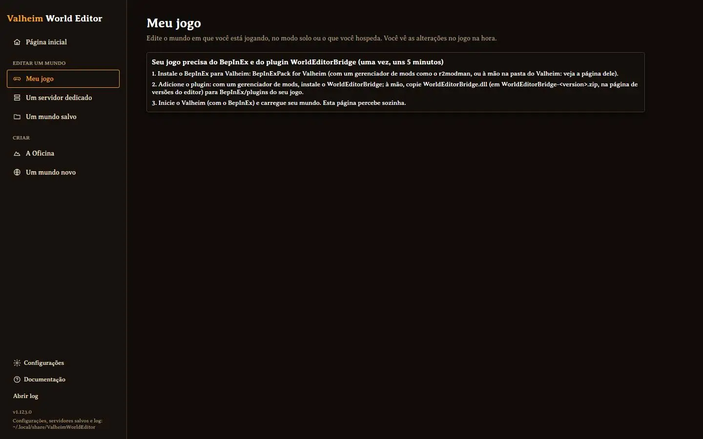
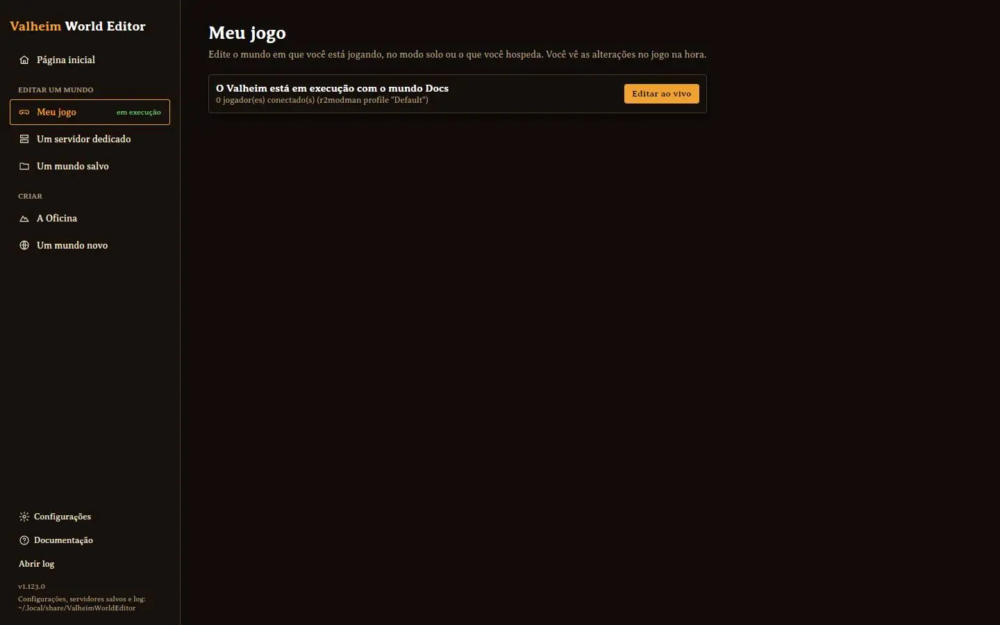

<!-- source: 0fe62110 -->
# Editar o mundo em que você está jogando

Altere o mundo do seu próprio jogo em execução (um jogador, ou o mundo que você hospeda) e veja cada alteração no jogo
na hora.

**Você precisa de:** Valheim neste computador, o editor e uns 5 minutos para instalar o BepInEx e o plugin
WorldEditorBridge uma vez.

*O que **Meu jogo** diz antes de o BepInEx e o plugin estarem instalados: os passos abaixo, em resumo.*

1. Instale o **BepInEx** no seu Valheim, uma vez: [BepInExPack for Valheim](https://thunderstore.io/c/valheim/p/denikson/BepInExPack_Valheim/),
   com um gerenciador de mods (r2modman, Thunderstore Mod Manager) ou à mão na pasta do Valheim, como a página dele
   explica. No Linux com o jogo nativo, o BepInEx inicia pelo script de inicialização do pacote (a página dele mostra a
   opção de inicialização do Steam); um gerenciador de mods faz isso por você.
2. Adicione o plugin. Com um gerenciador de mods, instale o **WorldEditorBridge** do
   [Thunderstore](https://thunderstore.io/c/valheim/p/Tie/WorldEditorBridge/) ou do
   [Hexium](https://valheim.hexium.gg/mods/Tie/WorldEditorBridge). À mão, copie `WorldEditorBridge.dll` de
   `WorldEditorBridge-<version>.zip` (na [página de versões](https://github.com/Shuiei/valheim-world-editor/releases/latest) do editor)
   para `BepInEx/plugins` do seu Valheim ou do perfil do gerenciador de mods. Use o plugin da mesma versão do seu editor.
3. Inicie o Valheim com o BepInEx e carregue seu mundo (um jogador, ou inicie um servidor pelo jogo para hospedá-lo).
   Nessa primeira execução, o plugin grava as configurações e o token secreto dele, que o editor lê sozinho.
4. No editor, abra a página inicial. **Página inicial** mostra "O Valheim está em execução com o mundo …" e quantos
   jogadores estão conectados; **Meu jogo** no menu lateral diz *em execução*.
5. Clique em **Editar ao vivo**. O mundo abre no mapa dele.
6. Clique num ponto perto de você e escolha **Editar em 3D**.
7. Faça uma alteração, por exemplo erga um pequeno morro com o pincel **Elevar**.
8. Pressione **Aplicar ao vivo** (ou `Ctrl+S`).

*A página inicial percebeu sozinha o jogo em execução: **Editar ao vivo** abre o mundo dele.*

## Verificar se funcionou

- A barra superior mostra **AO VIVO** e, depois da aplicação, "Tudo aplicado".
- A barra de status diz "Aplicado ao jogo em execução: …".
- No jogo, o morro aparece na hora. O jogo o salva como qualquer outra alteração.

Enquanto o jogo não estiver pronto, **Meu jogo** diz o que falta: os três passos, "O BepInEx está instalado: faltam só
os passos 2 e 3.", "Inicie o Valheim uma vez com o BepInEx" (o plugin nunca foi executado) ou "Inicie o Valheim e
carregue seu mundo". Se ficar parado nisso, veja [Meu jogo mostra passos a fazer](../help/troubleshooting.md#meu-jogo-mostra-passos-a-fazer).

## Desfazer

Pressione `Ctrl+Z` (ou use **Remover** no passo, no Histórico) e depois **Aplicar ao vivo** de novo: o jogo desfaz a
alteração. Redefinições de zona não podem ser desfeitas depois de aplicadas. Para que cada alteração seja aplicada
assim que você a faz, ative **Auto**.

## Relacionados

- [Modo ao vivo](../live-mode.md): Aplicar ao vivo, Auto, acompanhar o jogo, jogadores
- [Editar um servidor dedicado enquanto as pessoas jogam](edit-a-server-live.md)
- [Edição ao vivo](../concepts/live-editing.md#como-ele-se-conecta): como o editor alcança o jogo
- [Desfazer um passo, reverter uma alteração ou descartar tudo](undo-changes.md)
