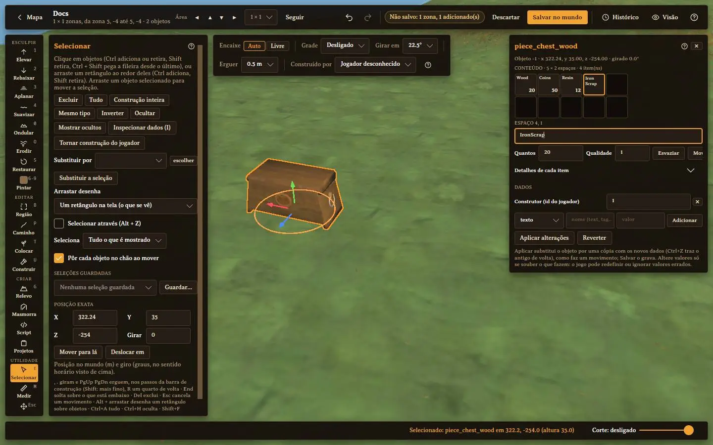

<!-- source: 0fb1e9cf -->
# Alterar o que um baú guarda ou o que uma placa diz

Ponha itens num baú, tire-os, ou escreva um texto novo numa placa, com o Inspetor.

**Você precisa de:** um mundo aberto no editor, com a área em volta do baú ou da placa aberta. Para encontrá-lo antes,
veja [Encontrar um objeto, um item de baú ou uma placa](find-things.md).

## Um baú

1. Pressione `E` para abrir [Selecionar](../select.md).
2. Clique duas vezes no baú: ele é selecionado sozinho e se abre no Inspetor, com os espaços mostrados como no jogo.
3. Clique num espaço vazio.
4. Em **Buscar um item…**, digite algumas letras do item (`iron`, `mead`) e escolha-o na lista.
5. Defina **Quantos** e, para ferramentas e armaduras, **Qualidade**.
6. Repita para outros espaços. Para tirar um item, clique no espaço dele e depois em **Esvaziar**; para movê-lo, em
   **Mover** e depois em outro espaço.
7. Clique em **Aplicar alterações**.
8. Clique em **Salvar no mundo** (ou **Aplicar ao vivo**).

Quantos é reduzido à maior pilha que o jogo permite para esse item. O conteúdo alterado continua sendo do próprio baú:
um baú que ninguém abriu não se enche com o saque do jogo por cima dele.

*Espaço 4 clicado, IronScrap escolhido em **Buscar um item…** e **Quantos** definido como 20; Wood, Coins e Resin
preenchem os três primeiros espaços. **Aplicar alterações** os põe no baú.*

## Uma placa

1. Pressione `E` e clique na placa.
2. Pressione `I` (**Inspecionar dados (I)**): clicar duas vezes numa placa selecionaria a construção inteira.
3. Em **DADOS**, encontre **Texto (placa)** e digite o novo texto.
4. Clique em **Aplicar alterações** e depois em **Salvar no mundo** (ou **Aplicar ao vivo**).

Para uma placa que ainda não tem texto, use **Adicionar**: escolha **texto**, digite `text` como nome e depois as
palavras.

## Verificar se funcionou

Selecione o baú ou a placa de novo e pressione `I`: o Inspetor mostra o novo conteúdo ou o novo texto. Depois de
salvar, abra o baú ou leia a placa no jogo.

## Desfazer

- Antes de aplicar: **Reverter** esquece as alterações no cartão.
- Depois de aplicar: `Ctrl+Z` devolve o baú ou a placa antigos.
- Depois de salvar: veja [Desfazer um passo, reverter uma alteração ou descartar tudo](undo-changes.md).

## Relacionados

- [Inspetor](../select.md#inspetor) (na página Selecionar)
- [O que é um objeto](../concepts/objects.md#o-que-é-um-objeto)
- [Encontrar um objeto, um item de baú ou uma placa](find-things.md)
