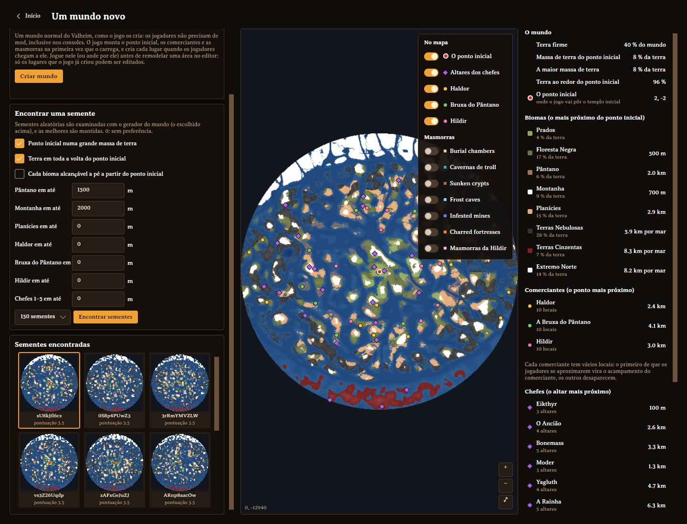

<!-- source: cccbe33c -->
# Encontrar uma semente com o que você quer perto do início

Deixe o editor examinar muitas sementes e escolher uma cujo ponto inicial tenha por perto os biomas, comerciantes ou
chefes que você quer, e depois crie o mundo.

**Você precisa de:** o editor e o Valheim neste computador. Nenhum mundo precisa estar aberto.

1. Na página inicial, escolha **Um mundo novo** em **Criar** e depois **Criar um mundo novo**.
2. Em **Encontrar uma semente**, mantenha **Ponto inicial numa grande massa de terra** e **Terra em toda a volta do
   ponto inicial** ligados, ou desligue-os se você gosta de ilhas.
3. Opcional: ligue **Cada bioma alcançável a pé a partir do ponto inicial** para não precisar de um barco cedo.
4. Defina as distâncias que você quer, em metros: **Pântano em até**, **Montanha em até**, **Planícies em até**, um
   comerciante (**Haldor em até**, **Bruxa do Pântano em até**, **Hildir em até**) ou **Chefes 1–5 em até**. Deixe uma
   caixa em 0 para nenhum desejo. Os desejos de comerciantes e chefes deixam a busca algumas vezes mais lenta.
5. Escolha quantas sementes examinar: **60 sementes**, **150 sementes** ou **400 sementes**.
6. Pressione **Encontrar sementes**. A barra mostra o andamento; **Parar** mantém as melhores encontradas até ali.
7. Em **Sementes encontradas**, passe o cursor sobre uma semente para ver os dados dela e clique nela para vê-la no mapa
   grande.
8. Confira-a no mapa grande: a busca examina cada semente de forma grosseira e pode deixar passar pequenas ilhas ou
   estreitos. Opcional: ligue os tipos de **Masmorras** que interessam a você.
9. Digite o **Nome** do mundo, escolha **Salvo em** e pressione **Criar mundo**.
10. Inicie o Valheim e carregue o mundo uma vez antes de editá-lo no editor: o jogo cria cada lugar quando os jogadores
    chegam perto dele.

*Os desejos à esquerda; as melhores sementes em **Sementes encontradas**, a melhor primeiro, cada uma com a pontuação.*

## Verificar se funcionou

- O editor abre o mapa do novo mundo com a mensagem "… criado (semente …)".
- No Valheim, o mundo está na lista da pasta que você escolheu; um personagem novo chega no lugar do ponto vermelho.
- Os lugares dos comerciantes e dos chefes estão onde a página os mostrou.

## Desfazer

Nada é criado até **Criar mundo**. Para se livrar de um mundo que você criou, exclua a pasta dele da pasta de mundos em
que ele foi salvo (a escolha **Salvo em**). Uma semente de que você gosta sempre pode ser digitada de novo: a mesma
semente cria o mesmo mundo.

## Relacionados

- [Um mundo novo](../new-world.md): todos os controles, o mapa, os dados e como as sementes são pontuadas
- [Abrir um mundo que não está na lista](open-a-world.md)
- [Editar um mundo criado com Expand World, Riverheim ou Tunnelheim](use-mods-worlds.md)
