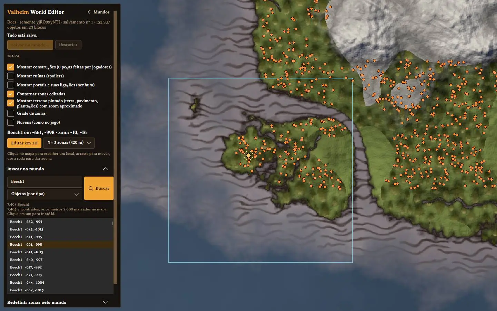

<!-- source: 1ca7ded6 -->
# Encontrar um objeto, um item de baú ou uma placa

Busque no mundo inteiro um objeto, um item em qualquer baú ou um texto numa placa ou num portal, e abra-o em 3D.

**Você precisa de:** um mundo aberto no [mapa](../map.md).

1. No painel lateral do mapa, abra **Buscar no mundo**.
2. Digite parte do que você procura: um tipo (`portal`, `chest`, `Beech`), um item (`Silver`, `Wood`) ou palavras de
   uma placa. Maiúsculas e minúsculas não importam.
3. Escolha o que procurar: **Objetos (por tipo)**, **Itens em contêineres** ou **Textos (placas, portais, proteções…)**.
4. Pressione **Buscar** (ou `Enter`). Cada resultado é marcado em laranja no mapa e listado com uma contagem por tipo.
5. Clique num resultado da lista. O mapa se centraliza nele e escolhe a zona dele.
6. Pressione **Editar em 3D**. O editor abre com esse objeto selecionado. Para um item ou um texto, os dados dele
   também se abrem.
7. Opcional: altere o conteúdo do baú ou o texto da placa (veja
   [Alterar o que um baú guarda ou o que uma placa diz](fill-a-chest.md)) e depois **Salvar no mundo** (ou
   **Aplicar ao vivo**).

*Cada marcador é um objeto encontrado; o escolhido na lista é maior, com um anel dourado.*

## Verificar se funcionou

- A linha acima dos resultados diz quantos foram encontrados. A lista mostra os 300 primeiros; até 2.000 são marcados.
- **Nada encontrado?** Confira a grafia e o que você escolheu procurar. A busca vê o mundo como ele está no editor:
  objetos que você excluiu mas não salvou não são encontrados. Os objetos de controle interno do próprio jogo
  (`_ZoneCtrl`…) só são encontrados quando o seu texto começa com `_`.

## Desfazer

A busca não altera nada. Uma alteração que você faz no objeto é um passo: `Ctrl+Z` a desfaz.

## Relacionados

- [Mapa do mundo](../map.md#buscar-no-mundo)
- [Alterar o que um baú guarda ou o que uma placa diz](fill-a-chest.md)
- [Selecionar](../select.md)
