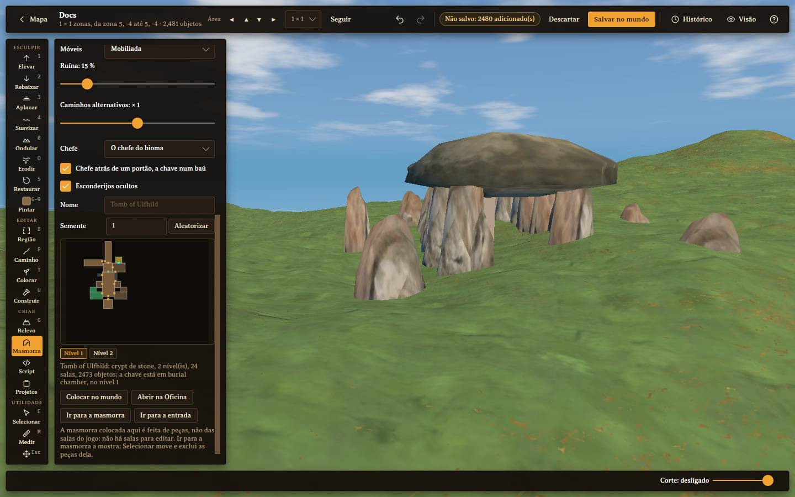

<!-- source: 89221403 -->
# Gerar uma masmorra e colocá-la no mundo

Crie uma masmorra inteira a partir de algumas escolhas e coloque-a atrás de uma entrada, como o jogo faz com as dele.

**Você precisa de:** um mundo aberto no editor, com a área onde a entrada vai ficar aberta, numa zona que ainda não
tenha entrada de masmorra (antes, um backup: veja [Fazer backup de um mundo](back-up-a-world.md)).

## Passos

1. Clique em **Masmorra** na barra de ferramentas (seção CRIAR).
2. Em **Gerar uma masmorra**, escolha o **Bioma**: ele define os monstros, o saque e a entrada no chão.
3. Escolha o **Tamanho** e os **Níveis**, e o chefe em **Chefe**.
4. Observe a planta; clique em **Nível 1**, **Nível 2**... abaixo dela para ver cada nível.
5. Opcional: clique em **Aleatorizar** até gostar da planta, ou digite um **Nome** para a placa do salão de entrada.
6. Gire a visão para ficar de frente para o lugar onde a entrada deve ficar, com esse lugar no meio da visão.
7. Clique em **Colocar no mundo**. A entrada aparece no chão, com a porta voltada para você.
8. Clique em **Ir para a masmorra** para olhar dentro dela de cima, com os tetos cortados.
9. Clique em **Ir para a entrada** para voltar para baixo.
10. Clique em **Salvar no mundo** (ou **Aplicar ao vivo**).

*A entrada depois de **Colocar no mundo**: o monte de uma câmara funerária, com a porta voltada para a câmera.*

Para alterar a masmorra à mão antes de colocá-la (mover móveis, encher baús), salve (ou aplique) as suas alterações e
depois clique em **Abrir na Oficina** em vez do passo 7: a Oficina toma o lugar do mundo. Altere a masmorra, clique em
**Salvar projeto**, abra o mundo de novo e cole-a: veja [Colar um projeto num mundo](paste-a-blueprint.md).

## Verificar se funcionou

A barra de status diz *… gerada: … objetos, 5000 m acima daqui.* **Ir para a masmorra** mostra as salas dela. Depois de
salvar, abra o mundo no jogo, vá até a entrada e passe pela porta: você chega ao salão de entrada.

## Desfazer

- Antes de salvar: `Ctrl+Z` desfaz a colocação inteira num só passo.
- Depois de salvar: veja [Desfazer um passo, reverter uma alteração ou descartar tudo](undo-changes.md), ou
  [Restaurar uma área a partir de um backup](restore-from-backup.md).

## Dicas

- *Já há algo lá em cima*: cada zona (64 × 64 m) guarda uma masmorra. Ponha a entrada em outra zona.
- As mesmas escolhas e a mesma semente sempre criam a mesma masmorra de peças de construção: anote a **Semente** para
  criá-la de novo. Uma masmorra com as salas do próprio jogo é disposta de novo a partir da entrada quando colocada,
  então também precisa do mesmo lugar e da mesma direção.
- **Feito de: As salas do próprio jogo** a constrói com as salas do jogo, para editar sala por sala.

## Relacionados

- [Masmorra](../dungeons.md)
- [Como o jogo guarda as masmorras](../concepts/dungeons.md#como-o-jogo-guarda-as-masmorras)
- [Oficina](../workshop.md)
