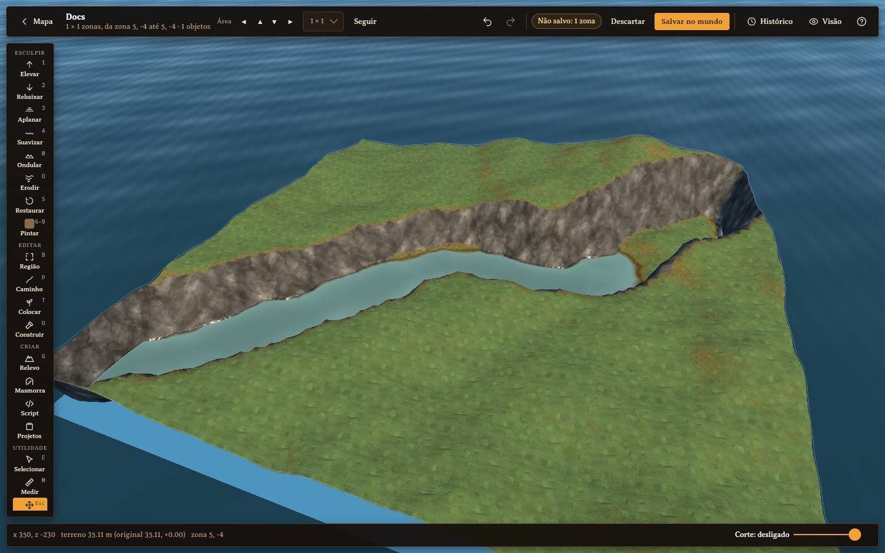

<!-- source: d55dc125 -->
# Cavar um rio ou um lago

Cave um rio, um canal ou um lago que se enche de água.

**Você precisa de:** um mundo aberto em 3D, com o jogo fechado ou no [modo ao vivo](edit-your-game-live.md). Terreno
baixo perto do mar é o mais fácil.

O Valheim não tem água corrente: a água dos rios é o mar, a 30 m em todo lugar. Um rio ou lago só tem água onde o leito
fica abaixo de 30 m.

1. Passe o cursor sobre o trajeto e leia a altura do terreno na barra de status. Sem a opção Sem limite, você só pode cavar
   8 m para baixo, então terreno acima de uns 36 m não vai segurar água.
2. Pressione `P` ([Caminho](../path.md)) e clique em pontos ao longo do rio, a partir do mar ou de um lago para o
   interior.
3. No painel, escolha **Rio / canal (água)**.
4. Defina **Largura** (a largura da água), **Borda suave** (as margens) e **Profundidade** (quanto o leito fica abaixo
   do nível do mar no meio, 2 m para começar).
5. Pressione **Aplicar (Enter)**. O leito se enche de água.
6. Para um lago, pressione `B` ([Região](../area.md)), escolha **Polígono**, clique ao redor do lago e clique duas
   vezes no último canto para fechar a forma.
7. No grupo **Terreno**, escolha **Aplanar** em **Ação**, digite uma **Altura** abaixo de 30 m (28 m dá água com 2 m de
   profundidade), defina **Borda suave** em uns 5 m para margens suaves e pressione **Aplanar (Enter)**.
8. Clique em **Salvar no mundo** (ou **Aplicar ao vivo**).

*Um rio cavado com Rio / canal (água): o mar o enche.*

## Verificar se funcionou

- A água aparece na visão 3D assim que o leito fica abaixo de 30 m.
- Se a barra de status disser que parte dele atingiu o limite do jogo, o terreno está alto demais ali: rebaixe-o
  primeiro perto do mar, siga um terreno mais baixo ou ative **Sem limite** (veja
  [Elevar ou cavar além do limite de 8 m do jogo](raise-past-the-limit.md)).

## Desfazer

`Ctrl+Z` desfaz o último **Aplicar** ou **Aplanar**. Depois de salvar, desfaça e salve de novo (veja
[Desfazer um passo, reverter uma alteração ou descartar tudo](undo-changes.md)).

Para aterrar um rio mais tarde, quando os passos de desfazer já se foram, desenhe a linha de novo (ou mantenha-a) e
aplique **Restaurar** da ferramenta Caminho: o terreno ao longo dela volta a ser como o mundo o gerou. O pincel
**Restaurar** (`5`) faz o mesmo num só lugar.

## Relacionados

- [Caminho](../path.md#rio-ou-canal)
- [Medir e sobreposições](../measure.md): profundidade da água
- [Limites do terreno](../concepts/ground-limits.md)
