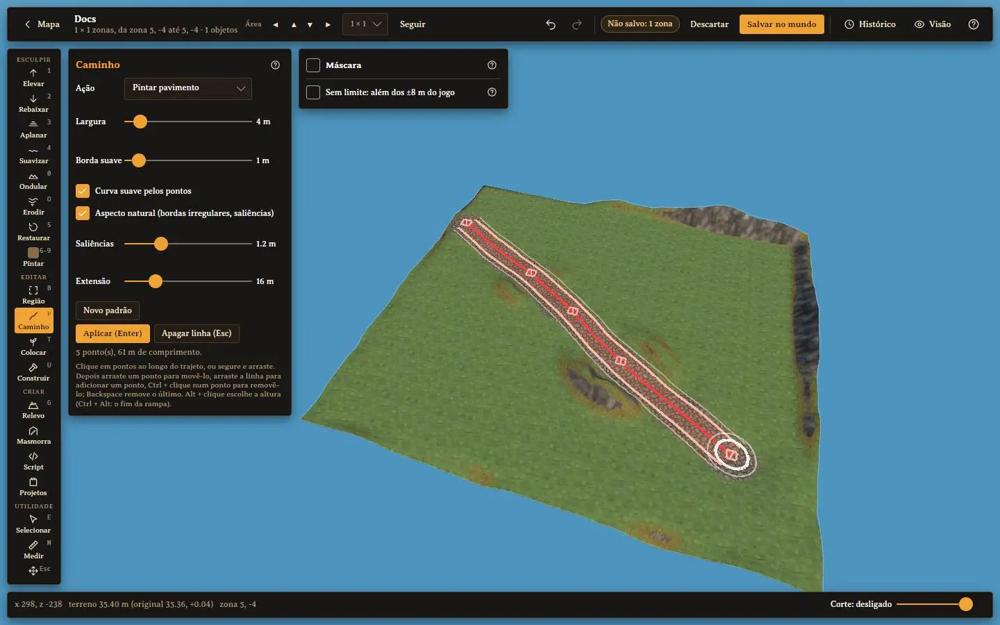

<!-- source: 20a95afa -->
# Fazer uma estrada ou uma rampa subindo uma colina

Desenhe uma estrada nivelada com uma rampa uniforme subindo a colina, pavimentada no meio.

**Você precisa de:** um mundo aberto em 3D, com o jogo fechado ou no [modo ao vivo](edit-your-game-live.md).

1. Opcional: confira o declive antes. Pressione `M` ([Medir](../measure.md)), clique no pé da colina e depois no topo:
   **Declive** é o que uma rampa entre eles vai dar.
2. Pressione `P` ([Caminho](../path.md)) e clique em pontos ao longo da parte nivelada da estrada.
3. No painel, escolha **Aplanar**. Use `Alt`+clique no terreno para pegar a altura dele, ou digite-a em **Altura**.
4. Ajuste **Largura** (8 m é uma boa estrada) e **Borda suave** (4 m a mistura com a encosta).
5. Opcional: marque **Aspecto natural (bordas irregulares, saliências)** para uma trilha gasta.
6. Clique em **Aplicar (Enter)** e depois em **Apagar linha (Esc)**.
7. Para a colina, clique num ponto no pé dela e num no topo, e escolha **Rampa (início → fim)**. **Início** e **Fim**
   acompanham o terreno sob as duas pontas; digite uma altura para alterar uma delas.
8. Clique em **Aplicar (Enter)**. A linha continua.
9. Para pavimentá-la, escolha **Pintar pavimento**, diminua **Largura** e **Borda suave** (4 m e 1 m) e clique em
   **Aplicar (Enter)** de novo na mesma linha.
10. Clique em **Salvar no mundo** (ou **Aplicar ao vivo**).

*Uma estrada feita com Aplanar através de dois montes, depois Pintar pavimento (Largura 4 m, Borda suave 1 m) na mesma
linha.*

## Verificar se funcionou

- Meça ao longo da estrada: o **Declive** fica igual em toda a rampa.
- Se pontos ficaram vermelhos, parte da estrada atingiu o limite de 8 m do jogo: veja
  [Elevar ou cavar além do limite de 8 m do jogo](raise-past-the-limit.md).

## Desfazer

Cada **Aplicar** é um passo de desfazer: `Ctrl+Z` reverte o último. **Apagar linha (Esc)** remove só a linha, não o que
você aplicou. Depois de salvar, desfaça e salve de novo (veja
[Desfazer um passo, reverter uma alteração ou descartar tudo](undo-changes.md)).

Para tirar uma estrada mais tarde, quando os passos de desfazer já não existirem, desenhe uma linha ao longo dela e
aplique **Restaurar** com uma **Largura** que a cubra: o terreno volta a ser como o mundo o gerou, sem a pintura.

## Relacionados

- [Caminho](../path.md)
- [Medir e sobreposições](../measure.md)
- [Retirar árvores e rochas, aplanar um terreno para construir](clear-an-area.md)
