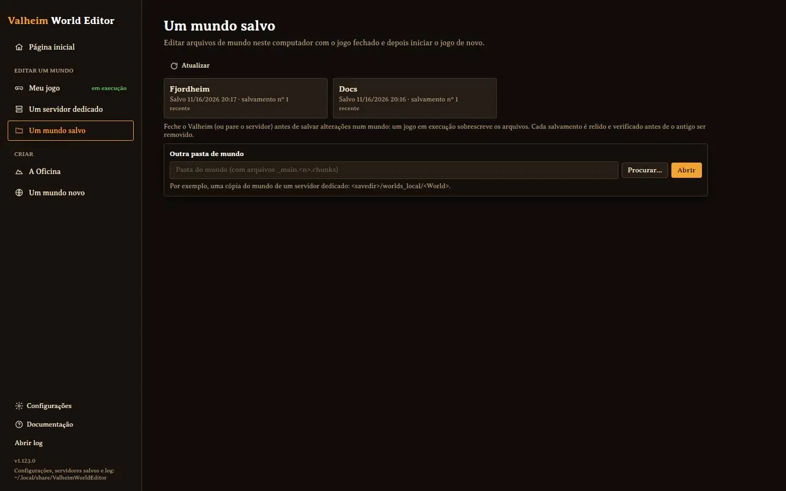

<!-- source: 289a125b -->
# Abrir um mundo que não está na lista

Abra um mundo de qualquer pasta deste computador: uma cópia do mundo de um servidor, um backup, um mundo em outro disco.

**Você precisa de:** a pasta do mundo (a que contém os arquivos `_main.<n>.chunks`), e nenhum jogo ou servidor em
execução com ele.

1. Feche o Valheim, ou pare o servidor que usa o mundo: um jogo em execução grava por cima dos arquivos que o editor
   salva.
2. Para o mundo de um servidor dedicado, copie a pasta dele, `<savedir>/worlds_local/<World>`, do servidor para este
   computador.
3. Na página inicial, clique em **Um mundo salvo**.
4. Em **Outra pasta de mundo**, clique em **Procurar…** e escolha a pasta do mundo, ou cole o caminho dela na caixa.
5. Clique em **Abrir**. O mundo abre no [mapa](../map.md) dele.
6. Opcional: para ter o mundo na lista sempre, abra **Configurações**, clique em **Adicionar uma pasta** em **Pastas de
   mundos**, escolha a pasta do mundo (ou uma pasta de mundos) com **Procurar…** e depois **Salvar**.

*Os mundos que o editor encontrou sozinho, depois **Outra pasta de mundo** com **Procurar…** e **Abrir**.*

## Verificar se funcionou

- O mapa mostra o mundo, com o nome e a semente dele no alto do painel lateral.
- Em **Página inicial**, o mundo aparece em **Recentes**, então da próxima vez ele abre num clique.
- Com a pasta adicionada em **Configurações**, **Um mundo salvo** lista o mundo com *seu* sob o nome.

## Desfazer

Abrir um mundo não altera nada nele: só **Salvar no mundo** grava. Para tirar uma pasta da lista, abra
**Configurações**, clique no **✕** ao lado dela em **Pastas de mundos** e depois em **Salvar**.

## Dicas

- O editor diz o que há de errado com uma pasta: "That folder holds worlds; pick one of them" (você escolheu
  `worlds_local`: escolha um mundo dentro dela), ou "No Valheim world in that folder" (não há mundo do Valheim nessa
  pasta).
- Um mundo no antigo formato de arquivo único (`<World>.db` e `.fwl`) aparece esmaecido: carregue-o no Valheim uma vez,
  e o jogo o transforma numa pasta de mundo que o editor abre.
- Um mundo feito com um mod de geração de mundo (Expand World, Riverheim) precisa do complemento dele: veja
  [Editar um mundo criado com Expand World, Riverheim ou Tunnelheim](use-mods-worlds.md).
- Depois de editar aqui o mundo de um servidor, copie a pasta de volta para o servidor com o servidor parado.

## Relacionados

- [Fazer backup de um mundo antes de editar](back-up-a-world.md)
- [Editar um servidor dedicado enquanto as pessoas jogam](edit-a-server-live.md)
- [A janela do editor](../editor-basics.md)
- [O mapa do mundo](../map.md)
