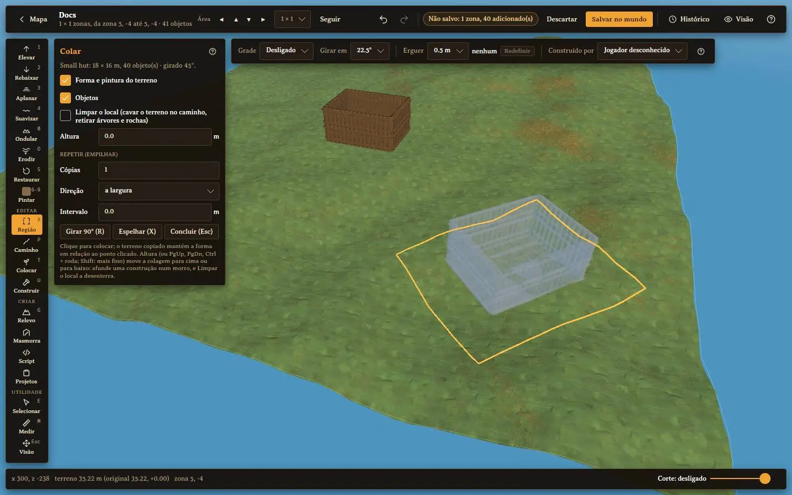

<!-- source: 45f0d395 -->
# Colar um projeto num mundo

Coloque num mundo uma construção da sua biblioteca de projetos (feita na Oficina, salva a partir de um mundo ou
importada).

**Você precisa de:** um mundo aberto no editor, com aberta a área onde a construção vai ficar, e um projeto na
biblioteca (veja [Oficina](../workshop.md)). Antes, um backup: veja [Faça backup de um mundo](back-up-a-world.md).

## Passos

1. Clique em **Projetos** na barra de ferramentas (seção CRIAR).
2. Opcional: para trazer um arquivo que alguém enviou a você, clique em **Importar arquivo…** e escolha o arquivo
   `.blueprint` ou `.vbuild`.
3. Digite uma palavra do nome ou das tags dele em **Buscar projetos**.
4. Clique em **Colar** ao lado do projeto. O painel fecha e o projeto segue o cursor, transparente.
5. Gire-o com `R` (um quarto de volta) ou `,` `.` (pelo **Girar em** da barra de construção); pressione `X` para
   espelhá-lo.
6. Opcional: para afundá-lo numa encosta, abaixe-o com `PgDn` (ou `Ctrl` + roda). **Limpar o local** no painel Colar
   (ligado de início) cava o terreno no caminho e retira árvores e rochas.
7. Clique onde ele deve ficar. Clique de novo em outro lugar para mais cópias.
8. Pressione `Esc` para parar de colar.
9. Clique em **Salvar no mundo** (ou **Aplicar ao vivo**).

As peças coladas guardam o que o projeto guarda: conteúdo de baús, textos de placas, criaturas. O construtor delas é o
jogador escolhido em **Construído por** na [barra de construção](../build.md#a-barra-de-construção), exibida enquanto você
cola; as peças de uma ruína ficam sem construtor. Peças de mods que este mundo não tem ficam de fora, e a mensagem as
lista.

*Depois de **Colar**: a cabana segue o cursor transparente, com a área ocupada contornada, girada 45° (`girado 45°` no
painel **Colar**), **Limpar o local** desligado. Atrás dela, a cabana a partir da qual o projeto foi salvo.*

Um projeto marcado como **Uma masmorra** não é posto no chão: a entrada dele vai onde você clica e a construção fica
5000 m acima dela. Veja [Masmorra](../dungeons.md).

## Verificar se funcionou

A construção fica firme onde você clicou, com pontos verdes de não salvo, e a barra de status diz quantos objetos
foram colados. Olhe sob as bordas: nada deve flutuar. Depois de salvar, vá até ela no jogo.

## Desfazer

- Antes de salvar: `Ctrl+Z` desfaz cada colagem.
- Depois de salvar: veja [Desfazer um passo, reverter uma alteração ou descartar tudo](undo-changes.md).

## Dicas

- A colagem precisa caber dentro da área aberta; se aparecer *Não colado*, abra uma área maior em volta do lugar.
- As peças que o editor coloca por conta própria (estátuas, adereços, criaturas) também são coladas, embora o martelo do
  Homestead as ignore.
- Para alterar o projeto antes, clique em **Abrir** para abri-lo na Oficina.
- Para guardar algo de um mundo como projeto: copie-o (a ferramenta Região, ou `Ctrl+C` em Selecionar) e clique em
  **Salvar como projeto…** na linha **Cópia** do painel.

## Relacionados

- [Oficina](../workshop.md) · [Região](../area.md)
- [Mover ou copiar uma construção](move-a-building.md)
- [Peças construídas por jogadores](../concepts/objects.md#peças-construídas-por-jogadores)
