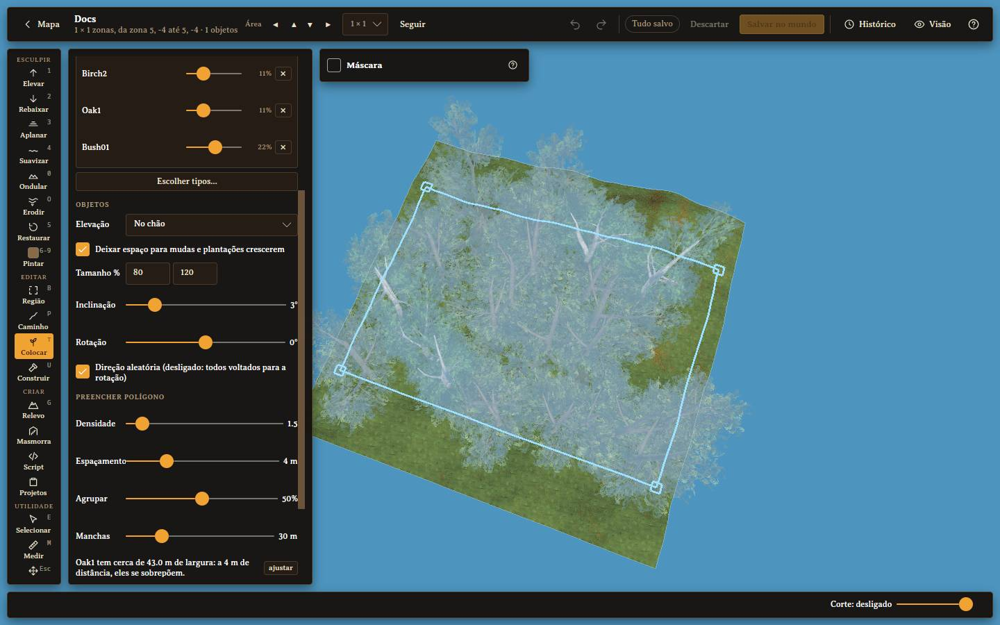

<!-- source: 78139bdb -->
# Plantar uma floresta, uma plantação ou uma sebe

Preencha um trecho de terra com árvores em bosques naturais, uma plantação em fileiras ou uma sebe ao longo de uma
linha.

**Você precisa de:** um mundo aberto no editor (um backup antes: veja [Fazer backup de um mundo](back-up-a-world.md)).

## Uma floresta

1. Pressione `T` para abrir [Colocar](../place.md).
2. Em **Escolher uma predefinição**, escolha **Bosque dos Prados** (ou **Mata da Floresta Negra**, **Pântano**).
3. No topo do painel, escolha **Polígono**.
4. Clique em pontos no chão em volta do contorno da floresta, ou segure e arraste para desenhá-lo à mão livre.
5. Opcional: em **PREENCHER POLÍGONO**, aumente **Agrupar** para uns 50% para ter bosques com clareiras entre
   eles, e ajuste **Manchas** ao tamanho que os bosques devem ter.
6. Pressione `N` (**Novo arranjo (N)**) até a prévia ficar boa.
7. Pressione `Enter` para plantar.
8. Clique em **Salvar no mundo** (ou **Aplicar ao vivo**).

*Um polígono de uns 58 × 40 m com **Agrupar** 50% e **Manchas** 30 m (e **Densidade** 1.5): as árvores
transparentes se juntam em bosques com clareiras entre eles. As linhas de **PREENCHER POLÍGONO** ficam na parte de
baixo do painel.*

## Uma plantação

1. Pinte a plantação com **Cultivar** (barra de ferramentas, **Pintar**, ou tecla `7`): as plantações só crescem em
   terreno cultivado.
2. Em Colocar, clique em **Escolher tipos…**, procure `carrot`, marque as plantações que você quer e clique em
   **Concluído**.
3. Escolha **Grade** e ajuste **Espaçamento** em **GRADE** (1 m é bom para cenouras).
4. Arraste um retângulo sobre o terreno cultivado e pressione `Enter`.

Mantenha **Deixar espaço para mudas e plantações crescerem** ligado, para que cada plantação tenha o espaço de que o
jogo precisa para crescer.

## Uma sebe

1. Em Colocar, clique em **Escolher tipos…**, procure `bush` e marque um ou dois arbustos.
2. Escolha **Linha** e depois **Pontos**.
3. Clique em pontos ao longo da sebe; ajuste **A cada** para uns 1.5 m e **Oscilação** para 0.25 m.
4. Pressione `Enter`.

## Verificar se funcionou

A prévia transparente fica sólida onde você plantou, com um ponto verde de não salvo em cada objeto. A barra de status
diz quantos objetos foram colocados. No jogo, caminhe até lá depois de salvar.

## Desfazer

- Antes de salvar: `Ctrl+Z` reverte o último polígono, grade, linha ou traço de pincel.
- Para remover alguns: modo Pincel com os mesmos tipos marcados, `Shift` + arrastar sobre eles.
- Depois de salvar: veja [Desfazer um passo, reverter uma alteração ou descartar tudo](undo-changes.md).

## Relacionados

- [Colocar](../place.md)
- [Regras de crescimento](../concepts/objects.md#regras-de-crescimento)
- [Retirar árvores e rochas, aplanar um terreno para construir](clear-an-area.md)
