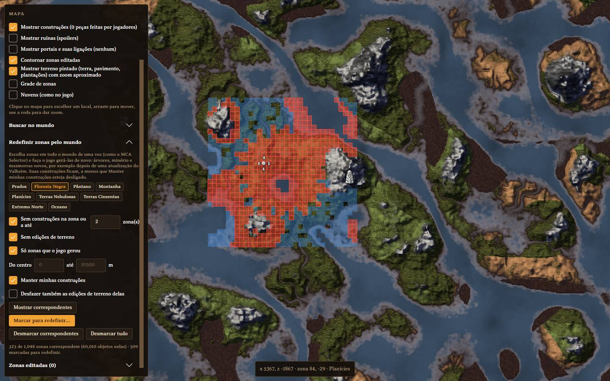

<!-- source: e87fa23c -->
# Gerar zonas de novo

Faça o jogo criar de novo, a partir da semente, as zonas escolhidas, com novas árvores, rochas, minério e masmorras, por
exemplo para ter o conteúdo novo de uma atualização do Valheim em lugares onde ninguém construiu.

**Você precisa de:** o mundo fechado no jogo (ou o servidor parado), ou o [modo ao vivo](edit-a-server-live.md), e um
[backup do mundo](back-up-a-world.md): uma redefinição salva não pode ser desfeita.

1. No jogo, leve os animais domados para longe dos lugares que você vai redefinir: tudo numa zona redefinida some,
   exceto as lápides e, com **Manter minhas construções** ligado, as peças construídas por jogadores. Depois feche o
   jogo (ou pare o servidor), a menos que você edite ao vivo.
2. Faça backup do mundo.
3. Abra o mundo. O [mapa](../map.md) dele abre.
4. No painel lateral, abra **Redefinir zonas pelo mundo**.
5. Defina o filtro: os biomas a redefinir, e deixe **Sem construções na zona ou a até N zona(s)** e **Manter minhas
   construções** ligados para que as bases e o terreno em volta delas fiquem intactos. Use **Do centro … até … m** para redefinir só parte do mundo.
6. Pressione **Mostrar correspondentes**. Na primeira vez, o editor lê todas as zonas. As zonas correspondentes ficam
   azuis, e uma linha diz quantas correspondem e quantos objetos elas contêm.
7. Altere o filtro até que as zonas azuis sejam as que você quer.
8. Pressione **Marcar para redefinir…**. A pergunta diz quantas zonas, o que some e se as suas construções são mantidas:
   leia-a e confirme. As zonas ficam vermelhas.
9. Clique em **Salvar no mundo** (ou **Aplicar ao vivo**).

*As zonas azuis correspondem ao filtro; as vermelhas estão marcadas para redefinição.*

Para redefinir só as zonas sob um lugar, use a ferramenta [Região](../area.md#redefinir-zonas): desenhe um retângulo sobre
elas, escolha **Recuperar**, depois **Redefinir zonas** em **Ação**, e pressione **Redefinir zonas… (Enter)**. Ela tem
os mesmos interruptores **Manter minhas construções** e **Desfazer também as edições de terreno delas** do mapa.

## Verificar se funcionou

- Antes de salvar, a linha sob os botões conta as zonas marcadas para redefinição.
- No jogo, vá até uma zona redefinida: ela é criada de novo quando você se aproxima, com novas árvores, rochas e o seu
  local.

## Desfazer

- **Antes de salvar:** **Desmarcar tudo** (no mapa ou na ferramenta Região) cancela todas as redefinições marcadas, e
  **Desmarcar correspondentes** só as das zonas que o filtro encontra (uma marcada com **Redefinir zonas** da ferramenta
  Região: `Ctrl+Z` também).
- **Depois de salvar:** não dá para desfazer no editor. Ponha de volta o backup do mundo do passo 2 (veja
  [Fazer backup de um mundo antes de editar](back-up-a-world.md#desfazer)).

## Relacionados

- [Mapa do mundo](../map.md#redefinir-zonas-pelo-mundo)
- [Zonas](../concepts/areas-and-zones.md#zonas)
- [Fazer backup de um mundo antes de editar](back-up-a-world.md)
