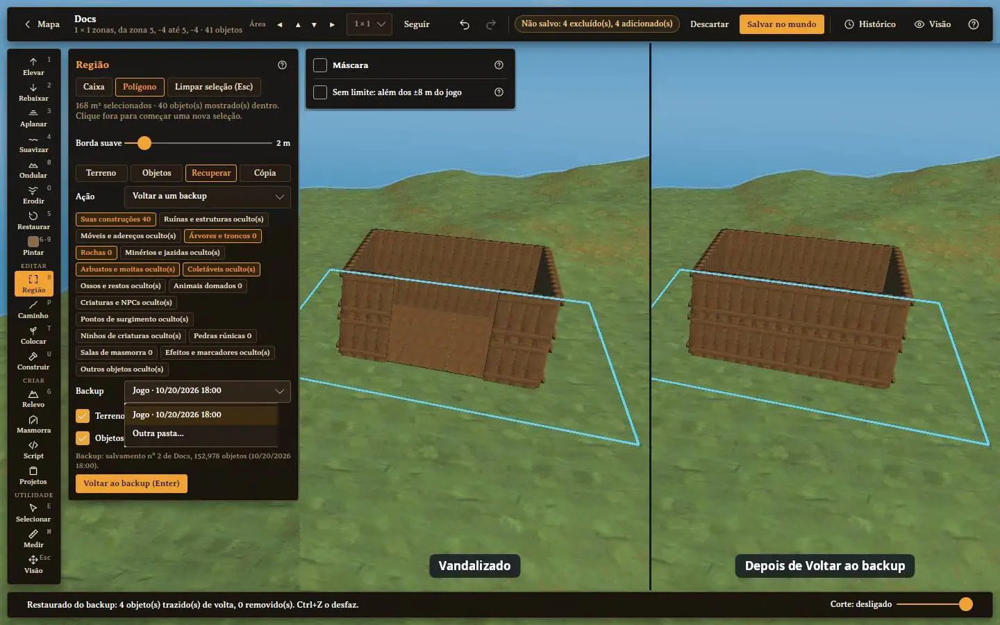

<!-- source: 0a333811 -->
# Restaurar uma área a partir de um backup

Ponha um lugar de volta como estava num backup, depois de vandalismo, de um ataque desastroso ou de uma edição da qual
você se arrepende, sem voltar o resto do mundo.

**Você precisa de:** um backup do mundo de antes do estrago: os backups do próprio jogo ao lado da pasta do mundo
(`<World>_backup_auto-<date>`), ou um backup do servidor copiado para este computador. O jogo fechado, ou o
[modo ao vivo](edit-a-server-live.md).

1. Abra o mundo e encontre o lugar no [mapa](../map.md). Clique em **Editar em 3D**.
2. Pressione `B` ([Região](../area.md)), escolha **Polígono** e clique em volta do lugar danificado, um pouco além
   dele.
3. Escolha **Recuperar** e depois **Voltar a um backup** em **Ação**.
4. Em **Backup**, escolha uma data anterior ao estrago ("Jogo · data"). Para um backup de servidor ou outra cópia,
   escolha **Outra pasta…** e selecione-a (ao vivo, essa é a única forma). A linha embaixo diz qual salvamento é.
5. Escolha os chips de tipo a trazer de volta. Para uma construção, ligue **Suas construções**.
6. Deixe **Terreno (altura e pintura)** e **Objetos dos tipos escolhidos acima** marcados, ou desmarque o que você não
   quer de volta.
7. Clique em **Voltar ao backup (Enter)**.
8. Confira o resultado. Se estiver certo, use **Salvar no mundo** (ou **Aplicar ao vivo**).

*À esquerda: um polígono em volta de uma cabana com parte da parede da frente faltando, **Voltar a um backup**
escolhido, a lista **Backup** aberta no backup do jogo e **Suas construções** ligado. À direita: depois de **Voltar ao
backup (Enter)**, a parede está inteira de novo; a linha acima do botão nomeia o salvamento do backup, e a barra de
status conta o que voltou.*

## Verificar se funcionou

- A barra de status diz "Restaurado do backup: o terreno, N objeto(s) trazido(s) de volta, M removido(s)."
- "Nada para restaurar: a seleção está como estava no backup" quer dizer que o backup tem os mesmos objetos e o mesmo
  terreno ali: escolha um backup mais antigo.
- Um baú restaurado tem o conteúdo de volta: clique nele com [Selecionar](../select.md) (`E`) e pressione `I` para
  olhar dentro.

## Desfazer

`Ctrl+Z` reverte a restauração: ela é um passo no Histórico. Depois de salvar, desfaça e salve de novo. Os objetos dos
tipos escolhidos que não estão no backup são removidos, então restaure de novo a partir de um backup mais novo se você
perdeu algo que construiu depois.

## Relacionados

- [Região: Voltar a um backup](../area.md#voltar-a-um-backup)
- [Fazer backup de um mundo antes de editar](back-up-a-world.md)
- [Backups](../concepts/saving-and-history.md#backups)
