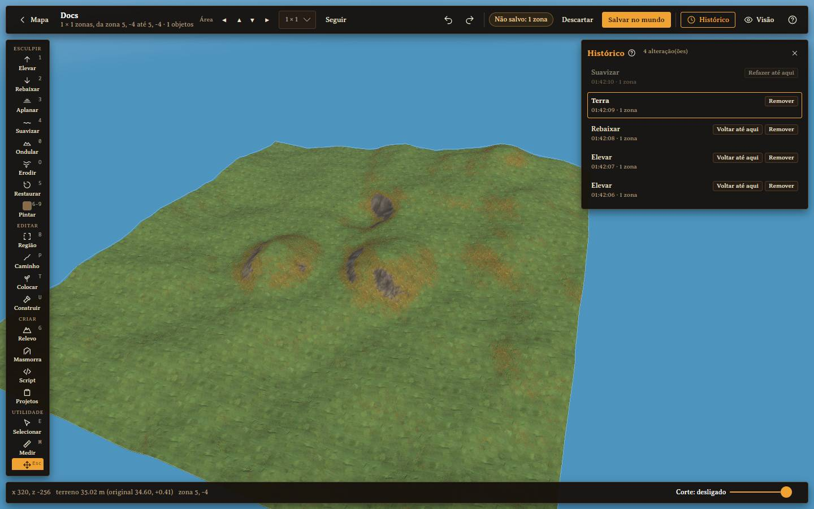

<!-- source: a0f30736 -->
# Desfazer um passo, reverter uma alteração ou descartar tudo

Reverta o que você fez no editor: os últimos passos, uma alteração do meio mantendo o resto, ou tudo o que ainda não
foi salvo.

**Você precisa de:** um mundo aberto em 3D (salvo ou ao vivo) ou a Oficina, com alterações no **Histórico**.

1. Para desfazer a última alteração, pressione `Ctrl+Z` (ou a seta curva na barra superior). Pressione de novo para o
   passo anterior. O texto da seta ao passar o mouse nomeia o passo que ela desfaz.
2. Para refazer o que você acabou de desfazer, pressione `Ctrl+Y` ou `Ctrl+Shift+Z`.
3. Para voltar vários passos de uma vez, abra o **Histórico** (`L`) e clique em **Voltar até aqui** na última
   alteração a manter. As posteriores ficam cinza; **Refazer até aqui** numa delas as traz de volta.
4. Para reverter uma alteração e manter tudo o que foi feito depois dela, clique em **Remover** nessa alteração, no
   **Histórico**. Ela fica riscada, e a remoção é um passo próprio: `Ctrl+Z` traz a alteração de volta.
5. Para reverter tudo o que o Claude fez e manter as suas próprias alterações, clique em **Reverter as alterações do
   Claude** no **Histórico** (só aparece quando o Claude fez alterações na área aberta). Faça isso em cada área que o
   Claude alterou: a barra de status diz quantas alterações do Claude em outras áreas são mantidas.
6. Para descartar tudo o que ainda não foi salvo ou aplicado, clique em **Descartar** na barra superior e confirme. As
   alterações salvas e aplicadas ficam: um passo salvo que você tinha desfeito volta, então salve depois de desfazê-lo
   se quiser que ele suma.
7. Para reverter uma alteração que você já salvou, desfaça-a (ou use **Remover**) e use **Salvar no mundo** de novo.
   Ao vivo, desfaça-a e use **Aplicar ao vivo** de novo (ou deixe o **Auto** enviá-la).

*Histórico: a última alteração desfeita com **Voltar até aqui**, acinzentada, com **Refazer até aqui**.*

> [!WARNING]
> Uma alteração nova feita depois de desfazer descarta os passos acinzentados: eles não podem mais ser refeitos.
> Fechar o editor descarta todas as alterações que você não salvou nem aplicou.

## Verificar se funcionou

- A visão mostra o terreno e os objetos como eram, e a linha de pendências da barra superior conta menos (ou diz "Tudo
  salvo").
- No **Histórico**, a linha com contorno é o passo ao qual você voltou; os passos desfeitos ficam cinza, os removidos,
  riscados.

## Desfazer

Todas essas ações são reversíveis até você fazer uma alteração nova: `Ctrl+Y` refaz um desfazer, **Refazer até aqui**
traz de volta os passos acinzentados, e `Ctrl+Z` traz de volta uma alteração removida. **Descartar** não pode ser
desfeito: é por isso que ele pergunta antes.

## Dicas

- O Histórico é guardado depois de cada salvamento ou aplicação: abra o mundo de novo, mesmo depois de fechar o
  editor, e os passos voltam, com a marca **sessão anterior**. Se o mundo mudou desde então, o editor pergunta antes de
  desfazer um deles. Veja [Histórico](../concepts/saving-and-history.md#histórico).
- Um passo feito em outra área espera até você abrir uma área que o contém: o painel diz quantos.
- Para voltar mais longe do que o Histórico do editor permite, use uma cópia do mundo: veja
  [Fazer backup de um mundo antes de editar](back-up-a-world.md) ou
  [Restaurar uma área a partir de um backup](restore-from-backup.md).

## Relacionados

- [Restaurar uma área a partir de um backup](restore-from-backup.md)
- [Fazer backup de um mundo antes de editar](back-up-a-world.md)
- [Salvamento e histórico](../concepts/saving-and-history.md)
- [A janela do editor](../editor-basics.md#histórico)
