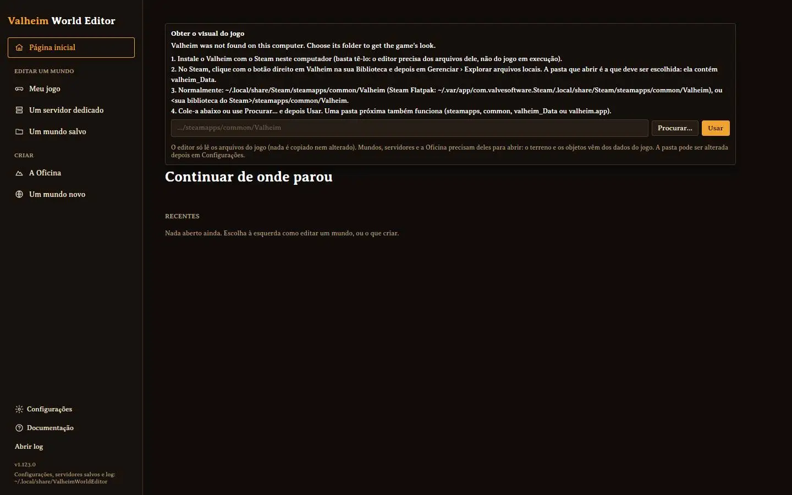
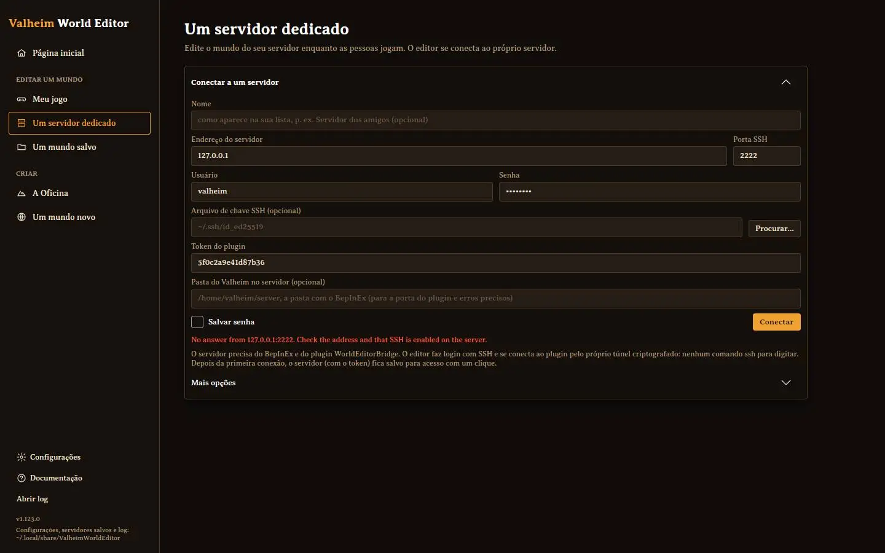
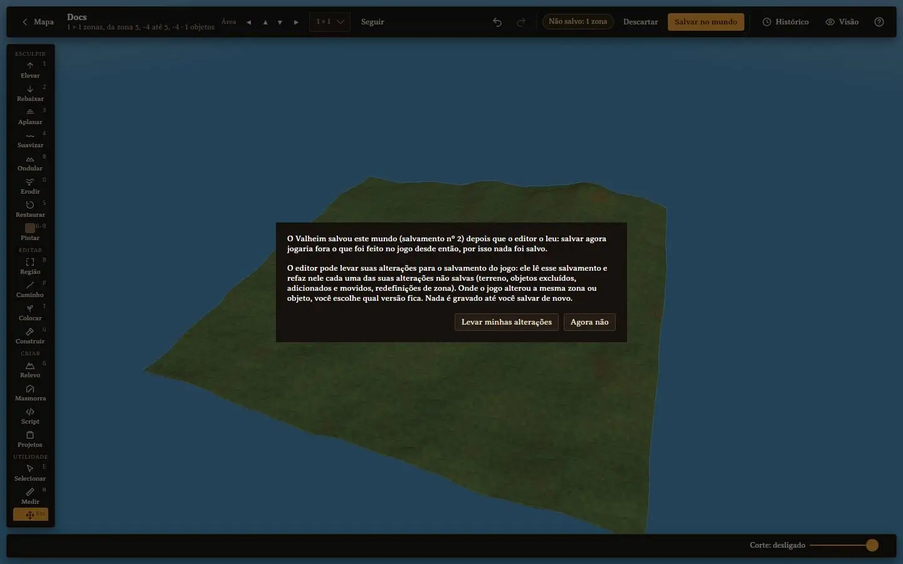

<!-- source: 5b752532 -->
# Solução de problemas

Encontre na tabela o que você está vendo e siga a seção indicada: cada uma diz por que isso acontece e o que fazer.

| O que você vê | Vá para |
|---|---|
| "O Valheim não foi encontrado neste computador", ou caixas no lugar dos modelos | [Valheim não encontrado](#valheim-não-encontrado) |
| **Meu jogo** lista passos, ou o jogo em execução não aparece em **Página inicial** | [Meu jogo mostra passos a fazer](#meu-jogo-mostra-passos-a-fazer) |
| Uma mensagem sob o formulário do servidor depois de **Conectar** | [Um servidor não se conecta](#um-servidor-não-se-conecta) |
| O cartão de um mundo está acinzentado, ou um mundo não abre | [Um mundo não abre ou está acinzentado](#um-mundo-não-abre-ou-está-acinzentado) |
| O salvamento termina com "Nada mudou" ou "Não salvo" | [O salvamento diz que nada mudou](#o-salvamento-diz-que-nada-mudou) |
| "O jogo salvou este mundo" quando você salva | [O jogo salvou enquanto você editava](#o-jogo-salvou-enquanto-você-editava) |
| Ao vivo: os jogadores não veem uma alteração, ou o editor não vê as deles | [Uma alteração ao vivo não aparece](#uma-alteração-ao-vivo-não-aparece) |
| Tremulação, linhas ou uma visão 3D preta no Windows | [Tremulação ou linhas no Windows](#tremulação-ou-linhas-no-windows) |
| "O Windows protegeu o computador", ou o macOS não abre o aplicativo | [O Windows ou o macOS bloqueia o aplicativo](#o-windows-ou-o-macos-bloqueia-o-aplicativo) |
| O Claude diz que não consegue alcançar o editor | [O Claude não consegue se conectar](#o-claude-não-consegue-se-conectar) |
| Um script diz "erros", "erro" ou "não alterou nada" | [Um script falha](#um-script-falha) |
| Qualquer outra coisa | [O log e os relatórios de bugs](#o-log-e-os-relatórios-de-bugs) |

## Valheim não encontrado

O editor lê as texturas, os modelos e o terreno do jogo na sua instalação do Valheim; sem ela, nenhum mundo nem a
Oficina abrem. A página inicial mostra então **Obter o visual do jogo** com "O Valheim não foi encontrado neste
computador."

1. Instale o Valheim com o Steam neste computador. Basta tê-lo: o jogo não precisa estar em execução.
2. No Steam, clique com o botão direito no Valheim na sua Biblioteca e depois em **Gerenciar › Explorar arquivos
   locais**. A pasta que se abre (a que tem `valheim_Data`, ou `valheim.app` num Mac) é a que você deve escolher.
3. Cole o caminho dela no cartão, ou use **Procurar…**, e depois **Usar**. Uma pasta próxima também funciona
   (`steamapps`, `common`, `valheim_Data`, `valheim.app`).

Lugares habituais:

- Windows: `C:\Program Files (x86)\Steam\steamapps\common\Valheim`
- Linux: `~/.local/share/Steam/steamapps/common/Valheim` (Steam em Flatpak:
  `~/.var/app/com.valvesoftware.Steam/.local/share/Steam/steamapps/common/Valheim`)
- macOS: `~/Library/Application Support/Steam/steamapps/common/Valheim`
- Outra biblioteca do Steam: `<library>/steamapps/common/Valheim`

A pasta pode ser alterada depois em **Configurações** → **Pasta do jogo Valheim** (**Automático** procura de novo nas
bibliotecas do Steam). Se o cartão disser **Não foi possível ler o visual do jogo**, pressione **Tentar de novo** ou
confira a pasta em Configurações; se falhar de novo, relate o problema com o log ([abaixo](#o-log-e-os-relatórios-de-bugs)).

*"O Valheim não foi encontrado neste computador.": escolha a pasta com `valheim_Data` e depois **Usar**.*

## Meu jogo mostra passos a fazer

**Meu jogo** diz do que o seu Valheim ainda precisa antes de **Editar ao vivo** aparecer:

| Ele diz | Faça isto |
|---|---|
| "Seu jogo precisa do BepInEx e do plugin WorldEditorBridge" | Instale os dois: veja [Editar o mundo em que você está jogando](../guides/edit-your-game-live.md). |
| "O BepInEx está instalado: faltam só os passos 2 e 3." | Adicione o plugin a `BepInEx/plugins` e depois inicie o Valheim. |
| "Inicie o Valheim uma vez com o BepInEx" | O plugin nunca foi executado. Inicie o jogo pelo BepInEx (o **Start modded** do gerenciador de mods, ou o script de inicialização do pacote no Linux), não pelo botão comum do Steam. |
| "Inicie o Valheim e carregue seu mundo" | Carregue um mundo no jogo (um jogador, ou hospedando um). Um jogo que entrou no servidor de outra pessoa não pode ser editado. |

O editor verifica a cada poucos segundos. Ele procura o arquivo de configurações do plugin em cada pasta do BepInEx que
conhece: a pasta do seu Valheim, o perfil do gerenciador de mods em que o próprio editor foi instalado, cada perfil do
r2modman e do Thunderstore Mod Manager para o Valheim (no Linux, também o r2modman em Flatpak) e as pastas em
**Configurações** → **Pastas do BepInEx**. Se o seu jogo ou perfil estiver em outro lugar, adicione ali a pasta
`BepInEx` dele, o perfil dele ou uma pasta de perfis.

**Ainda nada com o jogo em execução?** O plugin escuta na porta 5182. Se outro programa usar essa porta (um túnel
`ssh -L 5182:…` que você abriu à mão, por exemplo), o plugin não consegue iniciar, e o `BepInEx/LogOutput.log` do jogo
tem uma linha `WorldEditorBridge: caught at … while listening on 127.0.0.1:5182 (the bridge does
not answer)`. Feche esse programa ou altere `Port` nas [configurações do plugin](../live-mode.md#configurações-do-plugin).

"Não foi possível verificar o seu jogo: …" significa que o editor não conseguiu ler uma pasta do BepInEx: o resto da
mensagem diz por quê.

## Um servidor não se conecta

A mensagem sob o formulário diz o que deu errado. As mensagens que começam do mesmo jeito aparecem uma vez só.

| Mensagem | O que fazer |
|---|---|
| "Digite o endereço do servidor." / "Digite o token do plugin: …" | Preencha **Endereço do servidor** ou **Token do plugin**. |
| "The server refused the login: check the user name and the password or key." (o servidor recusou o login) | Confira **Usuário** e a **Senha** ou o **Arquivo de chave SSH (opcional)**. Uma chave com senha precisa de **Mais opções** → **Senha da chave**. |
| "No answer from <address>:<port>. Check the address and that SSH is enabled on the server." (nenhuma resposta do endereço) | Confira **Endereço do servidor** e **Porta SSH** (22, a menos que tenha sido alterada), e se o servidor aceita SSH. |
| "The server's identity changed (it was …, now …)." (a identidade do servidor mudou) | Se você reinstalou o servidor, esvazie a linha `HostKey` que a mensagem indica em `servers.cfg` e conecte de novo. Senão, não se conecte: alguém pode estar se passando pelo seu servidor. |
| "The server answered but refused the token." (o servidor respondeu, mas recusou o token) | Copie de novo, inteira, a linha `Token` de `BepInEx/config/Tie.WorldEditorBridge.cfg` no servidor. |
| "That token cannot be sent (…)" (esse token não pode ser enviado) | O token contém uma quebra de linha ou outro caractere indevido: copie-o de novo. |
| "O túnel está aberto, mas o plugin não responde no servidor: …" | O servidor não está em execução, ou não com o BepInEx e o plugin. Preencha **Pasta do Valheim no servidor (opcional)** no formulário e conecte de novo para ter uma resposta precisa (abaixo). Um servidor num contêiner (um painel de jogos como o Pterodactyl) nunca responde assim: veja [Um servidor num contêiner](../guides/edit-a-rented-server.md#um-servidor-num-contêiner). |
| "The plugin answered, but the game it runs in does not host the world" (o jogo do plugin não hospeda o mundo) | O plugin está num jogo que entrou em outro servidor. Instale-o no servidor que hospeda o mundo. |
| "The server answered with an error (…). Is it the WorldEditorBridge plugin?" (o servidor respondeu com um erro) | Outra coisa responde na porta do plugin: confira **Mais opções** → **Porta do plugin** e `Port` nas configurações do plugin. Com 400, por um túnel até um `BindAddress` diferente de `127.0.0.1`: defina `BindAddress = +` (veja [Um servidor num contêiner](../guides/edit-a-rented-server.md#um-servidor-num-contêiner)). |
| "Could not connect: …" (não foi possível conectar) | Qualquer outra falha; o resto da mensagem diz qual. |

Com **Pasta do Valheim no servidor** preenchida, o editor olha ali por SSH e diz exatamente o que falta: "The folder
… does not exist on the server" (a pasta não existe), "BepInEx is not installed in …" (o BepInEx não está instalado),
"The plugin is not in …/BepInEx/plugins" (o plugin não está lá), "The plugin is installed but has never run: restart
the server with BepInEx" (o plugin nunca rodou: reinicie o servidor com o BepInEx) ou "The plugin is installed but
does not answer: is the server running, and started with BepInEx (not the plain start script)?" (o plugin não
responde). Esta última, num servidor que
de fato roda com o BepInEx, costuma significar que ele roda num contêiner (Pterodactyl, Pelican, Docker): veja
[Um servidor num contêiner](../guides/edit-a-rented-server.md#um-servidor-num-contêiner).

Um servidor de jogo alugado de uma hospedagem, com painel web e FTP mas sem login SSH, não pode ser alcançado ao vivo:
edite os arquivos do mundo dele, como em
[Um servidor de jogo alugado](../guides/edit-a-rented-server.md#um-servidor-de-jogo-alugado).

Com **Criei meu próprio túnel**, "Nothing answers on 127.0.0.1:…" ou "No answer from 127.0.0.1:… within … s"
(nada responde) significa que o seu túnel não está aberto, ou que o servidor não está em execução com o plugin.

*Conectar pressionado sem nada respondendo no endereço: "No answer from 127.0.0.1:2222. Check the address and that SSH
is enabled on the server." Confira **Endereço do servidor** e **Porta SSH**.*

## Um mundo não abre ou está acinzentado

Um cartão acinzentado em **Um mundo salvo** diz por quê, em laranja. Os motivos habituais:

- "Old save format: load this world in Valheim once, then it can be edited here." (formato de salvamento antigo). O jogo converte os mundos antigos de
  arquivo único quando os carrega.
- "Feito com um mod de geração de mundo (…) que nenhum complemento em uso desenha", "… o complemento está desligado" ou
  "… desenha quando … estiver numa das pastas de plugins do BepInEx": instale o complemento, ative-o em
  **Configurações → Complementos** ou adicione a pasta do BepInEx do mod em Configurações. Veja
  [Editar um mundo criado com Expand World, Riverheim ou Tunnelheim](../guides/use-mods-worlds.md).
- Um mundo do Riverheim também precisa de um Riverheim que conheça a predefinição dele (atualize um mais antigo), e o
  Riverheim 1.3 ou posterior precisa do Worldhalla na mesma pasta do BepInEx; mundos criados com o beta descontinuado
  do Riverheim não podem ser abertos.

Para uma pasta que você digitou em **Outra pasta de mundo**: "That folder holds worlds; pick one of them (…)" significa
que você escolheu uma pasta `worlds_local` em vez de um mundo; "No Valheim world in that folder" significa que ela não
contém arquivos `_main.<n>.chunks`. Veja [Abrir um mundo que não está na lista](../guides/open-a-world.md).

"Não foi possível abrir o mundo: …" dá o motivo depois dos dois-pontos; o log tem os detalhes.

## O salvamento diz que nada mudou

O editor verifica cada salvamento relendo-o: se algo estiver errado, ele remove os arquivos novos e termina com "Nada
mudou". O seu mundo fica como estava, e as suas alterações continuam no editor.

| Mensagem | O que fazer |
|---|---|
| "Não há alterações não salvas." | Nada está esperando para ser salvo. |
| "O Valheim salvou este mundo (salvamento nº …) depois que o editor o leu" | Veja [O jogo salvou enquanto você editava](#o-jogo-salvou-enquanto-você-editava). |
| "O salvamento falhou (…). Nada mudou." / "O mundo salvo não foi relido corretamente (…). Nada mudou." | Confira o motivo entre parênteses (um disco cheio, uma pasta em que você não pode gravar). Feche o Valheim se ele usar o mundo e salve de novo. |
| "Este mundo usa o formato de salvamento …; o editor só salva nos formatos … a …." | Um formato mais novo: atualize o editor. Um mais antigo: carregue e salve o mundo num Valheim atualizado e depois abra-o de novo. |
| "Não salvo: … zone …: not generated yet (…; visit it in game first)" | Nenhum jogador esteve lá, então o mundo não tem dados para alterar. Vá até lá no jogo e depois edite de novo. |
| "Não salvo: … the world has no terrain object to copy yet (edit the ground once in game first)" | Cave ou nivele o terreno uma vez em qualquer lugar no jogo, salve o jogo e depois salve de novo. |
| "Nada pôde ser salvo." | Tudo estava na lista "Não salvo" acima. |

Um traço de pincel que não faz nada, com "Nada mudou: a Máscara exclui todo o terreno sob o pincel", é a
[Máscara](../masks.md) em ação: confira os ajustes de altura, declive, bioma e pintura dela.

## O jogo salvou enquanto você editava

Um jogo em execução mantém o mundo na memória e grava por cima dos arquivos. Se ele salvou depois que o editor leu o
mundo, **Salvar no mundo** não salva nada e pergunta **O jogo salvou este mundo**:

1. Pressione **Levar minhas alterações**. O editor lê o salvamento do jogo e refaz cada uma das suas alterações nele.
2. Se o jogo alterou as mesmas zonas ou os mesmos objetos, ele pergunta uma vez por tipo (terreno, objetos alterados,
   objetos removidos): **Manter o meu** ou **Manter o do jogo**.
3. Revise o resultado: as suas alterações agora estão pendentes sobre o salvamento do jogo. Nada foi gravado ainda.
4. Feche o Valheim (ou pare o servidor) e pressione **Salvar no mundo** de novo.

*Salvamento recusado porque o jogo salvou o mundo depois que o editor o leu: **Levar minhas alterações** refaz as suas alterações sobre o salvamento do jogo.*

**Agora não** deixa tudo como estava. Levar as suas alterações pode descartar alguns passos do Histórico (a mensagem
diz quantos).

Para evitar isso, feche o jogo antes de salvar, ou edite ao vivo. Mais em
[Salvar um mundo](../concepts/saving-and-history.md#salvar-um-mundo).

## Uma alteração ao vivo não aparece

- **Os jogadores não veem uma alteração aplicada.** Veja o `BepInEx/LogOutput.log` do servidor: as linhas depois de
  cada aplicação dizem o que foi destruído, criado e movido, e se algo refez um objeto destruído. Veja
  [O que o plugin registra no log](../live-mode.md#o-que-o-plugin-registra-no-log).
- **"Não foi possível aplicar ao vivo: …" ou "Não foi possível alcançar o jogo: …"**. O jogo não respondeu em 30
  segundos (está carregando, ou ocupado). Nada disso foi feito: pressione **Aplicar ao vivo** de novo.
- **"Não aplicado: o jogo alterou o terreno onde você tem alterações"**. Você respondeu **Agora não** a **Aplicar sobre
  as alterações do jogo**: aplique de novo e escolha **Aplicar**, ou desfaça as suas alterações ali.
- **O editor não vê o que os jogadores alteram** e diz "O plugin WorldEditorBridge no servidor é mais antigo que este
  editor". Atualize o plugin; enquanto isso, **Recarregar** lê o mundo de novo.

## Tremulação ou linhas no Windows

No Windows, o editor desenha com Direct3D, como os jogos. Se a visão 3D ou o mapa tremular, mostrar linhas, ou for
desenhado errado ou devagar, experimente o próprio OpenGL do driver de vídeo:

1. Na página inicial, abra **Configurações**.
2. Em **Desenho**, ative **Desenhar com o OpenGL do driver de vídeo** e depois pressione **Salvar**.
3. Feche o editor e inicie-o de novo.

Desative da mesma forma se ficar pior. Atualizar o driver de vídeo também ajuda. O cartão **Controles** (`F3` na visão
3D) mostra, em **Este computador**, qual placa de vídeo e qual versão do OpenGL desenham a visão.

## O Windows ou o macOS bloqueia o aplicativo

**Windows: "O Windows protegeu o computador".** O SmartScreen mostra isso na primeira vez, até conhecer a assinatura do
editor. Clique em **Mais informações** (aparece o editor do programa) e depois em **Executar assim mesmo**.

**macOS: "não pode ser aberto".** A versão para Mac é assinada, mas não com um certificado Apple Developer, então o
macOS não consegue verificar quem a fez.

1. Clique duas vezes em **ValheimWorldEditor.app** uma vez e feche a mensagem.
2. Em **Ajustes do Sistema › Privacidade e Segurança**, clique em **Abrir Mesmo Assim** ao lado de ValheimWorldEditor.
3. Ou, no Terminal: `xattr -dr com.apple.quarantine /Applications/ValheimWorldEditor.app`.

<!-- picture: os-blocked.jpg: two halves side by side: left, Windows SmartScreen "Windows protected your PC" after More info, showing the publisher and Run anyway; right, macOS System Settings › Privacy & Security scrolled to the "ValheimWorldEditor was blocked" line with Open Anyway -->

Depois disso, ele abre com um clique duplo. A versão para Mac é experimental (Apple silicon, macOS 12 ou posterior).

## O Claude não consegue se conectar

| Verifique | O que fazer |
|---|---|
| O editor está em execução | O Claude só alcança o editor enquanto ele está em execução. Inicie-o. |
| **Permitir que o Claude se conecte** está ligado | Em **Configurações → Claude**, ative-o e pressione **Salvar**. A seção deve dizer "Listening on http://127.0.0.1:5731/mcp" (escutando nesse endereço). |
| "Could not listen on port …" (não foi possível escutar na porta) | Outro programa usa a porta. Escolha outra **Porta**, pressione **Salvar** e depois adicione o editor ao Claude de novo com o novo comando. |
| Você pressionou **Novo token** | O token antigo deixou de funcionar: execute de novo o novo comando do Claude Code. |
| Claude Desktop | Reinicie-o depois de editar a configuração dele. Se você moveu a pasta do editor, copie de novo as linhas de Configurações: elas contêm o caminho do programa. |
| Claude Code | `/mcp` deve listar **valheim-editor** como conectado. Se não listar, execute de novo o comando de Configurações. |

O Claude se conectou mas não altera nada? Enquanto um mundo ao vivo tem **Auto** ligado, o Claude só pode alterar o
painel Visão: desligue Auto. Os scripts precisam de **O Claude pode executar scripts**. Veja [Claude](../claude.md).

## Um script falha

A caixa de saída sob o script diz o que aconteceu, e em todos os casos nada foi alterado:

- "O script tem erros": um erro de digitação ou de C#, listado com a linha (`line 4: The name 'Groud' does not exist
  in the current context`). Corrija essa linha. "O script não tem instrução para executar" abaixo disso significa que a
  caixa está vazia ou só contém comentários: escreva pelo menos uma linha de código, ou carregue um exemplo.
- "O script parou com um erro": ele falhou durante a execução, na linha indicada (um nome de objeto que o editor não
  consegue criar, uma predefinição de pintura ou de montanha que ele não conhece, um tamanho de 0 ou menos, uma divisão
  por zero).
- "O script rodou e não alterou nada.": use `Print` para verificar se o seu laço encontra o que você espera.
- "A área mudou enquanto o script rodava": você editou, desfez ou salvou nesse meio-tempo. Execute-o de novo e espere.
- "O script foi interrompido (ou rodou por 2 minutos)": deixe-o mais leve, por exemplo `Area.Points(step: 4)`.

Mais em [Script](../scripting.md#quando-algo-dá-errado).

## O log e os relatórios de bugs

Tudo o que o editor diz vai para `ValheimWorldEditor.log`, recomeçado a cada execução, na pasta de dados do editor:

- Windows: `%LOCALAPPDATA%\ValheimWorldEditor`
- Linux: `~/.local/share/ValheimWorldEditor`
- macOS: `~/Library/Application Support/ValheimWorldEditor`

**Abrir log**, na parte de baixo do menu lateral da página inicial, abre o log; a pasta também é mostrada ali. Cada erro
que o editor trata é uma linha que começa com `Caught at`, com onde aconteceu e o que o editor estava fazendo. Os dados
pessoais ficam de fora: a sua pasta pessoal é escrita `~`, e caminhos, endereços, nomes de conta, senhas e tokens são
substituídos por marcadores como `<path>`.

Para relatar um problema, [abra uma issue](https://github.com/Shuiei/valheim-world-editor/issues) com:

1. O que você fez e o que viu (uma captura de tela ajuda).
2. O log do editor, de **Abrir log**, logo depois do problema (antes de iniciar o editor de novo).
3. Ao vivo: o `BepInEx/LogOutput.log` do jogo ou do servidor.
4. Para uma visão lenta: ative **Registrar taxa de quadros** no cartão **Controles** (`F3`), use a visão e anexe
   `perf-native.log` da mesma pasta de dados.

Encontrou um problema de segurança? Relate-o em particular: veja [SECURITY.md](../../../SECURITY.md).
