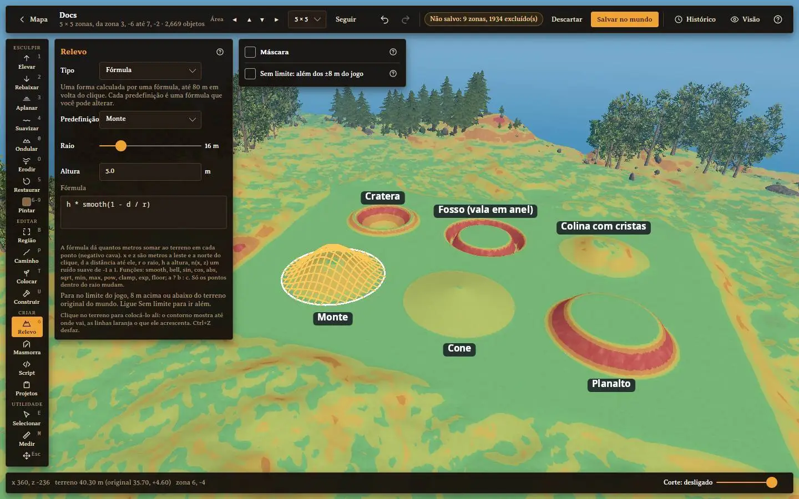
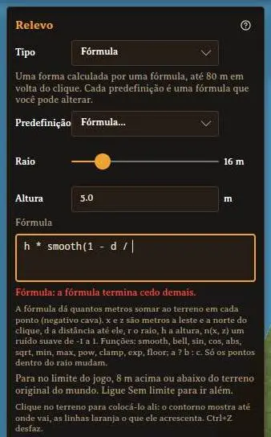
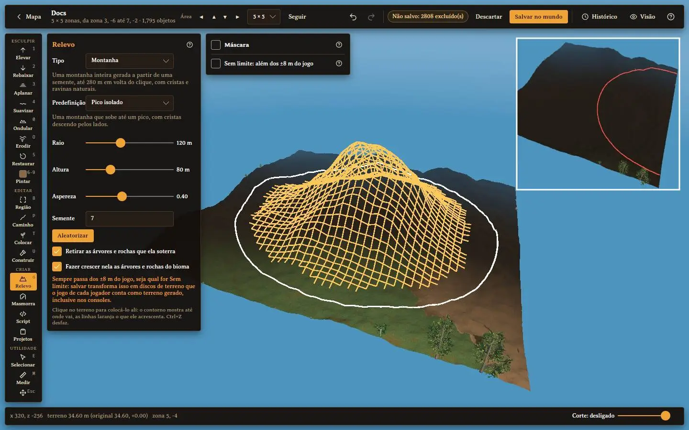
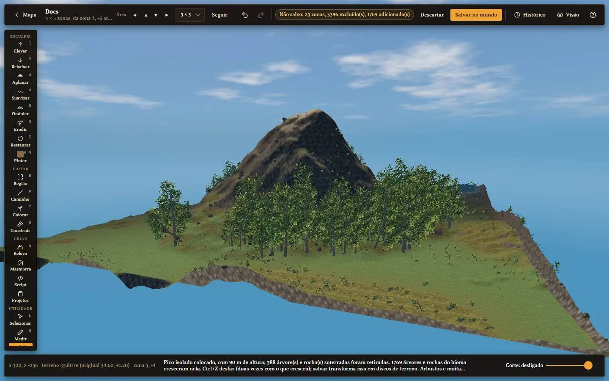
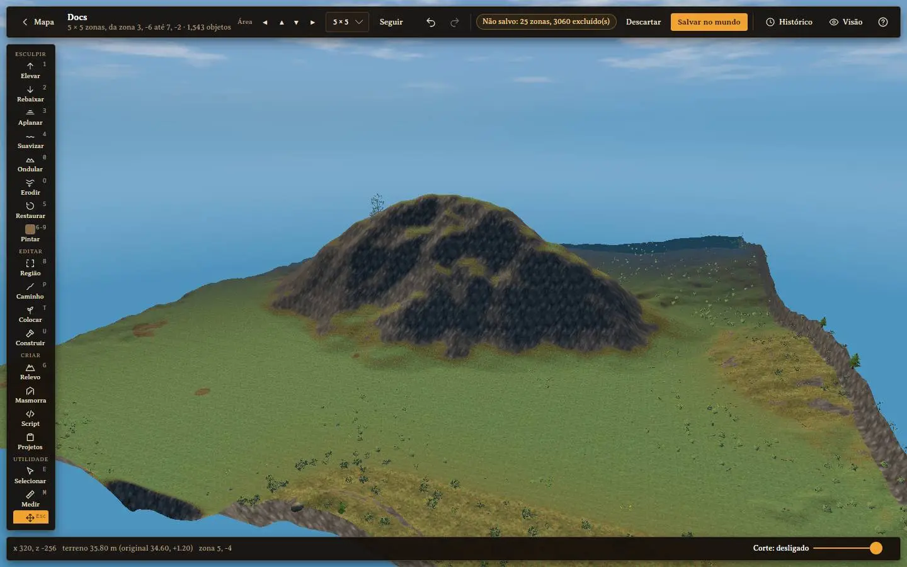
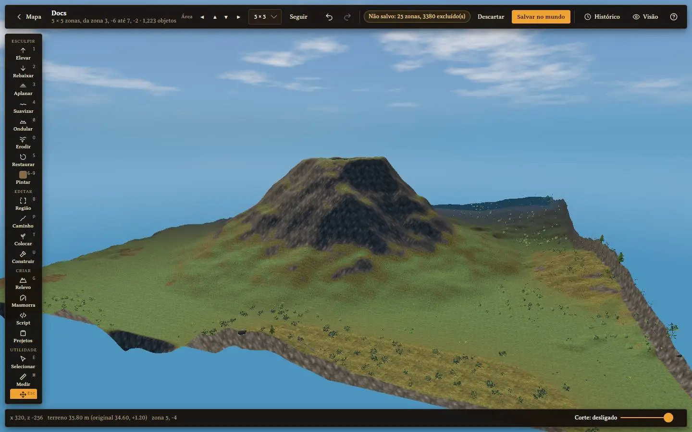
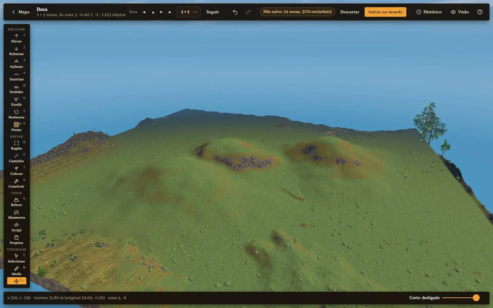
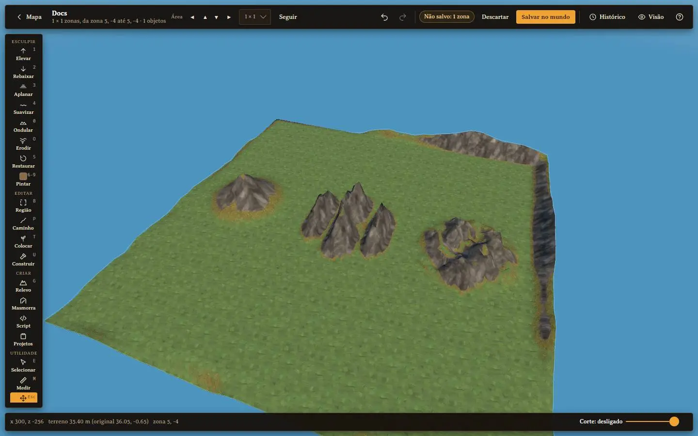
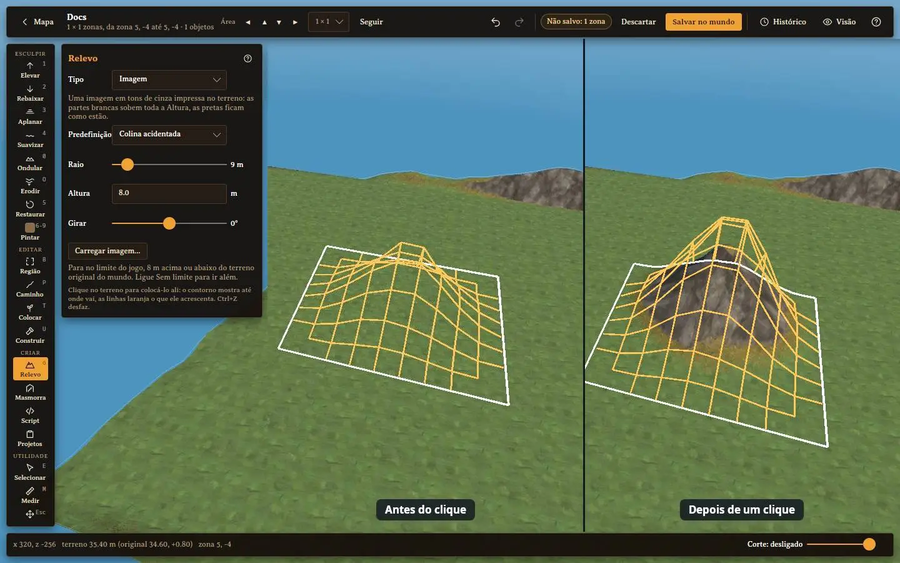

<!-- source: e6ef7a67 -->
# Relevo

Ponha um relevo inteiro no terreno com um clique: um monte ou uma cratera calculados por uma fórmula, uma montanha bem
além dos 8 m do jogo, ou uma imagem sua impressa no chão.

**Onde:** barra de ferramentas, seção **CRIAR** · **Tecla:** `G` · **Funciona em:** mundos salvos, ao vivo

*O tipo **Fórmula**. Fileira da frente, da esquerda: Monte, Cone, Planalto. Fileira de trás, da esquerda: Cratera,
Fosso (vala em anel), Colina com cristas, cada um com o raio padrão de 16 m e a altura de 5 m, com **Cores de declive**
ligado em Visão para que as encostas fiquem legíveis. O painel mostra o Monte e a fórmula dele; sobre o monte, o
contorno branco é o raio e as linhas laranja, o que outro clique acrescentaria.*

## Como usar

1. Na barra de ferramentas, clique em **Relevo** (`G`).
2. No painel, escolha um **Tipo**: **Fórmula**, **Montanha** ou **Imagem** (veja [Os três tipos](#os-três-tipos)).
3. Escolha uma **Predefinição** e ajuste **Raio** e **Altura**.
4. Mova o ponteiro sobre o terreno. O contorno branco mostra até onde o relevo vai, e as linhas laranja mostram o que
   ele acrescenta, tão alto ou tão fundo quanto ele vai ficar.
5. Clique. O relevo entra na hora.
6. Não ficou bom? `Ctrl+Z` o desfaz. Cada clique é um passo de desfazer ("Relevo: Monte").

## Os três tipos

Cada tipo tem as próprias predefinições. Nenhuma predefinição tem o mesmo nome em dois tipos, então o nome diz qual
você usou.

| Tipo | Cria | Raio | O limite de ±8 m do jogo |
|---|---|---|---|
| **Fórmula** | Uma forma lisa e exata, calculada por uma fórmula que você pode ler e alterar. | 2 a 80 m | Respeita, a menos que **Sem limite** esteja ligado. |
| **Montanha** | Uma montanha natural inteira a partir de uma semente, com cristas e ravinas, e árvores crescidas nela. | 20 a 280 m | Sempre passa dele. |
| **Imagem** | Uma imagem em tons de cinza impressa no terreno: uma embutida, ou qualquer arquivo de imagem. | 2 a 80 m | Respeita, a menos que **Sem limite** esteja ligado. |

Uma linha perto da parte de baixo do painel diz como o tipo escolhido se comporta com o limite neste momento. Ela fica
âmbar quando o relevo vai passar do limite. Veja [Sem limite](terrain.md#sem-limite) para o interruptor e para o que o
salvamento faz com terreno além do limite.

## Configurações que todo tipo tem

Elas ficam no mesmo lugar, com os mesmos nomes, nos três tipos. Cada tipo lembra os próprios valores.

| Configuração | O que faz |
|---|---|
| **Tipo** | Do que o relevo é feito. Fica lembrado para a próxima vez. |
| **Predefinição** | O relevo: a lista própria do tipo. |
| **Raio** | Até onde ele vai a partir do clique. |
| **Altura** | Quanto ele sobe (m). Para **Fórmula** e **Imagem**, uma altura negativa o vira de cabeça para baixo: um monte vira um buraco, um fosso vira uma muralha em anel. |
| **Girar** | A direção dele, quando tem uma: uma crista ou cordilheira de **Montanha**, e qualquer **Imagem**. |

## Fórmula

Uma forma calculada ponto a ponto. Cada predefinição é uma fórmula mostrada na caixa; altere-a e a lista passa para
**Fórmula…**, a sua, que fica lembrada para a próxima vez.

| Predefinição | Forma |
|---|---|
| **Monte** | Uma colina redonda e suave. |
| **Cone** | Encostas retas até uma ponta. |
| **Planalto** | Um topo plano com uma encosta suave em volta. |
| **Cratera** | Uma depressão com uma borda elevada. |
| **Fosso (vala em anel)** | Uma vala a três quartos do raio. Com altura negativa, uma muralha em anel. |
| **Bacia** | Uma depressão redonda. |
| **Colina com cristas** | Um monte com cristas atravessando-o. |
| **Fórmula…** | A sua própria. |

| Configuração | O que faz |
|---|---|
| **Raio** | 2 a 80 m (padrão 16 m). Só o terreno dentro dele muda. |
| **Altura** | Padrão 5 m. É o `h` da fórmula. |
| **Fórmula** | Quantos metros somar ao terreno em cada ponto dentro do raio; um número negativo cava. Um erro aparece embaixo da caixa, e nada pode ser colocado até ele ser corrigido. |

*Uma fórmula incompleta: a lista passou para **Fórmula…**, e a linha embaixo da caixa diz o que está errado ("a
fórmula termina cedo demais").*

### Escrever uma fórmula

A fórmula é calculada para cada ponto do terreno dentro do raio, e o resultado é somado ao terreno ali.

| Nome | Significado |
|---|---|
| `x`, `z` | Metros a leste e a norte do clique. |
| `d`, `r`, `h` | Distância do clique, o raio, a altura. |
| `n(x, z)` | Ruído suave de mais ou menos -1 a 1, do padrão dos pincéis (**Novo padrão** em [Ondular](terrain.md#ondular) o muda). Use `n(x / 10, z / 10)` para saliências largas. |
| `pi` | 3.14159… |

Funções: `abs`, `atan2(y, x)`, `bell(t)` (1 em 0, sumindo por volta de ±1), `ceil`, `clamp(v, a, b)`, `cos`, `exp`,
`floor`, `log`, `max(…)` e `min(…)` (qualquer número de valores), `pow(a, b)`, `round`, `sign`, `sin`, `smooth(t)` (0
abaixo de 0, 1 acima de 1, um S suave entre eles), `sqrt`, `tan`.

Operadores: `+ - * / %`, `^` (potência), comparações `< > <= >= == !=` (1 ou 0), `&&`, `||`, `!`, e `a ? b : c`.

As predefinições mostram como funciona:

| Predefinição | Fórmula |
|---|---|
| **Monte** | `h * smooth(1 - d / r)` |
| **Cone** | `h * max(0, 1 - d / r)` |
| **Planalto** | `h * smooth((r - d) / (0.35 * r))` |
| **Bacia** | `-h * smooth(1 - (d / r) ^ 2)` |
| **Fosso (vala em anel)** | `-h * bell((d - 0.75 * r) / (0.12 * r))`: uma vala a três quartos do raio. |

Mais duas para começar: `h * smooth(1 - d / r) * (1 + 0.3 * n(x / 8, z / 8))` é uma colina cheia de saliências, e
`abs(x) < 3 ? -h : 0` cava uma trincheira de 6 m de largura atravessando o círculo.

## Montanha

Uma montanha inteira gerada a partir de uma semente, somada ao terreno que já existe, de modo que ela mantém o relevo
próprio do lugar e se mistura de volta a ele na borda. O contorno dela nunca é um círculo perfeito, e **Aspereza**
acrescenta ondulações, cristas e ravinas proporcionais ao tamanho dela.

*Pico isolado, 80 m de altura, raio de 120 m, antes do clique: as linhas laranja o mostram tão alto quanto vai subir e
o anel branco, até onde vai. No detalhe, em cima à direita: com o ponteiro perto da borda da área, o anel fica
vermelho e nenhuma prévia aparece, porque ela não caberia.*

| Predefinição | Altura / raio sorteados | Forma |
|---|---|---|
| **Pico isolado** | 50–110 m / 120–240 m | Uma montanha que sobe até um pico, com cristas descendo pelos lados. |
| **Crista** | 35–80 m / 140–260 m | Uma crista longa, com metade da largura do comprimento. |
| **Cordilheira** | 40–90 m / 180–280 m | Três a cinco picos ao longo de uma linha, ligados por colos. |
| **Mesa** | 20–50 m / 70–150 m | Um topo plano com encostas íngremes e rochosas: espaço para construir lá em cima. A aspereza fica só nas encostas. |
| **Vulcão** | 45–100 m / 130–240 m | Um cone com uma cratera no topo. |
| **Colinas onduladas** | 12–30 m / 100–220 m | Três a seis colinas suaves juntas. |

| Pico isolado | Crista |
|---|---|
|  |  |
| **Vulcão** | **Colinas onduladas** |
|  |  |

*Quatro predefinições no meio de uma área de 5 × 5 limpa e nivelada antes, para que cada uma se destaque. O pico
isolado tem as árvores do bioma crescidas nele; os outros ficam nus para que a forma apareça.*

| Configuração | O que faz |
|---|---|
| **Predefinição** | O tipo de montanha. Escolher uma sorteia uma montanha nova dela, como **Aleatorizar**. |
| **Raio** | 20 a 280 m. O contorno é irregular, até 15% mais longe: o anel o mostra. |
| **Altura** | Quanto ela sobe acima do terreno ali, de 5 a 300 m. |
| **Girar** | Só **Crista** e **Cordilheira**: a direção em que ela corre, de 0° a 179°. |
| **Aspereza** | 0: encostas lisas. 1: ravinas e cristas fundas. |
| **Semente** | O número de onde vêm os detalhes: a mesma predefinição, os mesmos valores e a mesma semente geram a mesma montanha de novo. |
| **Aleatorizar** | Uma montanha nova da predefinição: tamanho, aspereza, direção e semente novos. Se ela não couber na área aberta, é reduzida por inteiro, altura também, para que as encostas continuem suaves. |
| **Retirar as árvores e rochas que ela soterra** | Ligado no início. Árvores, rochas, minério, arbustos e coletáveis onde ela eleva o terreno mais de 2 m são retirados (o salvamento faria isso de qualquer jeito). As peças de construção ficam, assim como o que está numa masmorra bem acima. |
| **Fazer crescer nela as árvores e rochas do bioma** | Ligado no início. Faz crescer as árvores e rochas do próprio bioma, pelas regras do jogo, nas encostas que ela elevou mais de um metro, longe do que já está ali. Um segundo passo de desfazer. |

Uma montanha precisa caber inteira na área aberta, borda irregular incluída: onde o anel está vermelho, um clique não
põe nada.

## Imagem

Uma imagem em tons de cinza impressa no terreno: as partes brancas sobem toda a **Altura**, as cinzas parte dela, as
pretas ficam como estão. A imagem cobre um quadrado com o dobro da largura do **Raio**; o contorno o mostra.

*As imagens embutidas, com 6 m de altura e raio de 8 m. Da esquerda: Colina acidentada, Dunas, Terreno rochoso.*

*A **Colina acidentada**, **Raio** de 9 m e **Altura** de 8 m. À esquerda: o contorno quadrado e a prévia laranja em
terreno plano, antes do clique. À direita: a colina inteira, aplicada com um clique.*

| Predefinição | Forma |
|---|---|
| **Colina acidentada** | Um pequeno pico com encostas ásperas. |
| **Dunas** | Cristas paralelas dentro de uma mancha redonda. |
| **Terreno rochoso** | Terreno irregular e acidentado. |
| As suas | Cada imagem que você carregou, com o nome do arquivo. |

| Configuração | O que faz |
|---|---|
| **Raio** | Metade do lado da imagem, de 2 a 80 m (padrão 16 m). |
| **Altura** | Quanto as partes brancas sobem (m, padrão 4). Negativa: elas são afundadas. |
| **Girar** | Gira a imagem, de -180° a 180°. |
| **Carregar imagem…** | Usa qualquer imagem (PNG, JPEG…): um mapa de altura de outra ferramenta, um logotipo, uma forma desenhada à mão. O brilho dela é a altura; as partes transparentes contam como preto. Ela é redimensionada para um quadrado de 128 × 128 pontos, então uma imagem larga fica achatada e os detalhes finos se perdem. Ela fica guardada para a próxima vez com o nome do arquivo. |
| **Esquecer imagem** | Remove a imagem carregada escolhida. Só aparece para imagens carregadas: as embutidas ficam. |

As imagens são os [carimbos](terrain.md#carimbos) dos pincéis: uma que você carrega aqui também é uma forma de pincel, e
uma carregada lá é oferecida aqui. Dois carimbos embutidos, **Mesa (topo plano)** e **Borda de cratera**, são só
formas de pincel: como relevos, o tipo **Fórmula** os cria (**Planalto**, e **Fosso** com altura negativa).

## Atalhos

| Tecla ou mouse | O que faz |
|---|---|
| `G` | Escolhe Relevo. |
| Clicar no terreno | Põe o relevo ali. |
| `Ctrl+Z` | Desfaz o último (pressione duas vezes quando árvores cresceram numa montanha). |
| `Esc` | Sai da ferramenta (volta para Visão). |

## Dicas e limites

- **Fórmula e Imagem param a 8 m do terreno gerado**, e a barra de status avisa. Para relevos mais altos, marque
  **Sem limite: além dos ±8 m do jogo** no cartão **Máscara** ao lado do painel (veja [Sem limite](terrain.md#sem-limite)):
  ele fica ligado para todas as ferramentas de terreno até você desligá-lo.
- **Uma montanha sempre passa dos 8 m do jogo**, seja qual for o estado de **Sem limite**. Salvar a transforma em
  discos de terreno e limpa o Histórico da área, como com [Sem limite](terrain.md#sem-limite). Confira-a antes de
  salvar.
- **Para montanhas grandes, abra antes uma área maior** (a lista de tamanhos da área, na barra superior): numa área de
  5 × 5, o raio pode chegar a uns 137 m.
- **A [Máscara](masks.md) vale**: onde ela deixa o terreno de fora, o relevo para num degrau, e uma montanha num
  penhasco.
- **Uma fórmula que dá 0 em todo lugar** não muda nada, e a barra de status avisa. Os pontos onde ela não dá número
  (uma divisão por zero) ficam como estavam.
- **A linha de pontos mais externa da área nunca muda** (veja
  [A borda travada](concepts/areas-and-zones.md#a-borda-travada)).
- **Para suavizar uma borda** depois, passe sobre ela com o pincel **Suavizar** ou **Ondular**.
- **Encostas suaves mantêm grama e árvores; as íngremes mostram rocha nua**, como o jogo as desenha.
- **Para usar uma imagem como pincel** enquanto arrasta, escolha-a como **Forma** do pincel (veja
  [Carimbos](terrain.md#carimbos)). Para definir as alturas de uma área inteira a partir de uma imagem, veja
  [Mapa de altura](area.md#mapa-de-altura).
- **Um [script](scripting.md)** também pode colocar formas de fórmula e montanhas, por regra.

## Relacionados

- [Elevar ou cavar além do limite de 8 m do jogo](guides/raise-past-the-limit.md)
- [Sem limite](concepts/ground-limits.md#sem-limite): como o terreno é salvo além de 8 m
- [Como uma montanha é feita](concepts/ground-limits.md#como-uma-montanha-é-feita)
- [Regras de crescimento](concepts/objects.md#regras-de-crescimento): o que cresce numa montanha
- [Esculpir e pintar](terrain.md): pincéis e carimbos
