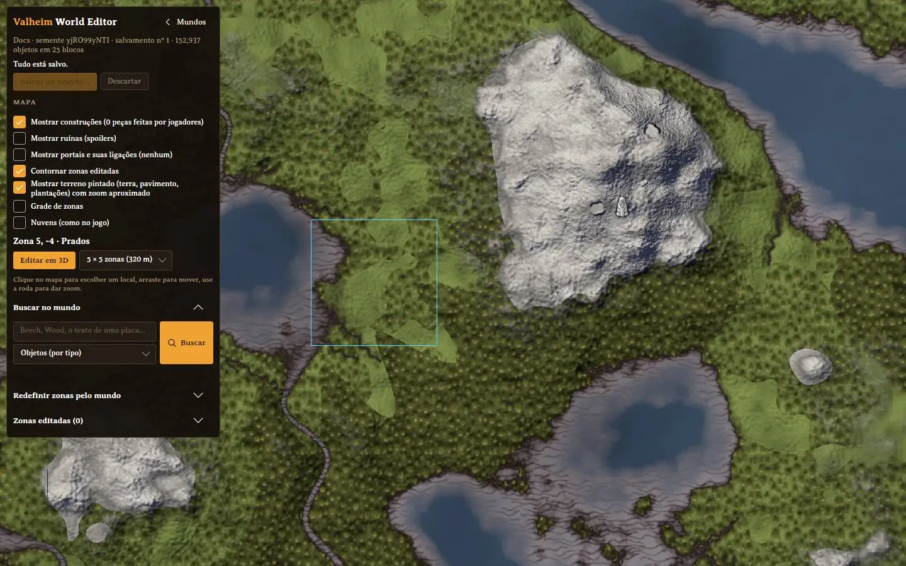
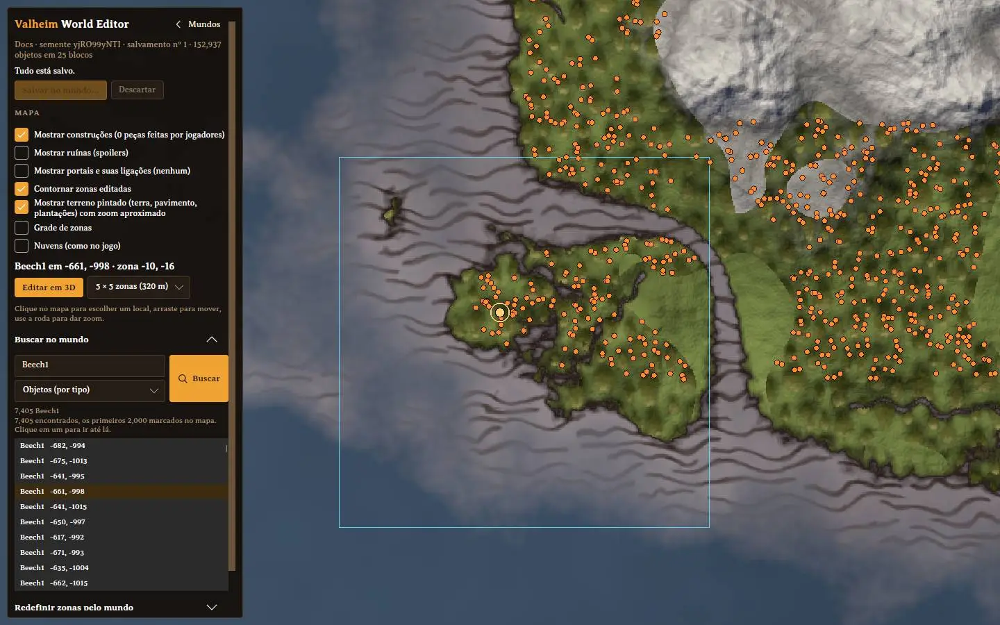
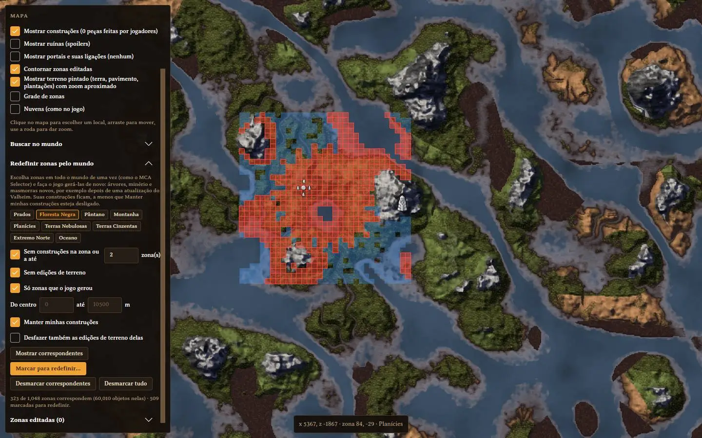
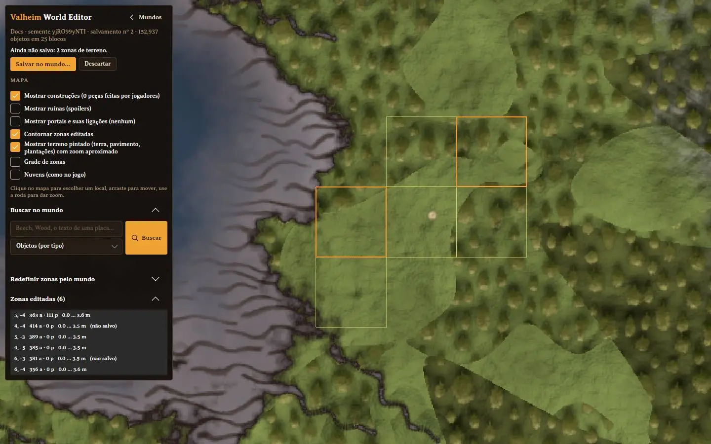

<!-- source: 2b176694 -->
# Mapa do mundo

Veja o mundo inteiro, escolha o lugar a editar em 3D, busque em todos os objetos, baús e placas, redefina zonas em
qualquer lugar de uma vez e salve o que está pendente.

**Onde:** abre com cada mundo; **Mapa** na barra superior do editor volta a ele · **Tecla:** nenhuma (`F1` abre esta
página) · **Funciona em:**
mundos salvos, ao vivo

> [!WARNING]
> **Feche o jogo ou pare o servidor antes de salvar um mundo offline.** Um jogo em execução grava por cima dos arquivos
> do mundo quando salva, e as suas alterações, inclusive as redefinições de zonas, se perdem. Para alterar um mundo
> enquanto ele roda, use o [modo ao vivo](live-mode.md).

*Uma zona está escolhida: o quadrado azul-claro é a área que **Editar em 3D** vai abrir, no tamanho escolhido ao lado
do botão.*

O mapa é desenhado como o jogo desenha o dele, a partir dos dados do mundo, então ele se parece com o mapa do jogo com
tudo revelado. O ponto inicial e os comerciantes (depois que a zona deles é criada) mostram os ícones deles como no
jogo.

## Como usar

1. Arraste para mover o mapa; gire a roda do mouse para dar zoom na direção do ponteiro.
2. Clique num local. O painel lateral mostra a zona e o bioma dele ("Zona 12, -4 · Floresta Negra"), e a área que vai
   abrir fica contornada em azul-claro.
3. No painel lateral, escolha o tamanho na lista ao lado de **Editar em 3D**.
4. Pressione **Editar em 3D**. O [editor 3D](editor-basics.md) abre em volta da zona em que você clicou.

O mapa lembra onde você olhou por último, também da próxima vez que você iniciar o editor. A caixa embaixo mostra o
ponto sob o ponteiro: as coordenadas, a zona e o bioma dele ("x 812, z -260 · zona 13, -4 · Prados"), e o bioma
alternativo da área dele quando houver um ("bioma alt. Dark Meadows", mostrado alguns segundos depois que o mapa abre).

## Configurações

O alto do painel lateral dá o nome do mundo, a semente, o número do salvamento e quantos objetos ele contém (ao vivo: a
conexão em vez do número do salvamento); depois de um salvamento, ele mostra o novo número. **Mundos** volta à página
inicial: com alterações pendentes, pergunta antes, e **Sair mesmo assim** as perde.

| Configuração | O que faz |
|---|---|
| **Recarregar do jogo** | Só ao vivo: lê o mundo inteiro de novo a partir do jogo em execução. A linha de cima lista os jogadores online ("Mundo ao vivo · 2 jogador(es) online: Ragnar, Freya"). |
| **Salvar no mundo…** / **Aplicar ao vivo** | Grava todas as alterações pendentes nos arquivos do mundo (ao vivo: envia-as ao jogo em execução). A linha de cima diz o que está pendente, por exemplo "Ainda não salvo: 3 zonas de terreno, 12 excluído(s), 40 adicionado(s), 25 redefinição(ões) de zona." |
| **Descartar** | Joga fora todas as alterações ainda não salvas ou aplicadas, depois de perguntar. |
| **Mostrar construções (N peças feitas por jogadores)** | Desenha todas as peças feitas por jogadores: as áreas ocupadas de perto, pontos mais de longe, nada com o zoom bem afastado. As ruínas em que jogadores construíram são desenhadas com a construção. Ligado de início. |
| **Mostrar ruínas (spoilers)** | Desenha também as ruínas do mundo (torres de pedra, casas em ruínas, ruínas das Terras Nebulosas e das Terras Cinzentas), mais apagadas. Desligado de início, porque mostra onde elas estão. |
| **Mostrar portais e suas ligações (N: P par(es) ligado(s), A sozinho(s))** | Desenha cada portal como um ponto violeta, com uma linha entre os dois que compartilham uma tag (o par que o jogo une); um portal sem par fica vazado. Com zoom aproximado (8 m por pixel ou mais perto), cada tag é escrita ao lado do portal dela ("sem tag" para uma vazia). N conta os portais, P os pares ligados, A os portais sem par. Os portais adicionados ou excluídos no editor contam assim que o mapa é mostrado de novo. Desligado de início, porque mostra onde está cada portal. |
| **Contornar zonas editadas** | Contorna as zonas cujo terreno foi alterado: uma linha amarela fina para as alterações já no mundo, uma linha laranja mais grossa para as alterações ainda não salvas ou aplicadas. Ligado de início. |
| **Mostrar terreno pintado (terra, pavimento, plantações) com zoom aproximado** | De perto, o mapa é desenhado com detalhe de 1 m com as suas alterações de terreno pendentes; isto também mostra o terreno de terra, pavimentado e cultivado. Ligado de início. |
| **Grade de zonas** | Desenha as linhas entre as [zonas](concepts/areas-and-zones.md#zonas) de 64 m, quando o zoom está aproximado o bastante. |
| **Nuvens (como no jogo)** | Desenha as sombras das nuvens em movimento do mapa do jogo. |
| **Editar em 3D** | Abre o editor 3D na área em volta da zona escolhida. |
| Lista de tamanhos (ao lado de **Editar em 3D**) | Quanto terreno o editor carrega: **3 × 3 zonas (192 m)**, **5 × 5 zonas (320 m)** (padrão), **7 × 7**, **9 × 9**, **13 × 13** ou **17 × 17 zonas (1088 m)**. Use 5 × 5 para a maior parte do trabalho, 9 × 9 ou mais para colar uma vila ou erguer uma grande montanha. Áreas maiores são mais lentas. Você pode mudar isso depois na barra superior. |

No modo ao vivo, os jogadores online aparecem como pontos azuis com os nomes deles, atualizados a cada 5 segundos. As
alterações ficam [pendentes](concepts/saving-and-history.md#alterações-pendentes) de uma área para outra: edite uma área,
volte ao mapa, abra outra e salve tudo de uma vez.

## Buscar no mundo

*Cada marcador laranja é um objeto encontrado. O resultado escolhido na lista fica maior, com um anel dourado, e o mapa
fica centralizado nele.*

1. Abra **Buscar no mundo**.
2. Digite parte de um nome ou texto, por exemplo `Beech`, `Wood` ou as palavras de uma placa. Maiúsculas e minúsculas
   não importam.
3. Escolha o que procurar (abaixo).
4. Pressione **Buscar** (ou `Enter`). Cada resultado é marcado no mapa e listado.
5. Clique num resultado: o mapa se centraliza nele e escolhe a zona dele. **Editar em 3D** abre então com esse objeto
   selecionado.

| Procurar por | Encontra |
|---|---|
| **Objetos (por tipo)** | Todo objeto cujo tipo contém o texto: `portal`, `Beech`, `chest`, `guard_stone`… |
| **Itens em contêineres** | Todo baú, carroça, navio ou outro contêiner que guarda um item cujo nome contém o texto: `Wood`, `Draugr`, `Silver`… Cada resultado diz quantos ("Wood ×50"). |
| **Textos (placas, portais, proteções…)** | Todo objeto com um texto que o contém: textos de placas, tags de portais, nomes de proteções e de lápides. Cada resultado mostra o texto que correspondeu. |

Uma linha acima dos resultados conta o que foi encontrado por tipo (por item, para os contêineres) e no total. A lista
mostra os 300 primeiros resultados; até 2.000 são marcados no mapa. Para itens e textos, os
[dados](select.md) do objeto também se abrem, então você pode mudar na hora o conteúdo do baú ou o texto da placa.
Mudar o que procurar busca de novo na hora.

A busca lê o mundo como ele está no editor: os objetos que você colocou mas não salvou são encontrados, os que você
excluiu mas não salvou, não. Os objetos de controle interno do próprio jogo (nomes que começam com `_`, como
`_ZoneCtrl`) só são encontrados quando o seu texto também começa com `_`.

## Redefinir zonas pelo mundo

*As zonas dos Prados foram marcadas para redefinir (vermelho), depois **Floresta Negra** foi escolhida e **Mostrar
correspondentes** pressionado (azul). A linha sob os botões conta as duas.*

Escolha zonas em qualquer lugar do mundo pelo que elas são, e faça o jogo gerá-las de novo: novas árvores, rochas,
minérios e masmorras, por exemplo depois de uma atualização do Valheim, em lugares onde ninguém construiu. Para
redefinir as zonas sob uma única seleção, use a ferramenta [Região](area.md#redefinir-zonas), que tem os mesmos dois
interruptores e marca do mesmo jeito; passo a passo: [Gerar zonas de novo](guides/reset-zones.md).

1. Abra **Redefinir zonas pelo mundo**.
2. Defina o filtro (abaixo).
3. Pressione **Mostrar correspondentes**. Na primeira vez, o editor lê todas as zonas (um instante). As zonas
   correspondentes ficam azuis e uma linha diz "N de M zonas correspondem (K objetos nelas)". A partir daí, o mapa
   acompanha o filtro enquanto você o muda.
4. Pressione **Marcar para redefinir…** e confirme. As zonas correspondentes ficam vermelhas.
5. **Salvar no mundo** (offline) ou **Aplicar ao vivo** faz a redefinição. Até lá, **Desmarcar tudo** a cancela, e
   **Desmarcar correspondentes** a cancela para as zonas a que o filtro corresponde agora.

> [!CAUTION]
> **Uma redefinição não pode ser desfeita depois de salva ou aplicada.** Todo objeto da zona é removido, exceto as
> lápides dos jogadores e, com **Manter minhas construções** ligado, as peças feitas por jogadores: árvores, rochas,
> minérios, ruínas, entradas de masmorras, itens no chão e criaturas, inclusive os animais domados. Tire os animais
> domados de lá primeiro, e [faça backup do mundo](guides/back-up-a-world.md).

| Configuração | O que faz |
|---|---|
| Botões de bioma (**Prados** … **Oceano**) | Só as zonas cujo meio está num dos biomas ligados. Nenhum ligado: todos os biomas. |
| **Sem construções na zona ou a até N zona(s)** | Deixa de fora as zonas a até N zonas de peças feitas por jogadores, diagonais incluídas (de 0 a 50; 2 de início). Ligado de início. Com isto desligado, uma zona que contém peças continua de fora enquanto **Manter minhas construções** estiver ligado. |
| **Sem edições de terreno** | Deixa de fora as zonas cujo terreno foi alterado (no jogo ou no editor). Ligado de início. |
| **Só zonas que o jogo gerou** | Só as zonas de que um jogador já chegou perto. Desligado: também as zonas que só contêm objetos ou edições de terreno do editor. Ligado de início. |
| **Do centro … até … m** | Só as zonas a essa distância do meio do mundo. Vazio: sem limite (a borda do mundo fica a 10.500 m). Por exemplo, redefina só os anéis externos. |
| **Manter minhas construções** | Ligado de início: as construções nunca são redefinidas a partir do mapa, e uma zona que contém peças feitas por jogadores nunca corresponde. Desligado, e com **Sem construções…** também desligado, as zonas com construções correspondem como qualquer outra e as construções delas vão junto com o resto; a pergunta antes de marcar diz isso. |
| **Desfazer também as edições de terreno delas** | A redefinição também retira as alterações de terreno das zonas, de volta ao terreno da semente. Só importa quando **Sem edições de terreno** está desligado. Desligado de início aqui (o da ferramenta Região fica ligado de início). |
| **Mostrar correspondentes** | Sombreia de azul as zonas correspondentes e conta-as, junto com os objetos nelas. |
| **Marcar para redefinir…** | Marca para redefinir todas as zonas correspondentes (vermelho), depois de perguntar. |
| **Desmarcar correspondentes** | Cancela a redefinição das zonas correspondentes que estão marcadas; as outras marcas ficam. |
| **Desmarcar tudo** | Cancela todas as redefinições de zona marcadas, inclusive as marcadas com a ferramenta Região. |

Da próxima vez que um jogador chegar perto de uma zona redefinida, o jogo a gera de novo a partir da semente, com o
local dela (ruína, masmorra, altar). Ao vivo, isso acontece na hora onde há jogadores; depois de uma redefinição ao
vivo, o editor lê o mundo de novo, e o histórico vem junto, sem o que ele fez nas zonas redefinidas.

## Zonas editadas

**Zonas editadas (N)** lista todas as zonas cujo terreno foi alterado, as mais alteradas primeiro. Cada linha dá a
zona, quantos pontos de altura (`a`) e de pintura (`p`) foram alterados, a faixa das alterações de altura
(`-2.4 … 6.0 m`) e "(não salvo)" quando há alterações pendentes ("(não aplicado)" num mundo ao vivo). Clique numa linha
para dar zoom nessa zona e escolhê-la, pronta para **Editar em 3D**.

*Quatro zonas salvas (amarelo fino) e duas editadas desde então (laranja mais grosso): a lista marca as pendentes com
"(não salvo)".*

## Atalhos

| Tecla ou mouse | O que faz |
|---|---|
| Arrastar | Mover o mapa. |
| Roda do mouse | Dar zoom na direção do ponteiro. |
| Clique | Escolher a zona ali. |
| `Enter` na caixa de busca | Buscar. |

## Dicas e limites

- **O mapa mostra o mundo como ele foi lido.** Ao vivo, o editor 3D acompanha o que os jogadores alteram na área
  aberta, mas o resto do mapa só muda com **Recarregar do jogo**.
- **Com zoom mais aproximado que cerca de 6 m por pixel**, a parte visível é desenhada de novo com detalhe de 1 m, com
  as suas alterações de terreno pendentes.
- **Só as zonas dentro do mundo** são listadas para redefinir. Um servidor dedicado sem ninguém online também gera
  zonas muito fora do mundo: essas ficam de fora.
- **Para desfazer uma alteração**, **Desmarcar tudo** cancela as redefinições marcadas, e **Descartar** descarta tudo o
  que está pendente. Para desfazer uma única alteração, abra a área dela em 3D e pressione `Ctrl+Z` ou use o Histórico:
  veja [Desfazer um passo, reverter uma alteração ou descartar tudo](guides/undo-changes.md).
- **A busca não encontra nada?** Confira a grafia e a escolha em **Procurar por**; os objetos de controle interno
  precisam de um `_` no início.
- **Mundos feitos com o Expand World**: com o complemento dele instalado e ligado, um mundo mais largo aparece inteiro,
  os ícones dos locais vêm dos dados dele, e a leitura acrescenta o território e os efeitos de status que um jogador
  recebe ali ("território frost · efeitos Freezing (noite)"). Veja
  [Editar um mundo criado com Expand World, Riverheim ou Tunnelheim](guides/use-mods-worlds.md).

## Relacionados

- [Encontrar um objeto, um item de baú ou uma placa](guides/find-things.md)
- [Gerar zonas de novo](guides/reset-zones.md)
- [Fazer backup de um mundo antes de editar](guides/back-up-a-world.md)
- [Áreas e zonas](concepts/areas-and-zones.md)
- [Noções básicas do editor](editor-basics.md), [Modo ao vivo](live-mode.md)
