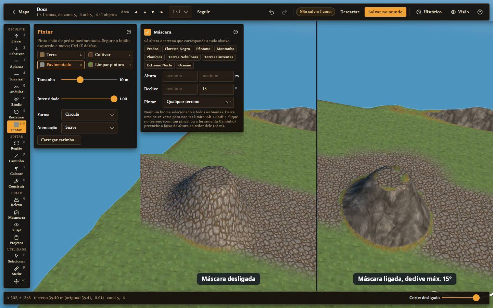
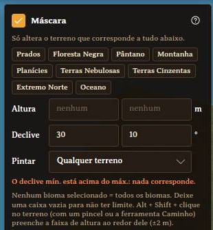

<!-- source: 1cb7e459 -->
# Máscara

Faça uma ferramenta alterar só o terreno que você escolhe, por bioma, altura, declive ou pintura: pavimente só as
partes planas de uma colina, nivele o fundo de um vale sem tocar nas encostas, plante só em terreno sem pintura.

**Onde:** o cartão **Máscara** ao lado do painel da ferramenta · **Tecla:** nenhuma (`Alt`+`Shift`+clique define uma
faixa de altura) · **Funciona em:** mundos salvos, ao vivo

*O mesmo traço largo de pintura Pavimentado sobre um monte. À esquerda, Máscara desligada: tudo fica pavimentado. À
direita, Máscara ligada com declives abaixo de 15°: o terreno plano fica pavimentado, as encostas íngremes do monte
não. O cartão Máscara fica ao lado do painel da ferramenta.*

A Máscara funciona com os pincéis de esculpir e o pincel Pintar, [Relevo](landform.md), [Caminho](path.md), as ações
da ferramenta [Região](area.md), a colagem e [Colocar](place.md). Ela não restringe [Construir](build.md): uma peça vai
para onde você aponta.

## Como usar

1. Escolha uma ferramenta que use a Máscara. O cartão **Máscara** aparece ao lado do painel dela.
2. No cartão, marque **Máscara**. As configurações dela abrem embaixo.
3. Defina os biomas, a altura, o declive e a pintura que você quer. Deixe uma configuração vazia para não limitar por
   ela.
4. Use a ferramenta como de costume: ela só altera o terreno que corresponde a todas as configurações.
5. Quando terminar, desmarque **Máscara**. Ela continua ligada, com as configurações, quando você troca de ferramenta.

## Configurações

| Configuração | O que faz |
|---|---|
| **Máscara** | Ligada: a ferramenta só altera o terreno que corresponde a tudo abaixo. Desligada: sem limite. |
| Chips de bioma | **Prados**, **Floresta Negra**, **Pântano**, **Montanha**, **Planícies**, **Terras Nebulosas**, **Terras Cinzentas**, **Extremo Norte**, **Oceano**: só esses biomas. Nenhum escolhido: todos os biomas. |
| **Altura** mín. / máx. | Só o terreno entre essas alturas (m; o mar fica em 30 m). Deixe uma caixa vazia ("nenhum") para não ter limite desse lado. |
| **Declive** mín. / máx. | Só o terreno entre essas inclinações, de 0° a 90°. Um máximo de 0 só deixa passar terreno perfeitamente plano. |
| **Pintar** | **Qualquer terreno**, **Só sem pintura**, **Só pintado**, **Só terra**, **Só cultivado** ou **Só pavimentado**. |

Um aviso laranja aparece embaixo das configurações quando elas não deixam passar nada: um declive máximo de 0°, ou um
mínimo acima do máximo.

*Declive mín. de 30° está acima do máx. de 10°, então o cartão avisa em laranja: "O declive mín. está acima do máx.:
nada corresponde."*

### Sem limite, no mesmo cartão

Embaixo da Máscara, o cartão traz a outra configuração que todas as ferramentas de terreno compartilham:

| Configuração | O que faz |
|---|---|
| **Sem limite: além dos ±8 m do jogo** | Ligado: as ferramentas de terreno vão até 400 m a partir do terreno gerado, não só os 8 m do jogo. Um só interruptor para os pincéis de esculpir, [Relevo](landform.md) (as fórmulas e imagens dele), [Caminho](path.md) e [Região](area.md); ele fica ligado até você desligá-lo, e fica desligado toda vez que o editor inicia. Veja [Sem limite](terrain.md#sem-limite). |

Ele não faz parte da Máscara (funciona com a Máscara ligada ou desligada), e o cartão só o mostra com as ferramentas
que ele controla: não com o pincel Pintar nem com [Colocar](place.md), que não movem terreno. Uma montanha de Relevo
sempre passa do limite, seja qual for o estado do interruptor.

## Atalhos

| Tecla ou mouse | O que faz |
|---|---|
| `Alt`+`Shift`+clique no terreno | Com um pincel de esculpir ou pintar, ou com a ferramenta Caminho: liga a Máscara e preenche **Altura** de 2 m abaixo a 2 m acima desse ponto. Útil para trabalhar só num terraço ou numa linha de costa. |

## Dicas e limites

- **A Máscara não tem borda suave.** Cada ponto do terreno (um por metro) corresponde ou não, então esculpir com ela
  pode deixar um degrau onde o terreno que corresponde encontra o resto, principalmente com Elevar, Rebaixar e um
  [Relevo](landform.md). Passe sobre o degrau com o pincel **Suavizar** depois, com a Máscara desligada.
- **Durante um traço de pincel, a Máscara olha o terreno como ele estava quando você pressionou o botão.** Um traço
  de Elevar sob um limite de altura continua subindo além dele até você soltar. As edições de um clique (Relevo,
  Caminho, Região, colagem) olham o terreno logo antes delas.
- **O bioma é o bioma que o mundo gerou** ali. Remodelar o terreno não o muda.
- **Pintura:** o terreno limpo com **Limpar pintura** conta como sem pintura. **Só terra**, **Só cultivado** e
  **Só pavimentado** exigem que essa pintura seja pelo menos metade da cor.
- **Nada mudou?** A barra de status diz "Nada mudou: a Máscara exclui todo o terreno sob o pincel (verifique os
  ajustes de altura, declive, bioma e pintura dela)."
- **A colagem também obedece à Máscara, embora o cartão não apareça enquanto você cola.** Uma Máscara deixada ligada
  limita o terreno que a colagem molda (os objetos dela entram todos). Desmarque **Máscara** antes de copiar e colar se
  quiser o terreno inteiro.
- **A Máscara é uma configuração, não uma alteração**: ela não é desfeita com `Ctrl+Z` nem salva no mundo. Ela fica
  desligada, com as caixas vazias, toda vez que o editor inicia.

Ideias:

- Para pavimentar um caminho só nas partes planas de uma encosta, defina o **Declive** máx. e use **Pintar
  pavimento** da ferramenta Caminho.
- Para plantar só em terreno sem pintura ou só em terreno cultivado, defina **Pintar** e use [Colocar](place.md).
- Para nivelar o fundo de um vale sem tocar nas encostas, defina a **Altura** máx. um pouco acima do fundo do vale e
  use **Aplanar** ou a ferramenta [Região](area.md).

## Relacionados

- [Retirar árvores e rochas, aplanar um terreno para construir](guides/clear-an-area.md)
- [Plantar uma floresta, uma plantação ou uma sebe](guides/plant-a-forest.md)
- [Esculpir e pintar](terrain.md), [Caminho](path.md), [Região](area.md)
- [Como a máscara avalia o terreno](concepts/ground-limits.md#como-a-máscara-avalia-o-terreno)
