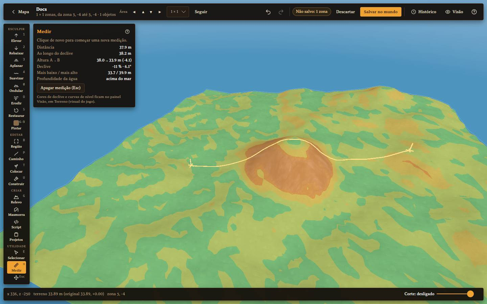
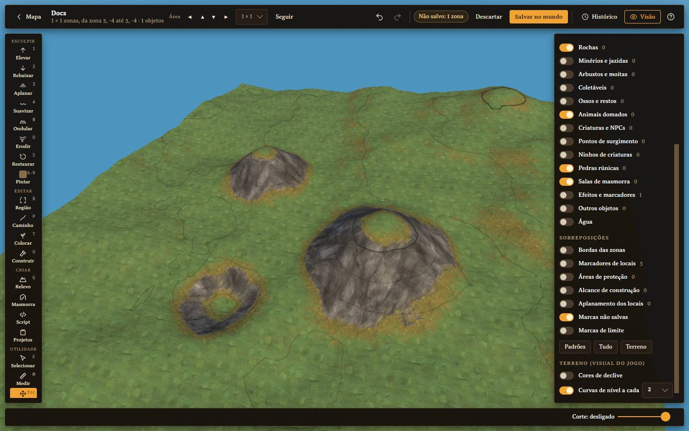
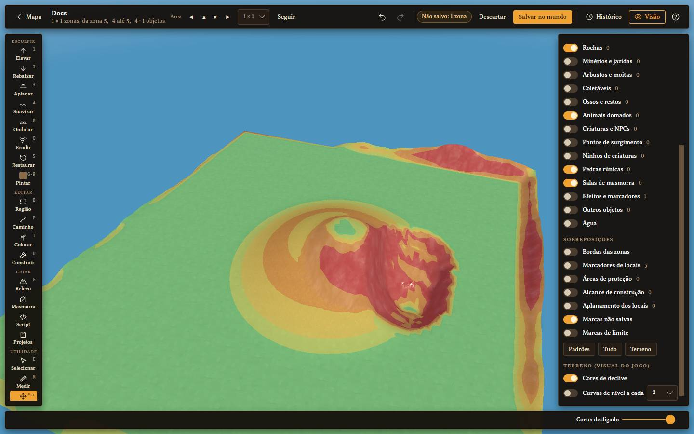

<!-- source: 164ad5c4 -->
# Medir e sobreposições

Clique em dois pontos e leia a distância, a diferença de altura e o declive entre eles. Duas sobreposições de terreno,
as cores de declive e as curvas de nível, mostram a inclinação e a altura em todo lugar de uma vez enquanto você usa
qualquer ferramenta.

**Onde:** barra de ferramentas, seção **UTILIDADES**; as sobreposições no painel Visão · **Tecla:** `M` · **Funciona
em:** mundos salvos, ao vivo

*Uma medição do pé de um monte até depois do topo, com as cores de declive ligadas. A linha acompanha o terreno; o
painel mostra a distância, as alturas e o declive.*

## Como usar

1. Na barra de ferramentas, clique em **Medir** (`M`).
2. Clique num primeiro ponto do terreno. A linha segue o cursor.
3. Clique num segundo ponto para fixar a medição. O painel mostra as leituras.
4. Clique mais uma vez para começar uma nova medição, ou pressione **Apagar medição (Esc)** para removê-la.

A linha é desenhada ao longo do terreno, então ela mostra o perfil entre os dois pontos. A dica no alto do painel diz o
que o próximo clique faz.

## Leituras

| Leitura | O que significa |
|---|---|
| **Distância** | A distância em linha reta vista de cima, como num mapa (m). |
| **Ao longo do declive** | O comprimento de uma linha reta de A a B, incluindo a diferença de altura (m). |
| **Altura A → B** | A altura do terreno nos dois pontos e a diferença, por exemplo `35.0 → 42.5 m (+7.5)`. |
| **Declive** | O declive médio de A a B, em % e em graus. Um declive de 100% tem 45°. |
| **Mais baixo / mais alto** | O terreno mais baixo e o mais alto ao longo da linha, lidos a cada metro: uma saliência ou depressão aparece aqui mesmo quando A e B estão no mesmo nível. |
| **Profundidade da água** | O quanto o ponto mais baixo está abaixo do mar (o mar fica em 30 m), ou "acima do mar". |

As alturas são as do jogo, como na barra de status. Você pode selecionar os valores no painel e copiá-los.

## Sobreposições de terreno

No painel Visão (`V`), em **TERRENO (visual do jogo)**:

| Configuração | O que faz |
|---|---|
| **Cores de declive** | Colore o terreno pela inclinação, para você ver onde uma rampa ou um terreno para construir é íngreme demais: verde abaixo de 10°, verde-amarelado de 10 a 20°, amarelo de 20 a 30°, laranja de 30 a 45°, vermelho acima de 45°. Os morros mantêm luz e sombra. |
| **Curvas de nível a cada** *N* **m** | Desenha curvas de nível a cada **1**, **2** (padrão), **5** ou **10** m. Uma em cada cinco linhas é mais escura e mais grossa. Linhas próximas umas das outras indicam terreno íngreme. |

As duas precisam de **Visual do jogo** (o aspecto do terreno no painel Visão), continuam ligadas enquanto você usa
outras ferramentas e são lembradas. As curvas de nível caem em múltiplos do passo, então o nível do mar (30 m) sempre
tem uma e a linha da costa é fácil de seguir.

*Curvas de nível a cada 2 m sobre dois montes e uma depressão, com as bordas das zonas desligadas. O painel Visão
mostra **Curvas de nível a cada** 2 m em **TERRENO (visual do jogo)**; uma em cada cinco linhas é mais escura.*

*Cores de declive num monte: verde no terreno plano, depois verde-amarelado, amarelo e laranja subindo pela encosta
suave, e vermelho no penhasco cortado nele. O painel Visão mostra **Cores de declive** marcado em **TERRENO (visual do
jogo)**.*

## Atalhos

| Tecla ou mouse | O que faz |
|---|---|
| `M` | Escolher Medir. |
| Clique | Definir o ponto A, depois o ponto B, depois recomeçar. |
| `Esc` | Apagar a medição; um segundo `Esc` sai da ferramenta. |
| `V` | Mostrar ou ocultar o painel Visão (as sobreposições). |

## Dicas e limites

- **A medição não altera nada** no mundo e não é salva.
- **As leituras acompanham o terreno.** Altere o terreno com outra ferramenta e volte a Medir, ou desfaça: as alturas,
  o declive e os pontos mais baixo e mais alto são lidos de novo nos mesmos A e B.
- **Planeje uma rampa:** meça do pé dela até o topo. **Declive** é o declive que a **Rampa** da ferramenta
  [Caminho](path.md) dá ao longo de uma linha reta entre os mesmos pontos.
- **Marcas de limite**, no mesmo painel Visão, tinge de vermelho o terreno que atingiu os ±8 m do jogo. Veja
  [Marcas de limite](concepts/ground-limits.md#marcas-de-limite).

## Relacionados

- [Fazer uma estrada ou uma rampa subindo uma colina](guides/make-a-road.md)
- [Retirar árvores e rochas, aplanar um terreno para construir](guides/clear-an-area.md)
- [Noções básicas do editor](editor-basics.md): o painel Visão
- [Caminho](path.md), [Esculpir e pintar](terrain.md)
