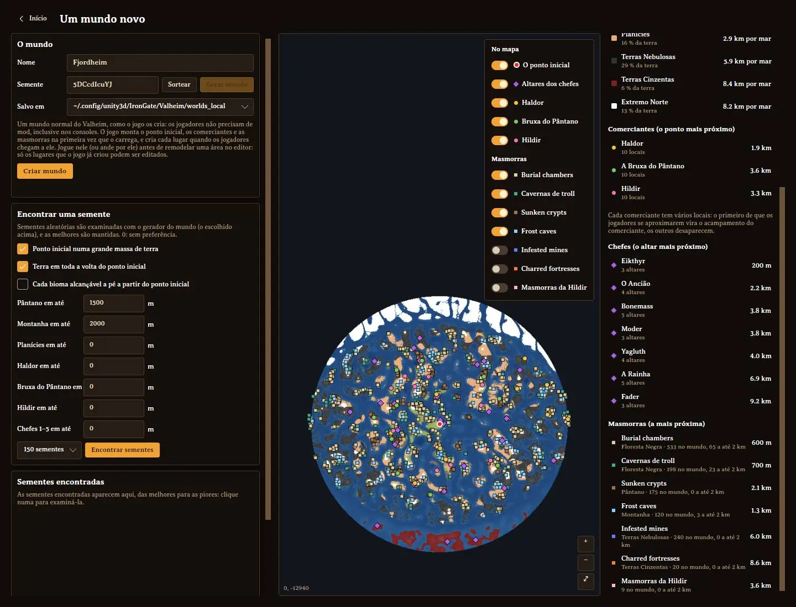
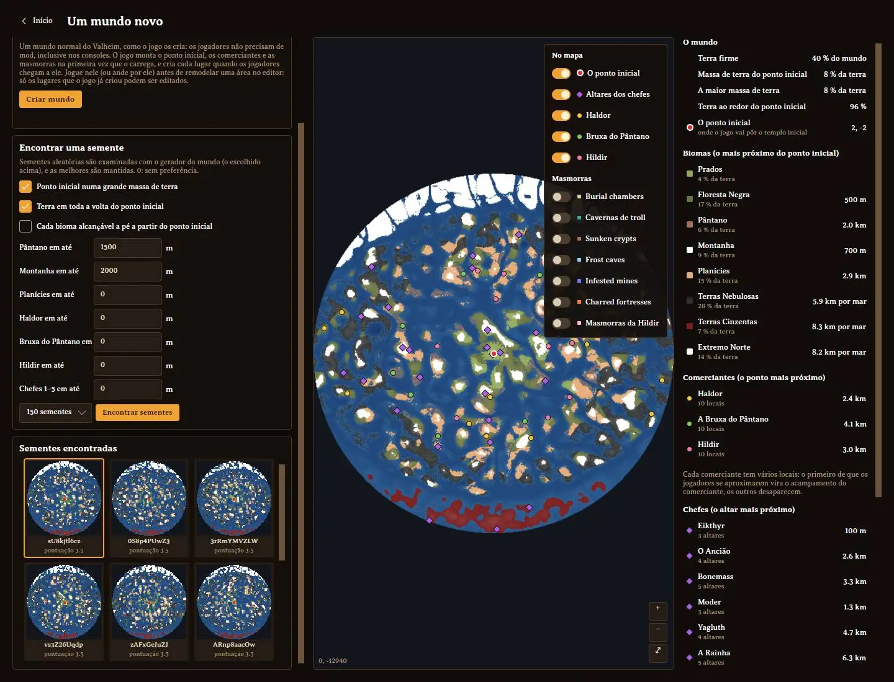

<!-- source: eca6c42a -->
# Um mundo novo

Veja o mundo de uma semente antes que ele exista, busque entre muitas sementes uma que combine com você e crie o mundo.

**Onde:** página inicial, **Criar** → **Um mundo novo** → **Criar um mundo novo** · **Tecla:** nenhuma ·
**Funciona em:** a página inicial (nenhum mundo precisa estar aberto)

*O ponto vermelho é o ponto inicial, os losangos roxos são os altares dos chefes, os pontos amarelo, verde e rosa são
os pontos dos comerciantes. A coluna da direita lista os dados da semente, aqui rolada até os altares mais próximos
dos chefes.*

O mundo que você cria é um mundo normal do Valheim, feito pelas próprias regras do jogo a partir da semente: os
jogadores entram nele sem nenhum mod, inclusive jogadores de console via crossplay (a menos que você escolha o gerador
de um mod de geração de mundo, veja [Dicas e limites](#dicas-e-limites)).

## Como usar

1. Na página inicial, escolha **Um mundo novo** em **Criar** e depois **Criar um mundo novo**. O mundo de uma semente
   aleatória é mostrado.
2. Digite uma semente e pressione **Gerar mundo** (ou `Enter`), ou pressione **Sortear** para outra aleatória. Para
   deixar o editor buscar, veja [Encontrar uma semente](#encontrar-uma-semente).
3. Observe o mapa e os dados ao lado dele. Opcional: ative os tipos de masmorra que interessam a você.
4. Digite o **Nome** do mundo, escolha onde ele é **Salvo em** e pressione **Criar mundo**. O editor grava o mundo e
   abre o mapa dele.
5. Inicie o Valheim, carregue o mundo novo e percorra as partes que você quer editar. O jogo só cria cada lugar quando
   os jogadores chegam perto dele.
6. Abra o mundo de novo no editor para remodelar o que o jogo criou.

**Início** (no canto superior esquerdo) volta à página inicial; nada é criado.

## Configurações

| Configuração | O que faz |
|---|---|
| **Semente** | Até 10 letras e algarismos, como no jogo. A mesma semente sempre cria o mesmo mundo. Maiúsculas e minúsculas importam: `Valheim` e `valheim` são dois mundos. |
| **Sortear** | Põe outra semente aleatória na caixa e mostra o mundo dela. |
| **Gerar mundo** | Mostra o mundo da semente (ou `Enter` na caixa da semente). Fica acinzentado enquanto a semente da caixa for a que está sendo mostrada. |
| **No mapa** | Mostra ou oculta **O ponto inicial**, **Altares dos chefes**, **Haldor**, **Bruxa do Pântano** e **Hildir**. |
| **Masmorras** | Mostra onde cada tipo de masmorra vai ficar (desligado de início). Veja [Masmorras](#masmorras). |
| **Nome** | O nome do mundo, como o jogo o lista. É também o nome da pasta dele, então não pode conter `/ \ : * ? " < > \|`. |
| **Salvo em** | Em qual das pastas de mundos do jogo ele vai: os seus mundos locais (`worlds_local`) ou os mundos na nuvem do Steam (`worlds`), aquelas que existem neste computador. A pasta em que o jogo instalado salva vem primeiro (no Linux, a versão para Windows executada pelo Proton guarda os mundos dentro do prefixo do Steam dela), para que o jogo liste o mundo. |
| **Gerador** | Só aparece quando um complemento para um mod de geração de mundo está em uso e o mod é encontrado: o gerador do mod ou **O do jogo**. Veja [Dicas e limites](#dicas-e-limites). |
| **Criar mundo** | Cria o mundo e abre o mapa dele. Um mundo com o mesmo nome que já esteja nessa pasta nunca é sobrescrito: você é solicitado a dar outro nome. |

## O mapa

O mapa mostra o mundo da semente como o jogo vai criá-lo: terra colorida por bioma (terreno mais alto mais claro),
água em terra tingida de azul, o mar sombreado pela profundidade, com o norte para cima. Leva alguns segundos;
"Examinando o mundo de …" aparece enquanto isso. Com zoom, a visão é desenhada de novo com um ponto por pixel da tela,
para que costas e rios fiquem nítidos. O canto inferior esquerdo mostra as coordenadas sob o ponteiro.

Sobre o mapa estão os lugares que o jogo dispõe quando carrega o mundo pela primeira vez:

- o **ponto inicial** (ponto vermelho com um anel branco): o templo inicial, aonde os novos jogadores chegam;
- os **altares dos chefes** (losangos roxos): Eikthyr, o Ancião, Bonemass, Moder, Yagluth, a Rainha e Fader;
- os **pontos dos comerciantes**: Haldor (amarelo), a Bruxa do Pântano (verde) e Hildir (rosa). Cada comerciante tem
  vários pontos: o primeiro de que os jogadores se aproximam vira o acampamento, e os outros desaparecem.

Passe o ponteiro sobre uma marca para ver as coordenadas dela e a distância até o ponto inicial. Os pontos estão
exatamente onde o jogo vai colocá-los: o editor reproduz as regras de posicionamento do jogo, lidas dos arquivos do seu
Valheim (alguns segundos, na primeira vez).

## Masmorras

*Quatro tipos ativados: cada pequeno quadrado é uma masmorra, e a cor é o tipo dela, como nos interruptores e em
**Masmorras (a mais próxima)** (distância, bioma, quantas há no mundo e a até 2 km).*

Os interruptores de **Masmorras** mostram **Burial chambers**, **Cavernas de troll**, **Sunken crypts**, **Frost
caves**, **Infested mines**, **Charred fortresses** e **Masmorras da Hildir**. O editor começa a encontrá-las assim que
uma semente é mostrada (alguns segundos); um tipo que você ativa aparece assim que é encontrado. As masmorras das
últimas 20 sementes que você examinou são guardadas, então voltar a uma delas as mostra na hora.

**Masmorras (a mais próxima)** informa, para cada tipo, a que distância do ponto inicial fica a mais próxima, o bioma
dela, quantas há no mundo e quantas ficam a até 2 km. Clique numa linha para ativar esse tipo e ver a mais próxima no
mapa.

Elas incluem os tipos que um **bioma alternativo** (uma variante como Dark Meadows) acrescenta ou exclui. Vilas, ruínas
e os outros lugares pequenos não são mostrados.

## Os dados da semente

Ao lado do mapa, o mundo da semente em forma de listas. Clique numa linha com uma marca para vê-la, ou a mais próxima
do tipo dela, no mapa.

- **O mundo**: **Terra firme** (quanto do mundo é terra), **Massa de terra do ponto inicial** e **A maior massa de
  terra** (cada uma como parcela de toda a terra), **Terra ao redor do ponto inicial** (terra a até 400 m do ponto
  inicial) e as coordenadas do ponto inicial.
- **Biomas (o mais próximo do ponto inicial)**: a parcela da terra de cada bioma e a que distância fica a terra mais
  próxima dele, com "por mar" quando ela está em outra massa de terra (você precisa de um barco).
- **Comerciantes (o ponto mais próximo)**: a que distância fica o ponto mais próximo de cada comerciante e quantos
  pontos ele tem.
- **Chefes (o altar mais próximo)**: a que distância fica o altar mais próximo de cada chefe e quantos existem.
- **Masmorras (a mais próxima)**: veja [Masmorras](#masmorras).

Terra, aqui, é o terreno em que você pode ficar de pé ou atravessar a pé: no máximo 1 m debaixo d'água, ou 3 m num
Pântano. Uma massa de terra é terra ligada a terra sem atravessar água mais funda.

## Encontrar uma semente

*Os desejos (aqui uma grande massa de terra com terra em toda a volta, um Pântano em até 1500 m e uma Montanha em até
2000 m, 150 sementes); as melhores sementes encontradas em **Sementes encontradas**, da melhor para a pior. A primeira
foi clicada: a borda dela se acende e o mundo dela preenche o mapa grande.*

**Encontrar uma semente** examina muitas sementes aleatórias em segundo plano e guarda as melhores para os seus
desejos. 0 numa caixa de distância significa "sem desejo". Para uma busca passo a passo, veja
[Encontrar uma semente com o que você quer perto do início](guides/find-a-seed.md).

| Configuração | O que faz |
|---|---|
| **Ponto inicial numa grande massa de terra** | Prefere sementes cujo ponto inicial fica numa grande massa de terra (ligado de início). |
| **Terra em toda a volta do ponto inicial** | Prefere sementes com pouca água a até 400 m do ponto inicial (ligado de início). |
| **Cada bioma alcançável a pé a partir do ponto inicial** | Prefere sementes em que o mais próximo de cada bioma fica na própria massa de terra do ponto inicial. |
| **Pântano em até**, **Montanha em até**, **Planícies em até** | Prefere sementes em que a terra mais próxima desse bioma fica a até tantos metros (de 0 a 8.000 m, em passos de 250; 1.500 para o Pântano e 2.000 para a Montanha de início). |
| **Haldor em até**, **Bruxa do Pântano em até**, **Hildir em até** | Prefere sementes em que um dos pontos desse comerciante fica a até tantos metros. |
| **Chefes 1–5 em até** | Prefere sementes em que um altar de cada um entre Eikthyr, o Ancião, Bonemass, Moder e Yagluth fica a até tantos metros. |
| Lista de sementes | Quantas sementes aleatórias examinar: **60 sementes**, **150 sementes** (o padrão) ou **400 sementes**. |
| **Encontrar sementes** | Inicia a busca; a barra embaixo mostra o andamento. |
| **Parar** | Para a busca e mostra as melhores encontradas até então. |

As 12 melhores sementes aparecem em **Sementes encontradas**, cada uma como um pequeno mapa com a semente e a
pontuação. Passe o ponteiro sobre uma para ver os dados dela; clique nela para vê-la no mapa grande (ela ganha uma
borda colorida).

### Como as sementes são pontuadas

- **Ponto inicial numa grande massa de terra** soma até 3 (a parcela da terra da massa do ponto inicial, vezes 3);
  **Terra em toda a volta do ponto inicial** soma até 2 (a parcela de terra a até 400 m, vezes 2).
- Um desejo de distância atendido soma de 1 a 2, mais quanto mais perto. Um que não é atendido subtrai, mais quanto mais
  longe; um bioma ou comerciante que a semente nem tem subtrai 2. **Chefes 1–5 em até** conta a média dos cinco chefes.
- **Cada bioma alcançável a pé** soma 0,25 para cada bioma cuja terra mais próxima fica na massa de terra do ponto
  inicial.

Uma pontuação nunca fica abaixo de 0. A busca examina cada semente com menos detalhe que o mapa grande (pontos a cerca
de 210 m uns dos outros em vez de cerca de 40 m), então pode deixar passar ilhas pequenas e estreitos: confira uma
semente encontrada no mapa grande antes de escolhê-la. Desejos de comerciantes ou chefes deixam a busca algumas vezes
mais lenta.

## Atalhos

| Entrada | Ação |
|---|---|
| `Enter` (na caixa da semente) | Mostra o mundo da semente |
| Roda do mouse | Zoom onde está o ponteiro |
| Arrastar | Move o mapa (de qualquer lugar, inclusive de uma marca) |
| Clique duplo | Mostra o mundo inteiro de novo |
| **+**, **−**, **⤢** (canto inferior direito) | Mais perto, mais longe, o mundo todo |

## Dicas e limites

- **Jogue o mundo antes de editá-lo.** Um mundo novo ainda não tem árvores, rochas nem construções, só o nome, a
  semente e uma lista de zonas vazia. O jogo dispõe o ponto inicial, os comerciantes, os altares e as masmorras na
  primeira vez que carrega o mundo (onde esta página os mostrou), e cria cada zona quando os jogadores chegam perto. O
  editor só pode remodelar zonas que o jogo já criou; até lá, o mapa mostra a terra da semente sem nada sobre ela.
- O mundo é gravado no formato de salvamento do Valheim 1.0.20 e posteriores, como o jogo grava um mundo novo: um jogo
  ou servidor mais antigo o recusa, então atualize-o antes. Um mundo com o mesmo nome nunca é sobrescrito.
- Se os chefes e os comerciantes não puderem ser lidos dos arquivos do seu jogo, a página avisa: o mapa ainda mostra os
  biomas, mas as marcas faltam e a busca não pode procurá-los. O log (**Abrir log** na página inicial) diz por quê.
- Com o [complemento Expand World](../../addons/ExpandWorld/README.md) em uso, as sementes examinadas e o mundo criado
  seguem as configurações e os arquivos de dados dos mods (a página avisa acima de **Criar mundo**): um mundo mais
  largo, outros biomas e lugares, o nível do mar dos mods. Um bioma que os mods acrescentam e um território aparecem
  com as próprias cores de mapa deles.
- Com o [complemento Riverheim](../../addons/Riverheim/README.md) em uso e o Riverheim instalado, **Gerador** oferece o
  Riverheim (escolhido de início, já que o jogo faz de cada mundo novo um mundo do Riverheim enquanto o mod está
  instalado) ou **O do jogo**. Um mundo do Riverheim precisa do Riverheim no jogo de cada jogador, então jogadores de
  console via crossplay não podem entrar nele. Cada semente leva alguns segundos: o Riverheim monta primeiro o mundo
  inteiro.
- Nada é criado até **Criar mundo**: **Início** e fechar a página não deixam rastro. Para remover um mundo que você
  criou, exclua a pasta dele da pasta de mundos em que ele foi salvo.

*Com o complemento Riverheim em uso, **Gerador** mostra Riverheim e a versão dele, e a nota embaixo diz o que um mundo
do Riverheim exige dos jogadores. O mapa e os dados são o próprio mundo do Riverheim para esta semente.*

## Relacionados

- [Encontrar uma semente com o que você quer perto do início](guides/find-a-seed.md)
- [Editar um mundo criado com Expand World, Riverheim ou Tunnelheim](guides/use-mods-worlds.md)
- [Áreas e zonas](concepts/areas-and-zones.md#zonas): por que o jogo precisa criar uma zona antes que você possa
  editá-la
- [Masmorras](dungeons.md): editar uma masmorra depois que o jogo a criou
