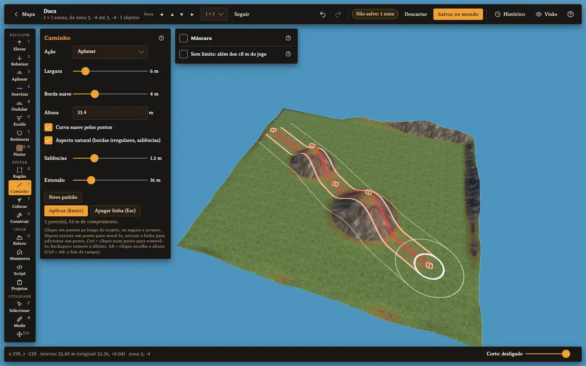
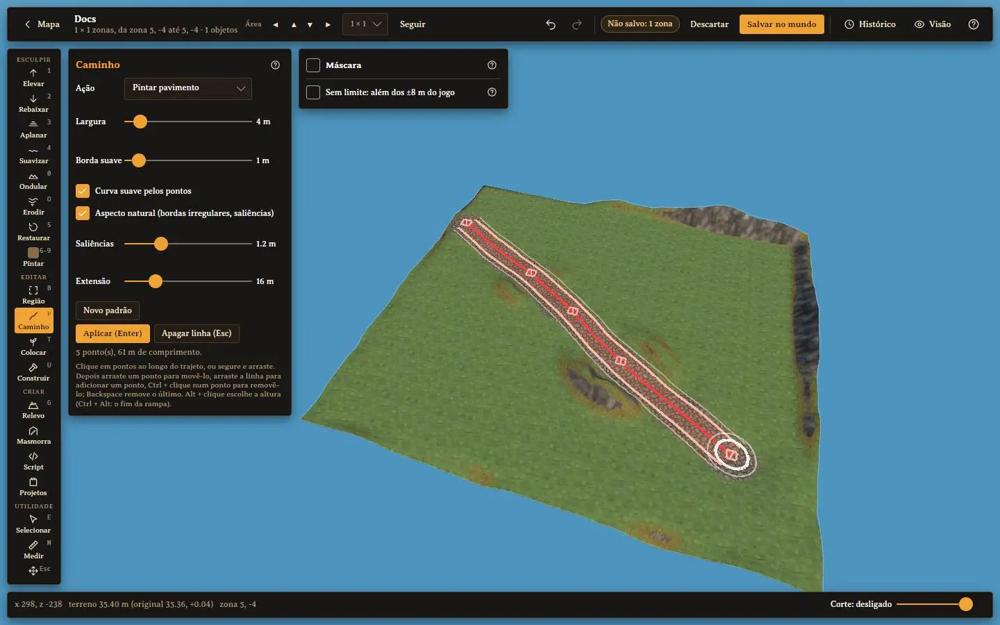
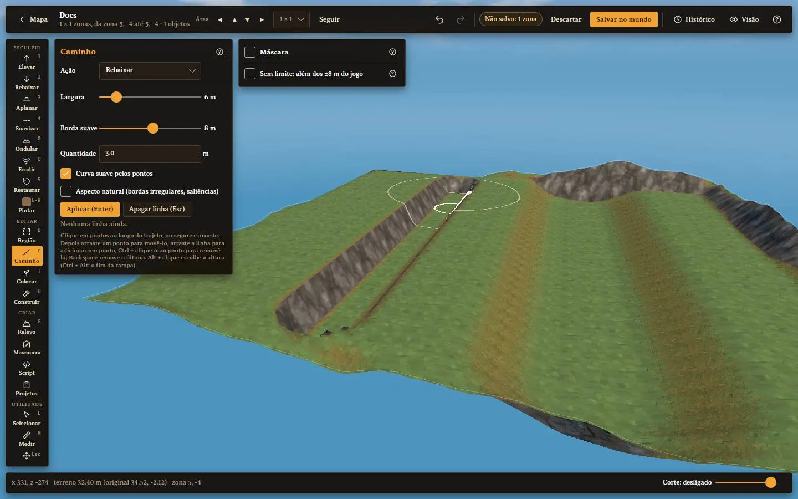
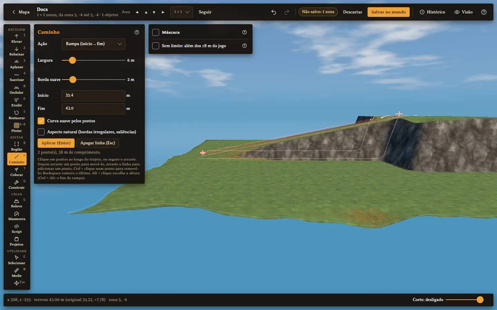
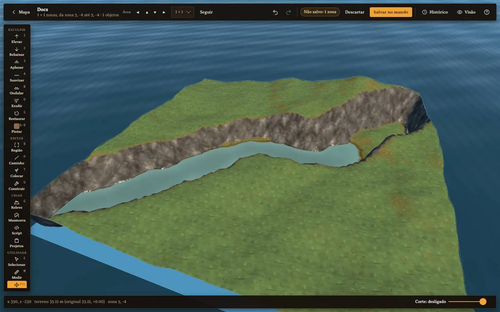

<!-- source: 2d41926b -->
# Caminho

Desenhe uma linha e então aplane, faça uma rampa, eleve, rebaixe, suavize, cave ou pinte o terreno ao longo dela:
estradas, rampas, aterros, valas e rios.

**Onde:** barra de ferramentas, seção **EDITAR** · **Tecla:** `P` · **Funciona em:** mundos salvos, ao vivo

*Uma linha de cinco pontos desenhada sobre dois montes, com **Aplanar** escolhido, a **Altura** tirada do terreno plano
com `Alt`+clique e **Aspecto natural** ligado. Nada mudou ainda: a faixa mostra a largura e as bordas suaves do caminho
até você pressionar **Aplicar (Enter)**; os círculos no último ponto são os do ponteiro.*

## Como usar

1. Na barra de ferramentas, clique em **Caminho** (`P`).
2. Clique em pontos ao longo do trajeto, ou segure e arraste para desenhá-lo à mão livre. Sob o ponteiro, um círculo
   mostra a largura do caminho e outro mais claro a borda suave; quando já há pontos, a faixa mostra as duas ao longo
   da linha.
3. Opcional: ajuste a linha. Arraste um ponto para movê-lo, arraste a linha entre dois pontos para adicionar um ponto
   ali, `Ctrl`+clique num ponto para removê-lo, `Backspace` para remover o último.
4. No painel, escolha uma **Ação** e defina as configurações dela.
5. Pressione **Aplicar (Enter)**. A alteração é um passo de desfazer, com o nome da ação ("Caminho: Aplanar").
6. Opcional: escolha outra ação e aplique-a à mesma linha (aplanar, depois pavimentar), ou mova os pontos e aplique de
   novo. A linha fica até você pressionar **Apagar linha (Esc)**.

O painel mostra quantos pontos a linha tem e qual o comprimento dela.

*A linha da primeira imagem, mesma câmera: **Aplanar** abriu uma estrada nivelada através dos dois montes, depois
**Pintar pavimento** com **Largura** de 4 m e **Borda suave** de 1 m pavimentou o meio dela. A linha fica para a
próxima ação.*

## Configurações

| Configuração | O que faz |
|---|---|
| **Ação** | O que acontece ao longo da linha (veja [Ações](#ações)). |
| **Largura** | Largura do caminho, de 1 a 40 m (padrão 8 m). A ação age por completo em toda ela. |
| **Borda suave** | Até onde a alteração se esvai de cada lado, de 0 a 15 m (padrão 4 m), para que o caminho se misture ao terreno. Em **0** a borda é abrupta: uma trincheira com laterais retas e íngremes. |
| **Altura** | **Aplanar**: a altura do caminho (m). `Alt`+clique no terreno a escolhe. |
| **Quantidade** | **Elevar** / **Rebaixar**: quanto (m, padrão 2). |
| **Início**, **Fim** | **Rampa**: a altura no primeiro e no último ponto (m). Veja [Rampa](#rampa). |
| **Profundidade** | **Rio / canal**: a que profundidade fica o leito abaixo do nível do mar, no meio (m, padrão 2). |
| **Curva suave pelos pontos** | Ligado (padrão): uma curva suave pelos seus pontos. Desligado: linhas retas entre eles. |
| **Aspecto natural (bordas irregulares, saliências)** | Uma largura que varia ao longo do trajeto (até 45% para mais ou para menos) e bordas irregulares, em todas as ações; também pequenas saliências na superfície para **Aplanar**, **Rampa**, **Elevar**, **Rebaixar** e **Rio / canal**. O caminho parece então gasto pelo uso, e não feito por uma ferramenta. |
| **Saliências**, **Extensão**, **Novo padrão** | **Ondular** e **Aspecto natural**: a altura e a largura das saliências, e outro padrão aleatório para elas. São as do pincel [Ondular](terrain.md#ondular): definidas aqui, lá ou na ferramenta [Região](area.md), são os mesmos valores. |
| **Ângulo de repouso** | **Erodir**: o declive mais íngreme que fica no lugar, de 10° a 60° (padrão 33°). O do pincel [Erodir](terrain.md#erodir), o mesmo valor. |

*Duas linhas retas em terreno plano, cada uma com **Rebaixar** de 3 m e **Largura** de 6 m, vistas no sentido delas.
À esquerda: **Borda suave** 0, uma trincheira de paredes íngremes e retas. À direita: **Borda suave** de 8 m, as margens
descem suavemente para o terreno.*

## Ações

| Ação | O que faz |
|---|---|
| **Aplanar** | Nivela o caminho na **Altura**: uma estrada, um terraço ao longo de uma encosta, um aterro sobre uma depressão. |
| **Rampa (início → fim)** | Um declive que sobe ou desce por igual de **Início** a **Fim**. |
| **Elevar** | Ergue o caminho pela **Quantidade**, mantendo os altos e baixos dele: uma margem, um dique. |
| **Rebaixar** | Cava o caminho pela **Quantidade**: uma vala, uma estrada afundada. |
| **Suavizar** | Uniformiza o terreno ao longo do caminho: cada ponto se aproxima da média do terreno num raio de 3 m. Aplique de novo para mais. |
| **Ondular** | Saliências de aspecto natural ao longo do caminho, sobre a forma geral do terreno, com **Saliências**, **Extensão** e o padrão: o que um caminho aplanado ou elevado precisa para voltar a parecer terreno. |
| **Erodir** | Desgasta o terreno ao longo do caminho de uma vez: os declives se acomodam no **Ângulo de repouso**, a chuva abre ravinas e deixa leques de sedimento, os declives se acomodam de novo. |
| **Restaurar** | Volta ao terreno que o mundo gerou ao longo do caminho, sem pintura, incluindo o terreno elevado ou cavado com Sem limite: desfaz uma estrada ou uma vala muito depois de o histórico de desfazer ter acabado. |
| **Rio / canal (água)** | Cava um leito abaixo do nível do mar, para que ele se encha de água (veja [Rio ou canal](#rio-ou-canal)). |
| **Pintar terra**, **Pintar pavimento**, **Pintar cultivado** | Pinta o caminho, com cor plena em toda a largura, esvaindo-se na borda suave. |
| **Limpar pintura** | Pinta o chão comum do bioma ao longo do caminho (veja [Pincel de pintura](terrain.md#pincel-pintar)). |

**Aplanar**, **Elevar**, **Rebaixar**, **Suavizar**, **Ondular**, **Erodir**, **Restaurar** e as pinturas são as mesmas
ações dos [pincéis](terrain.md) e da ferramenta [Região](area.md), com os mesmos nomes (a Região lista Restaurar como
**Voltar ao terreno gerado**, no grupo **Recuperar**): um pincel diz onde pelo traço, a ferramenta Região por uma
seleção, a ferramenta Caminho por uma linha, e o terreno muda da mesma forma.

### Rampa

*Uma rampa de dois pontos vista de lado, do terreno ao pé dela (**Início** 35.2 m) até o alto de uma plataforma
elevada 8 m (**Fim** 43 m). Ela sobe por igual o tempo todo.*

Até você digitar ou escolher uma altura, **Início** e **Fim** acompanham o terreno sob o primeiro e o último ponto, então
mover as pontas os atualiza. `Alt`+clique no terreno escolhe a altura inicial, `Ctrl`+`Alt`+clique a altura final.
**Apagar linha (Esc)** faz com que voltem a acompanhar o terreno. Uma rampa sinuosa tem o mesmo declive do começo ao
fim.

### Rio ou canal

*Um rio cavado atravessando a zona com **Rio / canal (água)**: o mar o enche.*

O Valheim não tem água corrente: a água dos rios é o mar, no mesmo nível (30 m) em todo lugar. Por isso um rio só tem
água onde o leito está abaixo do nível do mar. A ação cava um leito em forma de U, com **Profundidade** abaixo do nível
do mar no meio, subindo até a linha d'água na **Largura**; a **Borda suave** forma as margens. Ela só cava: o terreno
que já é mais baixo fica como está, então um rio pode desaguar num lago ou no mar.

Em terreno alto, um rio precisa de um corte profundo, e o limite de ±8 m do jogo o detém a 8 m de profundidade (a barra
de status avisa). Rebaixe primeiro o terreno perto do mar, siga terrenos baixos ou ligue [Sem limite](terrain.md#sem-limite).

## Atalhos

| Tecla ou mouse | O que faz |
|---|---|
| `P` | Escolhe Caminho. |
| Clique / segurar e arrastar | Adiciona pontos / desenha a linha à mão livre (um ponto a cada 2 m). |
| Arrastar um ponto / arrastar a linha | Move o ponto / adiciona um ponto ali e o move. |
| `Ctrl`+clique num ponto | Remove o ponto. |
| `Backspace` | Remove o último ponto. |
| `Alt`+clique | Escolhe a altura (Aplanar) ou o início da rampa. |
| `Ctrl`+`Alt`+clique | Escolhe a altura final da rampa. |
| `Alt`+`Shift`+clique | Define a faixa de altura da [Máscara](masks.md) de 2 m acima a 2 m abaixo desse ponto, como com um pincel. |
| `Enter` | Aplica a ação. |
| `Esc` | Apaga a linha; um segundo `Esc` sai da ferramenta. |
| `Ctrl+Z` | Desfaz a última aplicação. |

## Dicas e limites

- **A [Máscara](masks.md) vale para todas as ações**, assim como o limite de ±8 m, a menos que
  [Sem limite](terrain.md#sem-limite) esteja ligado. Onde o caminho atinge o limite, os pontos ficam vermelhos e a barra de
  status avisa. O interruptor Sem limite fica no cartão **Máscara**, ao lado do painel Caminho: um único interruptor
  para todas as ferramentas de terreno.
- **Uma curva fechada** precisa de dois pontos bem próximos, ou de **Curva suave pelos pontos** desligado: uma curva
  suave passa por todos os pontos em que você clica.
- **Confira antes o declive de uma rampa** com [Medir](measure.md): medido do pé ao alto, o **Declive** é o que a rampa
  vai dar.
- **Apagar linha (Esc) remove só a linha.** O que você aplicou fica; `Ctrl+Z` desfaz uma aplicação de cada vez.
- **O caminho só funciona dentro da área aberta**, e nunca move a linha mais externa de pontos dela (veja
  [A borda travada](concepts/areas-and-zones.md#a-borda-travada)).

## Relacionados

- [Fazer uma estrada ou uma rampa subindo uma colina](guides/make-a-road.md)
- [Cavar um rio ou um lago](guides/make-a-river.md)
- [Limites do terreno](concepts/ground-limits.md)
- [Esculpir e pintar](terrain.md), [Medir](measure.md)
- [Como a borda de um caminho se esvai](concepts/ground-limits.md#como-a-borda-de-um-caminho-se-esvai)
