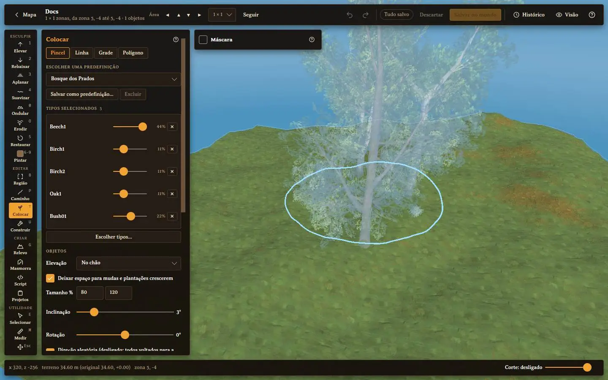
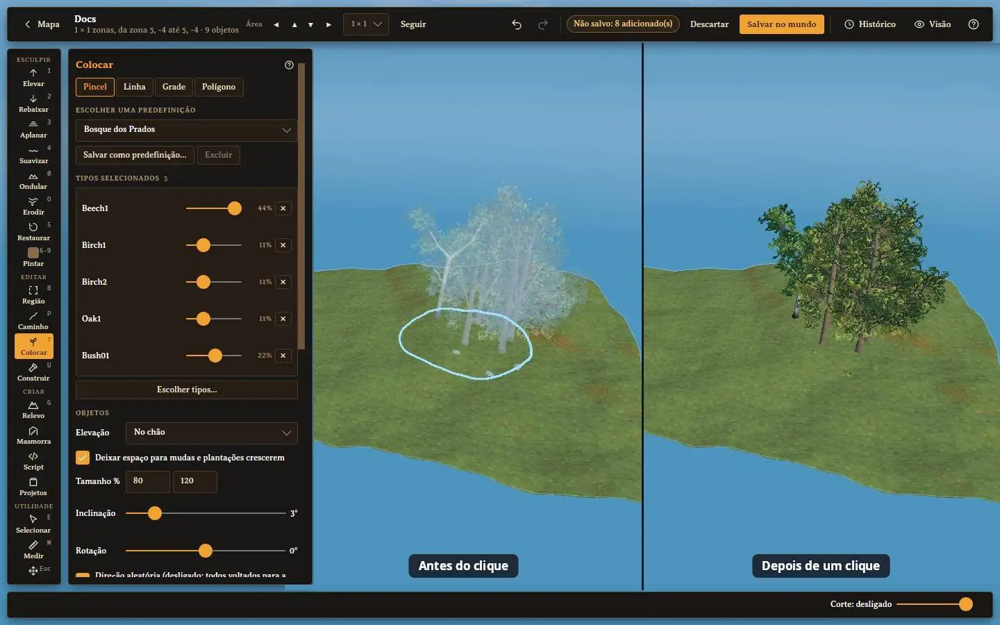
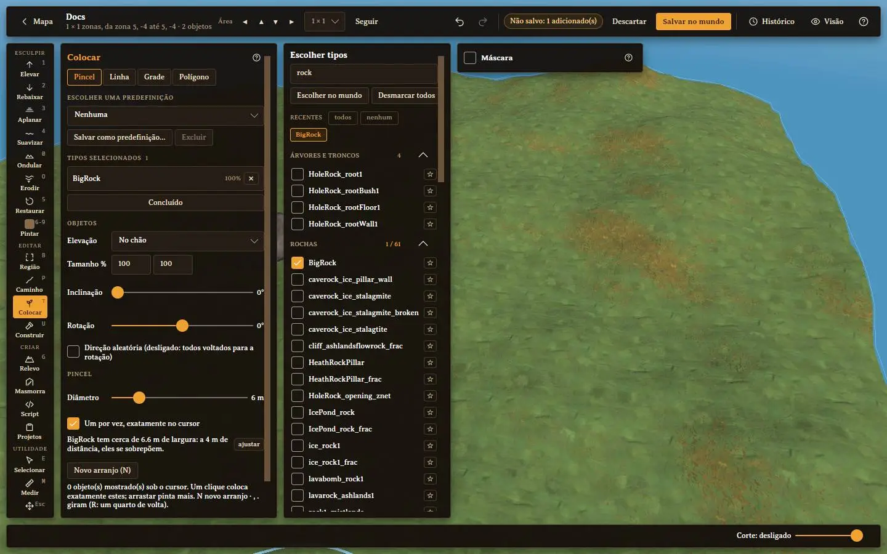
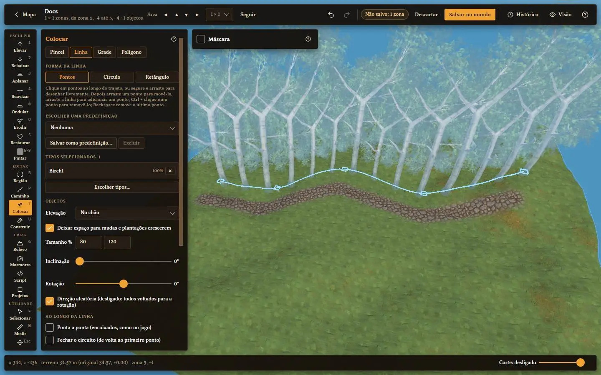
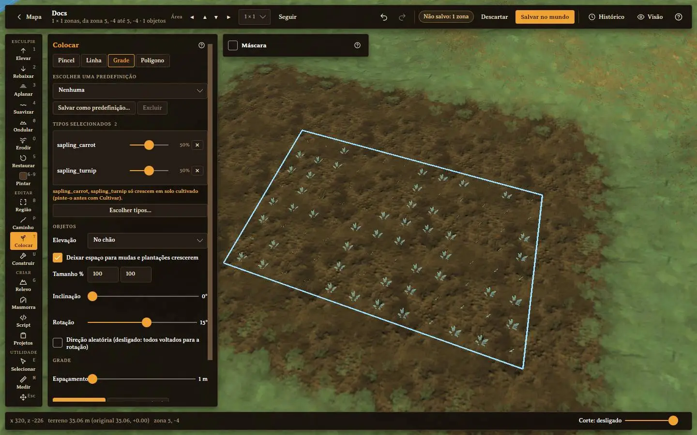
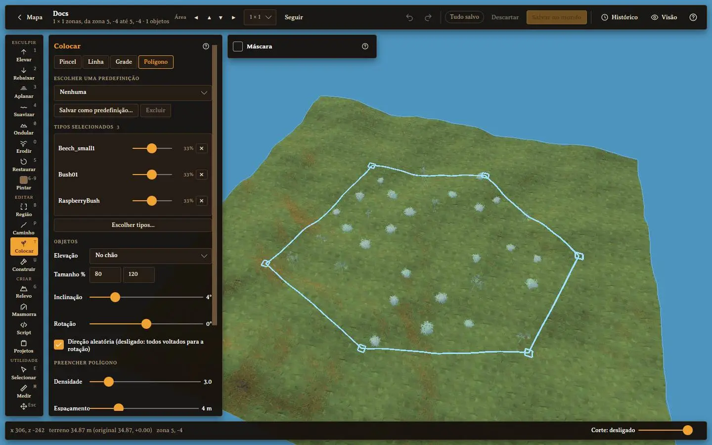
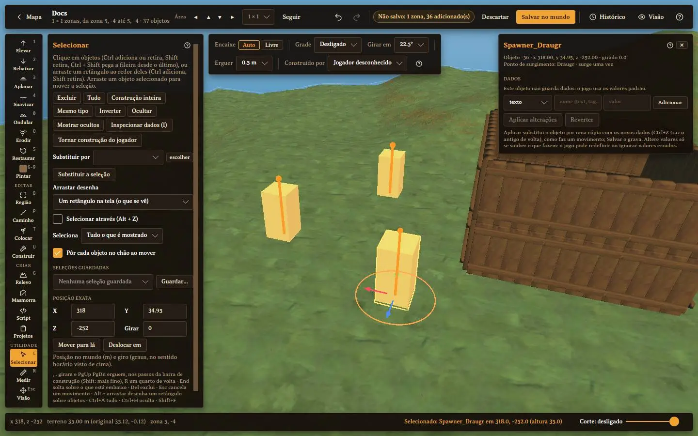

<!-- source: c6106c48 -->
# Colocar

Ponha árvores, rochas, arbustos, plantações e pontos de surgimento no mundo, um por vez ou às centenas. As peças que os
jogadores constroem (paredes, pisos, cercas, móveis) são postas com [Construir](build.md), a ferramenta logo abaixo na
barra.

**Onde:** barra de ferramentas, seção **EDITAR** · **Tecla:** `T` · **Funciona em:** mundos salvos, ao vivo (a Oficina
tem só [Construir](build.md))

*As árvores e arbustos transparentes no círculo do pincel são exatamente o que um clique coloca; o painel mostra a
predefinição Bosque dos Prados e os tipos dela.*

*À esquerda: a prévia transparente no círculo do pincel. À direita: o mesmo ponto depois de um clique, as árvores e
arbustos de pé onde a prévia os mostrava.*

## Como usar

Para plantar um pequeno bosque:

1. Pressione `T`.
2. No painel **Colocar**, em **Escolher uma predefinição**, escolha **Bosque dos Prados**.
3. No alto do painel, escolha **Pincel**.
4. Aponte para o chão: a prévia transparente mostra o que um clique coloca.
5. Clique para colocar, ou arraste para continuar adicionando.

Em Linha, Grade e Polígono, desenhe a forma, confira a prévia e pressione `Enter` (**Colocar (Enter)**). A forma
continua lá depois de colocar, com a prévia agora vazia (o que ela colocaria já está lá): pressione **Apagar forma (Esc)** para desenhar
a próxima.

Cada clique, traço ou `Enter` é um passo de desfazer (`Ctrl+Z`). Nada é gravado no mundo até você usar **Salvar no
mundo** (ou **Aplicar ao vivo**). Para mover ou excluir o que você colocou, use [Selecionar](select.md).

## Configurações

O painel, de cima para baixo. As linhas que não se aplicam ao modo ou aos tipos escolhidos ficam ocultas. Os tipos
marcados com as proporções deles, a **Taxa**, as suas predefinições, os favoritos e os tipos recentes são mantidos entre
execuções; as outras configurações voltam ao padrão. A [Máscara](masks.md) fica num cartão próprio ao lado do painel e
vale para todos os modos.

| Configuração | O que faz |
|---|---|
| **Pincel**, **Linha**, **Grade**, **Polígono** | O modo: veja [Modos](#modos). |
| **Forma da linha** | Só no modo Linha: **Pontos**, **Círculo** ou **Retângulo**. Veja [Linha](#linha). |
| **Escolher uma predefinição** | Carrega uma mistura: os tipos dela com as proporções, mais Densidade, Espaçamento, Agrupar, Manchas, Tamanho e Inclinação, com direção aleatória ligada. Incluídas: **Bosque dos Prados**, **Mata da Floresta Negra**, **Pântano**, **Canteiro de frutas silvestres**, **Chão de floresta**, **Rochas dos Prados**; as suas vêm depois, como **Sua: *nome***. Os tipos que o mundo não pode colocar ficam de fora (a barra de status diz quantos). **Nenhuma** não carrega nada; escolhê-la depois de uma predefinição desmarca todos os tipos. |
| **Salvar como predefinição…** / **Excluir** | Salva os tipos escolhidos, as proporções e essas configurações com um nome. **Excluir** remove uma das suas, depois de perguntar. |
| **Tipos selecionados** | Os tipos que você escolheu, cada um com o controle deslizante da proporção e um ✕ para retirá-lo ("Nenhum ainda" enquanto não houver nenhum). Com dois tipos ou mais, arraste um controle para definir a proporção desse tipo: os outros se ajustam para que as proporções somem 100%, e cada um fica com pelo menos 1%. Beech a 75% com Birch dá três faias para cada bétula. |
| **Escolher tipos…** | Abre o cartão **Escolher tipos**: veja [Escolha o que colocar](#escolha-o-que-colocar). |
| **OBJETOS: Elevação** | **No chão**: cada objeto fica sobre o chão (a parte de uma ruína pela base). **Acima do chão**: **Altura** em metros acima do chão sob ele. **A uma altura**: a base de todos os objetos na mesma **Altura**, seja qual for o terreno (um muro nivelado, uma plataforma). |
| **Altura** | Os metros para Acima do chão, ou a altura para A uma altura. |
| **Encaixar nas peças já existentes** | Aparece quando um tipo marcado é parte de uma ruína ou de uma masmorra que tem pontos de encaixe (as peças que os jogadores constroem são de [Construir](build.md)). Ligado: a parte se prende às peças em volta, como com o martelo. No modo Pincel, **Ao lado** a põe ponta a ponta com a peça vizinha do cursor e **Em cima** a assenta sobre a peça sob o cursor. A linha no pé do painel diz onde ela se encaixou ("Encaixado ao lado de *nome*."). Veja [Encaixe](concepts/objects.md#encaixe). |
| **Deixar espaço para mudas e plantações crescerem** | Aparece quando uma muda, uma plantação ou uma árvore que nasce de muda está marcada. Ligado: elas mantêm o espaço de que o jogo precisa para fazê-las crescer. Desligado: tão juntas quanto você quiser (podem não crescer). Veja [Regras de crescimento](concepts/objects.md#regras-de-crescimento). |
| **Tamanho %** mín. / máx. | Cada objeto recebe um tamanho aleatório entre os dois, de 10 a 300% (80 a 120 de início). |
| **Inclinação** | Inclinação aleatória, de 0 a 20°. |
| **Rotação** | Gira o padrão do pincel e a direção de cada objeto, de -180 a 180°. |
| **Direção aleatória (desligado: todos voltados para a rotação)** | Ligado: cada objeto fica voltado para uma direção aleatória. Desligado: todos voltados para a Rotação. |
| **PINCEL: Tamanho do pincel** | Raio do pincel, de 1 a 30 m. É também o tamanho dos pincéis de esculpir: um único valor para ambos. |
| **Taxa** | Pincel: a rapidez com que um arrasto planta, de 0.05 a 1. Mais alta enche antes o círculo do pincel até a Densidade dele. É própria do pincel de Colocar: a **Intensidade** dos pincéis de esculpir não a altera. Oculta com Um por vez. |
| **Um por vez, exatamente no cursor** | Pincel: um objeto exatamente sob o cursor a cada clique; um arrasto não adiciona mais nenhum. Só um objeto bem nesse ponto o impede. |
| **Densidade** | Pincel e Polígono: objetos por 100 m², de 0.2 a 20. |
| **Espaçamento** | Pincel e Polígono: a menor distância entre objetos, de 0.5 a 15 m, também em relação aos objetos que já existem. Em Grade: o tamanho da célula, de 1 a 30 m. |
| **Agrupar** | Pincel e Polígono: reúne os objetos em arvoredos com clareiras entre eles, de 0 a 100%. 0 é uma distribuição uniforme. |
| **Manchas** | Com Agrupar: o tamanho dos arvoredos e das clareiras, de 5 a 120 m. |
| **ajustar** | Aparece quando um tipo marcado é mais largo que o espaçamento ("Beech1 tem cerca de 6.2 m de largura: a 4 m de distância, eles se sobrepõem."). Clique para definir o espaçamento como essa largura. |
| **Colocar (Enter)**, **Apagar forma (Esc)**, **Remover último ponto (Backspace)** | Linha, Grade e Polígono: coloca o que a prévia mostra, remove a forma ou desfaz o último ponto clicado. |
| **Novo arranjo (N)** | Novos pontos, tipos, tamanhos e direções aleatórios para a prévia (e novos arvoredos com Agrupar). |

A linha no pé do painel diz quantos objetos a prévia mostra e quais teclas valem. Uma linha laranja sob os tipos
selecionados avisa quando algo pede cuidado: "Nada para colocar ainda", ou plantações que "só crescem em solo cultivado
(pinte-o antes com Cultivar)".

## Escolha o que colocar

**Escolher tipos…** abre um cartão ao lado do painel com todos os tipos que o jogo salva num mundo, inclusive tipos dos
quais o seu mundo ainda não tem nenhum e os tipos dos seus mods. Criaturas, itens largados e corpos não estão nele, nem
as peças do martelo e da bandeja de servir: essas ficam no painel [Construir](build.md). As mudas e plantações do
cultivador estão nos dois. **Concluído** o fecha.

*O cartão Escolher tipos buscando "rock", com BigRock marcado: a categoria Rochas conta 1 tipo marcado ao lado do total,
e BigRock encabeça a linha Recentes.*

| Controle | O que faz |
|---|---|
| **Buscar tipos (oak, rock, bush…)** | Filtra a lista pelo nome e abre todas as categorias com algum resultado. Pontos de surgimento e ninhos também são encontrados pela criatura (`boar` encontra `Spawner_Boar`). |
| Caixas de seleção | Todo tipo marcado é colocado; cada objeto escolhe um deles ao acaso, pela proporção. Clique no nome de uma categoria para recolhê-la ou abri-la; depois do nome, quantos tipos ela tem, ou "marcados / todos". |
| **Escolher no mundo** | Clique num objeto do mundo para colocar só o tipo dele; `Shift` + clique o adiciona aos tipos marcados (ou o retira). `Esc` cancela. Uma peça de construção não é aceita: a barra de status diz para colocá-la com Construir. |
| **Desmarcar todos** | Desmarca todos os tipos. |
| **Favoritos** | Clique na ☆ depois de um tipo para marcá-lo com estrela; os tipos com estrela aparecem como botões acima da lista. |
| **Recentes** | Os últimos oito tipos que você colocou, do mais novo ao mais antigo, depois dos tipos escolhidos agora. |
| Botões de Favoritos e Recentes | Clique: marca ou desmarca esse tipo. `Shift` + clique: coloca só esse tipo. **todos** / **nenhum** marcam ou desmarcam a linha inteira. |

As categorias: **Árvores e troncos**, **Rochas**, **Arbustos e moitas**, **Coletáveis**, **Minérios e jazidas**,
**Ruínas e estruturas**, **Móveis e adereços**, **Ossos e restos**, **Pontos de surgimento**, **Ninhos de criaturas**,
**Criaturas e NPCs** (comerciantes, pássaros), **Efeitos e marcadores** (névoa, música, zonas de evento de chefe) e
**Outros objetos**. Os tipos sem modelo aparecem como caixas na prévia.

## Modos

| Modo | Como funciona |
|---|---|
| **Pincel** | A prévia segue o cursor dentro do círculo do pincel. Um clique coloca exatamente o que ela mostra; um arrasto continua adicionando (a rapidez segue a Densidade e a **Taxa**). `Shift` + arrastar remove os tipos marcados sob o pincel. Com só partes de ruínas que se encaixam marcadas, **Um por vez** se liga sozinho e cada parte se encaixa. |
| **Linha** | Clique em pontos ao longo de um trajeto, ou desenhe um círculo ou um retângulo. Os objetos vão **A cada** tantos metros, ou ponta a ponta. |
| **Grade** | Arraste um retângulo. Um objeto vai no meio de cada célula; o retângulo recebe tantas células inteiras quantas couberem. |
| **Polígono** | Clique em pontos em volta de um trecho de terreno, ou segure e arraste para desenhar o contorno à mão livre. Os objetos vão em pontos aleatórios dentro dele (Densidade, Espaçamento). |

Em Linha e Polígono, arraste um ponto para movê-lo, arraste o contorno para adicionar um ponto e `Ctrl` + clique num
ponto para removê-lo. Um clique duplo no último ponto coloca a forma, como `Enter`. Em Grade e Polígono, `,` `.` e
`Alt` + roda giram o retângulo ou o polígono inteiro, com as células; `R` o gira um quarto de volta.

### Linha

*Modo Linha com **Pontos**: bétulas a cada 4 m ao longo de uma curva suave por cinco pontos, ao lado de um caminho
pavimentado, mostradas antes de **Colocar (Enter)**. As árvores pálidas são a prévia.*

| Controle | O que faz |
|---|---|
| **Pontos** | Clique em pontos ao longo do trajeto, ou segure e arraste para desenhar à mão livre. **Fechar o circuito (de volta ao primeiro ponto)** volta ao primeiro ponto, para fechar uma cerca em volta de um lugar. **Curva suave pelos pontos** desenha uma curva em vez de trechos retos. |
| **Círculo** | Pressione no centro e arraste para fora até o tamanho; solte para vê-lo. |
| **Retângulo** | Pressione num canto e arraste até o canto oposto. |
| **Ponta a ponta (encaixados, como no jogo)** | Cada parte começa onde a anterior termina, girada ao longo da linha, como o martelo as encaixa: o muro de uma ruína, uma fileira de pisos antigos. Vários tipos marcados se alternam. Liga-se sozinho quando todos os tipos marcados são partes que o jogo encaixa. Com ele, um círculo ajusta o tamanho a partes inteiras, e os lados de um retângulo são preenchidos a partir dos cantos para que os cantos se encontrem. Para dispor ponta a ponta as peças do martelo (uma cerca, uma paliçada), use **Dispor** de [Construir](build.md#dispor-peças-ao-longo-de-uma-linha-ou-numa-grade). |
| **Camadas** | Com Ponta a ponta: a linha empilhada de 1 a 20 partes de altura. |
| **A cada** | Sem Ponta a ponta: a distância entre objetos, de 0.5 a 30 m. |
| **Oscilação** | Desvio lateral aleatório em relação à linha, de 0 a 5 m. |
| **Seguir a linha (mais a rotação; substitui a direção aleatória)** | Ligado (o padrão): cada objeto fica voltado ao longo da linha, mais a Rotação. Desligado: direção aleatória. Círculos e retângulos sempre seguem o contorno. |

- Quando a linha não termina numa peça inteira, a linha do pé do painel diz quanto sobra ("sobram 0.8 m de linha no fim:
  mova um ponto para fechar").
- Uma linha que começa a menos de 1 m de uma peça já existente (com **Encaixar nas peças já existentes** ligado) a
  continua, no mesmo nível.
- Numa encosta, as partes ponta a ponta ficam niveladas e sobem ou descem em degraus com o terreno. Para uma fileira
  uniforme, aplane antes o terreno ao longo da linha ([Caminho](path.md), Aplanar), ou use **A uma altura**.

### Grade

*Cenouras e nabos numa grade girada 15°, vistos de perto e de cima para que a planta de cada célula apareça. A linha
laranja no painel avisa que as plantações precisam de solo cultivado.*

### Polígono

*Um polígono desenhado ponto a ponto, com arbustos e árvores jovens na prévia em pontos aleatórios dentro dele.*

Os pontos são sorteados uma vez e mantidos enquanto o polígono não muda; **Novo arranjo (N)** sorteia outros.

## Pontos de surgimento e ninhos

Pontos de surgimento são os marcadores invisíveis do jogo que põem criaturas em acampamentos, vilas e masmorras.
Encontre-os em **Escolher tipos**, em **Pontos de surgimento** (busque a criatura: `boar`), e coloque-os como qualquer
tipo. Cada tipo mostra o que faz surgir, lido do seu jogo:

- a criatura e as estrelas dela (`Boar · 0–2 ★`);
- **surge uma vez** (na primeira vez que um jogador chega perto, nunca mais depois que ela morre), ou **volta *N* min
  depois de morrer**;
- **só à noite**, **só de dia**, ou **quando um evento o desperta** para os poucos que esperam.

A criatura, as estrelas e o tempo de retorno são fixos para cada tipo: escolha o tipo que faz surgir o que você quer.
**Ninhos de criaturas** (ninhos de greydwarf, pilhas de ossos...) continuam fazendo criaturas surgirem em volta até
serem destruídos; a linha deles diz quantas e a que distância ("Greydwarf, Greydwarf_Elite · até 3 ao redor, num raio
de 5 m"). Veja [Pontos de surgimento](concepts/objects.md#pontos-de-surgimento).

*De perto, dois pontos de surgimento de javali e um de draugr perto de uma cabana. A linha do Inspetor para o draugr
selecionado diz o que ele faz surgir e se a criatura volta.*

Na visão 3D, cada ponto de surgimento e cada ninho aparece como uma caixa simples com um marcador acima, visível através
de tudo o que estiver na frente, num raio de 250 m: laranja para um ponto de surgimento (vermelho quando a criatura
volta), roxo para um ninho. Eles ficam ocultos de início: ative **Pontos de surgimento** e **Ninhos de criaturas** no
[painel Visão](editor-basics.md).

## Atalhos

| Tecla ou mouse | O que faz |
|---|---|
| `T` | Abre Colocar. |
| Clique / arrastar | Pincel: coloca / continua adicionando. Linha e Polígono: adiciona pontos. Grade: desenha o retângulo. |
| `Shift` + arrastar | Pincel: remove os tipos marcados sob o pincel. |
| `Ctrl` + clique num ponto | Linha e Polígono: remove esse ponto. |
| `Enter` | Coloca a linha, a grade ou o polígono. |
| `Esc` | Cancela **Escolher no mundo**; senão apaga a forma; sem nada desenhado, volta para **Visão**. |
| `Backspace` | Remove o último ponto. |
| `N` | Novo arranjo. |
| `,` `.` ou `Alt` + roda | Gira 15° (`Shift`, mais fino: 1°): a direção, ou em Grade e Polígono o retângulo ou polígono inteiro. |
| `R` | Gira o mesmo um quarto de volta. |
| `[` `]` | Tamanho do pincel. |
| `PgUp` / `PgDn` ou `Ctrl` + roda | Eleva ou abaixa a elevação em 0,5 m (`Shift`, mais fino: 0,1 m). A partir de No chão, começa a erguer acima dele. |
| `Alt` + clique | Muda para A uma altura, no alto da peça clicada (para ficar sobre ela), ou do terreno ali. |
| `Ctrl+Z` | Desfaz a última colocação. |

Todas as teclas do editor estão em [Atalhos](help/shortcuts.md).

## Dicas e limites

- **Desfazer:** `Ctrl+Z` desfaz um clique, um traço ou uma forma, inclusive depois de salvar (então salve de novo). Veja
  [Desfaça alterações](guides/undo-changes.md).
- No máximo 2000 objetos por linha, grade ou polígono, e 400 por clique de pincel.
- Os objetos só vão dentro da área aberta, não na linha mais externa de pontos dela, e onde a Máscara permite.
- Um objeto no chão fica de fora onde o chão está mais de 0,3 m debaixo d'água (algas e sargaços são exceção). Acima do
  chão ou A uma altura, ele pode ficar sobre a água.
- Pincel e Polígono mantêm o Espaçamento em relação ao que já existe. Linha e Grade o ignoram, exceto um objeto bem no
  mesmo ponto, então colocar a mesma forma duas vezes não a duplica.
- As plantações só crescem em solo cultivado: pinte-o antes com **Cultivar** (ou com Pintar da ferramenta Região).
- As mudas e plantações que você coloca são construídas por jogador, pelo jogador escolhido em **Construído por** na
  [barra de construção](build.md#a-barra-de-construção); árvores, rochas, pontos de surgimento e partes de ruínas não são.
  Veja [Peças construídas por jogadores](concepts/objects.md#peças-construídas-por-jogadores).
- Os objetos novos são novos em folha: sem conteúdo, sem pontos de vida. Para encher um baú, veja
  [Altere o que um baú guarda](guides/fill-a-chest.md).

## Relacionados

- [Plantar uma floresta, uma plantação ou uma sebe](guides/plant-a-forest.md)
- [Retirar árvores e rochas, aplanar um terreno para construir](guides/clear-an-area.md)
- [O que é um objeto](concepts/objects.md#o-que-é-um-objeto)
- [Construir](build.md) · [Selecionar](select.md) · [Máscaras](masks.md)
