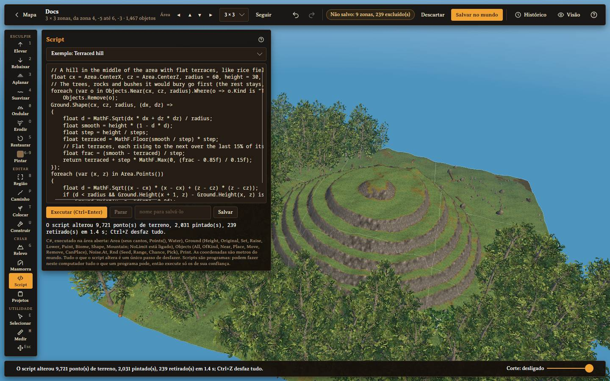
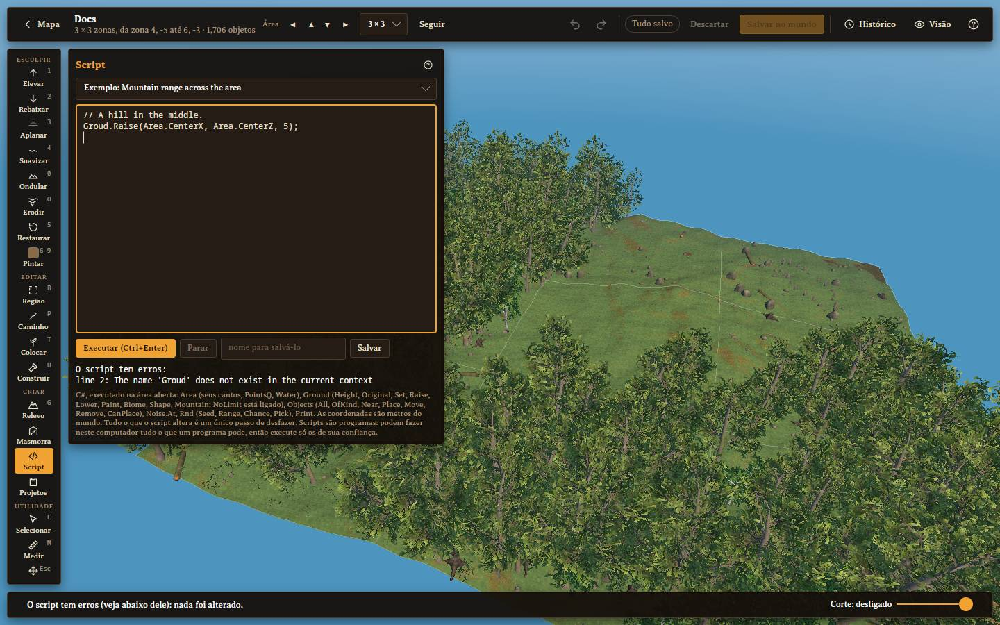

<!-- source: f2b8214d -->
# Script

Escreva algumas linhas de C# que moldam, pintam e preenchem a área aberta segundo uma regra: uma cordilheira, uma
floresta só nas encostas suaves, terraços, uma praça pavimentada exatamente na altura média.

**Onde:** barra de ferramentas, seção **CRIAR** · **Tecla:** nenhuma (`Ctrl+Enter` executa o script) · **Funciona em:**
mundos salvos, ao vivo (não na Oficina)


*O exemplo Terraced hill executado numa área de 3 × 3: o código no painel e, embaixo, a linha de resultado dizendo o
que o script alterou.*

Você não precisa instalar nada: o próprio editor compila o script. Se você nunca escreveu C#, comece por um
[exemplo](#os-exemplos) e mude os números dele, ou siga [Seu primeiro script](#seu-primeiro-script).

## Como usar

1. Abra uma área no editor 3D. Um script trabalha na **área aberta** (as zonas que você vê).
2. Escolha **Script** na seção **CRIAR** da barra de ferramentas.
3. Escolha um exemplo ou um script salvo na lista, ou escreva o seu na caixa de código.
4. Pressione **Executar (Ctrl+Enter)**. A caixa de saída mostra "Compilando…", "Executando…" e depois o que o script
   imprimiu e o que alterou, ou o que deu errado.
5. Veja o resultado. Desfazer (a seta na barra superior) desfaz a execução inteira num único passo; `Ctrl+Z` também,
   depois que você clicou na visão 3D (na caixa de código, ele desfaz a sua digitação). Mude os números e execute de
   novo até gostar.
6. Pressione **Salvar no mundo** (ou **Aplicar ao vivo**) para manter o resultado, como qualquer outra alteração.

Nada muda enquanto o script roda: quando ele termina, tudo o que ele alterou entra na área de uma vez, como um único
passo de desfazer. Se ele tiver erros, falhar, for interrompido ou rodar por 2 minutos, nada muda.

## Seu primeiro script

Esta lição ergue um monte no meio da área e depois o deixa mais alto.

1. Abra uma área e escolha **Script**.
2. Selecione todo o texto na caixa de código e substitua-o por:

   ```csharp
   // Um monte de 10 m de altura e 30 m de diâmetro, no meio da área.
   Ground.Shape(Area.CenterX, Area.CenterZ, 15, (dx, dz) =>
   {
       float d = MathF.Sqrt(dx * dx + dz * dz) / 15;   // 0 no meio, 1 na borda
       return 10 * (1 - d);                            // metros a acrescentar
   });
   Print($"The top is at {Ground.Height(Area.CenterX, Area.CenterZ):0.0} m.");
   ```

3. Pressione `Ctrl+Enter`. Um monte se ergue no meio da área; a saída diz onde fica o topo dele e quantos pontos de
   terreno mudaram.
4. Clique na visão 3D e pressione `Ctrl+Z`. O monte desaparece.
5. Clique na caixa de código, troque `10 *` por `20 *` e pressione `Ctrl+Enter` de novo. O monte fica duas vezes mais
   alto.
6. Opcional: digite um nome na caixa de nome e pressione **Salvar** para encontrar o script na lista da próxima vez.

`Ground.Shape` acrescenta os metros que a sua função devolve a cada ponto num raio de 15 m do meio; `dx` e `dz` são os
metros a partir do meio. Todas as outras chamadas estão na [referência da API](#referência-da-api).

## Configurações

| Configuração | O que faz |
|---|---|
| **Lista** | Os sete exemplos ("Exemplo: …"), depois os seus scripts salvos, os mais novos primeiro. Escolher um **substitui** o texto da caixa de código: salve o seu script antes. Um exemplo esvazia a caixa de nome; um script salvo põe o nome dele ali. |
| **Caixa de código** | O script. `Tab` recua a linha; `Ctrl+Enter` o executa; `Ctrl+Z` desfaz a sua digitação, não a execução. |
| **Executar (Ctrl+Enter)** | Compila e executa o script na área aberta. As alterações dele são **um único passo de desfazer**, chamado "Script: " seguido do nome da entrada da lista no Histórico. |
| **Parar** | Interrompe um script em execução, seja o que for que esteja fazendo: nada do que ele fez é mantido. |
| Caixa de nome, **Salvar** | Salva o código com o nome digitado e o seleciona na lista. Os caracteres que um nome de arquivo não aceita viram `_`. Salvar por cima de outro script salvo pergunta antes. |
| **Saída** | O que o script imprimiu (`Print`), depois o que ele alterou, ou os erros dele com a linha. |

Os scripts salvos são arquivos `<name>.csx` na pasta `scripts` da pasta de dados do editor
(`~/.local/share/ValheimWorldEditor/scripts` no Linux, `%LOCALAPPDATA%\ValheimWorldEditor\scripts` no Windows,
`~/Library/Application Support/ValheimWorldEditor/scripts` no macOS). Edite-os em qualquer editor de texto, ou
compartilhe-os: um arquivo `.csx` colocado ali aparece na lista quando o editor é iniciado de novo, ou depois que você
salva um script.

## Os exemplos

Cada exemplo é um script completo, pronto para executar em qualquer área aberta. Leia-os para ver como a API é usada.

| Exemplo | O que faz |
|---|---|
| **Mountain range across the area** | Quatro montanhas Lone peak em linha do sudoeste ao nordeste, cada uma com 35 a 60 m de altura. `Rnd.Seed = 7`, então é a mesma cordilheira a cada execução. Salvar as transforma em discos de terreno (além do limite de 8 m do jogo). |
| **Terraced hill** | Um morro de 30 m de altura e 60 m de raio, cortado em seis terraços planos como campos de arroz. As árvores, rochas e arbustos que ele enterraria são retirados antes (todo o resto fica); os degraus íngremes são pintados de terra. |
| **Canyon with a river** | Um cânion sinuoso de oeste a leste, 18 m para cada lado da linha dele, cavado até 3 m abaixo do nível do mar para que a água o encha, sumindo aos poucos nos últimos 30 m nas bordas da área. |
| **Scatter boulders** | Grandes pedregulhos (`rock4_forest`, `rock4_coast`, `rock4_heath`) a cada 6 m onde o ruído é alto, mais nas encostas, cada um girado e dimensionado ao acaso. Imprime quantos. |
| **Ring of trees** | Um anel de 36 faias a 40 m do meio; as árvores dentro do anel são retiradas. |
| **Flat paved base** | Um quadrado de 40 × 40 m nivelado na própria altura média e pavimentado, com uma encosta suave de 10 m até o terreno em volta. Fica dentro do limite de 8 m (`Ground.NoLimit = false`). Imprime a altura. |
| **Noise landscape** | Terreno ondulado na área inteira: morros e vales de até 25 m para cima ou para baixo com saliências menores por cima, voltando ao terreno como era nos últimos 40 m das bordas. |

## Como um script vê o mundo

- **C# comum.** Um script é uma lista de instruções executadas de cima para baixo. Ele pode declarar variáveis, laços,
  funções e classes, e usar o .NET (`MathF`, `System.Linq`…). `using System`, `System.Linq` e
  `System.Collections.Generic` já estão incluídos.
- **Metros do mundo.** Toda posição está em metros: **x** para leste, **z** para norte, os mesmos números da barra de
  status e do comando `pos` do jogo. As alturas são metros acima do zero do mundo; o mar fica em `Area.Water` (30 m).
- **Um ponto por metro.** `Ground.Set(x, z, …)` altera o ponto mais próximo de (x, z); `Ground.Height` lê de forma
  suave entre os pontos, como o terreno é desenhado.
- **As próprias alterações.** Um script vê o que alterou até ali (eleve um ponto e `Ground.Height` dará a nova altura),
  mas `Objects.All` continua como a área estava quando ele começou.
- **Só a área aberta.** A fileira externa de pontos fica como está, para que a área continue unida às vizinhas; as
  alterações ali ou fora da área são ignoradas sem erro. Abra uma área maior (até 17 × 17 zonas) para obras maiores.
- **Além do limite de 8 m.** `Ground.NoLimit` está ligado, como o interruptor
  [Sem limite](concepts/ground-limits.md#sem-limite): o terreno pode ir até 400 m acima ou abaixo do terreno gerado, e
  salvar o transforma em discos de terreno que o jogo de cada jogador conta como terreno gerado.
  `Ground.NoLimit = false;` fica dentro dos 8 m do jogo: os pontos que passariam disso param ali, e a linha de
  resultado diz quantos.
- **Sem Máscara.** A [Máscara](masks.md) limita as ferramentas que você usa à mão, não os scripts. Teste no script o
  que você precisar (`Ground.Biome`, a altura, o declive).
- **Um novo começo a cada execução.** As variáveis, `Rnd` e `Objects.All` recomeçam. Um script roda por vez.

## Referência da API

### Area

A área aberta.

| Membro | O que dá |
|---|---|
| `Area.MinX`, `Area.MinZ`, `Area.MaxX`, `Area.MaxZ` | Os cantos dela (metros do mundo). Uma área de 3 × 3 tem 192 m de lado. |
| `Area.CenterX`, `Area.CenterZ` | O meio dela. |
| `Area.Points()` | Todo ponto de terreno que o script pode alterar (sem a fileira externa), como `(x, z)`, fileira por fileira a partir do sul: `foreach (var (x, z) in Area.Points()) { … }`. `Area.Points(step: 4)` pega um metro a cada 4, para espalhar coisas. Um passo de 0 ou menos, ou pequeno demais para avançar pela área, interrompe o script com um erro. |
| `Area.Inside(x, z)` | Se um ponto está dentro da área (não na borda dela). |
| `Area.Water` | O nível do mar (30 m, ou onde as configurações do Expand World Rivers do mundo o puserem). |
| `Area.WorldSeed`, `Area.World` | A semente do mundo (um número) e o nome dele. |

### Ground

| Membro | O que faz |
|---|---|
| `Ground.Height(x, z)` | A altura do terreno ali agora (com as alterações do script até o momento). |
| `Ground.Original(x, z)` | O terreno antes de qualquer edição, como o mundo o gerou (com os discos de terreno já salvos). A diferença com `Height` é o que foi cavado ou erguido. |
| `Ground.Set(x, z, height)` | Põe o ponto de terreno dali nessa altura. |
| `Ground.Raise(x, z, metres)`, `Ground.Lower(x, z, metres)` | Move-o para cima ou para baixo nessa quantidade. |
| `Ground.Shape(x, z, radius, (dx, dz) => metres)` | Acrescenta os metros que a sua função dá a cada ponto dentro do raio em volta de (x, z). `dx`, `dz`: metros a partir do meio; `MathF.Sqrt(dx * dx + dz * dz)` é a distância. Um valor negativo cava. |
| `Ground.Mountain(x, z, "Lone peak", height:, radius:, rough:, turn:, seed:)` | Uma montanha da ferramenta [Relevo](landform.md#montanha), com o meio em (x, z): `"Lone peak"`, `"Ridge"`, `"Mountain range"`, `"Mesa"`, `"Volcano"` ou `"Rolling hills"`. `height` e `radius` em metros, `rough` de 0 a 1, `turn` em graus (a direção de uma crista). Omita um valor para ter um aleatório dentro da faixa da predefinição; a mesma `seed` dá a mesma montanha. Ela alcança cerca de 1,15 × o raio. Árvores, rochas, minérios, arbustos e coletáveis que ela enterra a mais de 2 m são retirados; ao contrário da ferramenta, ela não faz crescer árvores por cima depois. |
| `Ground.Paint(x, z, "dirt")` | Pinta o ponto: `"dirt"`, `"cultivated"`, `"paved"` ou `"clear"` (de volta ao terreno próprio do bioma). Um último número de 0 a 1 pinta só em parte (`0.5f`), misturando com a pintura que já está ali. |
| `Ground.Biome(x, z)` | O bioma ali: `"Meadows"`, `"BlackForest"`, `"Swamp"`, `"Mountain"`, `"Plains"`, `"Ocean"`, `"Mistlands"`, `"AshLands"` ou `"DeepNorth"` (`"None"` fora da área). |
| `Ground.NoLimit` | `true` por padrão: as alterações passam dos 8 m do jogo. `false`: elas param ali. Vale o valor que ele tiver quando o script termina. |

### Objects

O que está na área, como estava quando o script começou. Cada objeto (`Obj`) tem o nome `Prefab`, a posição `X`, `Y`,
`Z`, o giro `Yaw` e as inclinações `Pitch` e `Roll` (graus), o tamanho `Scale` (1: o do próprio jogo), o `Kind`, e
`Building` (uma peça construída por um jogador). `Objects.All` não muda enquanto o script roda: os objetos que você
coloca não estão nele, e os que você retira continuam listados.

| Membro | O que faz |
|---|---|
| `Objects.All` | Todos os objetos da área. |
| `Objects.OfKind("Trees")` | Os de um tipo (maiúsculas não importam): `Buildings`, `Ruins`, `Furniture`, `Trees`, `Rocks`, `Ore`, `Bushes`, `Pickables`, `Remains`, `Animals` (domados), `Creatures` (selvagens, comerciantes, pássaros), `SpawnPoints`, `Nests`, `Runestones`, `Dungeons`, `Effects`, `Other`: os tipos do painel Visão. |
| `Objects.Near(x, z, radius)` | Os que estão dentro do raio em volta de um ponto, medido no plano. |
| `Objects.Remove(o)` | Retira-o. |
| `Objects.Place("Beech1", x, z, yaw:, scale:, y:, pitch:, roll:, snap:)` | Um objeto novo pelo nome do prefab (`Beech1`, `Pinetree_01`, `rock4_forest`, `piece_chest_wood`…: os nomes que a ferramenta [Colocar](place.md) lista; para uma peça de construção, aponte para o bloco dela em [Construir](build.md)). Sem `y`, ele fica sobre o terreno **como o script o deixa** (cave primeiro, depois coloque: ele fica no buraco). `yaw` o gira (0: a frente dele aponta para o norte, 90: para leste), `pitch` e `roll` o inclinam, `scale` o dimensiona (`0.5f` metade, `2` o dobro). Com `snap: true`, uma peça de construção se move para encontrar os pontos de encaixe das peças a até 0,5 m, como faz o martelo. Uma criatura colocada dentro de uma peça de construção é posta em cima dela (a mensagem diz quantas). As peças de construção são construídas por jogador, pelo construtor escolhido em **Construído por** na [barra de construção](build.md#a-barra-de-construção) (veja [Peças construídas por jogadores](concepts/objects.md#peças-construídas-por-jogadores)). Um ponto fora da área (a borda conta como parte da área), um valor que não é número ou um tamanho abaixo de 0 interrompe o script. |
| `Objects.Move(o, x:, z:, y:, yaw:, pitch:, roll:, scale:)` | Move, gira ou dimensiona um objeto; o que você omitir fica como está (ou como um `Move` anterior o deixou). Ele mantém o que contém (conteúdo de baú, construtor…). O tamanho precisa ser acima de 0, o lugar dentro da área e todo valor um número. |
| `Objects.CanPlace("Beech1")` | Se o editor consegue criar esse objeto. Use-o antes de `Place` quando um nome pode estar errado: `Place` com um nome que ele não consegue criar interrompe o script. |

### Ruído e números aleatórios

| Membro | O que dá |
|---|---|
| `Noise.At(x, z, scale, seed)` | Ruído natural suave, de cerca de -1 a 1, do tipo de que são feitos o terreno do Valheim e as montanhas da ferramenta Relevo. `scale` é o tamanho das saliências dele em metros (padrão 32); outra `seed` (padrão 0) dá outro padrão. Ele se repete a cada 256 × `scale` metros. |
| `Rnd.Seed = 42;` | Faz os números aleatórios abaixo serem os mesmos a cada execução (sem isso, cada execução é diferente). |
| `Rnd.Next()` | Um número aleatório de 0 a 1. |
| `Rnd.Range(min, max)` | Um número aleatório entre `min` e `max`. |
| `Rnd.Int(min, max)` | Um número inteiro aleatório de `min` até `max`, sem incluí-lo. |
| `Rnd.Chance(0.3f)` | `true` 30% das vezes. |
| `Rnd.Pick("Beech1", "Oak1", "Birch1")` | Um dos valores, ao acaso. |

### Impressão

`Print(anything)` escreve uma linha na caixa de saída: valores, contagens, o que o script está fazendo (2.000 linhas no
máximo). Para conferir números antes de alterar qualquer coisa, comente as linhas que alteram (`//`) e imprima no
lugar.

## Receitas

Cada receita é um script completo: cole-o na caixa de código e execute-o em qualquer área aberta.

**Um morro redondo no meio da área**, com 25 m de altura e 40 m de diâmetro:

```csharp
Ground.Shape(Area.CenterX, Area.CenterZ, 40, (dx, dz) =>
{
    float d = MathF.Sqrt(dx * dx + dz * dz) / 40;   // 0 no meio, 1 na borda
    return 25 * (1 - d * d) * (1 - d * d);           // um sino suave
});
```

**Um lago**: cave uma depressão redonda abaixo do nível do mar; o mar a enche (o terreno abaixo de 30 m fica debaixo
d'água):

```csharp
float cx = Area.CenterX, cz = Area.CenterZ, radius = 35;
Ground.Shape(cx, cz, radius, (dx, dz) =>
{
    float d = MathF.Sqrt(dx * dx + dz * dz) / radius;
    float bed = Area.Water - 4 * (1 - d * d);         // 4 m de profundidade no meio
    float now = Ground.Height(cx + dx, cz + dz);
    return d < 0.8f ? bed - now : (bed - now) * (1 - d) / 0.2f;   // uma margem suave
});
```

**Pinheiral só nas encostas suaves**, mais denso onde o ruído é alto, nenhum na água:

```csharp
Rnd.Seed = 1;
int planted = 0;
foreach (var (x, z) in Area.Points(step: 5))
{
    float slope = MathF.Abs(Ground.Height(x + 1, z) - Ground.Height(x - 1, z)) / 2;   // subida por metro
    if (slope > 0.45f || Ground.Height(x, z) < Area.Water + 1) continue;             // cerca de 25°, e terra seca
    if (Noise.At(x, z, 50, seed: 2) < 0 || !Rnd.Chance(0.6f)) continue;
    string tree = Rnd.Pick("Pinetree_01", "FirTree");
    float px = x + Rnd.Range(-2, 2), pz = z + Rnd.Range(-2, 2);   // um pouco fora da grade
    if (!Area.Inside(px, pz)) continue;
    Objects.Place(tree, px, pz, yaw: Rnd.Range(0, 360));
    planted++;
}
Print($"{planted} trees planted.");
```

**Limpar a vegetação rasteira**: retire todos os arbustos e coletáveis da área (árvores e construções ficam):

```csharp
int n = 0;
foreach (var o in Objects.OfKind("Bushes").Concat(Objects.OfKind("Pickables")))
{
    Objects.Remove(o);
    n++;
}
Print($"{n} removed.");
```

**Uma estrada pavimentada** entre dois pontos, com 6 m de largura, nivelada da altura de uma ponta até a da outra:

```csharp
float x1 = Area.MinX + 20, z1 = Area.CenterZ, x2 = Area.MaxX - 20, z2 = Area.CenterZ + 30;
float h1 = Ground.Height(x1, z1), h2 = Ground.Height(x2, z2);
float length = MathF.Sqrt((x2 - x1) * (x2 - x1) + (z2 - z1) * (z2 - z1));
for (float s = 0; s <= length; s += 0.5f)
{
    float t = s / length, x = x1 + (x2 - x1) * t, z = z1 + (z2 - z1) * t;
    // Atravessando a estrada: 3 m de cada lado da linha.
    float ax = -(z2 - z1) / length, az = (x2 - x1) / length;
    for (float w = -3; w <= 3; w += 0.5f)
    {
        Ground.Set(x + ax * w, z + az * w, h1 + (h2 - h1) * t);
        Ground.Paint(x + ax * w, z + az * w, "paved");
    }
}
```

**Montanhas por bioma**: uma mesa nas Planícies, um pico isolado em qualquer outro lugar, no meio da área:

```csharp
float cx = Area.CenterX, cz = Area.CenterZ;
string preset = Ground.Biome(cx, cz) == "Plains" ? "Mesa" : "Lone peak";
Ground.Mountain(cx, cz, preset, height: 40, radius: 70, seed: 123);
Print($"{preset} in the {Ground.Biome(cx, cz)}.");
```

**A sua própria função**: as funções deixam os scripts maiores legíveis. Aqui, um círculo de pedras erguidas:

```csharp
void Stone(float x, float z) =>
    Objects.Place("highstone", x, z, yaw: Rnd.Range(0, 360), scale: Rnd.Range(0.7f, 1.1f));

Rnd.Seed = 5;
for (int i = 0; i < 12; i++)
{
    float a = i * MathF.Tau / 12;
    Stone(Area.CenterX + MathF.Cos(a) * 18, Area.CenterZ + MathF.Sin(a) * 18);
}
```

**Endireitar as rochas**: toda rocha inclinada da área posta de pé, mantendo o giro dela:

```csharp
int n = 0;
foreach (var o in Objects.OfKind("Rocks"))
{
    if (o.Pitch == 0 && o.Roll == 0) continue;
    Objects.Move(o, pitch: 0, roll: 0);
    n++;
}
Print($"{n} rocks stood up.");
```

**Um piso de madeira** de peças de piso de 2 m, encaixadas como o martelo faria, sobre uma base nivelada por baixo:

```csharp
float cx = Area.CenterX, cz = Area.CenterZ, level = Ground.Height(cx, cz);
for (float z = cz - 6; z <= cz + 6; z++)
    for (float x = cx - 6; x <= cx + 6; x++)
        Ground.Set(x, z, level);
for (int i = -2; i <= 2; i++)
    for (int j = -2; j <= 2; j++)
        Objects.Place("wood_floor", cx + i * 2, cz + j * 2, y: level, snap: true);
```

## Quando algo dá errado

A caixa de saída diz o que aconteceu; a barra de status diz em poucas palavras. Em todos os casos abaixo, nada mudou.

- **Erros de compilação**: o script não pode ser compilado. Eles são listados com a linha, 20 no máximo: `line 4: The
  name 'Groud' does not exist in the current context` é um erro de digitação na linha 4.
- **Erros** durante a execução o interrompem, com a linha: um nome de objeto que o editor não consegue criar (`the
  editor cannot make a “Beech” (a prefab name, like Beech1 or rock4_forest)`), uma pintura ou predefinição de montanha
  que ele não conhece (a mensagem lista as certas), um tamanho de 0 ou menos em `Move`, uma divisão por zero…
- "**O script não tem instrução para executar**": a caixa de código está vazia ou só contém comentários. Escreva pelo
  menos uma linha de código, ou escolha um exemplo na lista.
- "**O script rodou e não alterou nada.**" Confira com `Print` se o seu laço encontra o que você espera: um nome de tipo
  escrito de outro jeito, pontos fora da área ou na borda dela.
- "**A área mudou enquanto o script rodava: nada foi alterado. Execute-o de novo.**" Você editou, desfez ou salvou
  enquanto ele rodava (ou outra área foi aberta). Execute-o de novo e espere.


*Um nome escrito errado: a saída indica a linha e o erro; a barra de status diz que nada mudou.*

### Interromper um script

**Parar** e o limite de 2 minutos sempre funcionam. Um script termina na próxima volta de qualquer um dos laços dele,
no próximo ponto de `Area.Points()` ou na próxima fileira de `Ground.Shape` ou `Ground.Mountain`. Uma única chamada que
demora por si só (uma consulta LINQ enorme, `Thread.Sleep`, uma recursão sem fim) é encerrada um segundo depois,
junto com o processo em que o script roda. Em qualquer caso, nada do que ele fez é mantido.

Um laço sobre uma área inteira de 17 × 17 tem cerca de 1,2 milhão de pontos, alguns segundos de trabalho. Use
`Area.Points(step: 4)` quando não precisar de todos os pontos.

## Atalhos

| Tecla | Ação |
|---|---|
| `Ctrl+Enter` (na caixa de código) | Executar o script |
| `Tab` (na caixa de código) | Recuar a linha |
| `Ctrl+Z` (fora da caixa de código) | Desfazer a execução inteira |

## Dicas e limites

- **Scripts são programas.** Um script roda com as suas permissões e pode ler e gravar os seus arquivos, como qualquer
  programa; o processo em que ele roda não é uma sandbox. Execute só scripts que você escreveu ou em que confia. Veja
  [Scripts e o Claude](concepts/safety.md#scripts-e-o-claude).
- `Rnd.Seed` torna uma execução repetível: o mesmo script e a mesma semente dão o mesmo resultado na mesma área. Mude a
  semente para ter outra variação.
- As alterações de um script são edições comuns: **Descartar** as descarta, o Histórico lista a execução como um passo
  e, ao vivo, **Aplicar ao vivo** as envia como qualquer outra.
- Os objetos que você remove somem quando você salva. Remover uma pedra rúnica remove o local dela para sempre, como na
  ferramenta [Selecionar](select.md).
- Um objeto movido mantém todos os dados dele; ao vivo, ele se move no jogo como o mesmo objeto quando possível (veja
  [Mover coisas](live-mode.md#mover-coisas)).
- Uma parte de um grupo vinculado de um mod (um navio e as peças dele) nunca some nem se move sozinha:
  `Objects.Remove` ou `Objects.Move` de uma parte retira ou move o grupo inteiro, mantendo a forma, como faz a
  ferramenta Selecionar.
- Os scripts são C# 12. O [Claude](claude.md) executa scripts pelo mesmo mecanismo, e pode fazer uma simulação que só
  diz o que um script alteraria.

## Relacionados

- [Deixar o Claude moldar ou construir](guides/connect-claude.md)
- [Limites do terreno](concepts/ground-limits.md#sem-limite): o que acontece com o terreno além de 8 m quando você salva
- [Segurança](concepts/safety.md#scripts-e-o-claude): o que um script pode alcançar no seu computador
- [Relevo](landform.md), [Colocar](place.md) e [Construir](build.md): as ferramentas que as chamadas de um script seguem
