<!-- source: 24266405 -->
# Selecionar

Escolha objetos para movê-los, girá-los, erguê-los, copiá-los, substituí-los ou excluí-los, ou abra um no Inspetor para
ver e alterar o que ele contém.

**Onde:** barra de ferramentas, seção **UTILIDADES** · **Tecla:** `E` · **Funciona em:** mundos salvos, ao vivo, a
Oficina

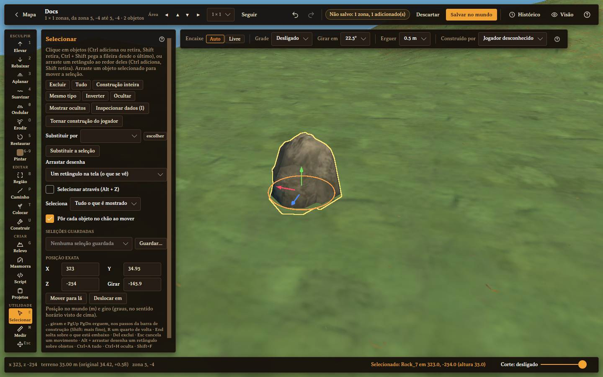
*De perto, uma rocha selecionada: o contorno laranja, as setas X vermelha, Y verde e Z azul que a movem ao longo de um
eixo, e o anel laranja que a gira. O painel Selecionar fica à esquerda.*

## Como usar

Para mover alguns objetos:

1. Pressione `E`.
2. Clique num objeto. Use `Ctrl` + clique para adicionar mais, ou arraste um retângulo na tela em volta deles.
3. Arraste um objeto selecionado para mover todos, ou arraste uma seta para mover ao longo de um eixo, ou o anel para
   girar.
4. Opcional: digite valores exatos em **POSIÇÃO EXATA** e clique em **Mover para lá**.

Na ferramenta **Visão**, um clique duplo num objeto passa para Selecionar com ele selecionado. Só os objetos mostrados
podem ser escolhidos: ligue os tipos deles no [painel Visão](editor-basics.md) antes. O objeto sob o cursor tem uma
caixa clara: é ele que um clique escolhe.

Cada movimento, giro, exclusão ou alteração é um passo de desfazer (`Ctrl+Z`). Nada é gravado no mundo até você usar
**Salvar no mundo** (ou **Aplicar ao vivo**).

## Configurações

O painel Selecionar, de cima para baixo.

| Configuração | O que faz |
|---|---|
| **Excluir** | Remove os objetos selecionados (`Del`). `Ctrl+Z` os traz de volta. |
| **Tudo** | Seleciona todos os objetos mostrados na área (`Ctrl+A`). |
| **Construção inteira** | Adiciona todas as peças de construção ligadas às selecionadas por peças que se tocam: paredes, pisos, telhados, vigas. Peças separadas não entram. |
| **Mesmo tipo** | Seleciona todos os objetos mostrados dos tipos selecionados agora: selecione uma faia e pegue todas as faias. |
| **Inverter** | Seleciona todos os objetos mostrados que não estão selecionados agora, e só eles (`Ctrl+I`). |
| **Ocultar** / **Mostrar ocultos** | Oculta os objetos selecionados na visão, para alcançar o que eles cobrem (`Ctrl+H`), e os mostra de novo (`Alt+H`). Objetos ocultos não são desenhados nem escolhidos; nada muda no mundo. Abrir outra área esquece o que estava oculto. |
| **Inspecionar dados (I)** | Abre o [Inspetor](#inspetor) no único objeto selecionado. |
| **Tornar construção do jogador** | Dá às peças selecionadas que não têm construtor o jogador escolhido em **Construído por** na [barra de construção](build.md#a-barra-de-construção), para que o jogo as trate como construídas por um jogador. Use-o numa ruína que você quer consertar e manter. Veja [Peças construídas por jogadores](concepts/objects.md#peças-construídas-por-jogadores). |
| **Substituir por** + **escolher** + **Substituir a seleção** | Escolha um tipo (ou clique em **escolher** e depois num objeto do mundo) e substitua por ele cada objeto selecionado, no mesmo lugar e na mesma direção. Os objetos novos não guardam nada dos dados dos antigos. |
| **Arrastar desenha** | **Um retângulo na tela (o que se vê)** ou **Um contorno no chão (tudo acima dele)**: veja [Selecionar vários de uma vez](#selecionar-vários-de-uma-vez). |
| **Selecionar através (Alt + Z)** | Um retângulo também pega o que está escondido atrás de outros dentro dele: os móveis dentro de uma casa, a parede atrás de outra. |
| **Seleciona** | O que cliques, retângulos e contornos pegam: **Tudo o que é mostrado**, **Só peças construídas** (o que os jogadores construíram) ou **Só natureza** (árvores, rochas, minério, arbustos, coletáveis, restos). O que fica de fora continua desenhado, mas não atrapalha: com Só peças construídas, um retângulo pega a parede atrás de uma árvore. Vale também para os cliques da ferramenta Visão; **Em cima** da ferramenta Colocar e os conta-gotas pegam todos os tipos. |
| **Pôr cada objeto no chão ao mover** | Ligado: cada objeto pousa no piso, na mesa ou na rocha embaixo dele onde terminar, senão no chão (árvores, arbustos e criaturas não sustentam nada: uma árvore movida num bosque fica no chão); uma construção se move como um bloco e se assenta no que há embaixo dela. Desligado: a seleção inteira se move como um bloco, na altura dela acima do chão. Ligado no início. |
| **SELEÇÕES GUARDADAS**: **Guardar…** | Guarda a seleção com um nome, para este mundo. Escolha uma na lista para ver os botões dela: **Selecionar** (no lugar da seleção atual), **Adicionar** (a ela) e **Esquecer** (depois de perguntar). Objetos movidos ou excluídos desde então contam como ausentes; a barra de status diz quantos. |
| **POSIÇÃO EXATA**: **X**, **Y**, **Z**, **Girar** | Aparece com uma seleção. X (leste–oeste) e Z (norte–sul) são o centro da seleção, Y a altura do objeto mais baixo dela, Girar a direção do primeiro objeto em graus, no sentido horário visto de cima. |
| **Mover para lá** | Move e gira a seleção para os valores digitados, como um passo de desfazer. Os valores digitados são exatos: nada se encaixa por cima deles. |
| **Deslocar em** | Muda os campos para quantidades: metros para leste, para cima e para norte, e graus de giro. **Deslocar por estes valores** executa. |

## Selecionar um objeto de cada vez

| Ação | O que faz |
|---|---|
| Clicar | Seleciona o objeto, e só ele. |
| Clicar de novo no mesmo ponto | Seleciona o objeto seguinte atrás dele, depois o seguinte: um baú num piso, o piso, a viga embaixo. |
| `Ctrl` + clique | Adiciona o objeto, ou o retira quando ele já está selecionado. |
| `Shift` + clique | Retira o objeto. |
| `Ctrl` + `Shift` + clique | Adiciona a fileira do último objeto clicado até este: clique na parede 1, depois na parede 3, e as paredes 1 a 3 ficam selecionadas. |
| Clique duplo numa peça de construção | Seleciona a construção inteira. Um baú (qualquer recipiente) é a exceção: ele é selecionado sozinho e abre no Inspetor. |
| Clique duplo numa parte de um navio | Seleciona o navio inteiro: veja [Navios e outros objetos vinculados](#navios-e-outros-objetos-vinculados). |
| Clicar no chão vazio, ou `Alt+A` | Limpa a seleção. |

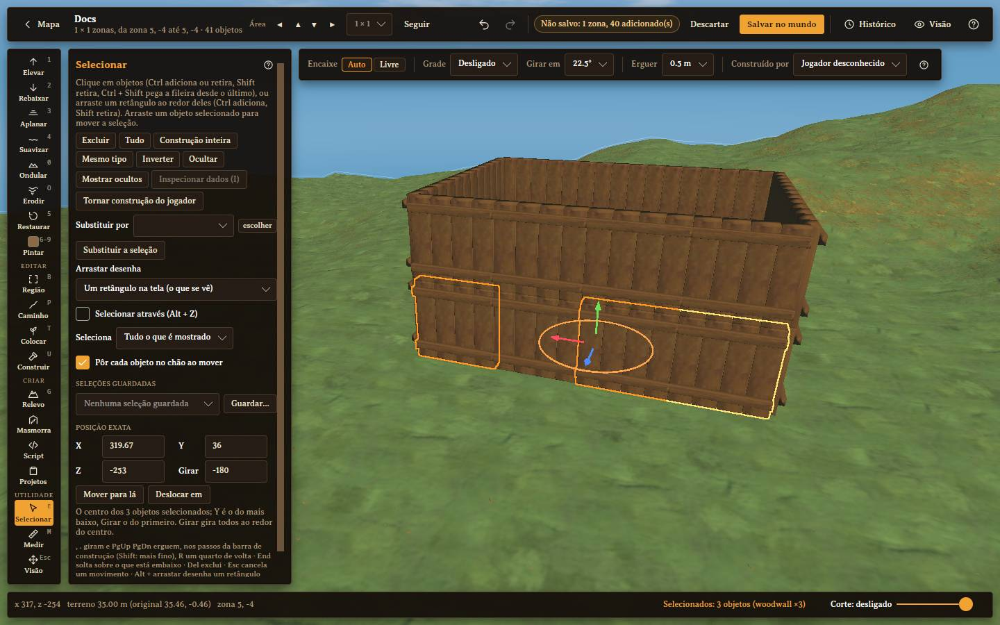
*Um clique numa peça de parede, depois `Ctrl` + clique em mais duas: a última clicada tem contorno amarelo mais claro,
as outras laranja, e a barra de status conta as três.*

## Selecionar vários de uma vez

Arrastar no chão vazio desenha um retângulo na tela. Quando você solta, os objetos **vistos** dentro dele são
selecionados, não os escondidos atrás de outros. Gire a câmera para escolher: de cima, o piso e o topo das paredes de
uma construção; de lado, uma parede.

| Ação | O que faz |
|---|---|
| Arrastar no chão vazio | Desenha o retângulo; o que se vê dentro vira a seleção. |
| `Alt` + arrastar | Desenha o retângulo mesmo quando você começa sobre um objeto (uma construção, um bosque). |
| `Ctrl` + arrastar | Adiciona o que o retângulo pega. |
| `Shift` + arrastar | Retira o que ele pega. |

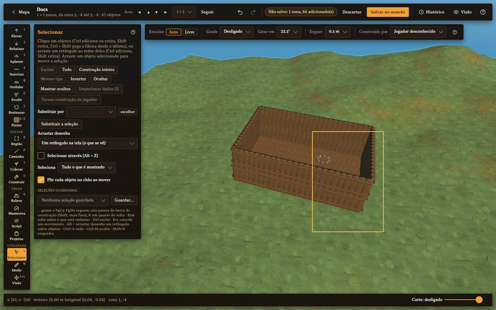
*`Alt` + arrastar do meio de uma cabana sobre a metade direita dela: o retângulo é desenhado na tela.*

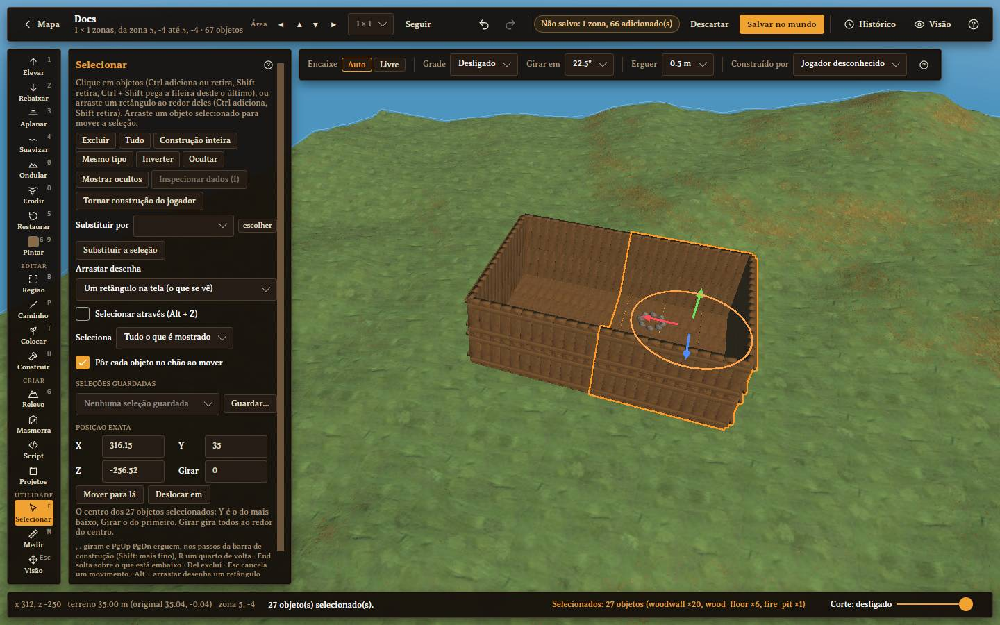
*Depois de soltar: 27 peças com contorno, as paredes, o piso visto entre elas e a fogueira; o piso e o baú escondidos
atrás da parede da frente ficam de fora. A barra de status conta os objetos.*

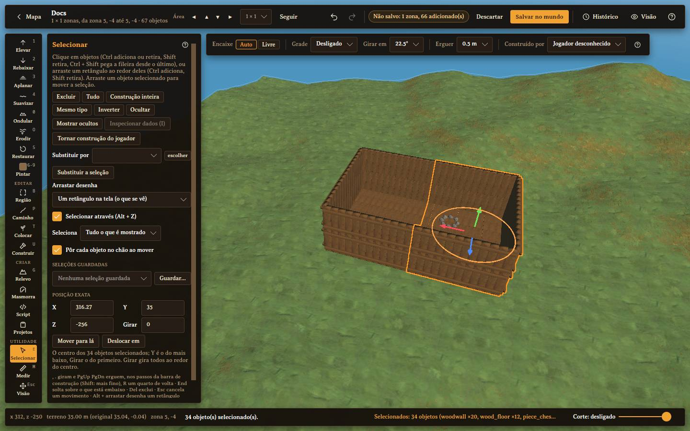
*O mesmo retângulo com **Selecionar através** ligado: 34 peças, inclusive o piso e o baú atrás da parede da frente.*

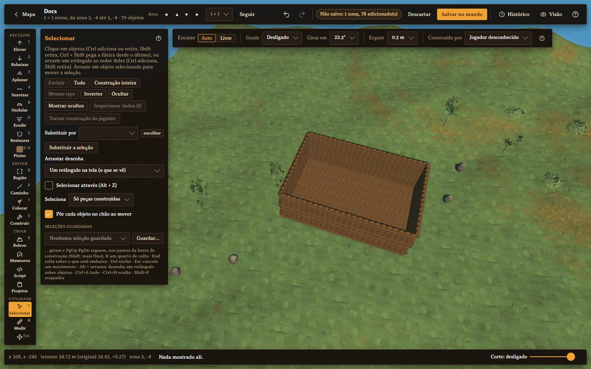
***Seleciona: Só peças construídas** e um retângulo sobre a cabana inteira entre rochas e arbustos: só as 58 peças da
cabana.*

Com **Arrastar desenha: Um contorno no chão (tudo acima dele)**, arrastar desenha um contorno no chão, e todos os
objetos mostrados que estão dentro dele são selecionados, escondidos ou não. `Alt`, `Ctrl` e `Shift` funcionam como no
retângulo.

Para selecionar por tipo dentro de um retângulo ou polígono exato (todas as árvores, ou só as faias, e só onde a
[Máscara](masks.md) deixa o terreno passar), use a ferramenta [Região](area.md#ações-de-objetos): em **Objetos**, o
**Selecionar os objetos (Enter)** dela os seleciona e passa para Selecionar, onde **Excluir** e **Substituir a
seleção** atuam sobre eles.

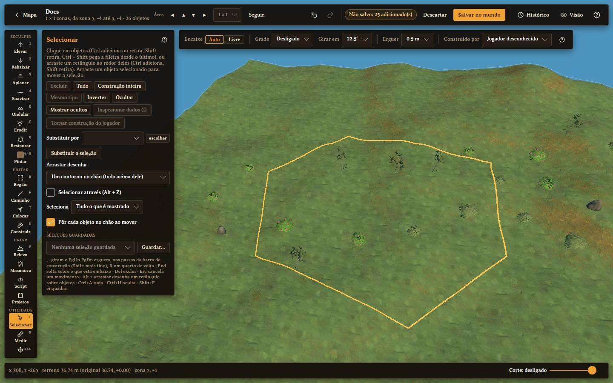
*`Alt` + arrastar em volta de rochas e arbustos: o contorno é desenhado mesmo que o arrasto tenha começado num
arbusto.*

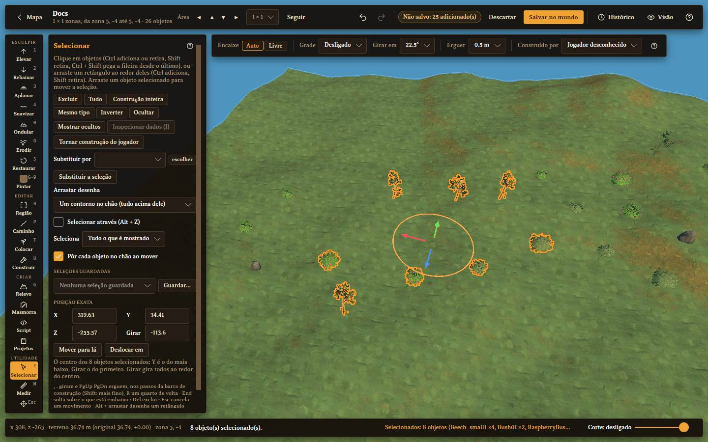
*Tudo o que é mostrado dentro fica selecionado, e **POSIÇÃO EXATA** mostra onde a seleção está.*

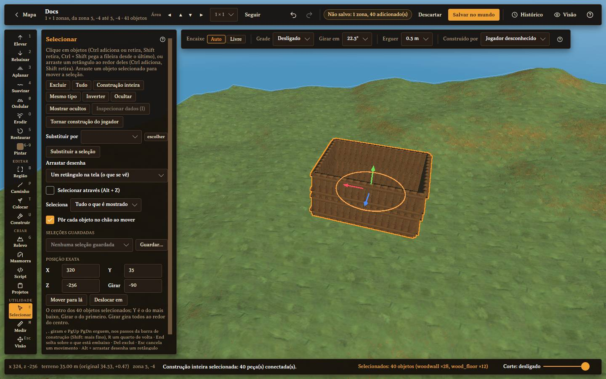
*Um clique numa parede, depois **Construção inteira**: todas as peças ligadas da cabana ficam selecionadas.*

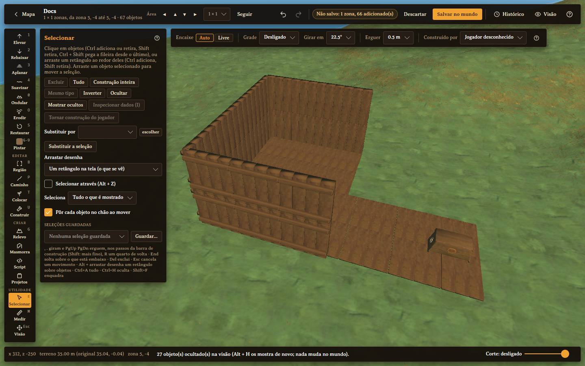
*De perto, a cabana depois que `Ctrl+H` ocultou a metade direita selecionada: o baú no piso de dentro fica à vista.
`Alt+H` traz as paredes de volta.*

## Mover e girar

| Ação | O que faz |
|---|---|
| Arrastar um objeto selecionado | Move a seleção inteira, seguindo o cursor no chão. As peças se encaixam nas peças em volta, ou seguem a grade, conforme a [barra de construção](build.md#a-barra-de-construção) estiver ajustada. |
| Arrastar uma seta | Move ao longo de um eixo: **X vermelho** leste–oeste, **Y verde** para cima–para baixo, **Z azul** norte–sul. Segure `Ctrl` para passos de 0,5 m. |
| Arrastar o anel laranja | Gira a seleção em torno do centro dela; segure `Ctrl` para passos de 15°. |
| `End` | Solta cada objeto direto para baixo, sobre o que há embaixo dele (um piso, uma mesa, uma rocha), senão o chão. |

A barra de construção ao lado do painel é a mesma que [Construir](build.md) e Colar usam: **Encaixe** (**Auto**: as
peças movidas se prendem aos pontos de encaixe mais próximos a até 0,75 m, como com o martelo; **Livre**: elas ficam
onde você as arrasta), **Grade** (as peças que não se encaixam a seguem), **Girar em** e **Erguer** (os passos das
teclas abaixo) e **Construído por**.

A barra de status acompanha o movimento: "Movendo 12 objeto(s): 4.5 m, girado(s) 15°, +0.25 m · encaixado(s) em
woodwall". Um objeto movido mantém os dados dele: um baú, o conteúdo; uma placa, o texto; uma peça, o construtor. Veja
[Encaixe](concepts/objects.md#encaixe) para saber onde um movimento termina.

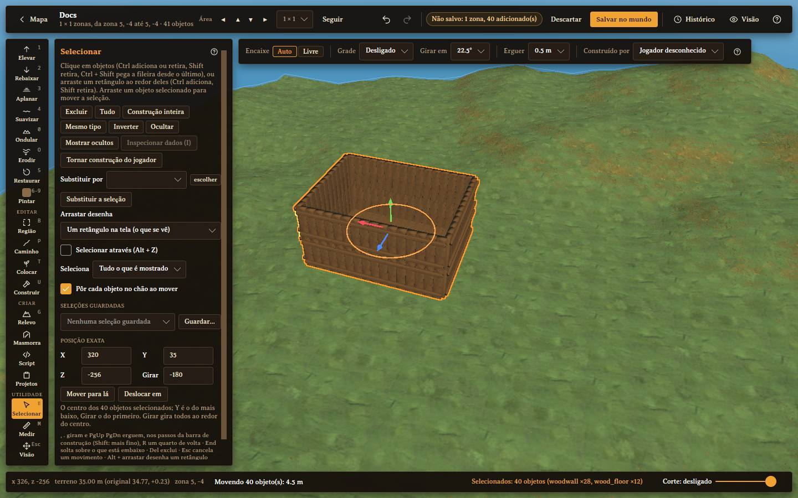
*Arrastando a seta X vermelha de uma cabana selecionada inteira: a barra de status acompanha o movimento, "Movendo 40
objeto(s): 4.5 m".*

## Copiar, recortar e colar

`Ctrl+C` copia a seleção; `Ctrl+V` a cola com a ferramenta de colar (`R` gira, `X` espelha), aqui ou em outra área:
veja [Região](area.md). As cópias guardam tudo o que os originais contêm. Árvores e coisas do tipo mantêm a altura
acima do chão onde pousam; as peças de construção mantêm a forma da construção e levam junto o terreno embaixo delas
(sem a pintura). `Ctrl+X` recorta: a mesma cópia, e depois os objetos saem do mundo, então colar os move.

Para guardar uma cópia como projeto, abra **Projetos** na barra e clique em **Salvar como projeto…** na linha
**Cópia**: veja [o painel Projetos](workshop.md#painel-projetos).

## Inspetor

O Inspetor mostra tudo o que um objeto contém no salvamento e deixa você alterar. Abra-o com **Inspecionar dados
(I)**, ou dê um clique duplo num baú (ou em qualquer objeto que não seja uma peça de construção).

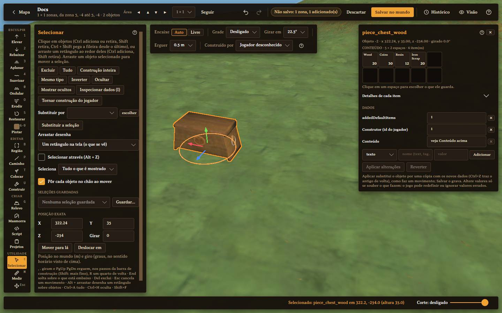
*De perto, um baú com quatro itens, aberto no Inspetor: os espaços como no jogo, cada um com o nome do item e a
quantidade, e depois todos os valores em DADOS.*

No topo: o nome do objeto, o id, a posição e o giro. Para um ponto de surgimento ou um ninho, o que ele gera
(`Spawn point: Boar · 0–2 ★ · spawns once`); para o objeto de um mod, de que mod ele vem.

| Parte | O que faz |
|---|---|
| **CONTEÚDO** | Baús e outros recipientes: os espaços como no jogo ("5 × 2 espaços · 4 item(ns)"). Clique num espaço e use **Buscar um item…** (digite algumas letras), **Quantos** e **Qualidade**. **Esvaziar** retira o item; **Mover**, depois outro espaço, move o item (dois itens trocam de lugar). A quantidade é limitada à maior pilha do jogo. |
| **Detalhes de cada item** | Cada item com a pilha, a qualidade, a durabilidade e o espaço. **Adicionar item** põe um novo no primeiro espaço livre; **✕** retira um; **Organizar espaços** move todos os itens para os primeiros espaços livres, fileira por fileira. |
| **SEGURA** / **VESTE** | Suportes de itens e suportes de armadura. A lista oferece só o que o jogo deixa aquele suporte aceitar (um suporte plano também aceita comida, para pôr a mesa). **Qual.** é a qualidade, **Estilo** a aparência, **Orientação** o jeito como fica pendurado, **Postura** a postura de um suporte de armadura; **✕** retira o item. |
| **DADOS** | Todos os valores, pelo nome do jogo, com um rótulo para os comuns: Text (placa), Tag (portal), Builder (id do jogador), Health, Fuel, Level (estrelas)... Altere números e textos ali mesmo; **✕** remove um valor (o jogo passa a usar o padrão dele). Outros dados binários são listados, mas não alterados. |
| **Adicionar** | Adiciona um valor que o objeto não tem: escolha o tipo, digite o nome como o jogo o chama (`text` para uma placa, `tag` para um portal) e o valor. |
| **Aplicar alterações** | Substitui o objeto por uma cópia com os dados novos, no mesmo lugar: um passo de desfazer. **Salvar no mundo** ou **Aplicar ao vivo** o grava. |
| **Reverter** | Esquece as alterações feitas no cartão. |

- O tamanho de um recipiente vem do jogo. Carroças e navios guardam o recipiente numa parte, então o tamanho deles é
  desconhecido.
- Itens fora dos espaços ficariam escondidos no jogo: o editor pergunta antes de aplicar isso.
- O conteúdo alterado passa a ser do próprio baú: um baú nunca aberto não se enche com o saque do jogo por cima dele.
- Um item posto num suporte é novo e tem durabilidade máxima para a qualidade dele. Em **Visual do jogo**, a visão 3D
  o desenha no suporte.
- Os nomes dos valores vêm do código do jogo e dos seus mods (lido, nunca executado). Um nome desconhecido aparece
  como número.

> [!WARNING]
> Altere um valor só quando souber o que ele faz: o jogo pode redefinir ou ignorar valores que não espera. `Ctrl+Z`
> põe o objeto antigo de volta até você salvar.

## Navios e outros objetos vinculados

Alguns mods montam objetos a partir de outros: a embarcação de um mod de navios é uma raiz e as peças construídas nela;
a locomotiva de um mod de trens e os vagões que ela puxa. Quando o mod os descreve (o `worldeditor.json` dele, veja
[Mods](modding.md), ou um complemento como o [ValheimRAFT](../../addons/ValheimRAFT/README.md) ou o
[Railroads](../../addons/Railroads/README.md)), o editor desenha o grupo como o mod o monta e o mantém junto:

- **Movido por inteiro.** Selecionar qualquer parte e mover, girar ou excluir pega o grupo inteiro (a barra de status
  avisa, nas palavras do mod: "vehicle por inteiro"). Um grupo movido mantém a altura (um navio continua flutuando),
  não se encaixa e não cai com `End`.
- **Copiado por inteiro.** `Ctrl+C` em qualquer parte copia o grupo inteiro, sem o terreno. Cada colagem é um grupo
  próprio, com ids novos. Uma parte copiada sem a raiz é colada como peça comum.
- **Removido por inteiro.** Excluir qualquer parte exclui o grupo inteiro, também quando a ferramenta
  [Região](area.md#ações-de-objetos) o selecionou.

As ferramentas do Claude fazem o mesmo. Veja [O que é um objeto](concepts/objects.md#o-que-é-um-objeto).

## Atalhos

| Tecla ou mouse | O que faz |
|---|---|
| `E` | Abre Selecionar. |
| `Ctrl+A` / `Alt+A` | Seleciona tudo o que é mostrado / limpa a seleção. |
| `Ctrl+I` | Inverte a seleção. |
| `Ctrl+H` / `Alt+H` | Oculta os objetos selecionados / mostra-os de novo. |
| `Alt+Z` | Liga ou desliga **Selecionar através**. |
| `Shift+F` ou `.` do teclado numérico | Enquadra a seleção (`F` sozinho troca o modo de visão). |
| `Del` | Exclui a seleção. |
| `I` | Abre o Inspetor no único objeto selecionado. |
| `,` `.` ou `Alt` + roda | Gira pelo passo **Girar em** da barra de construção, 22.5° de início (`Shift`, mais fino: 1°). |
| `R` | Gira um quarto de volta. |
| `PgUp` / `PgDn` ou `Ctrl` + roda | Ergue ou baixa pelo passo **Erguer** da barra de construção, 0.5 m de início (`Shift`, mais fino: um quinto disso). |
| `End` | Solta cada objeto sobre o que há embaixo dele. |
| `Esc` | Fecha o Inspetor; senão, cancela um retângulo, contorno ou movimento em andamento; senão, volta à ferramenta Visão (a seleção fica). |
| `Ctrl+C` / `Ctrl+X` / `Ctrl+V` | Copiar, recortar, colar. |
| `Ctrl+Z` | Desfazer. Teclas pressionadas num intervalo curto umas das outras são um só passo. |

Todas as teclas do editor estão em [Atalhos](help/shortcuts.md).

## Dicas e limites

> [!CAUTION]
> Pedras rúnicas podem ser selecionadas e excluídas, mas não movidas, giradas, copiadas nem inspecionadas: o jogo
> constrói cada uma a partir do local dela sempre que a zona carrega, então excluir uma remove aquele local de vez (com
> o pequeno nivelamento do terreno em volta dele). Salvar no mundo torna isso permanente; até lá, `Ctrl+Z` a traz de
> volta.

- **Recuperar:** excluiu ou moveu por engano: `Ctrl+Z`, mesmo depois de salvar (e então salve de novo). Ocultou algo:
  `Alt+H`. Veja [Desfazer alterações](guides/undo-changes.md).
- Retângulos, contornos, **Tudo**, **Mesmo tipo**, **Inverter** e **Construção inteira** deixam de fora qualquer coisa
  a mais de 10 m abaixo do chão (objetos que um mod esconde ali, como estações de criação embaixo de uma casa).
- Um clique escolhe um objeto pela forma desenhada, não pela caixa dele: uma pedra sob os galhos de uma árvore pode ser
  clicada entre os galhos. Folhas e grama só contam onde não há nada sólido atrás delas. Veja
  [O que é um objeto](concepts/objects.md#o-que-é-um-objeto).
- Os objetos selecionados perdem o ponto verde de não salvo enquanto estão selecionados.
- No modo ao vivo, um objeto movido mantém o id dele no jogo em execução quando nada mais nele mudou. Veja
  [O que é enviado e quando](concepts/live-editing.md#o-que-é-enviado-e-quando).

## Relacionados

- [Mover ou copiar uma construção](guides/move-a-building.md)
- [Alterar o que um baú guarda ou o que uma placa diz](guides/fill-a-chest.md)
- [Encontrar um objeto, um item de baú ou uma placa](guides/find-things.md)
- [Objetos](concepts/objects.md#o-que-é-um-objeto) · [Encaixe](concepts/objects.md#encaixe)
- [Construir](build.md) · [Colocar](place.md) · [Região](area.md)
