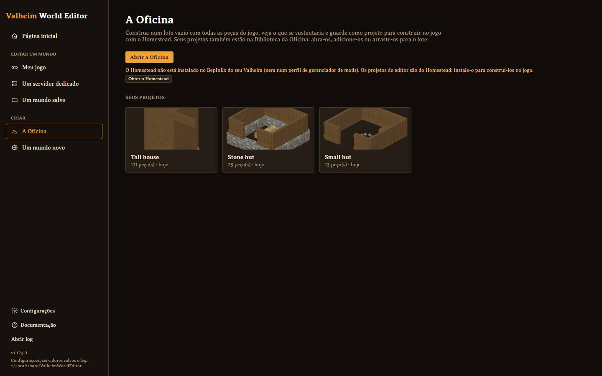
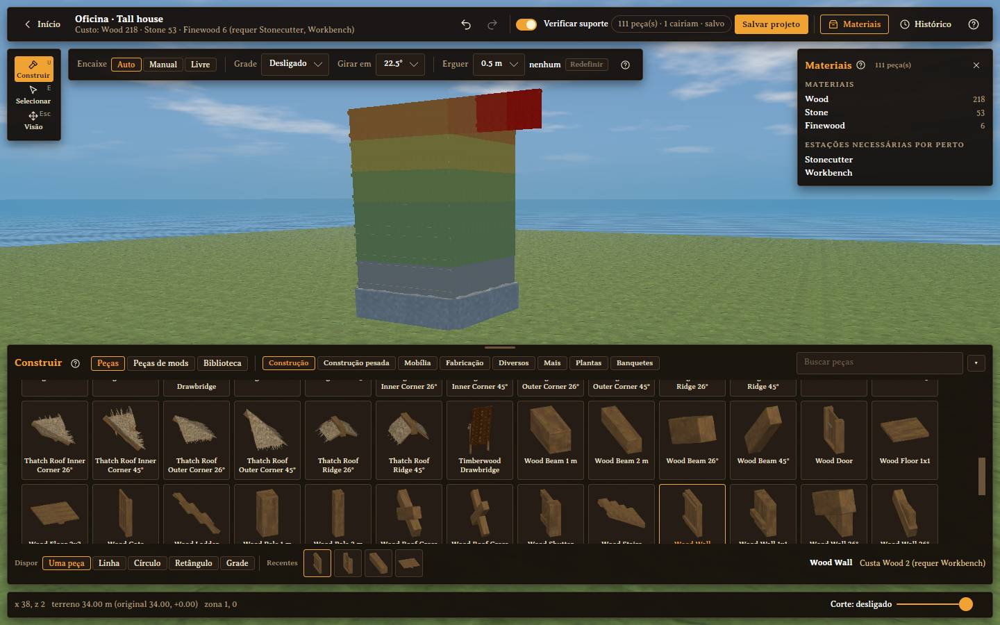
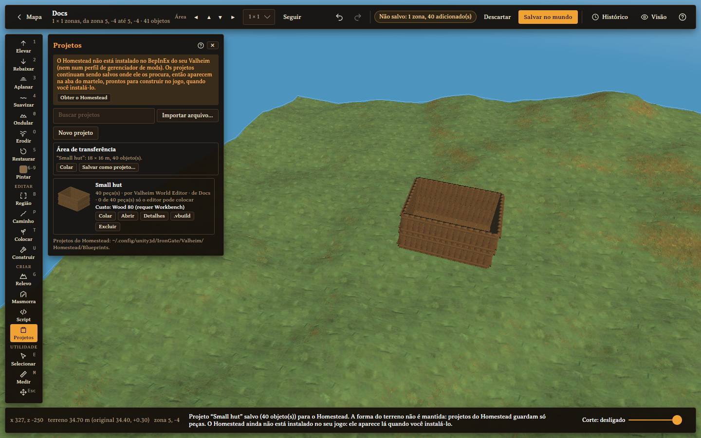

<!-- source: 491b2a7c -->
# Sua primeira construção

Em uns quinze minutos, você constrói uma pequena cabana de madeira na Oficina, vê a verificação de suporte colori-la,
guarda-a como projeto e a cola num mundo. Você não precisa de nenhum mundo na primeira parte: a Oficina é um lote vazio.

**Você precisa de:** o editor instalado ([Instalar o editor](install.md)). Para a última parte, um mundo com uma cópia
de backup ao lado, como em [Sua primeira edição](first-edit.md).

## 1. Abrir a Oficina

1. Na página inicial, clique em **A Oficina** e depois em **Abrir a Oficina**.

*Na página inicial, **A Oficina**: **Abrir a Oficina**, se o Homestead está instalado, e os seus projetos (três aqui; os
seus estão vazios na primeira vez).*

**O que você deve ver:** um lote plano e vazio de prado, o painel **Construir** ao longo da parte de baixo, na aba
**Peças**, e a barra superior dizendo "Nenhuma peça ainda". A barra de ferramentas tem só **Construir**, **Selecionar** e
**Visão**, com a barra de construção ao lado.

## 2. Assentar um piso

1. No painel **Construir**, digite `wood floor` em **Buscar peças**.
2. Clique no bloco do piso de madeira. O nome e o custo dele aparecem no rodapé do painel, e ele entra em
   **Recentes** ali.
3. Clique no meio do lote. O piso é colocado.
4. Aponte ao lado da borda do piso e clique de novo. O novo piso se encaixa no primeiro, borda com borda, como com o
   martelo do jogo. Coloque quatro pisos formando um quadrado.

**O que você deve ver:** um piso quadrado, com cada peça tingida de azul-claro: ela está apoiada no chão, então tem
suporte total. A barra superior conta "4 peça(s) · não salvo como projeto" e, sob o título, o custo da cabana.

## 3. Erguer as paredes

1. Busque `wood wall` e clique no bloco da parede de madeira.
2. Aponte para a borda externa de um piso e clique: a parede se encaixa na borda. Pressione `,` ou `.` para girá-la
   antes, se estiver voltada para o lado errado.
3. Coloque paredes em toda a volta do piso. Deixe uma abertura para uma porta.
4. Busque `wood door`, clique no bloco dela e coloque a porta na abertura.
5. Coloque uma segunda fileira de paredes em cima da primeira.

*A verificação de suporte numa casa alta: a base de pedra em azul-claro, as paredes acima em verde, depois amarelo e
laranja à medida que o suporte acaba, e uma saliência em vermelho: ela cairia.*

**O que você deve ver:** as paredes sobre o piso estão verdes (firmes); a segunda fileira está num verde mais claro ou
amarela, com menos suporte. Uma peça que cairia no jogo fica vermelha, e a barra superior diz quantas cairiam. Por quê:
veja [A verificação de suporte](../concepts/objects.md#a-verificação-de-suporte).

Uma peça no lugar errado? Pressione `Ctrl+Z` para desfazê-la, ou pressione `E` (**Selecionar**), clique na peça,
pressione `Del` e pressione `U` para voltar a construir.

## 4. Salvar o projeto

1. Clique em **Salvar projeto** na barra superior (ou pressione `Ctrl+S`).
2. Digite `My first hut` como **Nome**, algumas palavras como **Descrição** e `hut, wood` como **Tags**.
3. Clique em **Salvar**. Se algumas peças fossem cair no jogo, o editor pergunta antes: **Continuar construindo** para
   corrigi-las (elas estão vermelhas), ou **Salvar mesmo assim**.

**O que você deve ver:** a mensagem "Projeto “My first hut” salvo (… peça(s)) para o Homestead.", e a barra superior
diz "salvo". O projeto agora está na sua biblioteca, com uma imagem da cabana. Com o mod
[Homestead](https://thunderstore.io/c/valheim/p/sighsorry/Homestead/) no seu jogo, ele também aparece na aba do
martelo do Homestead, pronto para construir no jogo.

## 5. Colar num mundo

1. Clique em **Início** no canto superior esquerdo para voltar à página inicial.
2. Clique em **Um mundo salvo** e depois no seu mundo (não na cópia de backup). No mapa dele, clique num lugar de
   terreno aberto que você já visitou e clique em **Editar em 3D**.
3. Na barra de ferramentas, em **CRIAR**, clique em **Projetos**. Numa janela baixa, role a barra de ferramentas com a
   roda do mouse para alcançá-lo.
4. Encontre **My first hut** na lista e clique no botão **Colar** dele.
5. Mova o mouse sobre terreno aberto: a cabana o acompanha, transparente. Pressione `R` para girá-la um quarto de volta.
6. Clique para colocá-la e depois pressione `Esc` para parar de colar.

*O painel **Projetos** ao lado da barra de ferramentas: uma cabana salva com a imagem, o custo e o botão **Colar**.*

**O que você deve ver:** a cabana de pé no terreno. Com **Limpar o local** ligado no painel Colar (ele vem ligado), o
terreno no caminho é escavado, e as árvores e rochas do local somem. A barra superior diz "Não salvo: … adicionado(s)".

Um contorno vermelho antes do clique significa que a cabana não cabe na área aberta: abra uma maior pelo mapa.

## 6. Salvar o mundo

1. Feche o Valheim, se estiver em execução.
2. Clique em **Salvar no mundo**, confira a **Pasta do mundo** na pergunta e clique em **Salvar**.
3. Inicie o Valheim, carregue o mundo e vá até o lugar.

**O que você deve ver:** a sua cabana, de pé onde você a colou. As peças dela são construção do jogador, então o jogo a
trata como a sua base (veja [Peças construídas por jogadores](../concepts/objects.md#peças-construídas-por-jogadores)).

## Se não funcionou

- **Uma peça não se encaixa**: aponte mais perto da borda ou do topo da peça que já está ali; o encaixe usa os pontos de
  encaixe mais próximos dentro de meio metro.
- **A Oficina diz que o Homestead não está instalado**: não tem problema. Os projetos são salvos onde o Homestead os
  procura, e colar num mundo funciona sem ele.
- **O contorno da colagem está vermelho**: a cabana está perto demais da borda da área. Mova o mouse para dentro ou
  abra uma área maior.
- **Você não gosta do resultado**: `Ctrl+Z` desfaz a colagem antes de você salvar. Depois de salvar, desfaça-a e use
  **Salvar no mundo** de novo: veja [Desfazer um passo, reverter uma alteração ou descartar tudo](../guides/undo-changes.md).

## Próximos passos

- [A Oficina](../workshop.md): cada aba de peças, a biblioteca, o Corte e como as peças se encaixam.
- [Colar um projeto num mundo](../guides/paste-a-blueprint.md)
- [Mover ou copiar uma construção](../guides/move-a-building.md)
