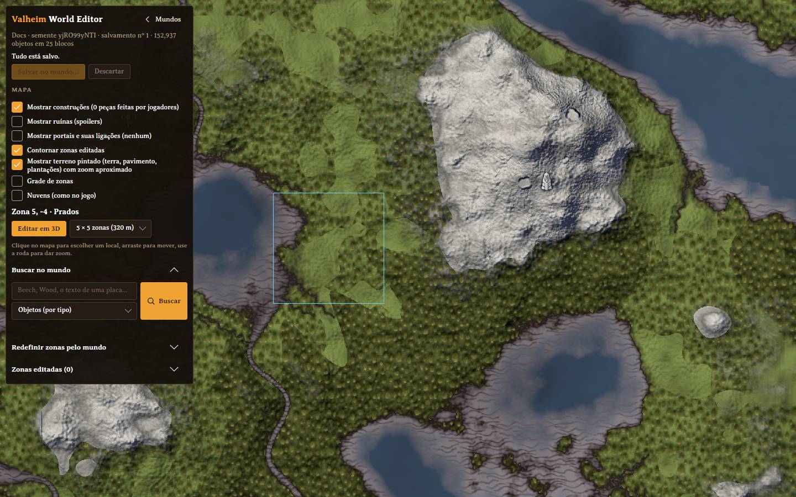
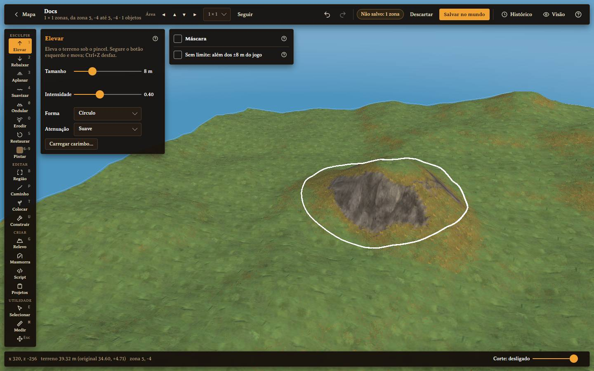
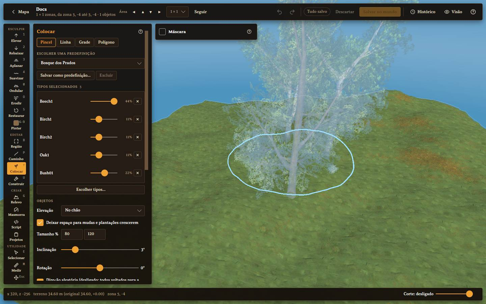
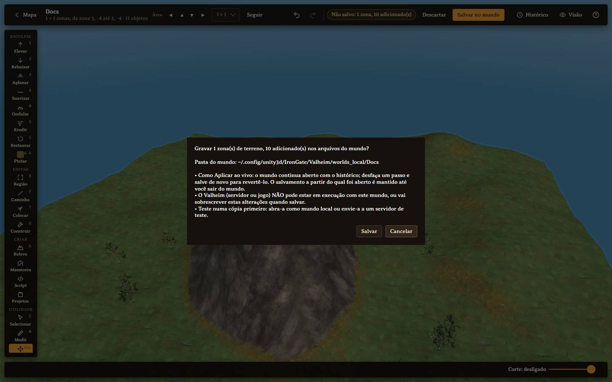

<!-- source: b94e61af -->
# Sua primeira edição

Em uns dez minutos, você copia um mundo, eleva uma pequena colina e planta algumas árvores ao lado da sua base, desfaz
e refaz, salva e caminha até o resultado no Valheim. A cópia guarda o mundo como estava, então nada pode se perder.

**Você precisa de:** o editor instalado ([Instalar o editor](install.md)) e um mundo de modo solo em que você já
jogou: um onde você construiu uma base e usou a enxada ou a picareta pelo menos uma vez. O Valheim precisa estar
fechado.

## 1. Copiar o mundo

A cópia é o seu caminho de volta: o que quer que você faça a seguir, você pode pôr o mundo de volta exatamente como
está agora.

1. Feche o Valheim.
2. No editor, na página inicial, clique em **Um mundo salvo** e passe o mouse sobre o cartão do seu mundo. A dica
   termina com a pasta do mundo, por exemplo `…/IronGate/Valheim/worlds_local/Midgard`.
3. No seu gerenciador de arquivos, abra a pasta `worlds_local` que a contém.
4. Copie a pasta do mundo e cole a cópia na mesma pasta `worlds_local`.
5. Renomeie a cópia como `<World>_backup_<date>`, por exemplo `Midgard_backup_2026-10-22`.

**O que você deve ver:** depois de alguns segundos, **Um mundo salvo** lista os dois: o seu mundo e
`Midgard_backup_2026-10-22`. Você edita o próprio mundo; a cópia fica intocada ao lado dele. Mais sobre cópias:
[Fazer backup de um mundo antes de editar](../guides/back-up-a-world.md).

## 2. Abrir o mundo

1. Em **Um mundo salvo**, clique no seu mundo (não na cópia). Ele abre no mapa.
2. No mapa, clique num ponto de terreno aberto perto da sua base.
3. No painel lateral, escolha **3 × 3 zonas (192 m)** na lista de tamanhos ao lado de **Editar em 3D** e clique em
   **Editar em 3D**.

*O mapa: um clique escolheu uma zona (o quadrado azul); **Editar em 3D** a abre com o tamanho escolhido ao lado.*

**O que você deve ver:** a visão 3D da sua base e das terras em volta, a barra de ferramentas à esquerda e a barra
superior dizendo "Tudo salvo". Se a visão estiver longe, gire a roda para se aproximar; arrastar com o botão direito
gira a visão.

## 3. Elevar uma colina

1. Pressione `1`, ou clique em **Elevar** na barra. O painel dele abre ao lado da barra.
2. No painel, arraste **Tamanho** até uns 10 m.
3. Em terreno aberto ao lado da sua base, segure o botão esquerdo do mouse e mova o mouse em pequenos círculos por
   alguns segundos.

*Elevar: o contorno do pincel no chão, um monte elevado ao lado dele e o painel com **Tamanho** e **Intensidade**.*

**O que você deve ver:** o terreno sobe sob o pincel, e a barra superior diz "Não salvo: 1 zona" em âmbar. Nada foi
gravado no mundo ainda: a alteração está [pendente](../concepts/saving-and-history.md#alterações-pendentes).

## 4. Plantar árvores

1. Pressione `T`, ou clique em **Colocar** na barra.
2. No painel **Colocar**, clique em **Pincel** e escolha **Bosque dos Prados** em **Escolher uma predefinição**.
3. Arraste o mouse ao longo do pé da sua colina.

*Colocar com **Pincel** e a predefinição **Bosque dos Prados**: o pincel mostra as próximas árvores transparentes; as
já plantadas ficam em volta dele.*

**O que você deve ver:** faias, bétulas, carvalhos e arbustos aparecem onde você arrasta, cada um com um pequeno ponto
verde (ainda não salvo), e a barra superior acrescenta "… adicionados".

## 5. Desfazer e refazer

1. Pressione `Ctrl+Z` (`Cmd+Z` num Mac). As árvores que você plantou por último desaparecem.
2. Pressione `Ctrl+Y`. Elas voltam.
3. Pressione `L` para abrir o **Histórico**.

**O que você deve ver:** o Histórico lista os seus passos, dos mais novos aos mais antigos: "… colocado(s)", depois
Elevar. **Voltar até aqui** numa linha volta até ela; **Remover** retira só aquela alteração. Pressione `L` de novo
para fechá-lo.

Mais: [Desfazer um passo, reverter uma alteração ou descartar tudo](../guides/undo-changes.md).

## 6. Salvar

1. Clique em **Salvar no mundo** na barra superior (ou pressione `Ctrl+S`).
2. Leia a pergunta: ela diz o que vai gravar e a **Pasta do mundo**. Confira se a pasta é a do seu mundo, não a da
   cópia, e clique em **Salvar**.

*A pergunta antes de salvar: confira a linha **Pasta do mundo** e clique em **Salvar**.*

**O que você deve ver:** a barra de status diz "1 zona(s), … objeto(s) novo(s) salvo(s) no salvamento nº …", a barra
superior diz "Tudo salvo" e os pontos verdes somem. O editor gravou um novo salvamento ao lado do antigo e o releu para
conferi-lo.

O mundo continua aberto com o Histórico: você ainda pode desfazer um passo e salvar de novo para revertê-lo.

## 7. Ver no jogo

1. Clique em **Mapa**, no canto superior esquerdo, e depois em **Mundos**, para sair do mundo.
2. Inicie o Valheim e carregue o mundo.
3. Caminhe até o ponto ao lado da sua base.

**O que você deve ver:** a sua colina e as suas árvores, como no editor. O jogo as salva normalmente a partir de
agora.

## Se não funcionou

- **"Não salvo: … not generated yet"**: você editou uma zona que nenhum jogador visitou, então o mundo não tem dados
  ali. Escolha um ponto por onde você já passou, ou visite-o no jogo antes.
- **"… the world has no terrain object to copy yet"**: ninguém nunca cavou nem nivelou o terreno neste mundo. No jogo,
  use a enxada ou a picareta uma vez em qualquer lugar, salve, saia e salve de novo no editor.
- **"O Valheim salvou este mundo … depois que o editor o leu"**: o jogo estava rodando, ou salvou o mundo, enquanto
  você editava. Veja [Salvar no mundo](../editor-basics.md#salvar-no-mundo).
- **Você não gostou do resultado**: abra o mundo de novo, desfaça (ou use **Remover** nos passos do Histórico) e use
  **Salvar no mundo**. Ou ponha a cópia de volta: veja
  [Fazer backup de um mundo antes de editar](../guides/back-up-a-world.md#desfazer).

## Próximos passos

- [Sua primeira construção](first-build.md): construa uma cabana na Oficina e cole-a neste mundo.
- [A janela do editor](../editor-basics.md): todas as partes da janela.
- [Atalhos](../help/shortcuts.md): todas as teclas e ações do mouse.

No editor, `F1` (ou o pequeno **?** no topo de um painel) abre esta ajuda na ferramenta que você está usando.
