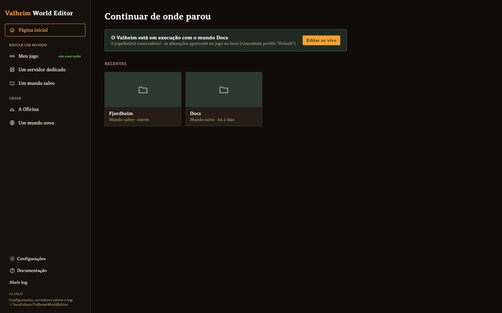
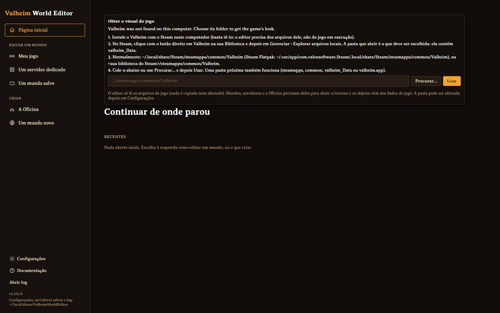
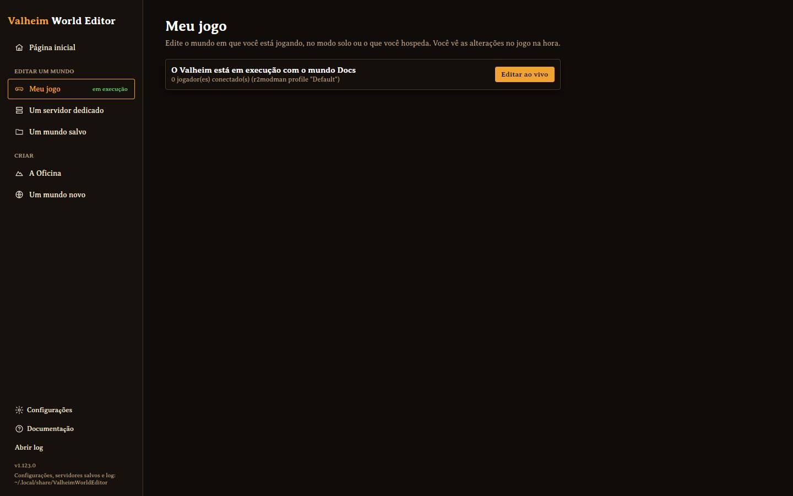
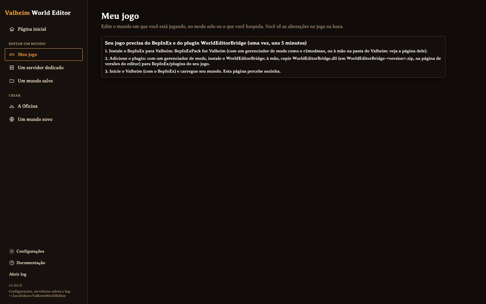

<!-- source: 68ffaeda -->
# Instalar o editor

Baixe o editor, inicie-o e deixe-o encontrar o seu Valheim. No fim, o editor está aberto na página inicial e já leu os
arquivos do jogo, pronto para a [sua primeira edição](first-edit.md).

## Do que você precisa

- **Windows 10 ou 11**, ou **Linux**, de 64 bits; ou **macOS 12 ou mais recente num Mac com Apple silicon** (M1 e
  posteriores). A versão para Mac é experimental: ainda não foi testada num Mac, e os Macs Intel não são suportados.
- **Valheim**, instalado pelo Steam no mesmo computador. Basta tê-lo: o editor lê os arquivos do jogo (texturas,
  modelos, terreno e mapa), ele não precisa do jogo em execução. Nada é copiado nem alterado.

Você não precisa de mais nada instalado. Tudo de que o editor precisa vem no download.

## Download

1. Abra a [página de versões](https://github.com/Shuiei/valheim-world-editor/releases/latest).
2. Baixe o arquivo para o seu computador:
   - Windows: `ValheimWorldEditor-v<version>-win-x64.zip`
   - Linux: `ValheimWorldEditor-v<version>-linux-x64.tar.gz`
   - macOS: `ValheimWorldEditor-v<version>-macos-arm64-experimental.zip`

O editor também está no [Nexus Mods](https://www.nexusmods.com/valheim/mods/4348). O editor é um programa, não um mod:
o Thunderstore e o Hexium só distribuem o plugin dele (veja [O plugin para editar ao vivo](#o-plugin-para-editar-ao-vivo)).

## Iniciar no Windows

1. Descompacte o download em qualquer lugar, por exemplo na Área de Trabalho. Mantenha os arquivos juntos:
   `ValheimWorldEditor.exe` precisa dos arquivos `.dll` ao lado dele. Não o execute de dentro do zip.
2. Clique duas vezes em `ValheimWorldEditor.exe`.
3. Se o Windows disser "O Windows protegeu o computador", clique em **Mais informações** (aparece o nome do editor do
   programa) e depois em **Executar assim mesmo**. O Windows pergunta isso até o SmartScreen conhecer a assinatura do
   editor.

<!-- picture: install-smartscreen.jpg: Windows 11, the blue "Windows protected your PC" dialog after More info was clicked, the publisher line and the Run anyway button visible, nothing else on screen -->

## Iniciar no Linux

1. Descompacte o download em qualquer lugar, por exemplo na sua pasta pessoal.
2. Clique duas vezes em `ValheimWorldEditor` na pasta. Se o seu gerenciador de arquivos o abrir como texto ou perguntar
   o que fazer, escolha **Executar** (ou clique com o botão direito, **Executar como programa**). Num terminal:
   `./ValheimWorldEditor`.

O editor desenha com OpenGL 3.3, que qualquer driver de vídeo dos últimos dez anos tem (Mesa, AMD, NVIDIA, Intel).

## Iniciar no macOS (experimental)

1. Descompacte o download e mova **ValheimWorldEditor.app** para onde quiser, por exemplo para Aplicativos.
2. Clique duas vezes nele uma vez. O macOS se recusa a abri-lo, porque o editor não é assinado com um certificado
   Apple Developer. Feche a mensagem.
3. Abra **Ajustes do Sistema › Privacidade e Segurança**, role até **Segurança**, clique em **Abrir Mesmo Assim** ao
   lado de ValheimWorldEditor e confirme com a sua senha.
4. Clique duas vezes no app de novo. A partir de agora, ele abre com um clique duplo.

Em vez dos passos 2 e 3, você pode executar no Terminal:
`xattr -dr com.apple.quarantine /Applications/ValheimWorldEditor.app` (com o caminho onde você o pôs).

Num Mac, `Cmd` funciona onde a documentação diz `Ctrl`: `Cmd+Z` desfaz, `Cmd`+clique adiciona a uma seleção. O
terreno do jogo é desenhado com o próprio shader do jogo quando a versão para Mac traz um que o editor consegue ler;
do contrário, em cores simples. Se algo não funcionar,
[abra uma issue](https://github.com/Shuiei/valheim-world-editor/issues) com o log do editor (**Abrir log** na página
inicial).

## A primeira execução

O editor abre na própria janela, na seção **Página inicial** da página inicial. Na primeira vez, e depois de cada atualização
do Valheim, um cartão diz **Preparando o visual do jogo** enquanto o editor lê os arquivos do jogo por alguns segundos.
Mundos, servidores e a Oficina abrem assim que ele diz **O visual do jogo está pronto.**

*A página inicial: o menu lateral à esquerda, a seção Página inicial à direita. Depois que um mundo é aberto, ele aparece em
Recentes.*

## Quando o Valheim não é encontrado

O editor procura sozinho em todas as bibliotecas do Steam (inclusive no Steam Flatpak). Se ele não encontrar o jogo, o
cartão diz **Obter o visual do jogo** e "O Valheim não foi encontrado neste computador."

*Os passos do cartão dizem onde encontrar a pasta; cole-a na caixa (ou use **Procurar…**) e depois **Usar**.*

1. No Steam, clique com o botão direito em Valheim na sua Biblioteca e depois em **Gerenciar › Explorar arquivos
   locais**. A pasta que abre é a que deve ser escolhida: ela contém `valheim_Data` (`valheim.app` num Mac).
2. Copie o caminho dela, cole-o na caixa do cartão (ou clique em **Procurar…** e escolha-a) e depois clique em
   **Usar**.

Os lugares usuais são:

- Windows: `C:\Program Files (x86)\Steam\steamapps\common\Valheim`
- Linux: `~/.local/share/Steam/steamapps/common/Valheim` (Steam Flatpak:
  `~/.var/app/com.valvesoftware.Steam/.local/share/Steam/steamapps/common/Valheim`)
- macOS: `~/Library/Application Support/Steam/steamapps/common/Valheim`
- Outra biblioteca do Steam: `<library>/steamapps/common/Valheim`

Uma pasta próxima também serve (`steamapps`, `common`, `valheim_Data` ou `valheim.app`): o editor encontra a pasta do
jogo a partir dela. Você pode mudá-la depois em **Configurações** (**Pasta do jogo Valheim**), veja
[Configurações](../editor-basics.md#configurações).

## O plugin para editar ao vivo

Para editar um mundo enquanto o jogo roda (o seu próprio jogo, ou um servidor dedicado enquanto as pessoas jogam), o
jogo que hospeda o mundo precisa do **BepInEx** e do plugin **WorldEditorBridge** do editor. Os jogadores que entram
não precisam de nenhum dos dois, inclusive os de console. Para editar mundos salvos com o jogo fechado, ou para
construir na Oficina, você não precisa de nenhum dos dois.

Para o seu próprio jogo:

1. Instale o BepInEx uma vez: [BepInExPack for Valheim](https://thunderstore.io/c/valheim/p/denikson/BepInExPack_Valheim/),
   com um gerenciador de mods (r2modman, Thunderstore Mod Manager) ou à mão na pasta do Valheim, seguindo a página
   dele.
2. Adicione o plugin. Com um gerenciador de mods, instale o WorldEditorBridge pelo
   [Thunderstore](https://thunderstore.io/c/valheim/p/Tie/WorldEditorBridge/) ou pelo
   [Hexium](https://valheim.hexium.gg/mods/Tie/WorldEditorBridge) (o BepInEx vem junto). À mão, copie
   `WorldEditorBridge.dll` de `WorldEditorBridge-<version>.zip` (na
   [página de versões](https://github.com/Shuiei/valheim-world-editor/releases/latest) ou no
   [Nexus Mods](https://www.nexusmods.com/valheim/mods/4348)) para `BepInEx/plugins` do seu Valheim. Use a mesma versão
   do editor.
3. Inicie o Valheim com o BepInEx e carregue o seu mundo (modo solo, ou um servidor que você inicia pelo jogo). Nessa
   primeira execução, o plugin grava as configurações dele, `BepInEx/config/Tie.WorldEditorBridge.cfg`, com um
   **Token** aleatório.
4. Na página inicial do editor, a seção **Página inicial** agora diz "O Valheim está em execução com o mundo …" e **Meu jogo**
   mostra *em execução*. O editor encontra o plugin e o token dele sozinho, inclusive nos perfis dos gerenciadores de
   mods. Clique em **Editar ao vivo**.

***Meu jogo** com o jogo em execução: o cartão dá o nome do mundo, os jogadores conectados e onde o plugin foi
encontrado (aqui, um perfil do r2modman), com **Editar ao vivo**.*

Até o jogo rodar, **Meu jogo** diz o que está faltando, passo a passo.

***Meu jogo** antes de o BepInEx ser instalado: os três passos, feitos uma única vez. A página percebe o jogo sozinha
assim que ele roda.*

Depois siga [Editar o mundo em que você está jogando](../guides/edit-your-game-live.md).

Para um **servidor dedicado**, instale o BepInEx (seguindo as instruções do BepInExPack para servidores dedicados) e
copie `WorldEditorBridge.dll` para `BepInEx/plugins` do servidor (ou instale o plugin no perfil de servidor de um
gerenciador de mods), depois inicie o servidor uma vez para que ele grave o token. O editor se conecta a ele por SSH,
por um túnel criptografado próprio, então o servidor precisa lhe dar acesso SSH à máquina dele: veja
[Editar um servidor dedicado enquanto as pessoas jogam](../guides/edit-a-server-live.md). Um servidor de jogo alugado
de uma hospedagem muitas vezes não tem acesso SSH: veja
[Editar um servidor alugado ou hospedado num painel](../guides/edit-a-rented-server.md).

## Complementos para mods

Alguns mods de geração de mundo e de construção precisam de um **complemento** para que o editor desenhe ou edite o
que eles criam. Cada um é um download separado na
[página de versões](https://github.com/Shuiei/valheim-world-editor/releases/latest):
`ValheimWorldEditor-addon-<Name>-<version>.zip`.

1. Descompacte o complemento na pasta `addons` ao lado do editor (no macOS, ao lado de `ValheimWorldEditor.app`).
2. Abra **Configurações**: em **Complementos**, ele lista o complemento e diz se está em uso. Um complemento é usado
   enquanto o mod dele estiver nas suas pastas de plugins do BepInEx; o interruptor dele o desliga sem removê-lo.

| Complemento | Para |
|---|---|
| [Expand World](../../../addons/ExpandWorld/README.md) | Mundos feitos com os mods Expand World (Size, Rivers, Data). |
| [Riverheim](../../../addons/Riverheim/README.md) | Mundos feitos com o Riverheim. |
| [Tunnelheim](../../../addons/Tunnelheim/README.md) | Os túneis que o Tunnelheim cava, e uma ferramenta Tunnel. |
| [Railroads](../../../addons/Railroads/README.md) | Os trilhos, estações e trens do Railroads. |
| [ValheimRAFT](../../../addons/ValheimRAFT/README.md) | Os navios e veículos terrestres do ValheimRAFT, cada um movido, copiado e excluído como um só. |

Um complemento é código que roda dentro do editor: instale só os de sua confiança. Veja
[Editar um mundo criado com Expand World, Riverheim ou Tunnelheim](../guides/use-mods-worlds.md).

## Onde o editor guarda os arquivos dele

As configurações, os servidores salvos (`servers.cfg`), o que ele lembra entre as execuções, o índice dos arquivos do
jogo (`game-index.json`) e o log (`ValheimWorldEditor.log`, um novo a cada execução) ficam em:

- Windows: `%LOCALAPPDATA%\ValheimWorldEditor`
- Linux: `~/.local/share/ValheimWorldEditor`
- macOS: `~/Library/Application Support/ValheimWorldEditor`

A parte de baixo do menu da página inicial mostra essa pasta, e **Abrir log** abre o log. Os seus projetos ficam na
pasta do Homestead, veja [a Oficina](../workshop.md).

## Próximo passo

[Sua primeira edição](first-edit.md): faça backup de um mundo, erga um morro, plante árvores, salve e veja no jogo.
