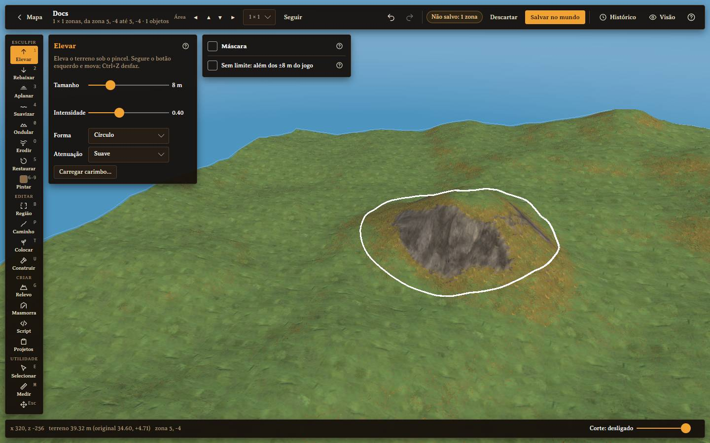
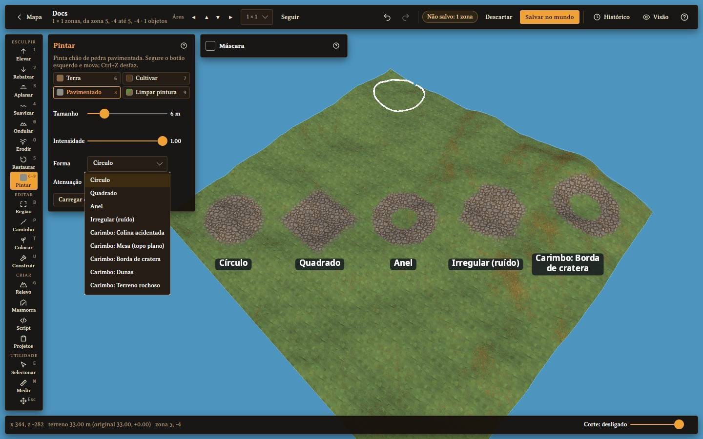
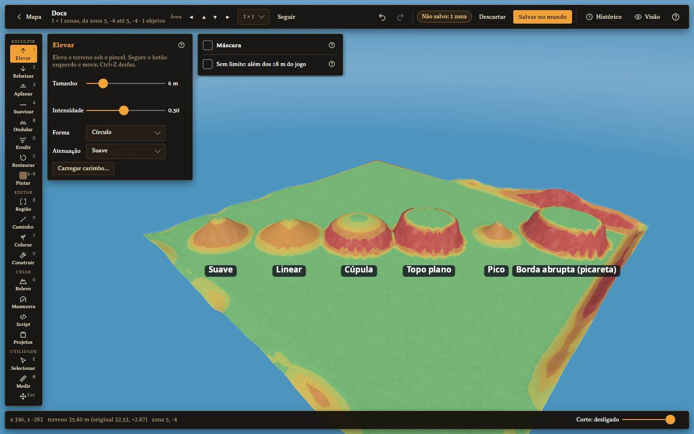
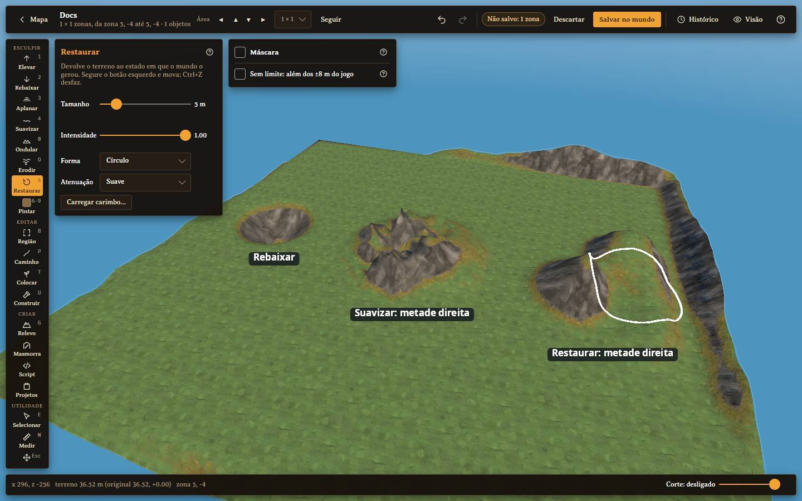
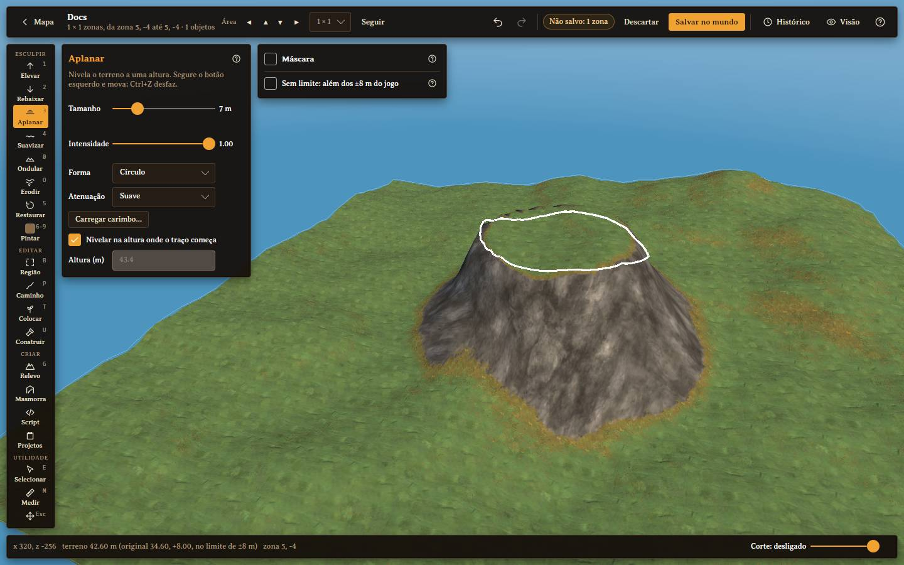
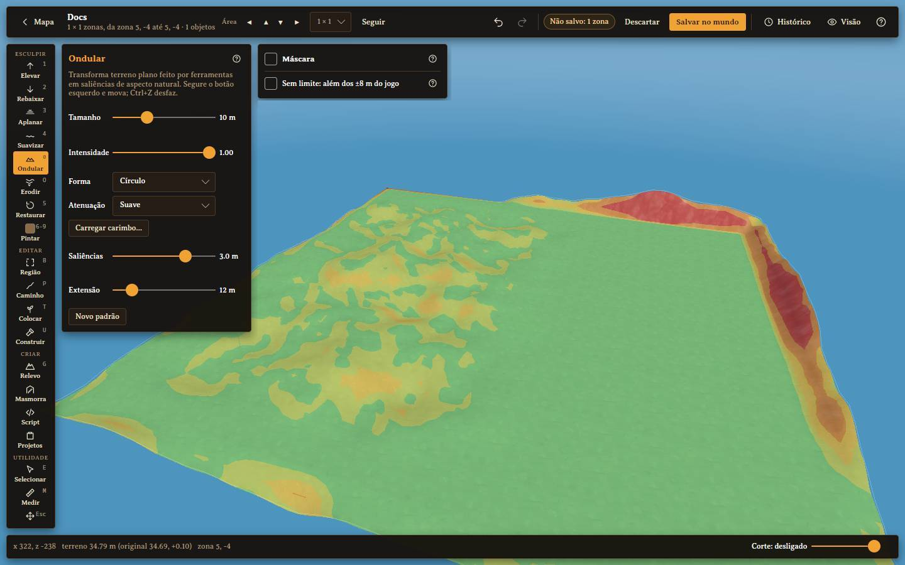
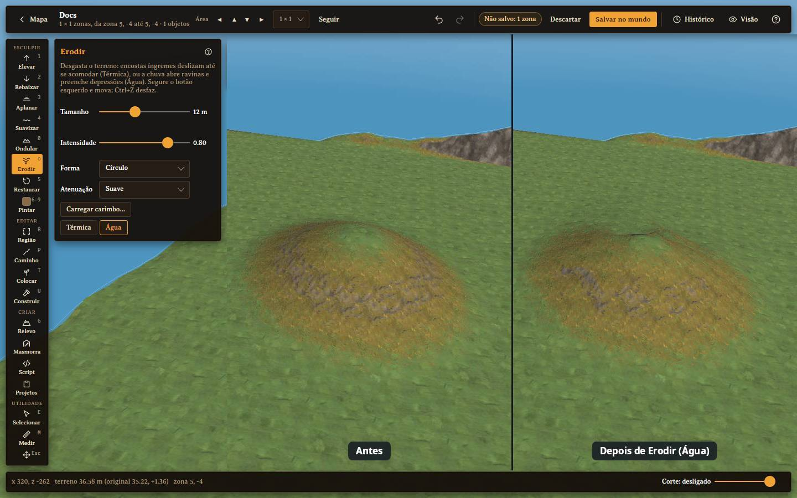
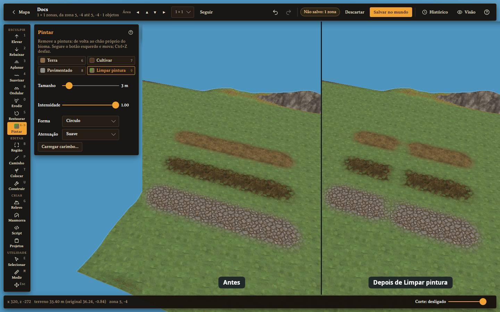
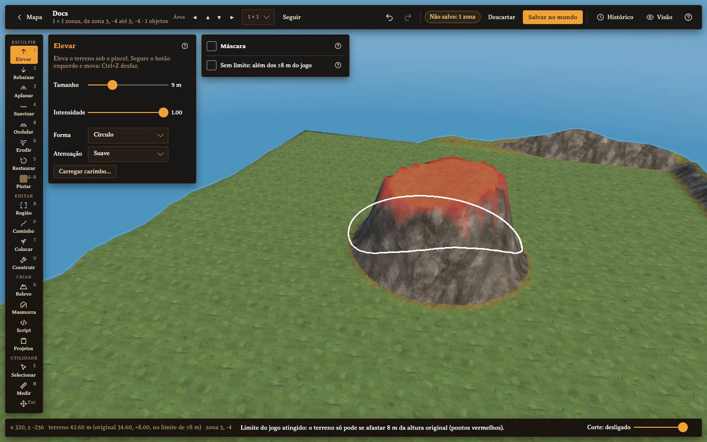
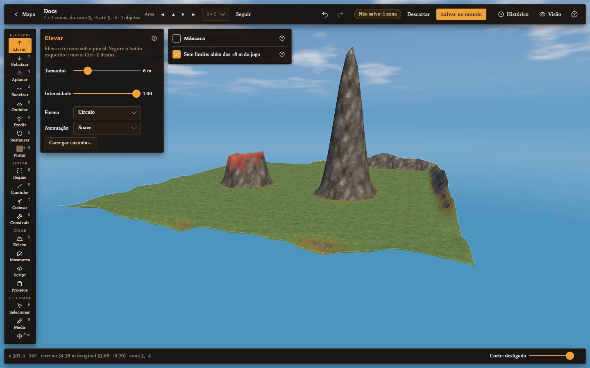

<!-- source: 9d7cf01c -->
# Esculpir e pintar

Eleve, rebaixe, nivele, suavize e pinte o terreno com um pincel que você segura e arrasta, como a enxada, a picareta e o
cultivador do jogo, só que mais rápido e maior.

**Onde:** barra de ferramentas, seção **ESCULPIR** · **Teclas:** `1` a `9`, `0`, `O` · **Funciona em:** mundos salvos,
ao vivo

*Um monte feito com três traços de Elevar. O anel branco no topo dele é o pincel; o painel à esquerda tem as
configurações dele.*

Toda alteração segue as próprias regras do jogo, então o mundo carrega no jogo de cada jogador, inclusive nos consoles,
sem nenhum mod. Cada traço é um passo de desfazer (`Ctrl+Z`).

## Como usar

1. Na barra de ferramentas, clique num pincel em **ESCULPIR**, ou pressione a tecla dele (veja [Atalhos](#atalhos)).
   Para pintar, clique em **Pintar** e escolha a pintura no painel (veja [Pincel Pintar](#pincel-pintar)).
2. No painel, defina **Tamanho** e **Intensidade**. `[` e `]` mudam o tamanho enquanto você trabalha.
3. Segure o botão esquerdo do mouse sobre o terreno e mova. O pincel continua trabalhando enquanto o botão está
   pressionado, então ficar parado trabalha o mesmo lugar cada vez mais.
4. Solte. O traço inteiro é um passo de desfazer, com o nome do pincel ("Elevar").
5. Para manter a alteração, use **Salvar no mundo** (ou **Aplicar ao vivo** no [modo ao vivo](live-mode.md)). Até lá,
   ela fica [pendente](concepts/saving-and-history.md#alterações-pendentes).

O anel no terreno acompanha os morros sob ele e mostra a forma do pincel: um quadrado ou um carimbo mostra o contorno
girado, a forma Anel um segundo contorno, interno.

## Configurações

O painel mostra as configurações que todos os pincéis compartilham e depois as próprias do pincel escolhido. Forma e
Atenuação são lembradas.

| Configuração | O que faz |
|---|---|
| **Tamanho** | O raio do pincel, de 1 a 30 m (para um quadrado, metade do lado). Padrão 6 m. |
| **Intensidade** | A rapidez com que o pincel trabalha, de 0.05 a 1 (padrão 0.40). |
| **Forma** | **Círculo**, **Quadrado**, **Anel**, **Irregular (ruído)** ou uma imagem (**Carimbo: …**, veja [Carimbos](#carimbos)). |
| **Atenuação** | Como o efeito diminui do meio até a borda (abaixo). Oculta para os carimbos: uma imagem tem a própria atenuação. |
| **Girar** | Só **Quadrado** e carimbos: gira o pincel, de -180° a 180°. |
| **Carregar carimbo…** / **Esquecer carimbo** | Acrescenta uma imagem como forma de pincel, ou remove uma que você acrescentou (veja [Carimbos](#carimbos)). |
| Configurações de Aplanar, Ondular, Erodir | Mostradas só para esse pincel (veja [Pincéis de esculpir](#pincéis-de-esculpir)). |

Duas configurações valem para todas as ferramentas de terreno, não só para os pincéis, por isso ficam no cartão
**Máscara** ao lado do painel: a própria [Máscara](masks.md), e **Sem limite: além dos ±8 m do jogo** embaixo dela (veja
[Sem limite](#sem-limite)).

### Formas

| Forma | O que cobre |
|---|---|
| **Círculo** | Um pincel redondo. |
| **Quadrado** | Um quadrado da largura do pincel. Ele gira com **Girar**. |
| **Anel** | Só uma faixa: nada dentro de 40% do tamanho, intensidade total a 70%, nada na borda. Para bordas de cratera, fossos e muros de terra. |
| **Irregular (ruído)** | Um pincel redondo cuja borda avança e recua até um terço do tamanho. O padrão é fixo no mundo, então dois traços sobre o mesmo lugar têm a mesma borda. |

*Uma pincelada de pintura Pavimentado por forma, cada uma identificada: Círculo, Quadrado, Anel, Irregular (ruído) e o
carimbo Borda de cratera. A lista Forma está aberta no painel.*

### Atenuações

| Atenuação | Como diminui | Bom para |
|---|---|---|
| **Suave** (padrão) | Uma curva em S: suave no meio e na borda. | A maior parte do trabalho. |
| **Linear** | Por igual do meio até a borda. | Cones, encostas regulares. |
| **Cúpula** | Continua forte até longe, depois cai rápido perto da borda. | Morros redondos de pé íngreme. |
| **Topo plano** | Intensidade total nos 80% internos, diminuindo só no quinto externo. | Bases, terraços, morros de topo plano. |
| **Pico** | Forte só perto do meio. | Agulhas e fossos. |
| **Borda abrupta (picareta)** | Intensidade total até a borda, nada além dela. | Paredes íngremes e cortes retos. |

*O mesmo traço de Elevar com cada atenuação, identificadas: Suave, Linear, Cúpula, Topo plano, Pico, Borda abrupta
(picareta). As cores de declive estão ligadas: quanto mais íngreme a encosta, mais vermelha.*

## Pincéis de esculpir

| Pincel (rótulo na barra) | Tecla | O que faz |
|---|---|---|
| **Elevar** | `1` | Ergue o terreno enquanto você segura o botão. |
| **Rebaixar** | `2` | Cava o terreno para baixo. |
| **Aplanar** | `3` | Nivela o terreno numa única altura: o terreno mais baixo é elevado, o mais alto é cortado. |
| **Suavizar** | `4` | Suaviza saliências e bordas vivas. Passe de novo sobre um lugar para mais. |
| **Ondular** | `0` | Transforma terreno plano, feito com ferramentas, em saliências de aspecto natural. |
| **Erodir** | `O` | Desgasta o terreno: as encostas íngremes deslizam para baixo, ou a chuva cava ravinas. |
| **Restaurar** | `5` | Devolve o terreno ao que o mundo gerou, e remove a pintura. |

*Identificados da esquerda: um buraco cavado com Rebaixar; um monte irregular cuja metade direita Suavizar deixou lisa;
um monte erguido cuja metade direita Restaurar devolveu ao terreno gerado, com o anel do pincel sobre ele.*

Aplanar, Suavizar, Ondular e Restaurar nunca passam do ponto: a cada momento eles movem o terreno uma parte do caminho
até o objetivo, então segurar por mais tempo só o aproxima.

As ferramentas [Região](area.md) e [Caminho](path.md) têm as mesmas ações com os mesmos nomes, aplicadas de uma vez a
uma seleção ou ao longo de uma linha em vez de sob um pincel que você segura. (Região lista Restaurar como **Voltar ao
terreno gerado**, no grupo **Recuperar**.) Elas alteram o terreno do mesmo jeito: um único **Suavizar** ali move cada
ponto para a média do terreno num raio de 3 m, mais ou menos o que segurar o pincel Suavizar sobre um lugar por um ou
dois segundos faz na intensidade padrão.

### Aplanar

*Um único traço de Aplanar começado no topo do monte o nivelou. **Nivelar na altura onde o traço começa** está ligado,
então **Altura (m)** fica acinzentado e mostra a altura que tomou: 43.4 m.*

| Configuração | O que faz |
|---|---|
| **Nivelar na altura onde o traço começa** | Ligado (padrão): o terreno onde você pressiona o botão define a altura do traço inteiro. **Altura (m)** a mostra. |
| **Altura (m)** | Usada quando a opção acima está desligada: todo traço nivela nessa altura. |

Para nivelar numa altura que você escolhe, use `Alt`+clique no terreno com qualquer pincel: o editor passa para
**Aplanar**, desliga a opção acima e põe essa altura em **Altura (m)**. Use isso para fazer várias bases coincidirem,
ou para nivelar um terreno na altura de uma porta que você já construiu.

### Ondular

| Configuração | O que faz |
|---|---|
| **Saliências** | A altura das saliências, de 0.2 a 4 m (padrão 1.2 m). |
| **Extensão** | A largura delas, de 4 a 60 m (padrão 16 m): valores pequenos dão terreno acidentado, valores grandes, ondulações suaves. |
| **Novo padrão** | Um novo padrão aleatório de saliências para o próximo Ondular (deste pincel, da ferramenta Região ou da ferramenta Caminho) e para os caminhos com Aspecto natural. A borda da forma **Irregular (ruído)** e o ruído das fórmulas de [Relevo](landform.md#escrever-uma-fórmula) vêm do mesmo padrão, então também mudam. |

Um segundo traço sobre o mesmo lugar não acumula mais saliências. O padrão é fixo no mundo, então traços vizinhos se
unem sem emendas. **Ondular** e **Aspecto natural** da ferramenta [Caminho](path.md) e **Ondular** da ferramenta
[Região](area.md) usam as mesmas configurações e o mesmo padrão, e os mostram nos próprios painéis: um valor definido
num deles fica definido nos três.

*Terreno nivelado com as cores de declive ligadas. A metade esquerda foi ondulada (Saliências 3 m, Tamanho das
saliências 12 m): as saliências aparecem como manchas amarelas. A metade direita continua plana e verde uniforme.*

### Erodir

| Configuração | O que faz |
|---|---|
| **Térmica** | O terreno mais íngreme que o **Ângulo de repouso** desliza para os vizinhos mais baixos até se assentar: taludes de detritos sob os penhascos, paredes feitas com ferramentas amaciadas. O terreno só é movido, nunca perdido. |
| **Água** | Chuva: as gotas caem sob o pincel, escorrem morro abaixo, arrastam terreno onde correm rápido e o largam onde desaceleram. Muitas gotas formam ravinas, leques de material no pé das encostas e fundos de vale mais lisos. **Intensidade** define quantas gotas caem. |
| **Ângulo de repouso** | Só **Térmica**: a encosta mais íngreme que fica parada, de 10° a 60° (padrão 33°). Valores menores aplainam mais. |

O material que desliza ou é levado para fora do pincel pode cair logo fora dele. **Erodir** das ferramentas
[Região](area.md) e [Caminho](path.md) faz os dois tipos de uma vez, sobre uma seleção inteira ou ao longo de uma
linha, com este **Ângulo de repouso** (os painéis delas também o mostram).

*O mesmo monte da mesma câmera. À esquerda: como foi erguido. À direita: depois de dois segundos de Erodir (Água): a
chuva desgastou o topo e riscou os flancos com pequenas ravinas.*

### Restaurar

**Restaurar** tira as suas edições um pouco a cada momento, até o terreno ficar como o mundo o gerou. Ele também desfaz
o terreno elevado ou cavado com [Sem limite](#sem-limite), salvo ou não: o próximo salvamento retira os discos de terreno
de que ele não precisa mais. Ele só remove a pintura na parte interna do pincel, para que a borda da pintura fique
limpa.

## Pincel Pintar

**Pintar**, o último botão da seção **ESCULPIR** da barra de ferramentas, é um único pincel para as quatro pinturas. O
painel dele as mostra como quatro amostras: clique numa para pintar com ela. A amostra escolhida fica contornada, e o
botão da barra assume a cor dela.

| Pintura | Tecla | O que faz |
|---|---|---|
| **Terra** | `6` | Terra nua, como um caminho pisado. |
| **Cultivar** | `7` | Solo cultivado, como o que o cultivador faz. No jogo, só se podem plantar cultivos nele. |
| **Pavimentado** | `8` | Terreno de pedra pavimentada. |
| **Limpar pintura** | `9` | Pinta o terreno comum do bioma. |

Cada tecla escolhe o pincel Pintar com essa pintura, a partir de qualquer ferramenta. O botão da barra volta com a
pintura que você usou por último (Terra de início).

Pintar usa os mesmos Tamanho, Intensidade, Forma, Atenuação e Máscara que os pincéis de esculpir. Ele muda a aparência
do terreno e o que cresce ali, nunca a altura. Um traço leve ou a borda suave do pincel dá uma mistura; segure por mais
tempo para a cor total.

**Limpar pintura ou Restaurar?** **Limpar pintura** pinta terreno comum do bioma por cima de tudo, então também esconde
a terra que o mundo gerou ali. **Restaurar** remove a sua pintura, para que o terreno mostre de novo o que o mundo
gerou.

*À esquerda: faixas pavimentada, cultivada e de terra. À direita: as mesmas faixas depois de um traço de Limpar pintura
atravessando as três (o painel Pintar à esquerda).*

## Carimbos

Um carimbo é uma imagem usada como forma do pincel: as partes brancas agem por inteiro, as cinzentas em parte, as
pretas de jeito nenhum. Escolha um em **Forma**, onde os carimbos aparecem como **Carimbo: …**. Um carimbo cobre um
quadrado com o dobro da largura de **Tamanho** e gira com **Girar**. Ele funciona com todos os pincéis de esculpir e com
Pintar.

| Carimbo | Forma |
|---|---|
| **Colina acidentada** | Um pequeno pico de encostas acidentadas. |
| **Mesa (topo plano)** | Um topo plano com encostas íngremes, um pouco irregulares. |
| **Borda de cratera** | Um muro em anel, para crateras (rebaixe dentro dele depois) e velhas fortificações de terra. |
| **Dunas** | Cristas paralelas dentro de uma mancha redonda. |
| **Terreno rochoso** | Terreno cheio de calombos e quebrado. |

| Configuração | O que faz |
|---|---|
| **Carregar carimbo…** | Usa qualquer imagem (PNG, JPEG…) como carimbo: um mapa de altura de outra ferramenta, um logotipo, uma forma desenhada à mão. O brilho dela é a intensidade; as partes transparentes contam como preto. Ela é redimensionada para um quadrado de 128 × 128 pontos, então uma imagem larga é achatada e os detalhes finos se perdem. Ela fica guardada para a próxima vez com o nome do arquivo. |
| **Esquecer carimbo** | Remove a imagem carregada escolhida em **Forma**. Mostrado só para imagens carregadas: os carimbos embutidos ficam. |

**Para pôr uma imagem inteira no terreno com um clique**, numa altura que você define, use o tipo **Imagem** da
ferramenta [Relevo](landform.md#imagem) em vez de um pincel: ele oferece as mesmas imagens, e as que você carregar
aqui.

## Sem limite

O jogo mantém toda alteração de terreno a menos de 8 m do terreno que ele gerou. Um pincel para ali, tinge o ponto de
vermelho, e a barra de status diz "Limite do jogo atingido: o terreno só pode se afastar 8 m da altura original (pontos
vermelhos)." Veja [O limite de 8 m do jogo](concepts/ground-limits.md#o-limite-de-8-m-do-jogo).

*Elevar segurado até o terreno parar 8 m acima. Com **Marcas de limite** ligado, o topo fica tingido de vermelho; a
barra de status mostra a mensagem e a leitura do cursor termina em "no limite de ±8 m".*

**Sem limite: além dos ±8 m do jogo**, no cartão **Máscara** ao lado do painel da ferramenta (embaixo da Máscara),
deixa as ferramentas de terreno irem até 400 m do terreno gerado: penhascos, cânions, agulhas, fossos profundos. É um
único interruptor para todas as ferramentas que ele controla, e o cartão o mostra com cada uma delas: todos os pincéis
de esculpir, [Relevo](landform.md) (os tipos **Fórmula** e **Imagem**), [Caminho](path.md) e [Região](area.md)
(inclusive as importações de mapa de altura). Ele fica ligado para todas as ferramentas até você desligá-lo, e começa
desligado toda vez que o editor é iniciado. O tipo **Montanha** de Relevo e a colagem de um lugar copiado sempre passam
do limite.

> [!IMPORTANT]
> Salvar terreno de Sem limite lê a área de novo a partir do mundo e **limpa o Histórico dela**: você não pode desfazer
> nada de antes desse salvamento. Confira a forma antes de salvar.

*O mesmo traço de Elevar com Sem limite desligado (à esquerda: parado em 8 m, o topo vermelho) e ligado (à direita:
muito mais alto). O interruptor fica no cartão Máscara, marcado como para o da direita.*

Quando você salva, o terreno além de ±8 m vira discos de terreno invisíveis que o jogo de cada jogador constrói do
mesmo jeito. A mensagem do salvamento diz quantos discos foram feitos e quantas árvores e rochas foram retiradas, por
exemplo "Terreno sem limite: 312 disco(s) de terreno, 40 árvore(s)/rocha(s) retirada(s); parte do terreno está até
2.5 m fora (íngreme demais)". Como isso funciona e o que muda no jogo: [Sem limite](concepts/ground-limits.md#sem-limite).

Depois de salvar:

- As árvores, rochas, minérios, arbustos e coletáveis onde o terreno se moveu mais de 2 m somem (ficariam enterrados
  ou flutuando). As peças de construção ficam.
- O novo terreno conta como gerado: a enxada e a picareta do jogo trabalham ±8 m a partir dele. Para desfazer uma forma
  salva, use **Restaurar** nela (de volta ao terreno que o mundo gerou), ou rebaixe-a de novo com Sem limite ligado.
- As paredes muito íngremes ficam um pouco mais suaves do que foram desenhadas.
- As zonas que nenhum jogador visitou ainda mantêm o terreno antigo; a mensagem diz quantas. Visite-as no jogo antes.
- O mapa do jogo não mostra a nova forma.

## Atalhos

| Tecla ou mouse | O que faz |
|---|---|
| `1` `2` `3` `4` `0` `O` `5` | Elevar, Rebaixar, Aplanar, Suavizar, Ondular, Erodir, Restaurar. |
| `6` `7` `8` `9` | O pincel Pintar com Terra, Cultivar, Pavimentado, Limpar pintura. |
| `[` / `]` | Tamanho do pincel 1 m menor / maior. |
| Segurar o botão esquerdo e arrastar | Trabalhar o terreno. |
| `Alt`+clique | Pegar a altura dali: passa para Aplanar nessa altura. |
| `Alt`+`Shift`+clique | Ligar a [Máscara](masks.md) de 2 m abaixo a 2 m acima desse lugar (também com a ferramenta Caminho). |
| Arrastar com o botão do meio | Deslizar a visão (também enquanto um pincel está escolhido). |
| `Ctrl+Z` | Desfazer o último traço. |
| `Esc` | Sair do pincel (de volta a Visão). |

Todas as teclas do editor: [Atalhos](help/shortcuts.md).

## Dicas e limites

- **Leia o terreno sob o cursor** na barra de status: `terreno 41.20 m (original 35.00, +6.20)`. Ela acrescenta "no
  limite de ±8 m" quando o ponto está ali. O mar fica em 30 m.
- **A linha de pontos mais externa da área nunca muda**, para que a área se una ao terreno em volta. Para trabalhar
  ali, mova ou aumente a área: veja [A borda travada](concepts/areas-and-zones.md#a-borda-travada).
- **O terreno tem uma altura por metro.** Uma parede sempre ocupa cerca de um metro e o terreno não pode formar
  saliências suspensas (um mod como o Tunnelheim cava túneis de verdade: veja
  [Editar um mundo criado com Expand World, Riverheim ou Tunnelheim](guides/use-mods-worlds.md)). Uma borda desenhada de
  nordeste a sudoeste mostra um pequeno serrilhado, no jogo também.
- **As aldeias, o comerciante e as entradas de masmorras aplainam o terreno em volta deles.** As suas edições ficam por
  cima disso; ligue **Aplanamento dos locais** no painel Visão para ver onde. Veja
  [Os locais aplainam o terreno](concepts/ground-limits.md#os-locais-nivelam-o-terreno).
- **Velocidade:** Elevar e Rebaixar movem o meio do pincel cerca de 2,4 m por segundo na Intensidade padrão, 6 m por
  segundo na Intensidade 1.
- **Nada mudou?** A [Máscara](masks.md) pode deixar de fora todo o terreno sob o pincel; a barra de status diz isso.
- **Para desfazer uma alteração:** `Ctrl+Z` para o último traço, **Restaurar** para um lugar, **Descartar** para tudo o
  que não foi salvo. Veja [Desfazer alterações](guides/undo-changes.md).

## Relacionados

- [Elevar ou cavar além do limite de 8 m do jogo](guides/raise-past-the-limit.md)
- [Retirar árvores e rochas, aplanar um terreno para construir](guides/clear-an-area.md)
- [Limites do terreno](concepts/ground-limits.md)
- [Máscara](masks.md), [Relevo](landform.md)
- [Como o terreno é guardado](concepts/ground-limits.md#como-o-terreno-é-guardado), [a rapidez com que um pincel trabalha](concepts/ground-limits.md#com-que-rapidez-um-pincel-trabalha)
