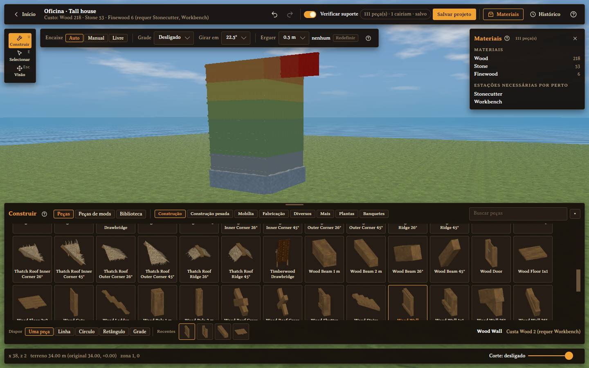
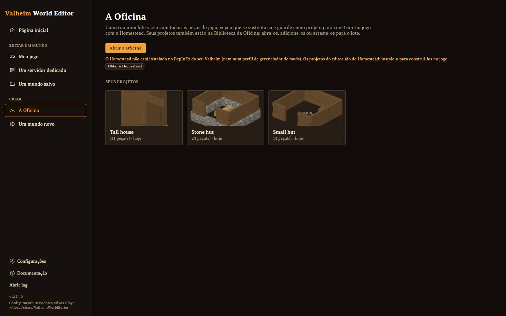
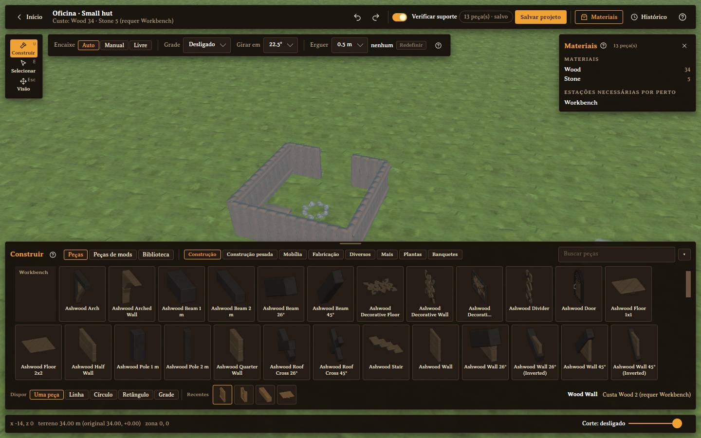
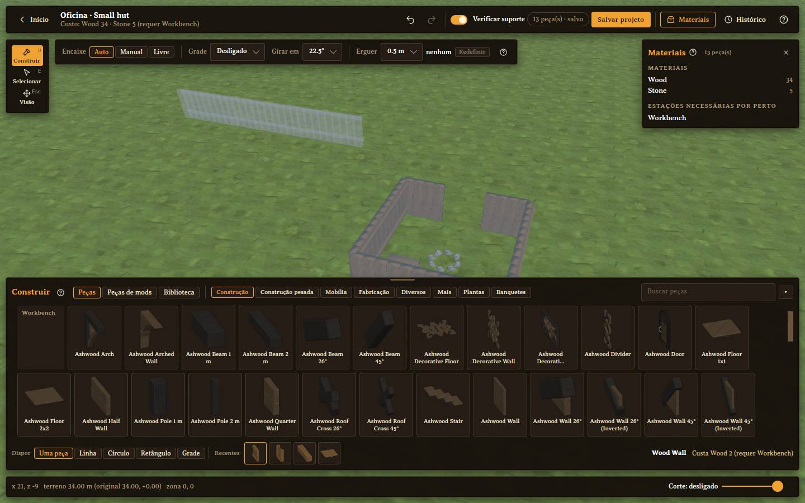
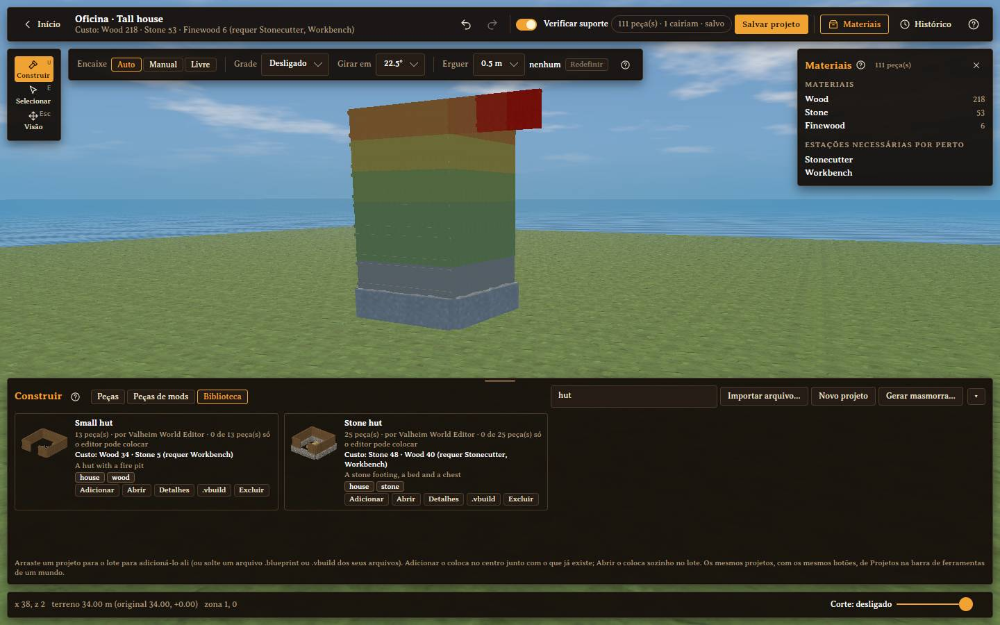
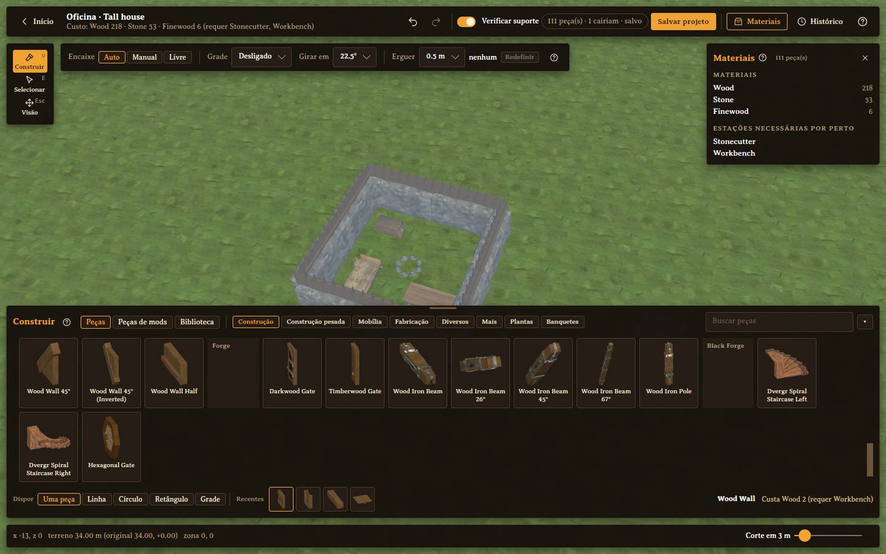
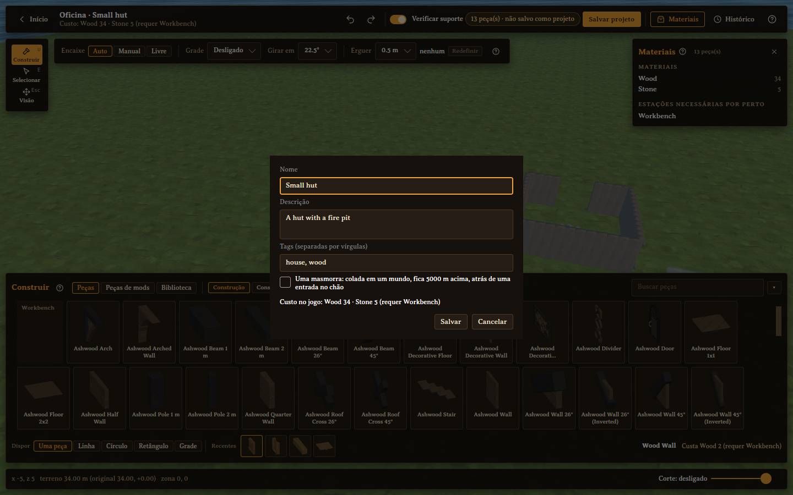
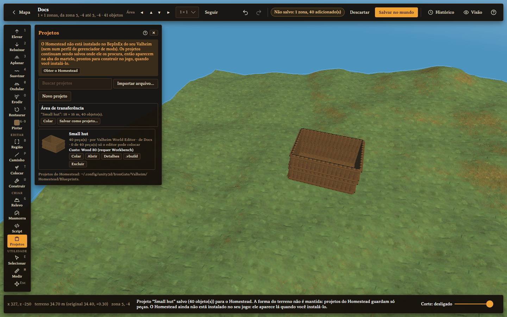

<!-- source: 820eb141 -->
# Oficina

Construa num lote vazio com todas as peças que o jogo tem, veja o que se sustentaria e quanto custa, e guarde o
resultado como projeto para construir no jogo ou colar em qualquer mundo.

**Onde:** página inicial, **A Oficina** → **Abrir a Oficina**; num mundo, **Projetos** (barra de ferramentas, seção
**CRIAR**) → **Novo projeto** · **Tecla:** nenhuma · **Funciona em:** o próprio lote da Oficina (o painel **Projetos**
funciona em mundos salvos e ao vivo)

*Uma casa alta com **Verificar suporte** ligado: a base de pedra em azul-claro, as paredes de madeira acima em verde,
depois amarelo, depois laranja perto do topo, e a saliência que avança a partir da fileira de cima em laranja, depois
vermelho. A barra superior mostra `111 peça(s) · 1 cairiam · salvo`.*

Um projeto é um arquivo do [Homestead](https://thunderstore.io/c/valheim/p/sighsorry/Homestead/), o mod de construção
dentro do jogo: o mesmo arquivo aparece na aba do martelo do Homestead, pronto para construir no jogo, e pode ser colado
num mundo pelo editor.

## Como usar

Para construir uma cabana e guardá-la:

1. Na página inicial, clique em **A Oficina** e depois em **Abrir a Oficina**. (A partir de um mundo: **Projetos** na
   barra de ferramentas e depois **Novo projeto**; um mundo com alterações não salvas pergunta antes.)
2. No painel **Construir**, ao longo da parte de baixo, escolha uma peça na aba **Peças**.
3. Clique no lote para colocá-la. Ela se encaixa nas peças que já estão ali, como com o martelo.
4. Gire a peça com `,` e `.`; erga-a com `PgUp` e `PgDn` (ou `Ctrl` + roda); segure `Alt` para posicioná-la livremente,
   de um quarto de metro em um quarto de metro. Para mover ou excluir peças, pressione `E` (Selecionar).
5. Acompanhe as cores de **Verificar suporte** e a contagem de "cairiam" na barra superior, e quanto custa no painel
   **Materiais**, à direita.
6. Clique em **Salvar projeto** (`Ctrl+S`) e dê a ele um nome, uma descrição e tags.
7. Clique em **Início** para voltar à página inicial.

Para alterar um projeto salvo, clique nele em **Seus projetos** na página inicial (ou em **Página inicial**), ou clique
em **Abrir** ao lado dele na biblioteca (o painel Projetos de um mundo, ou a aba **Biblioteca** da Oficina).

*Na página inicial, **A Oficina**: **Abrir a Oficina**, **Obter o Homestead** (ele não está instalado aqui) e três
projetos em **Seus projetos**, cada um com a sua imagem, do mais novo para o mais antigo.*

## O lote

O lote não faz parte de nenhum mundo: 3 × 3 zonas (192 m de lado) de prado plano, numa só altura. O meio dele, no nível
do chão, é a **âncora** do projeto, o ponto a partir do qual o Homestead mede cada peça.

- A barra de ferramentas tem só [Construir](build.md) (`U` ou `T`), **Selecionar** (`E`) e **Visão**. As ferramentas de
  terreno são para os mundos.
- Ao lado da barra de ferramentas, a **barra de construção**: **Encaixe**, **Grade**, **Girar em** e **Erguer** (veja
  [A barra de construção](#a-barra-de-construção)).
- Ao longo da parte de baixo, o **painel Construir**: as peças, as peças dos seus mods e os seus projetos (veja
  [O painel Construir](#o-painel-construir)).
- À direita, o painel **Materiais**: quanto a construção custa (veja [Materiais](#materiais)).
- Não há Máscara, painel Visão nem bordas de zona, e as construções são desenhadas sólidas.
- A barra superior tem **Início**, desfazer e refazer, o interruptor **Verificar suporte**, **Salvar projeto**,
  **Materiais** e **Histórico**. Ela conta as peças, diz quantas cairiam e se a construção está salva
  (`12 peça(s) · 2 cairiam · não salvo como projeto`).
- Sob o título: quanto a construção custa no jogo, em resumo; uma linha longa termina em "…".
- A barra de status tem o controle deslizante **Corte**, como num mundo (veja [Corte](#corte)).

Não há **Descartar**: desfaça, ou abra o projeto de novo. Sair com uma construção não salva como projeto (**Início**,
abrir outro, fechar o editor) pergunta antes.

*A Oficina com uma pequena cabana no lote: a barra de ferramentas com só **Construir**, **Selecionar** e **Visão**, a
barra de construção ao lado; a barra superior com **Início**, **Verificar suporte**, a contagem de peças, **Salvar
projeto** e **Materiais**; o painel **Materiais** à direita; o painel Construir ao longo da parte de baixo na aba
**Construção**, com as quatro últimas peças escolhidas em **Recentes** e a parede de madeira selecionada.*

## Configurações

### O painel Construir

O painel **Construir** (o da ferramenta [Construir](build.md), o mesmo num mundo) ocupa a parte de baixo da janela, e
o lote fica com o resto. A fileira de cima tem três abas, **Peças**, **Peças de mods** e **Biblioteca**, e depois as
opções da própria aba e a busca dela. Arraste a borda de cima para cima ou para baixo para deixá-lo mais alto ou mais
baixo, e clique em **▾** na ponta direita para recolhê-lo até essa fileira (**▴** o abre de novo). Ambos são mantidos
para a próxima vez.

**Peças** lista tudo o que os jogadores constroem, cada uma com uma imagem do modelo do jogo:

| Aba | O que contém |
|---|---|
| **Construção**, **Construção pesada**, **Mobília**, **Fabricação**, **Diversos**, **Mais** | As próprias abas do martelo, na ordem do jogo. |
| **Plantas** | As peças do cultivador: plantações, mudas e flores. |
| **Banquetes** | As peças da bandeja de servir. |

Em cada aba, as peças são agrupadas pela estação de fabricação de que precisam, na ordem em que os jogadores as obtêm
(nenhuma, bancada, cortador de pedra, forja, mesa de artesão, forja negra, mesa galdr), e depois pelo nome. Cada grupo
começa com o nome da estação.

**Peças de mods** lista as peças que os seus mods acrescentam, um mod por vez: escolha o mod na lista do lado esquerdo
(com o número de peças dele). Os títulos são os próprios grupos do mod (a estação de fabricação dele, para uma peça que
não tem grupo). As peças vêm de dois lugares:

- **Os mods instalados neste computador**, nas pastas do BepInEx que o editor conhece (a do seu Valheim, as dos perfis
  do seu gerenciador de mods, as adicionadas em Configurações). A Oficina lê os arquivos deles na primeira vez que
  abre, sem o jogo, e de novo só quando eles mudam; **Reler mods** os lê de novo agora. Os nomes e as imagens vêm dos
  próprios arquivos dos mods. Uma peça lida assim se encaixa pelos próprios pontos de encaixe, mas o custo dela não é
  conhecido (os mods o definem quando o jogo inicia): ela mostra `Custo desconhecido`, e [Materiais](#materiais) a lista
  em **Sem receita conhecida**.
- **Um jogo ao vivo** executando os mods com o WorldEditorBridge (veja [Modo ao vivo](live-mode.md#jogos-com-mods)): ele
  informa os nomes e custos reais, que valem mais do que o que os arquivos dizem.

Os mods que criam as peças em código (Railroads) são listados pelo [complemento](modding.md) deles, que as nomeia.

<!-- picture: workshop-mod-pieces.jpg, the Mod pieces tab with Moonforged Build Pieces and Railroads installed: the two mods down its side, Moonforged's walls with their pictures, two of them snapped together on the plot -->

| Configuração | O que faz |
|---|---|
| **Buscar peças** | Encontra peças em todas as abas, inclusive as dos mods, pelo nome ou pelo prefab (`stone floor`, `woodwall`). Todas as palavras precisam corresponder. |
| O bloco de uma peça | Escolhe a peça. O nome e o custo dela aparecem no rodapé do painel (`Wood Wall · Custa Wood 2 (requer Workbench)`), com o nome do mod para a peça de um mod. Aponte para um bloco para ver o nome de prefab dele. |
| **Recentes** | As últimas 12 peças que você escolheu, da mais nova para a mais antiga, no rodapé do painel: clique numa para escolhê-la de novo. Mantidas para a próxima vez. |

Cada clique coloca uma peça. Sem nenhuma peça escolhida, Construir escolhe a parede de madeira. **Dispor**, no rodapé
do painel, põe a peça ao longo de uma linha, em volta de um círculo ou de um retângulo, ou numa grade: veja
[Dispor peças ao longo de uma linha ou numa grade](build.md#dispor-peças-ao-longo-de-uma-linha-ou-numa-grade).

**Atalhos** enquanto **Construir** está ativo:

| Mouse | O que faz |
|---|---|
| Arrastar | Dispõe uma fileira da peça a partir de onde você pressionou: cópias borda com borda, separadas pelo comprimento de uma peça (a largura de uma parede, o lado de um piso), ao longo do lado da peça mais próximo do arraste, na altura da primeira, até 64. Uma parede só forma fileira ao longo da largura dela: gire-a antes para formar a fileira no outro sentido. Solte para colocar a fileira, num só passo de desfazer. |
| `Shift` + clique direito | Retira a peça sob o ponteiro (`Ctrl+Z` a traz de volta). Um arraste com o botão direito continua girando a visão, e `Shift` + arraste com o botão direito continua deslizando-a. |
| Clique do meio | Constrói com o tipo da peça sob o ponteiro, como um conta-gotas: ela é escolhida no painel e fica em primeiro em **Recentes**. Um arraste com o botão do meio continua deslizando a visão. |

*Um arraste a partir da esquerda: uma fileira de paredes de madeira disposta ponta a ponta, transparente até o botão
ser solto.*

### A barra de construção

A barra ao lado da barra de ferramentas define como a peça é colocada: **Encaixe** (**Auto**, **Manual**, **Livre**),
**Grade**, **Girar em** e **Erguer**. É a mesma barra num mundo, onde Selecionar e Colar a compartilham e ela também tem
**Construído por**: veja [A barra de construção](build.md#a-barra-de-construção).

### Aba Biblioteca

*A aba **Biblioteca** buscando "hut": a busca, **Importar arquivo…**, **Novo projeto** e **Gerar masmorra…** na fileira
de cima do painel, e depois as duas cabanas lado a lado (a casa alta fica de fora), cada uma com a imagem, as peças, o
custo, a descrição, as tags e os botões **Adicionar**, **Abrir**, **Detalhes**, **.vbuild** e **Excluir**.*

A Biblioteca é a mesma lista que o [painel Projetos](#painel-projetos) de um mundo: os mesmos projetos, mostrados da
mesma forma, com os mesmos botões. Só o jeito de colocar um muda: o lote o recebe com **Adicionar** (ou arrastando), um
mundo com **Colar**.

| Configuração | O que faz |
|---|---|
| **Buscar projetos** | Mantém os projetos que têm todas as palavras que você digita no nome, no autor, na descrição ou nas tags. |
| **Adicionar** | Adiciona o projeto ao lote, no meio dele. Um passo de desfazer. |
| Arrastar um projeto para o lote | Adiciona o projeto onde você o solta. |
| **Abrir** | O projeto sozinho no lote, para alterá-lo (pergunta antes quando o lote não está salvo). **Salvar projeto** o grava de volta. |
| **Detalhes** | Altera o nome, a descrição, as tags e o interruptor de masmorra. Um nome novo renomeia o arquivo e a imagem quando esse nome está livre. Para o projeto do lote, a Oficina adota o novo nome, e **Salvar projeto** grava esse arquivo. |
| **.vbuild** | Grava os objetos dele como um arquivo `.vbuild` na pasta `export` da pasta de projetos do editor, e diz onde. |
| **Excluir** | Remove o arquivo e a imagem dele, depois de perguntar. O Homestead também o perde. Excluir o projeto do lote deixa a construção ali, marcada como *não salvo como projeto*. |
| Soltar arquivos no lote | Arquivos `.blueprint` e `.vbuild` do seu gerenciador de arquivos são importados e depois adicionados onde caem. Soltos num mundo, eles só são importados. |
| **Importar arquivo…** | Importa um arquivo `.blueprint` (Homestead, PlanBuild) ou `.vbuild` para a biblioteca. |
| **Novo projeto** | Um lote vazio (pergunta antes quando o lote não está salvo). |
| **Gerar masmorra…** | Mostra o gerador de masmorras (só peças de construção; veja [Masmorra](dungeons.md)). **Abrir no lote** põe a masmorra ali sozinha, **Adicionar ao lote** a adiciona no meio; de qualquer forma, o projeto dela fica guardado na biblioteca, sem uma imagem `.png` ao lado. **← Biblioteca** volta. |

Um projeto aberto ou adicionado mantém a forma exata, movido como um todo para que a peça de construção mais baixa
fique sobre o lote. Um projeto do Homestead mantém a âncora no meio do lote; os outros arquivos são centralizados.
Salvá-lo de novo mantém a altura da âncora, para que a construção fique como antes quando o Homestead a constrói. As
peças de mods que você não tem ficam de fora, e a mensagem as lista. Um projeto aberto de fora da pasta do Homestead
pergunta antes de sobrescrever um projeto da biblioteca com o mesmo nome.

Os projetos de versões do editor anteriores ao Homestead são listados depois dos outros, em **Projetos antigos do
editor**: **Para o Homestead** guarda um deles como projeto do Homestead, que então pode ser adicionado ou aberto.

### Materiais

O painel **Materiais**, à direita, lista quanto a construção do lote custa no jogo e acompanha cada alteração:

| Parte | O que lista |
|---|---|
| **Materiais** | Cada material com a quantidade, do maior para o menor. |
| **Estações necessárias por perto** | As estações de fabricação que precisam estar perto para construí-la. |
| **Sem receita conhecida** | Peças para as quais o editor não conhece receita (de um mod, antes de um jogo ao vivo informá-la), por mod. Elas não são contadas. |
| **Só o editor pode colocar** | Estátuas, adereços, navios e criaturas: o martelo do Homestead os ignora, então não são contados. |

**Materiais** na barra superior (ou o **✕** do painel) o fecha e o abre; a Oficina lembra a escolha.

### Verificar suporte

**Verificar suporte** (ligado por padrão) tinge cada peça de construção com as cores que o modo de construção do jogo
dá ao suporte dela:

| Cor | Significado |
|---|---|
| **Azul-claro** | Suporte total: está apoiada no terreno. |
| **Verde** | Firme. |
| **Amarelo**, **laranja** | Mais fraca. |
| **Vermelho** | Prestes a quebrar: no jogo, cai assim que um jogador chega perto. |

A barra superior diz quantas peças cairiam, e **Salvar projeto** pergunta antes quando algumas cairiam (também com o
interruptor desligado: ele só oculta as cores). A pedra sobe alto, mas não consegue avançar para o lado; a madeira
avança mais, mas não sobe tão alto. Veja [A verificação de suporte](concepts/objects.md#a-verificação-de-suporte).

### Corte

*A mesma casa com **Corte em 3 m**, vista de cima: tudo acima de 3 m fica oculto, então você vê dentro do térreo, com a
fogueira, a cama, a mesa e o baú.*

O controle deslizante **Corte**, na barra de status, oculta tudo acima de uma altura, de 0 a 39 m acima do lote, e o
cursor atravessa o que está oculto, para que você possa construir por dentro. Na ponta direita, ele fica desligado
(`Corte: desligado`). É o mesmo controle deslizante que num mundo e numa masmorra, onde os metros contam a partir do
terreno ou do piso da masmorra: veja [Corte](editor-basics.md#corte).

## Salvar um projeto

**Salvar projeto** (`Ctrl+S`) pede:

| Campo | O que é |
|---|---|
| **Nome** | O Homestead o lista com este nome; o arquivo leva esse nome. |
| **Descrição** | Algumas palavras, mostradas na biblioteca e para as pessoas com quem você o compartilha. As quebras de linha viram espaços. |
| **Tags (separadas por vírgulas)** | Palavras para encontrá-lo: `house, viking, stone`. Até 12, sem repetições. |
| **Uma masmorra: colada em um mundo, fica 5000 m acima, atrás de uma entrada no chão** | Faz dele um projeto de masmorra: veja [Masmorra](dungeons.md). |

A caixa de diálogo mostra o **Custo no jogo**. Salvar o projeto que você abriu o sobrescreve; outro nome cria um novo,
e só substitui um com esse nome depois de perguntar. Uma imagem é salva ao lado do arquivo (um `.png`, a construção
vista de cima em ângulo, sobre fundo transparente), que o Homestead usa como ícone. Ela é desenhada com os modelos do
jogo quando o editor consegue lê-los; senão, com a forma de cada peça na cor do material dela. Um projeto feito em
outro lugar sem imagem ganha uma desenhada na biblioteca, só na memória.

*Salvando a cabana: **Nome** "Small hut", **Descrição** "A hut with a fire pit", **Tags** "house, wood", **Uma
masmorra** desligado, e a linha **Custo no jogo** acima de **Salvar**.*

O que é guardado:

- **Tudo o que está sobre o lote**, não o terreno do lote. O lote começa vazio, então tudo isso é seu: as peças que você
  construiu e o que quer que um projeto aberto ou adicionado tenha trazido (árvores, rochas, criaturas). Precisa haver
  pelo menos uma peça de construção.
- **O que os objetos guardam**: o conteúdo de um baú, o texto de uma placa, o item de um suporte de itens, as estrelas
  de uma criatura. Selecione um objeto e pressione `I` para ver ou alterar isso: veja [Inspetor](select.md).
- **Se é uma ruína**: peças sem construtor, como as ruínas do jogo e as masmorras geradas. Nenhum construtor é gravado
  para o resto: quem o constrói no jogo se torna o construtor dele.
- **Peças só do editor**: estátuas, adereços, navios e criaturas. O martelo do Homestead as ignora; colar pelo editor
  as coloca. A biblioteca as conta (`2 de 40 peça(s) só o editor pode colocar`), e o custo as deixa de fora.

## Painel Projetos

*O painel **Projetos** num mundo: a faixa do Homestead, **Buscar projetos** e **Importar arquivo…**, **Novo projeto**, a
**Cópia** com **Colar** e **Salvar como projeto…**, e depois uma cabana salva com a imagem, as peças, o
custo e os botões **Colar**, **Abrir**, **Detalhes**, **.vbuild** e **Excluir**.*

Num mundo, **Projetos** na barra de ferramentas (ou **Projetos…** no painel Região) abre a biblioteca ao lado da barra
de ferramentas; **✕** volta para Visão. Uma faixa diz se o Homestead está instalado, com a versão dele, ou oferece
**Obter o Homestead**. Cada projeto mostra a imagem, as peças, o autor, o mundo de onde veio, o custo, a descrição e as
tags. **Buscar projetos** procura no nome, no autor, na descrição e nas tags. É a mesma lista, com os mesmos botões, que
a [aba Biblioteca](#aba-biblioteca) da Oficina; um projeto sem imagem também ganha uma desenhada aqui.

| Botão | O que faz |
|---|---|
| **Colar** | Fecha o painel e começa a colá-lo na área aberta (veja [Copiar e colar](area.md#copiar-e-colar)). Os tipos que este mundo não consegue criar ficam de fora e são listados. Um projeto de masmorra vai para o alto, atrás de uma entrada. |
| **Abrir** | Abre-o na Oficina, sozinho no lote, para alterá-lo. |
| **Detalhes** | Altera o nome, a descrição, as tags e o interruptor de masmorra. Um nome novo renomeia o arquivo e a imagem quando esse nome está livre. |
| **.vbuild** | Grava os objetos dele (não o terreno) como um arquivo `.vbuild` (BuildShare e ferramentas mais antigas) na pasta `export` da pasta de projetos do editor, e diz onde. |
| **Excluir** | Remove o arquivo e a imagem dele, depois de perguntar. O Homestead também o perde. |
| **Importar arquivo…** | Importa um arquivo `.blueprint` ou `.vbuild`. |
| **Novo projeto** | Abre a Oficina num lote vazio. |

A linha **Cópia**, acima dos projetos, mostra o que foi copiado por último com a ferramenta Região ou
com `Ctrl+C` em Selecionar (o tamanho e quantos objetos), ou que nada foi copiado ainda:

| Botão | O que faz |
|---|---|
| **Colar** | Cola a área de transferência, como `Ctrl+V` faz. |
| **Salvar como projeto…** | Salva os objetos da área de transferência como projeto do Homestead, com nome, descrição e tags, e se é uma masmorra (veja [Masmorras](dungeons.md)). O terreno e os construtores não são guardados. Um projeto com o mesmo nome é substituído, depois de perguntar. O mesmo que **Salvar projeto…** no painel Região. |

Os projetos de versões do editor anteriores ao Homestead ficam em **Projetos antigos do editor**, com **Colar**, **Para
o Homestead** (guarda-o como projeto do Homestead, numerado quando o nome já existe), **.vbuild** e **Excluir**. Os
projetos do Homestead não guardam terreno: a forma do terreno de uma cópia não é mantida, e a mensagem avisa.

**Para salvar um projeto a partir de um mundo**, copie algo com a ferramenta Região ou Selecionar (`Ctrl+C`), abra
**Projetos** na barra de ferramentas e clique em **Salvar como projeto…** na linha **Cópia**. Veja
[Colar um projeto num mundo](guides/paste-a-blueprint.md) para o caminho inverso.

## Arquivos de projeto

O Homestead constrói os projetos do editor no jogo, com um baú para os materiais. A página inicial e o painel Projetos
procuram `Homestead.dll` em todas as pastas `BepInEx/plugins` que o editor conhece: a do seu Valheim, o perfil do
gerenciador de mods a partir do qual o editor é executado, as pastas adicionadas em Configurações e os perfis do
r2modman e do Thunderstore Mod Manager. Os projetos são salvos onde o Homestead os procura mesmo quando ele não está
instalado, então aparecem no jogo assim que você o instala.

Os projetos ficam na pasta do Homestead dentro da pasta de salvamento do Valheim (a que já a tiver; senão, a pasta de
salvamento dos seus mundos):

- Linux: `~/.config/unity3d/IronGate/Valheim/Homestead/Blueprints`
- Windows: `%USERPROFILE%\AppData\LocalLow\IronGate\Valheim\Homestead\Blueprints`

Para compartilhar uma construção, compartilhe o arquivo `.blueprint` dela e o `.png` ao lado.

**Importar** lê arquivos `.blueprint` do Homestead e do PlanBuild (as marcas de terreno deles não são mantidas) e
arquivos `.vbuild`. O arquivo vira um projeto do Homestead com o próprio nome, numerado (`House (2)`) quando o nome já
existe. A mensagem diz quantas peças eram desconhecidas e quantas linhas não puderam ser lidas.

Um projeto do Homestead é um arquivo `.blueprint` do PlanBuild com linhas de cabeçalho (`#Name:`, `#Creator:`,
`#Description:`, `#Category:`, `#HomesteadVersion:`...) e uma linha por peça depois de `#Pieces`:
`prefab;Building;x;y;z;qx;qy;qz;qw;"";1;1;1`, a posição dela em metros a partir da âncora, o giro e a escala. O editor
acrescenta linhas próprias (`#Tags:`, `#EditorData:` para o que os objetos guardam, `#EditorRuin:1`), que o Homestead
e o PlanBuild ignoram, para que o arquivo continue sendo construído no jogo. As peças são gravadas das mais baixas para
as mais altas, com precisão de milímetro. O nome do arquivo é o nome do projeto, com os caracteres que o Windows ou o
Linux recusam trocados por `_`, no máximo 64 caracteres.

O custo vem das receitas do seu próprio Valheim: os materiais de cada peça vezes a quantidade, do maior para o menor,
com as estações que precisam estar perto (`Wood 120 · Stone 64 · Core wood 20 · … (requer Stonecutter, Workbench)`).
As peças sem receita conhecida (de mods) são listadas à parte; sem nenhuma conhecida, ele mostra
`Custo desconhecido (peças de mods?)`.

## Atalhos

| Tecla ou mouse | O que faz |
|---|---|
| `U` ou `T` | Construir. As teclas dela (girar, erguer, pontos de encaixe, fileiras, linhas) estão na página de [Construir](build.md#atalhos). |
| `E` | Selecionar: mover, girar, excluir peças (com **Encaixe** em **Manual** em Construir: o próximo ponto de encaixe). |
| `Esc` | Visão. |
| `Ctrl+S` | Salvar projeto. |
| `Ctrl+Z` | Desfazer. |
| `Ctrl+Y` ou `Ctrl+Shift+Z` | Refazer. |

Todas as teclas do editor estão em [Atalhos](help/shortcuts.md).

## Dicas e limites

- **Recuperar:** `Ctrl+Z` funciona no lote. Um projeto salvo continua na biblioteca: **Abrir** o traz de volta.
- Uma aba mostra no máximo 300 peças: use a busca para encontrar as outras.
- **O que volta.** Colados pelo editor, os objetos de um projeto guardam o que guardavam (conteúdo de baús, placas, o
  chefe). Construído no jogo com o Homestead, são só as peças: os baús vêm vazios e nenhuma criatura aparece.
- Copiar e colar são para os mundos: `Ctrl+V` não faz nada no lote, então ali `Ctrl+X` só remove as peças (`Ctrl+Z` as
  traz de volta). Para adicionar uma construção, use **Adicionar** ou arraste um projeto para dentro.
- Um projeto feito com mods que você não tem abre sem as peças deles; salvá-lo então o grava sem elas.
- As criaturas dentro de uma peça de construção são postas sobre a peça mais alta abaixo delas (a mensagem diz
  quantas). A barra superior conta as que continuam dentro de uma peça.
- A verificação de suporte deixa de fora rochas e árvores (o lote não tem nenhuma) e conta as formas de malha pela
  caixa delas.
- O Homestead confere as versões com o servidor: um servidor que o executa desconecta os jogadores que não o têm
  (jogadores de console não podem tê-lo). Os jogadores só precisam dele no próprio jogo para construir projetos.
- Para construir no terreno aberto de um mundo ou dentro de uma masmorra com o mesmo painel Construir, veja
  [Construir](build.md) e [Masmorra](dungeons.md).
- O **Claude** pode construir no lote e salvar projetos: veja [Claude](claude.md).

## Relacionados

- [Colar um projeto num mundo](guides/paste-a-blueprint.md)
- [Sua primeira construção](start/first-build.md)
- [A verificação de suporte](concepts/objects.md#a-verificação-de-suporte) · [Encaixe](concepts/objects.md#encaixe)
- [Construir](build.md) · [Masmorra](dungeons.md) · [Selecionar](select.md)
