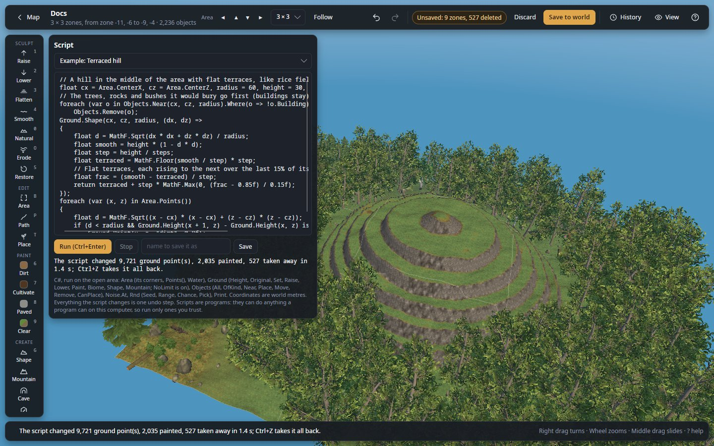
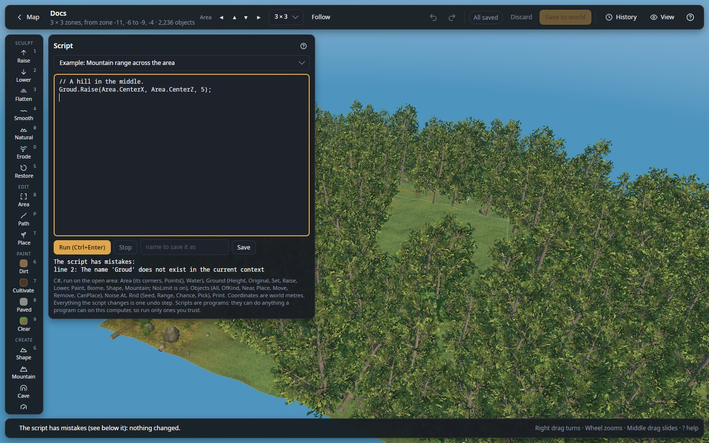

# Script

Write a few lines of C# that shape, paint and fill the open area by rule: a mountain range, a forest only on gentle
slopes, terraces, a paved square at exactly the average height.

**Where:** tool rail, CREATE section · **Key:** none (`Ctrl+Enter` runs the script) · **Works in:** saved worlds, live
(not the Workshop)


*The Terraced hill example run on a 3 × 3 area: the code in the panel, and under it the result line saying what the
script changed.*

You need nothing installed: the editor compiles the script itself. If you have never written C#, start from an
[example](#the-examples) and change its numbers, or follow [Your first script](#your-first-script).

## Use it

1. Open an area in the 3D editor. A script works on the **open area** (the zones you see).
2. Choose **Script** in the CREATE section of the tool rail.
3. Pick an example or a saved script in the list, or write your own in the code box.
4. Press **Run (Ctrl+Enter)**. The output box shows "Compiling…", "Running…", then what the script printed and
   what it changed, or what went wrong.
5. Look at the result. `Ctrl+Z` takes the whole run back in one step. Change the numbers and run again until you
   like it.
6. Press **Save to world** (or **Apply live**) to keep it, like any other change.

Nothing changes while the script runs: when it has finished, everything it changed goes into the area at once, as
one undo step. If it has mistakes, fails, is stopped or runs for 2 minutes, nothing changes.

## Your first script

This lesson raises a mound in the middle of the area, then makes it taller.

1. Open an area and choose **Script**.
2. Select all the text in the code box and replace it with:

   ```csharp
   // A mound 10 m high and 30 m across, in the middle of the area.
   Ground.Shape(Area.CenterX, Area.CenterZ, 15, (dx, dz) =>
   {
       float d = MathF.Sqrt(dx * dx + dz * dz) / 15;   // 0 in the middle, 1 at the edge
       return 10 * (1 - d);                            // metres to add
   });
   Print($"The top is at {Ground.Height(Area.CenterX, Area.CenterZ):0.0} m.");
   ```

3. Press `Ctrl+Enter`. A mound rises in the middle of the area; the output says where its top is and how many ground
   points changed.
4. Press `Ctrl+Z`. The mound is gone.
5. In the code, change `10 *` to `20 *` and press `Ctrl+Enter` again. The mound is twice as high.
6. Optional: type a name in the name box and press **Save** to find the script in the list next time.

`Ground.Shape` adds the metres your function returns to every point within 15 m of the middle; `dx` and `dz` are the
metres from the middle. Every other call is in the [API reference](#api-reference).

## Settings

| Setting | What it does |
|---|---|
| **List** | The seven examples ("Example: …"), then your saved scripts, newest first. Picking one **replaces** the text in the code box: save your own script first. An example empties the name box; a saved script puts its name there. |
| **Code box** | The script. `Tab` indents; `Ctrl+Enter` runs it. |
| **Run (Ctrl+Enter)** | Compiles and runs the script on the open area. Its changes are **one undo step**, named "Script: " and the list entry's name in History. |
| **Stop** | Stops a running script, whatever it is doing: nothing it did is kept. |
| Name box, **Save** | Saves the code under the name typed and selects it in the list. Characters a file name cannot hold become `_`. Saving over another saved script asks first. |
| **Output** | What the script printed (`Print`), then what it changed, or its mistakes or error with their line. |

Saved scripts are `<name>.csx` files in the `scripts` folder of the editor's data folder
(`~/.local/share/ValheimWorldEditor/scripts` on Linux, `%LOCALAPPDATA%\ValheimWorldEditor\scripts` on Windows,
`~/Library/Application Support/ValheimWorldEditor/scripts` on macOS). Edit them in any text editor, or share them: a
`.csx` file put there shows in the list when the editor starts again, or after you save a script.

## The examples

Each example is a whole script, ready to run on any open area. Read them to see how the API is used.

| Example | What it does |
|---|---|
| **Mountain range across the area** | Four Lone peak mountains in a line from the south-west to the north-east, each 35 to 60 m high. `Rnd.Seed = 7`, so it is the same range each run. Saving turns them into ground discs (past the game's 8 m limit). |
| **Terraced hill** | A hill 30 m high and 60 m in radius, cut into six flat terraces like rice fields. The trees, rocks and bushes it would bury are taken away first (buildings stay); the steep steps are painted dirt. |
| **Canyon with a river** | A winding canyon 18 m wide from west to east, dug to 3 m below sea level so water fills it, fading out over the last 30 m at the area's edges. |
| **Scatter boulders** | Big boulders (`rock4_forest`, `rock4_coast`, `rock4_heath`) every 6 m where the noise is high, more on slopes, each turned and sized at random. Prints how many. |
| **Ring of trees** | A ring of 36 beeches 40 m from the middle; the trees inside the ring are taken away. |
| **Flat paved base** | A 40 × 40 m square levelled to its own average height and paved, with a smooth 10 m slope to the ground around it. Keeps within the 8 m limit (`Ground.NoLimit = false`). Prints the height. |
| **Noise landscape** | Rolling land over the whole area: hills and valleys up to 25 m up or down with smaller bumps on top, fading back to the ground as it was over the last 40 m at the edges. |

## How a script sees the world

- **Plain C#.** A script is a list of statements run from top to bottom. It can declare variables, loops, functions
  and classes, and use .NET (`MathF`, `System.Linq`…). `using System`, `System.Linq` and
  `System.Collections.Generic` are already there.
- **World metres.** Every position is in metres: **x** east, **z** north, the same numbers as the status bar and the
  game's `pos` command. Heights are metres above the world's zero; the sea is at `Area.Water` (30 m).
- **One point per metre.** `Ground.Set(x, z, …)` changes the point nearest to (x, z); `Ground.Height` reads smoothly
  between points, as the ground is drawn.
- **Its own changes.** A script sees what it changed so far (raise a point, then `Ground.Height` gives the new
  height), but `Objects.All` stays as the area was when it started.
- **The open area only.** The outer row of points stays as it is, so the area still joins its neighbours; changes
  there or outside the area are ignored without an error. Open a bigger area (up to 17 × 17 zones) for bigger works.
- **Past the 8 m limit.** `Ground.NoLimit` is on, as the [No limit](concepts/ground-limits.md#no-limit) switch: ground
  can go up to 400 m above or below the generated ground, and saving turns it into ground discs every player's game
  counts as generated ground. `Ground.NoLimit = false;` keeps within the game's 8 m: points past it stop there, and
  the result line says how many.
- **No Mask.** The [Mask](masks.md) limits brushes, not scripts. Test what you need in the script (`Ground.Biome`,
  the height, the slope).
- **A new start each run.** Variables, `Rnd` and `Objects.All` start over. One script runs at a time.

## API reference

### Area

The open area.

| Member | What it gives |
|---|---|
| `Area.MinX`, `Area.MinZ`, `Area.MaxX`, `Area.MaxZ` | Its corners (world metres). A 3 × 3 area is 192 m across. |
| `Area.CenterX`, `Area.CenterZ` | Its middle. |
| `Area.Points()` | Every ground point the script can change (the outer row left out), as `(x, z)`, row by row from the south: `foreach (var (x, z) in Area.Points()) { … }`. `Area.Points(step: 4)` takes every 4th metre, for scattering. A step of 0 or less, or one too small to move along the area, stops the script with an error. |
| `Area.Inside(x, z)` | Whether a point is inside the area (not on its edge). |
| `Area.Water` | Sea level (30 m, or where the world's Expand World Rivers settings put it). |
| `Area.WorldSeed`, `Area.World` | The world's seed (a number) and its name. |

### Ground

| Member | What it does |
|---|---|
| `Ground.Height(x, z)` | The ground's height there now (with the script's changes so far). |
| `Ground.Original(x, z)` | The ground before any edit, as the world generated it (with ground discs already saved). The difference with `Height` is what was dug or built up. |
| `Ground.Set(x, z, height)` | Puts the ground point there at that height. |
| `Ground.Raise(x, z, metres)`, `Ground.Lower(x, z, metres)` | Moves it up or down by that much. |
| `Ground.Shape(x, z, radius, (dx, dz) => metres)` | Adds the metres your function gives to every point within the radius of (x, z). `dx`, `dz`: metres from the middle; `MathF.Sqrt(dx * dx + dz * dz)` is the distance. A negative value digs. |
| `Ground.Mountain(x, z, "Lone peak", height:, radius:, rough:, turn:, seed:)` | A mountain of the [Mountain](mountain.md) tool, its middle at (x, z): `"Lone peak"`, `"Ridge"`, `"Mountain range"`, `"Mesa"`, `"Volcano"` or `"Rolling hills"`. `height` and `radius` in metres, `rough` from 0 to 1, `turn` in degrees (a ridge's direction). Leave a value out for a random one in the preset's range; the same `seed` gives the same mountain. It reaches about 1.15 × its radius. Trees, rocks, ore, bushes and pickables it buries by more than 2 m are taken away; unlike the tool, it grows no trees on it afterwards. |
| `Ground.Paint(x, z, "dirt")` | Paints the point: `"dirt"`, `"cultivated"`, `"paved"` or `"clear"` (back to the biome's own ground). A last number from 0 to 1 paints only partly (`0.5f`), blending with the paint there. |
| `Ground.Biome(x, z)` | The biome there: `"Meadows"`, `"BlackForest"`, `"Swamp"`, `"Mountain"`, `"Plains"`, `"Ocean"`, `"Mistlands"`, `"AshLands"` or `"DeepNorth"` (`"None"` outside the area). |
| `Ground.NoLimit` | `true` by default: changes go past the game's 8 m. `false`: they stop at it. Its value when the script ends counts. |

### Objects

What stands in the area, as it was when the script started. Each object (`Obj`) has its `Prefab` name, its position
`X`, `Y`, `Z`, its turn `Yaw` and tilts `Pitch` and `Roll` (degrees), its size `Scale` (1: the game's own), its
`Kind`, and `Building` (a piece a player built). `Objects.All` does not change while the script runs: objects you
place are not in it, and those you take away are still listed.

| Member | What it does |
|---|---|
| `Objects.All` | Every object of the area. |
| `Objects.OfKind("Trees")` | Those of a kind (capitals do not matter): `Buildings`, `Ruins`, `Furniture`, `Trees`, `Rocks`, `Ore`, `Bushes`, `Pickables`, `Remains`, `Animals` (tamed), `Creatures` (wild, traders, birds), `SpawnPoints`, `Nests`, `Runestones`, `Dungeons`, `Effects`, `Other`: the kinds of the View panel. |
| `Objects.Near(x, z, radius)` | Those within the radius of a point, measured flat. |
| `Objects.Remove(o)` | Takes it away. |
| `Objects.Place("Beech1", x, z, yaw:, scale:, y:, pitch:, roll:, snap:)` | A new object by its prefab name (`Beech1`, `Pinetree_01`, `rock4_forest`, `piece_chest_wood`…: the names the [Place](place.md) tool lists). Without `y` it stands on the ground **as the script leaves it** (dig first, then place: it sits in the hole). `yaw` turns it (0: its front faces north, 90: east), `pitch` and `roll` tilt it, `scale` sizes it (`0.5f` half, `2` double). With `snap: true`, a building piece moves to meet the snap points of pieces within 0.5 m, as the hammer does. A creature placed inside a building piece is stood on top of it (the message says how many). Building pieces are player built, by the builder chosen in View → Building → **Built by** (see [Player-built pieces](concepts/objects.md#player-built-pieces)). A point outside the area (its edge included in the area), a value that is not a number, or a size below 0 stops the script. |
| `Objects.Move(o, x:, z:, y:, yaw:, pitch:, roll:, scale:)` | Moves, turns or sizes an object; what you leave out stays as it is (or as an earlier `Move` left it). It keeps what it holds (chest contents, builder…). The size must be above 0, the place within the area, and every value a number. |
| `Objects.CanPlace("Beech1")` | Whether the editor can make that object. Use it before `Place` when a name may be wrong: `Place` with a name it cannot make stops the script. |

### Noise and random numbers

| Member | What it gives |
|---|---|
| `Noise.At(x, z, scale, seed)` | Smooth natural noise, from about -1 to 1, the kind Valheim's terrain and the Mountain tool are made of. `scale` is the size of its bumps in metres (default 32); another `seed` (default 0) gives another pattern. It repeats every 256 × `scale` metres. |
| `Rnd.Seed = 42;` | Makes the random numbers below the same on every run (without it, each run differs). |
| `Rnd.Next()` | A random number from 0 to 1. |
| `Rnd.Range(min, max)` | A random number between `min` and `max`. |
| `Rnd.Int(min, max)` | A random whole number from `min` up to, but not including, `max`. |
| `Rnd.Chance(0.3f)` | `true` 30% of the time. |
| `Rnd.Pick("Beech1", "Oak1", "Birch1")` | One of the values, at random. |

### Printing

`Print(anything)` writes a line in the output box: values, counts, what the script is doing (2,000 lines at most).
To check numbers before changing anything, comment out the changing lines (`//`) and print instead.

## Recipes

Each recipe is a whole script: paste it into the code box and run it on any open area.

**A round hill in the middle of the area**, 25 m high, 40 m across:

```csharp
Ground.Shape(Area.CenterX, Area.CenterZ, 40, (dx, dz) =>
{
    float d = MathF.Sqrt(dx * dx + dz * dz) / 40;   // 0 in the middle, 1 at the edge
    return 25 * (1 - d * d) * (1 - d * d);           // a smooth bell
});
```

**A lake**: dig a round hollow below sea level; the sea fills it (ground below 30 m is under water):

```csharp
float cx = Area.CenterX, cz = Area.CenterZ, radius = 35;
Ground.Shape(cx, cz, radius, (dx, dz) =>
{
    float d = MathF.Sqrt(dx * dx + dz * dz) / radius;
    float bed = Area.Water - 4 * (1 - d * d);         // 4 m deep in the middle
    float now = Ground.Height(cx + dx, cz + dz);
    return d < 0.8f ? bed - now : (bed - now) * (1 - d) / 0.2f;   // a soft shore
});
```

**Pine forest only on gentle slopes**, denser where the noise is high, none in water:

```csharp
Rnd.Seed = 1;
int planted = 0;
foreach (var (x, z) in Area.Points(step: 5))
{
    float slope = MathF.Abs(Ground.Height(x + 1, z) - Ground.Height(x - 1, z)) / 2;   // rise per metre
    if (slope > 0.45f || Ground.Height(x, z) < Area.Water + 1) continue;             // about 25°, and dry land
    if (Noise.At(x, z, 50, seed: 2) < 0 || !Rnd.Chance(0.6f)) continue;
    string tree = Rnd.Pick("Pinetree_01", "FirTree");
    float px = x + Rnd.Range(-2, 2), pz = z + Rnd.Range(-2, 2);   // a little off the grid
    if (!Area.Inside(px, pz)) continue;
    Objects.Place(tree, px, pz, yaw: Rnd.Range(0, 360));
    planted++;
}
Print($"{planted} trees planted.");
```

**Clear the undergrowth**: take away every bush and pickable of the area (trees and buildings stay):

```csharp
int n = 0;
foreach (var o in Objects.OfKind("Bushes").Concat(Objects.OfKind("Pickables")))
{
    Objects.Remove(o);
    n++;
}
Print($"{n} removed.");
```

**A paved road** between two points, 6 m wide, levelled from one end's height to the other's:

```csharp
float x1 = Area.MinX + 20, z1 = Area.CenterZ, x2 = Area.MaxX - 20, z2 = Area.CenterZ + 30;
float h1 = Ground.Height(x1, z1), h2 = Ground.Height(x2, z2);
float length = MathF.Sqrt((x2 - x1) * (x2 - x1) + (z2 - z1) * (z2 - z1));
for (float s = 0; s <= length; s += 0.5f)
{
    float t = s / length, x = x1 + (x2 - x1) * t, z = z1 + (z2 - z1) * t;
    // Across the road: 3 m each side of the line.
    float ax = -(z2 - z1) / length, az = (x2 - x1) / length;
    for (float w = -3; w <= 3; w += 0.5f)
    {
        Ground.Set(x + ax * w, z + az * w, h1 + (h2 - h1) * t);
        Ground.Paint(x + ax * w, z + az * w, "paved");
    }
}
```

**Mountains by biome**: a mesa in the Plains, a lone peak anywhere else, in the middle of the area:

```csharp
float cx = Area.CenterX, cz = Area.CenterZ;
string preset = Ground.Biome(cx, cz) == "Plains" ? "Mesa" : "Lone peak";
Ground.Mountain(cx, cz, preset, height: 40, radius: 70, seed: 123);
Print($"{preset} in the {Ground.Biome(cx, cz)}.");
```

**Your own function**: functions make bigger scripts readable. Here, a ring of standing stones:

```csharp
void Stone(float x, float z) =>
    Objects.Place("highstone", x, z, yaw: Rnd.Range(0, 360), scale: Rnd.Range(0.7f, 1.1f));

Rnd.Seed = 5;
for (int i = 0; i < 12; i++)
{
    float a = i * MathF.Tau / 12;
    Stone(Area.CenterX + MathF.Cos(a) * 18, Area.CenterZ + MathF.Sin(a) * 18);
}
```

**Stand the rocks up**: every tilted rock of the area set upright, keeping its turn:

```csharp
int n = 0;
foreach (var o in Objects.OfKind("Rocks"))
{
    if (o.Pitch == 0 && o.Roll == 0) continue;
    Objects.Move(o, pitch: 0, roll: 0);
    n++;
}
Print($"{n} rocks stood up.");
```

**A wooden floor** of 2 m floor pieces, snapped together as the hammer would, on a pad levelled under it:

```csharp
float cx = Area.CenterX, cz = Area.CenterZ, level = Ground.Height(cx, cz);
for (float z = cz - 6; z <= cz + 6; z++)
    for (float x = cx - 6; x <= cx + 6; x++)
        Ground.Set(x, z, level);
for (int i = -2; i <= 2; i++)
    for (int j = -2; j <= 2; j++)
        Objects.Place("wood_floor", cx + i * 2, cz + j * 2, y: level, snap: true);
```

## When something goes wrong

The output box says what happened; the status bar says it in short. In every case below, nothing changed.

- **Mistakes**: the script cannot be compiled. They are listed with their line, 20 at most: `line 4: The name
  'Groud' does not exist in the current context` is a typing mistake on line 4.
- **Errors** while it runs stop it, with their line: an object name the editor cannot make (`the editor cannot make
  a “Beech” (a prefab name, like Beech1 or rock4_forest)`), a paint or mountain preset it does not know (the message
  lists the right ones), a size of 0 or less in `Move`, a division by zero…
- "**The script ran and changed nothing.**" Check with `Print` that your loop finds what you expect: a kind name
  spelled differently, points outside the area or on its edge.
- "**The area changed while the script ran: nothing changed. Run it again.**" You edited, undid or saved while it
  ran (or another area opened). Run it again and wait for it.


*A misspelt name: the output names the line and the mistake; the status bar says nothing changed.*

### Stopping a script

**Stop**, and the 2-minute limit, always work. A script ends at the next turn of any of its own loops, at the next
point of `Area.Points()`, or the next row of `Ground.Shape` or `Ground.Mountain`. A single call that takes long by
itself (a huge LINQ query, `Thread.Sleep`, a recursion that never ends) is ended a second later with the process the
script runs in. Either way nothing it did is kept.

A loop over a whole 17 × 17 area is about 1.2 million points, a few seconds of work. Use `Area.Points(step: 4)` when
every point is not needed.

## Shortcuts

| Key | Action |
|---|---|
| `Ctrl+Enter` (in the code box) | Run the script |
| `Tab` (in the code box) | Indent |
| `Ctrl+Z` | Take the whole run back |

## Tips and limits

- **Scripts are programs.** A script runs with your rights and can read and write your files, like any program;
  the process it runs in is not a sandbox. Run only scripts you wrote or trust. See
  [Scripts and Claude](concepts/safety.md#scripts-and-claude).
- `Rnd.Seed` makes a run repeatable: the same script and seed give the same result on the same area. Change the seed
  for another variation.
- A script's changes are ordinary edits: **Discard** drops them, History lists the run as one step, and live,
  **Apply live** sends them like any other.
- Objects you remove are gone when you save. Removing a runestone removes its location for good, as with the
  [Select](select.md) tool.
- A moved object keeps all its data; live, it moves in the game as the same object when it can (see
  [Moving things](live-mode.md#moving-things)).
- A script handles each object on its own: it does not take a mod's linked group (a ship and its pieces) whole, as
  the Select tool does. Move or remove such groups with the Select tool.
- Scripts are C# 12. [Claude](claude.md) runs scripts through the same engine, and can do a dry run that only says
  what a script would change.

## Related

- [Let Claude shape or build](guides/connect-claude.md)
- [Ground limits](concepts/ground-limits.md#no-limit): what happens to ground past 8 m when you save
- [Safety](concepts/safety.md#scripts-and-claude): what a script can reach on your computer
- [Mountain](mountain.md) and [Place](place.md): the tools a script's calls follow
