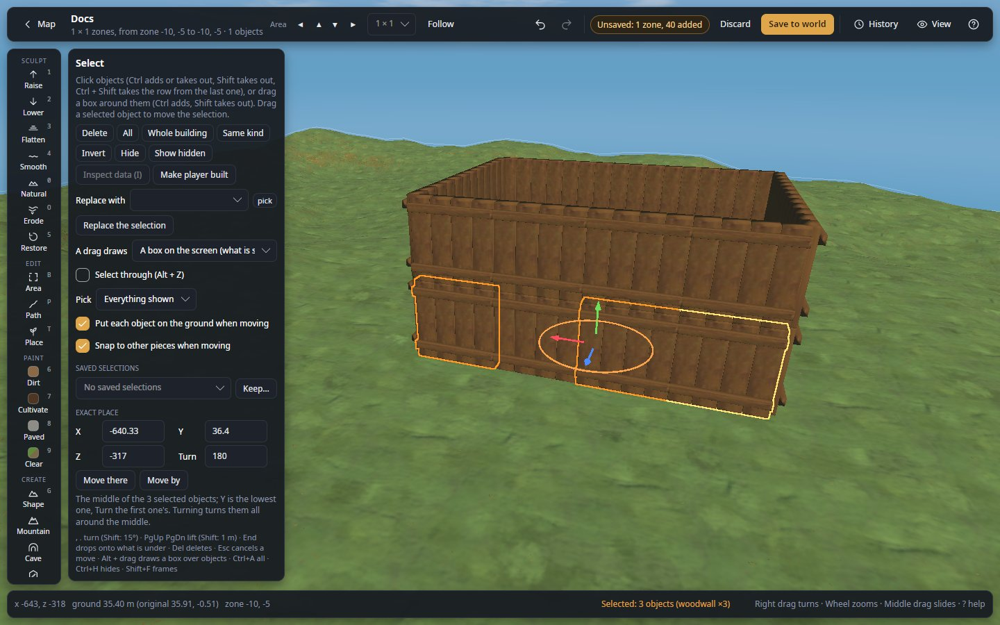
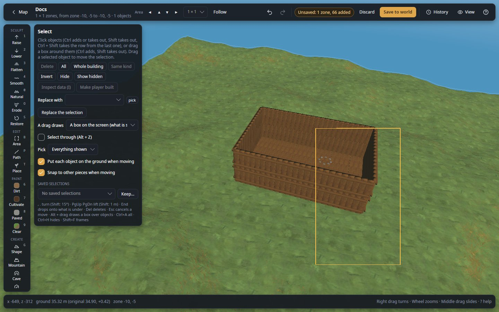
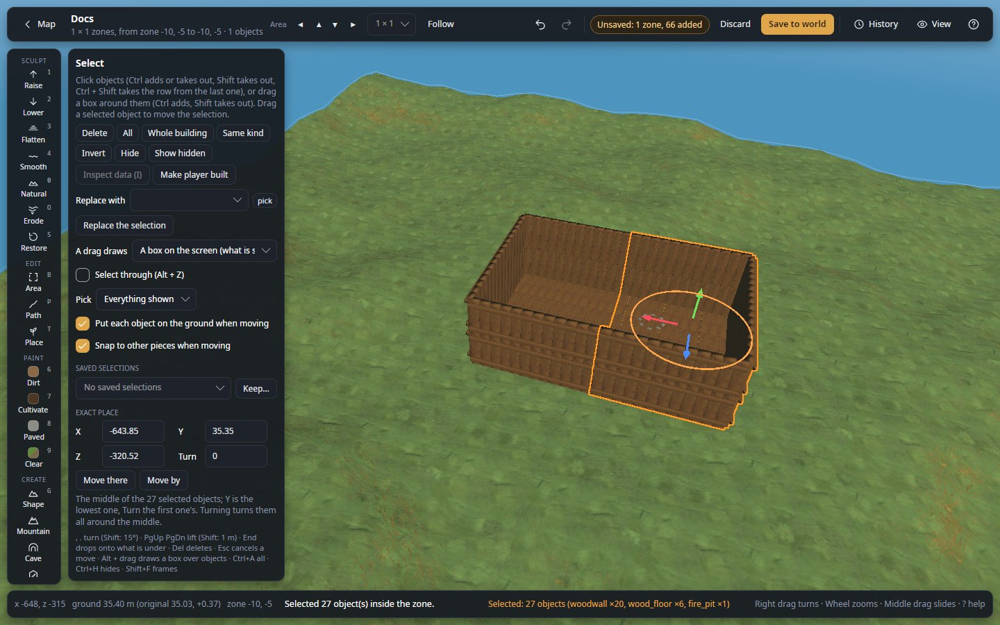
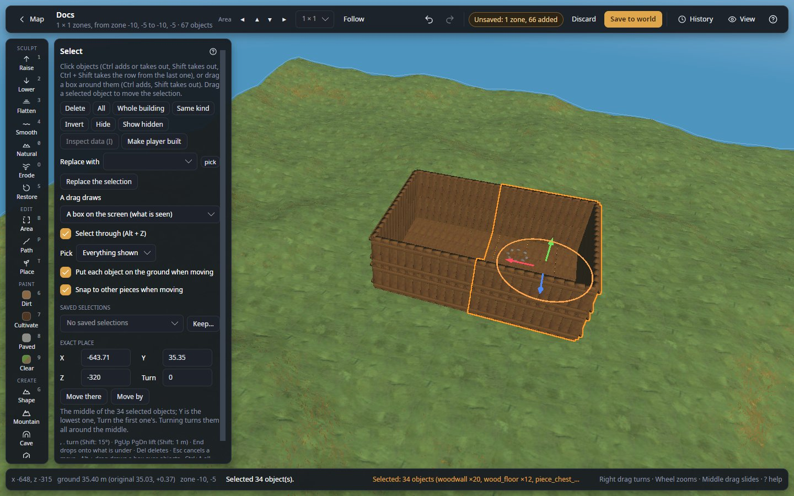
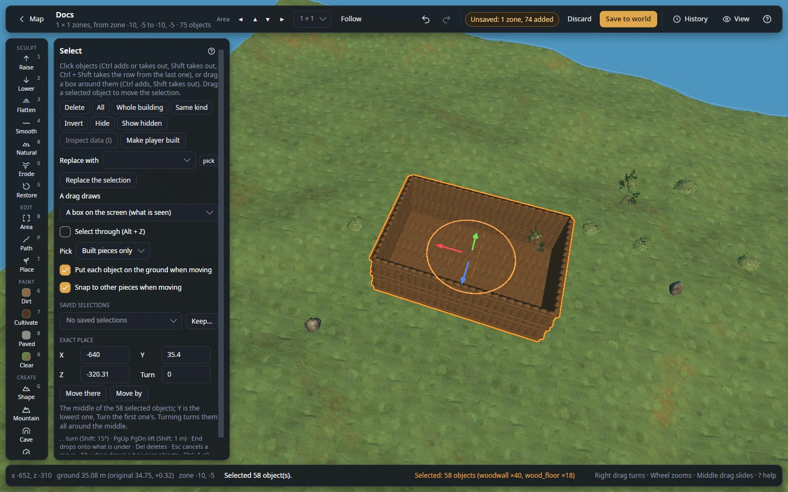
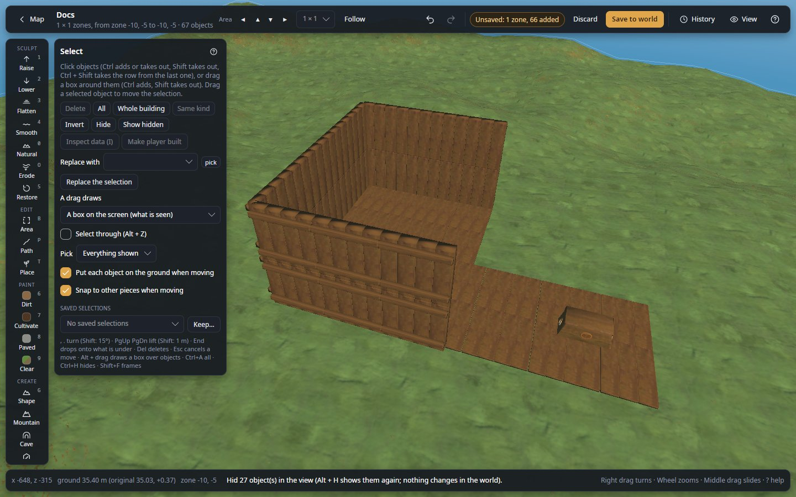
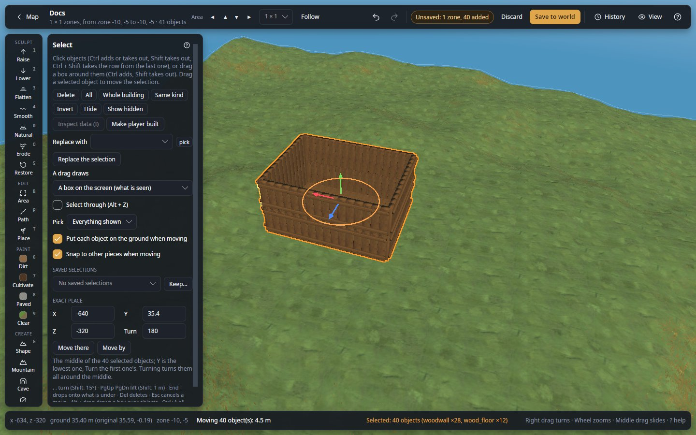

# Select

Pick objects to move, turn, lift, copy, replace or delete them, or open one in the Inspector to see and change what
it holds.

**Where:** tool rail, **TOOLS** section · **Key:** `E` · **Works in:** saved worlds, live, the Workshop

*Close on a selected rock: its orange outline, the red X, green Y and blue Z arrows that move it along one axis, and
the orange ring that turns it. The Select panel is on the left.*

## Use it

To move a few objects:

1. Press `E`.
2. Click an object. `Ctrl` + click more, or drag a box on the screen around them.
3. Drag a selected object to move them all, or drag an arrow to move along one axis, or the ring to turn.
4. Optional: type exact values under **EXACT PLACE**, then click **Move there**.

From the **View** tool, a double click on an object switches to Select with it selected. Only objects that are shown
can be picked: switch their kinds on in the [View panel](editor-basics.md) first. The object under the cursor has a
faint box: that is the one a click picks.

Each move, turn, delete or change is one undo step (`Ctrl+Z`). Nothing is written to the world until you **Save to
world** (or **Apply live**).

## Settings

The Select panel, top to bottom.

| Setting | What it does |
|---|---|
| **Delete** | Removes the selected objects (`Del`). `Ctrl+Z` brings them back. |
| **All** | Selects every shown object in the area (`Ctrl+A`). |
| **Whole building** | Adds every building piece connected to the selected ones through pieces that touch: walls, floors, roofs, beams. Pieces standing apart are not taken. |
| **Same kind** | Selects every shown object of the kinds selected now: select one beech, get all the beeches. |
| **Invert** | Selects every shown object that is not selected now, and only those (`Ctrl+I`). |
| **Hide** / **Show hidden** | Hides the selected objects in the view, to reach what they cover (`Ctrl+H`), and shows them again (`Alt+H`). Hidden objects are not drawn or picked; nothing changes in the world. Opening another area forgets what was hidden. |
| **Inspect data (I)** | Opens the [Inspector](#inspector) on the one selected object. |
| **Make player built** | Gives the selected pieces that have no builder the player chosen in View → **Built by**, so the game treats them as player built. Use it on a ruin you want to repair and keep. See [Player-built pieces](concepts/objects.md#player-built-pieces). |
| **Replace with** + **pick** + **Replace the selection** | Choose a kind (or click **pick**, then an object in the world), then replace every selected object by it, at the same place and facing. The new objects hold nothing of the old ones' data. |
| **A drag draws** | **A box on the screen (what is seen)** or **A zone on the ground (all above it)**: see [Select many at once](#select-many-at-once). |
| **Select through (Alt + Z)** | A box also takes what is hidden behind others inside it: the furniture inside a house, the wall behind another. |
| **Pick** | What clicks, boxes and zones take: **Everything shown**, **Built pieces only** (what players built) or **Nature only** (trees, rocks, ore, bushes, pickables, remains). What is left out is still drawn but not in the way: with Built pieces only, a box takes the wall behind a tree. It also applies to the View tool's clicks; the Place tool's **On top** and the eyedroppers pick every kind. |
| **Put each object on the ground when moving** | On: each object lands on the floor, table or rock under it where it ends up, else on the ground (trees, bushes and creatures hold nothing up: a tree moved in a wood stands on the ground); a building moves as one block and sits on what is under it. Off: the whole selection moves as one block at its height above the ground. On at first. |
| **Snap to other pieces when moving** | On: while you move, the nearest snap points within 0.75 m lock together, so walls, floors and fences join like with the hammer. On at first. See [Snapping](concepts/objects.md#snapping). |
| **SAVED SELECTIONS**: **Keep…** | Keeps the selection under a name, for this world. Pick one in the list for its buttons: **Select** (instead of the current selection), **Add** (to it) and **Forget** (after asking). Objects moved or deleted since count as missing; the status bar says how many. |
| **EXACT PLACE**: **X**, **Y**, **Z**, **Turn** | Shown with a selection. X (east–west) and Z (north–south) are the middle of the selection, Y the height of its lowest object, Turn the first object's facing in degrees, clockwise from above. |
| **Move there** | Moves and turns the selection to the typed values, as one undo step. Typed values are exact: nothing snaps on top of them. |
| **Move by** | Switches the fields to amounts: metres east, up and north, and degrees to turn. **Move by these** does it. |

## Select one object at a time

| Action | What it does |
|---|---|
| Click | Selects the object, and only it. |
| Click again at the same spot | Selects the next object behind it, then the next: a chest on a floor, the floor, the beam below. |
| `Ctrl` + click | Adds the object, or takes it out when it is selected already. |
| `Shift` + click | Takes the object out. |
| `Ctrl` + `Shift` + click | Adds the row from the last object clicked to this one: click wall 1, then wall 3, and walls 1 to 3 are selected. |
| Double-click a building piece | Selects the whole building. A chest (any container) is the exception: it is selected alone and opens in the Inspector. |
| Double-click a part of a ship | Selects the whole ship: see [Ships and other linked objects](#ships-and-other-linked-objects). |
| Click empty ground, or `Alt+A` | Clears the selection. |

*A click on one wall piece, then `Ctrl` + click on two more: the last one clicked is outlined in lighter yellow,
the others in orange, and the status bar counts the three.*

## Select many at once

A drag on empty ground draws a box on the screen. When you let go, the objects **seen** inside it are selected, not
those hidden behind others. Turn the camera to choose: from above, a building's floor and wall tops; from the side,
one wall.

| Action | What it does |
|---|---|
| Drag on empty ground | Draws the box; what is seen inside becomes the selection. |
| `Alt` + drag | Draws the box even when you start over an object (a building, a wood). |
| `Ctrl` + drag | Adds what the box takes. |
| `Shift` + drag | Takes it out. |

*`Alt` + drag from the middle of a hut over its right half: the box is drawn on the screen.*

*After letting go: 27 pieces outlined, the walls, the floor seen between them and the fire pit; the floor and chest
hidden behind the near wall are left out. The status bar counts the objects.*

*The same box with **Select through** on: 34 pieces, the floor and the chest behind the near wall too.*

***Pick: Built pieces only** and a box over the whole hut among rocks and bushes: the hut's 58 pieces alone.*

With **A drag draws: A zone on the ground (all above it)**, a drag draws an outline on the ground instead, and every
shown object standing inside it is selected, hidden or not. `Alt`, `Ctrl` and `Shift` work as for the box.

*`Alt` + drag round rocks and bushes: the zone is drawn even though the drag started on a bush.*

*Everything shown inside is selected, and **EXACT PLACE** shows where the selection is.*

*One click on a wall, then **Whole building**: every connected piece of the hut is selected.*

*Close on the hut after `Ctrl+H` hid its boxed right half: the chest on the floor inside is in plain view.
`Alt+H` brings the walls back.*

## Move and turn

| Action | What it does |
|---|---|
| Drag a selected object | Moves the whole selection, following the cursor on the ground. |
| Drag an arrow | Moves along one axis: **red X** east–west, **green Y** up–down, **blue Z** north–south. Hold `Ctrl` for 0.5 m steps. |
| Drag the orange ring | Turns the selection round its middle; hold `Ctrl` for 15° steps. |
| `End` | Drops each object straight down onto what is under it (a floor, a table, a rock), else the ground. |

The status bar follows the move: "Moving 12 object(s): 4.5 m, turned 15°, +0.25 m · snapped to woodwall". A moved
object keeps its data: a chest its contents, a sign its text, a piece its builder. See
[Snapping](concepts/objects.md#snapping) for how a move lands.

*Dragging the red X arrow of a hut selected whole: the status bar follows the move, "Moving 40 object(s): 4.5 m".*

## Copy, cut and paste

`Ctrl+C` copies the selection; `Ctrl+V` pastes it with the paste tool (`R` turns, `F` mirrors), here or in another
area: see [Area](area.md). Copies keep everything the originals hold. Trees and the like keep their height above the
ground where they land; building pieces keep the building's shape and take the ground under them along (without
paint). `Ctrl+X` cuts: the same copy, then the objects leave the world, so pasting moves them.

## Inspector

The Inspector shows everything one object holds in the save and lets you change it. Open it with **Inspect data (I)**,
or double-click a chest (or any object that is not a building piece).

*Close on a chest holding four items, open in the Inspector: its slots as in game, each with the item's name and
how many, then every value under DATA.*

At the top: the object's name, id, place and turn. For a spawn point or a nest, what it spawns
(`Spawn point: Boar · 0–2 ★ · spawns once`); for a mod's object, which mod it is from.

| Part | What it does |
|---|---|
| **CONTENTS** | Chests and other containers: the slots as in game ("5 × 2 slots · 4 item(s)"). Click a slot, then **Find an item…** (type a few letters), **How many** and **Quality**. **Empty** takes the item out; **Move**, then another slot, moves it (two items swap). How many is cut to the game's largest stack. |
| **Every item's details** | Every item with its stack, quality, durability and slot. **Add item** puts a new one in the first free slot; **✕** takes one out; **Tidy slots** moves every item to the first free slots, row by row. |
| **HOLDS** / **WEARS** | Item stands and armour stands. The list offers only what the game lets that stand take (a flat stand also takes food, to set a table). **Qual.** is its quality, **Style** its look, **Hangs** the way it hangs, **Pose** an armour stand's pose; **✕** takes it off. |
| **DATA** | Every value, by the game's name, with a label for the common ones: Text (sign), Tag (portal), Builder (player id), Health, Fuel, Level (stars)... Change numbers and texts in place; **✕** removes a value (the game then uses its default). Other binary data is listed but not changed. |
| **Add** | Adds a value the object does not have: choose its kind, type its name as the game calls it (`text` for a sign, `tag` for a portal) and the value. |
| **Apply changes** | Replaces the object by a copy with the new data, at the same place: one undo step. **Save to world** or **Apply live** writes it. |
| **Revert** | Forgets the changes made in the card. |

- A container's size comes from the game. Carts and ships keep their container on a part, so their size is unknown.
- Items outside the slots would be hidden in game: the editor asks before applying that.
- Changed contents become the chest's own: a chest never opened does not fill itself with the game's loot over them.
- An item set on a stand is new and at full durability for its quality. In **Game look**, the 3D view draws it on the
  stand.
- Value names come from the game's and your mods' code (read, never run). An unknown name shows as a number.

> [!WARNING]
> Change a value only when you know what it does: the game may reset or ignore values it does not expect. `Ctrl+Z`
> puts the old object back until you save.

## Ships and other linked objects

Some mods build objects out of others: a ship mod's vessel is a root and the pieces built on it. When the mod
describes them (its `worldeditor.json`, see [Modding](modding.md)), the editor draws the group as the mod builds it
and keeps it together:

- **Moved whole.** Selecting any part and moving, turning or deleting takes the whole group (the status bar says so,
  in the mod's words: "a whole vehicle"). A moved group keeps its height (a ship stays afloat), does not snap and
  does not drop with `End`.
- **Copied whole.** `Ctrl+C` on any part copies the whole group, without the ground. Each paste is a group of its own
  with new ids. A part copied without its root is pasted as an ordinary piece.
- **Removed whole.** The Area tool's Remove objects takes a root's parts with it.

Claude's tools do the same. See [What an object is](concepts/objects.md#what-an-object-is).

## Shortcuts

| Key or mouse | What it does |
|---|---|
| `E` | Opens Select. |
| `Ctrl+A` / `Alt+A` | Select all shown / clear the selection. |
| `Ctrl+I` | Invert the selection. |
| `Ctrl+H` / `Alt+H` | Hide the selected objects / show them again. |
| `Alt+Z` | Switch **Select through**. |
| `Shift+F` or Numpad `.` | Frame the selection (`F` alone switches the eye). |
| `Del` | Delete the selection. |
| `I` | Open the Inspector on the one selected object. |
| `,` `.` or `Alt` + wheel | Turn by 1° (`Shift`: 15°). |
| `PgUp` / `PgDn` | Lift or lower by 0.25 m (`Shift`: 1 m). |
| `End` | Drop each object onto what is under it. |
| `Esc` | Close the Inspector; else cancel a box, zone or move in progress; else go back to the View tool (the selection stays). |
| `Ctrl+C` / `Ctrl+X` / `Ctrl+V` | Copy, cut, paste. |
| `Ctrl+Z` | Undo. Keys pressed within a moment of each other are one step. |

All the editor's keys are in [Shortcuts](help/shortcuts.md).

## Tips and limits

> [!CAUTION]
> Runestones can be selected and deleted, but not moved, turned, copied or inspected: the game builds each one from
> its location whenever the zone loads, so deleting one removes that location for good (with the small levelling of
> the ground around it). Save to world makes it permanent; until then `Ctrl+Z` brings it back.

- **Recover:** deleted or moved by mistake: `Ctrl+Z`, after saving too (then save again). Hid something: `Alt+H`.
  See [Undo changes](guides/undo-changes.md).
- Boxes, zones, **All**, **Same kind**, **Invert** and **Whole building** leave out anything more than 10 m under the
  ground (objects a mod hides there, such as crafting stations under a house).
- A click picks an object by its drawn shape, not its box: a stone under a tree's branches can be clicked between the
  branches. Leaves and grass count only where nothing solid is behind them. See
  [What an object is](concepts/objects.md#what-an-object-is).
- Selected objects lose their green unsaved dot while they are selected.
- In live mode, a moved object keeps its id in the running game when nothing else about it changed. See
  [What is sent and when](concepts/live-editing.md#what-is-sent-and-when).

## Related

- [Move or copy a building](guides/move-a-building.md)
- [Change what a chest holds or a sign says](guides/fill-a-chest.md)
- [Find an object, a chest's item or a sign](guides/find-things.md)
- [Objects](concepts/objects.md#what-an-object-is) · [Snapping](concepts/objects.md#snapping)
- [Place](place.md) · [Area](area.md)
