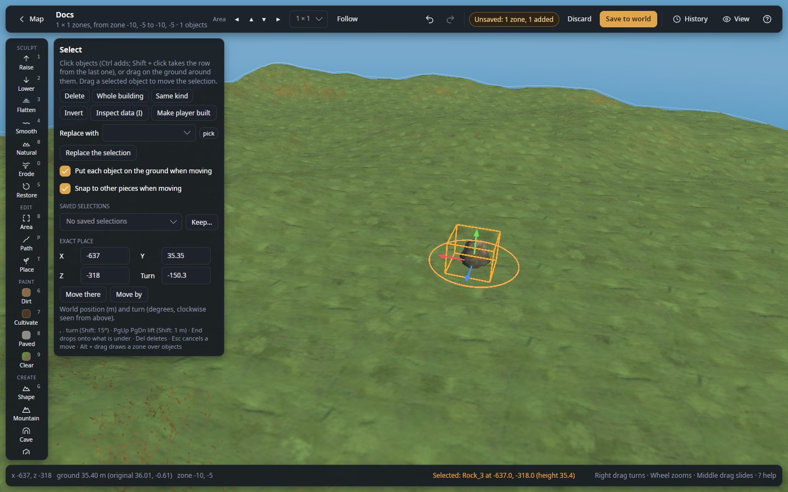
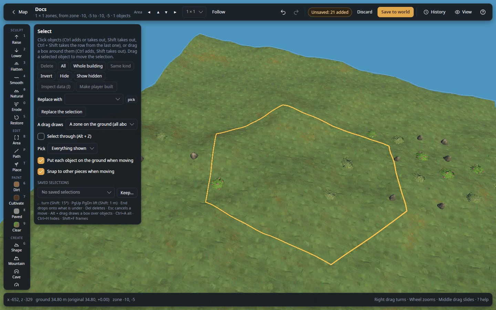
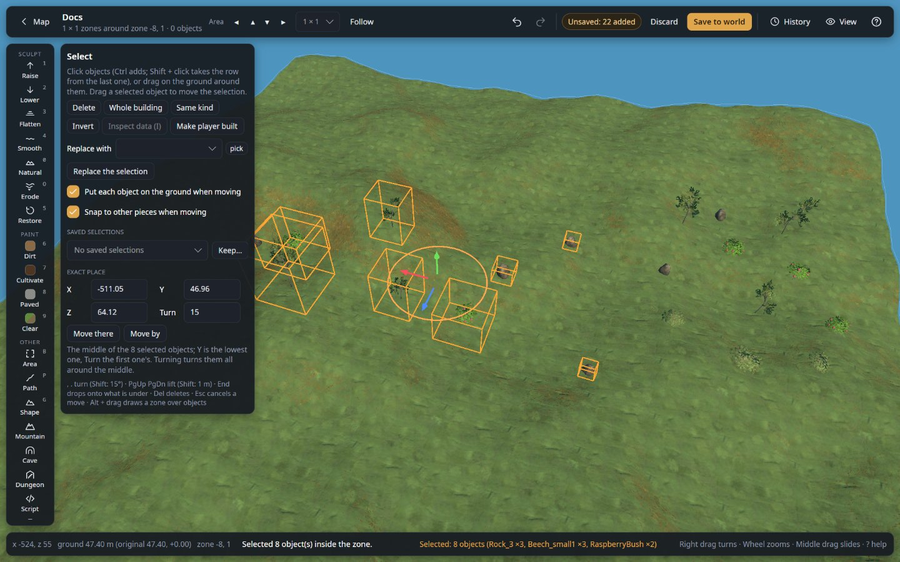
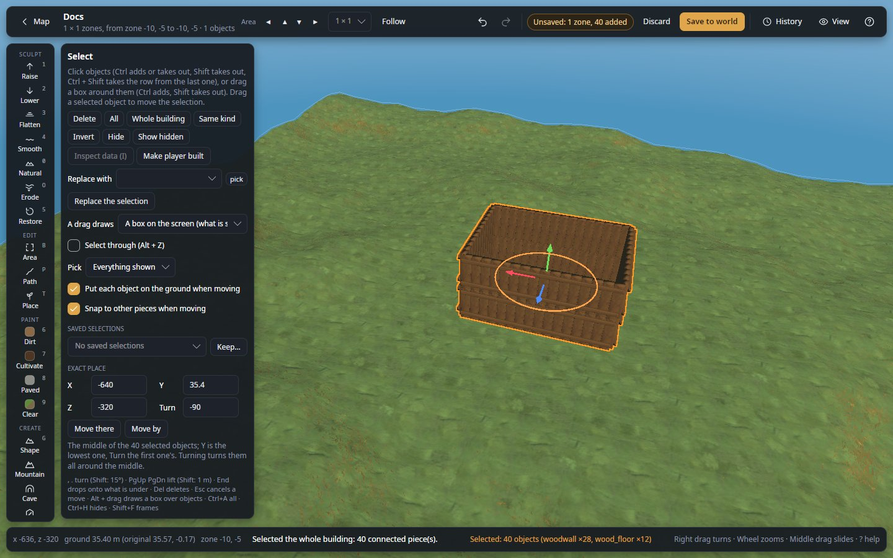
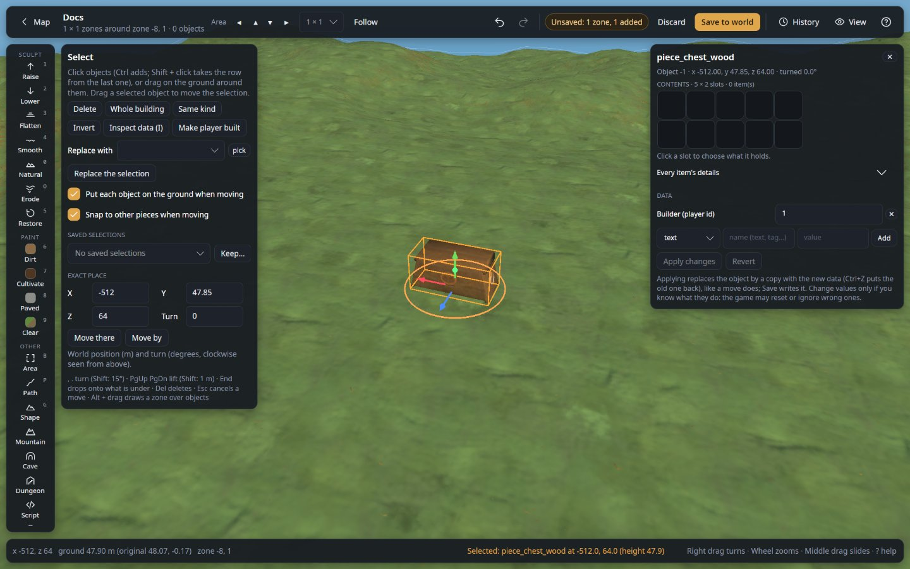

# Select (`E`)

*A rock selected: its yellow box, the red X, green Y and blue Z arrows to move it along one axis, and the
orange ring to turn it. The Select panel is on the left.*

Pick objects (trees, rocks, building pieces, anything shown), then move, turn, lift, drop, copy, replace
or delete them, or open one in the Inspector to see and change what it holds in the save. The object
under the cursor is outlined faintly: that is the one a click picks.

Only objects that are shown can be picked: switch kinds on in the
[View panel](editor-basics.md#view-panel) first. Runestones can be picked and deleted, but not moved,
turned, copied or inspected: the game builds each one from its location whenever the zone loads, so
deleting one removes that location for good (with the small levelling of the ground around it).

## How to use it

1. Press `E` (or **Select** in the rail's TOOLS section). From the **View** tool, a double click on an object
   also switches to Select with that object selected, its arrows and ring ready.
2. Click an object, `Ctrl` + click more, or drag on empty ground around them.
3. Drag a selected object, an arrow or the ring to move or turn the selection; or use the keys, the
   **EXACT PLACE** fields, or the panel's buttons.

Every move, turn, delete or change is one step in History (`Ctrl+Z`). Nothing is written to the world
until you **Save** (or **Apply live**).

## Selecting

| Action | What it does |
|---|---|
| **Click** an object | Selects it, and only it. A thin yellow box marks the selection; a blue box shows what is under the cursor. |
| `Ctrl` + click | Adds an object to the selection, or takes it out when it is selected already. Dragging any selected object then moves them all together. |
| `Shift` + click | Takes an object out of the selection. |
| `Ctrl` + `Shift` + click | Adds the row from the last object clicked to this one: click wall 1, then `Ctrl` + `Shift` + click wall 3, and walls 1, 2 and 3 are selected (the objects on the line between them). |
| **Drag on empty ground** | Draws a box on the screen; when you let go, the objects **seen** inside it are selected, not those hidden behind others or behind the ground. Look at a building from the side or from above to pick one floor, one wall or its roof. Dragged any way round. |
| `Alt` + drag | Draws the box even when you start over an object (over a building, or in woods where trees cover the ground). |
| **Select through** (Select panel) / `Alt` + `Z` | The box also takes what is hidden behind others inside it: the furniture inside a house, the wall behind another. Like Blender's X-ray. |
| **A drag draws: A zone on the ground** (Select panel) | Drags draw an outline on the ground instead, and everything shown above it is selected, from the ground up, hidden or not. |
| | A zone, **Same kind**, **Invert** and **Whole building** leave out anything more than 10 m under the ground: objects a mod hides there (crafting stations 10 km under a house) are not part of what stands above. |
| `Ctrl` + drag | Adds what the box or the zone takes to the selection. |
| `Shift` + drag | Takes what the box or the zone takes out of the selection. |
| `Ctrl` + `A` / `Alt` + `A` / `Ctrl` + `I` (or **All**, **Invert**) | Selects every shown object / clears the selection / inverts it. |
| `Ctrl` + `H` / `Alt` + `H` (or **Hide**, **Show hidden**) | Hides the selected objects in the view, to reach what they cover (inside a house: hide the roof); they are not drawn, picked or boxed, and nothing changes in the world. `Alt` + `H` shows them all again. |
| `Shift` + `F` or Numpad `.` | Turns the camera onto the selection, close enough to see all of it (`F` alone switches the eye). |
| **Click on empty ground** / `Esc` | Clears the selection (`Esc` first cancels a zone being drawn or a move in progress); with `Ctrl` or `Shift` held, a click on the ground keeps it. |
| **Double-click a building piece** | Selects the whole building (see **Whole building** below). A chest (any container) is the exception: a double click selects it alone and opens it in the [Inspector](#inspecting-and-changing-an-objects-data). |
| **Double-click a linked object's part** | Selects its whole [group](#linked-objects-ships-and-other-mods-groups) (a ship mod's vessel): its root and every part on it. |

*With **A drag draws: A zone on the ground**, `Alt` + drag round rocks and bushes: the zone is drawn even though the
drag started on a bush.*

*When you let go, everything shown inside is selected, with one box round it all, and **EXACT PLACE** shows where
the selection is.*

### How a click finds an object

- A click finds an object by its **drawn shape**, not by the box round it. The boxes only say which
  objects to try; then each one's model decides. A chest or a stone under a tree's branches can be
  clicked between the branches.
- Leaves, bushes and grass count only where nothing solid is behind them along the line of the click.
  Clicking through a bush onto a rock picks the rock. A piece drawn with a cut-out material (a bed's
  fur, a hide rug) is not looked through: a bed on a floor is picked, not the floor.
- When the ground is hit first (with half a metre of slack), nothing is picked: the click is on the
  ground.
- A standing tree is outlined by a column round its trunk (a tenth of its crown's width across, 0.5 to
  2 m either way), not by a box round its whole crown, so the outline shows where the tree really stands.
  Logs and stumps keep their box.
- An object whose model is not loaded yet is picked by its box.

A zone on the ground selects the objects whose position (their origin, where they stand) is inside it. A box on
the screen selects what a click would find at its points (every 3 pixels, more apart in a big box), so an object
counts as soon as a part of it is seen inside.

### Several objects

With more than one object selected, one yellow box marks them all instead of a box each: a box each over a
building makes a tangle of lines that hides it. Everything still works on each object.

### Panel buttons

| Control | What it does |
|---|---|
| **Delete** (`Del`) | Removes the selected objects. `Ctrl+Z` brings them back; they leave the world when it is saved. |
| **Whole building** | Adds every building piece connected to the selected pieces through pieces that touch: walls, floors, roofs, beams... Each piece's box is grown by 15 cm; boxes that overlap are connected. Pieces standing apart are not taken. |
| **Same kind** | Selects every shown object in the area of the kinds selected now (select one beech, then all the beeches). |
| **Invert** | Selects every shown object in the area that is not selected now, and only those. |
| **Inspect data (I)** | Opens the [Inspector](#inspecting-and-changing-an-objects-data) on the one selected object. |
| **Make player built** | See [Other actions](#other-actions). |

*One click on a wall, then **Whole building**: every connected piece of the hut is selected.*

### Saved selections

Under **SAVED SELECTIONS**:

| Control | What it does |
|---|---|
| **Keep…** | Keeps the selection under a name, for this world (in the editor's data folder). |
| List | Your saved selections for this world. Pick one to show its buttons. |
| **Select** | Selects its objects, instead of the current selection. |
| **Add** | Adds its objects to the current selection. |
| **Forget** | Removes it, after asking. |

A saved selection keeps each object's kind and place, not its id (ids change when the world is saved).
It finds the objects again by kind and place: within 5 cm across and 20 cm in height. Objects that were
moved or deleted since, or that are outside the open area, are counted as missing, and the status bar
says how many.

## Moving and turning

| Action | What it does |
|---|---|
| **Drag a selected object** | Moves the whole selection freely, following the cursor on the ground. |
| **Drag an arrow** | Moves the selection along one axis only: **red X** (east–west), **green Y** (up–down), **blue Z** (north–south). Hold `Ctrl` for 0.5 m steps. X and Z follow the ground as below; Y raises or sinks. |
| **Drag the orange ring** | Turns the selection around its middle; hold `Ctrl` for 15° steps. |
| `,` `.` or `Alt` + wheel | Turns the selection around its middle by 1° (`Shift`: 15°). |
| `PgUp` / `PgDn` | Lifts or lowers by 0.25 m (`Shift`: 1 m). |
| `End` | **Drops** each object onto what is below it (below). |
| `Esc` | Cancels a move that is still in progress. |
| **Put each object on the ground when moving** | Each object lands on what is under it where it ends up (a floor, a table...), else on the ground; see below. On at first; remembered. |
| **Snap to other pieces when moving** | See below. On at first; remembered. |

The arrows and the ring sit at the middle of the selection and keep their size on screen. The one under
the cursor (or being dragged) turns yellow. The status bar follows the move: "Moving 12 object(s): 4.5 m,
turned 15°, +0.25 m · snapped to woodwall".

### How a move lands

- **Put each object on the ground when moving** on: trees, rocks and other objects each land on what is
  under them where they end up: the top of a floor, a stair, a table, a rock or any other shown object,
  as `End` drops them (below), and on the ground when nothing is under them. Each is carried at the height
  above the ground it had and let down from there, so only a top no higher than the object itself counts:
  a chair moved into a house lands on its floor, not on its roof, and a tree moved under an eave goes under
  it. Building pieces move together and keep their shape: the whole building goes up or down until its
  bottom layer sits on what is under it, a floor or a platform no higher than the building, else the
  ground. On a slope, or half on a platform, part of it sinks in rather than float, since pieces need
  something to carry what stands on them.
- Off: the whole selection moves as one block that keeps its shape: it goes up or down with the ground under its middle, so a building stays straight on uneven ground.
- **Snap to other pieces when moving** on: while you move, the closest pair of snap points (one of a
  moved piece, one of a piece around, within 0.75 m) locks together, and the whole selection shifts so
  they meet. Walls, floors, beams and fences join exactly, like with the hammer. Off: free moves.
- `End` drops each object straight down from where it is onto the highest top of another shown object
  under it (a floor, a table, a rock), or onto the ground when there is none. Selected objects do not
  count as surfaces, for a drop or a move. The status bar says how many landed on objects and how many on
  the ground. A move with the switch on lands the same way; `End` is for an object you lifted first
  (`PgUp`), or one moved with the switch off.

Moves are combined: keys pressed within a moment of each other (0.7 s) become one undo step.

### What a move does to the object

A moved object keeps all of its data: a moved chest keeps its contents, a sign its text, a piece its
builder. In the save, the editor writes it as a copy at its new place in place of the original. In
[live mode](live-mode.md), a moved or turned object moves in the running game under its own id when
nothing else about it changed, so mods that follow objects keep knowing it; see
[Moving things](live-mode.md#moving-things).

## Exact place

Under **EXACT PLACE**, once something is selected:

| Control | What it does |
|---|---|
| **X** / **Z** | The world position (m) of the selection's middle (or of the one object): X east–west, Z north–south. |
| **Y** | The height (m) of the lowest selected object. |
| **Turn** | The first selected object's facing (degrees, clockwise seen from above); the others turn with it around the middle. |
| **Move there** | Moves and turns the selection to the typed values. |
| **Move by** | Switches the fields to amounts: metres east (X), up (Y) and north (Z), and degrees to turn, from where the selection is now. **Move by these** does it. |

It is one undo step, like a drag. The selection is first placed as a drag there would place it (with
**Put each object on the ground when moving**), then lifted or lowered as a whole so that its lowest
object is at **Y**. Typed values are exact: nothing snaps on top of them.

## Other actions

| Control | What it does |
|---|---|
| **Make player built** | Gives the selected pieces that have no builder the player chosen in View → Building → **Built by**, so the game treats them as player built (see [Player-built pieces](editor-basics.md#player-built-pieces)). Use it on a ruin you want to repair and keep. Other objects are left as they are. One undo step. |
| **Replace with** + **Replace the selection** | Replaces every selected object by the chosen kind, at the same place and facing. **pick** fills the list from the world: click an object to use its kind (`Esc` cancels). The new objects are fresh: nothing of the old ones' data is kept. |
| `Ctrl+C` | Copies the selection; `Ctrl+V` pastes it with the [paste tool](area.md#copy-and-paste) (`R` turns, `F` mirrors). Copies keep everything the originals hold (a chest's contents, a sign's text, who built them). Trees and the like keep their height above the ground where they land; building pieces keep the building's shape and take the ground under them along (without paint). |
| `Ctrl+X` | Cuts the selection: the same copy, then the selected objects leave the world (one undo step), so pasting moves them. The ground under them stays. |

## Linked objects (ships and other mods' groups)

Some mods build objects out of others: a ship mod's vessel is a root object and the pieces built on it.
The game saves such a piece with the id of what it hangs on (the root, or a part of it such as a swivel)
and its offset and turn in that one's frame; the mod builds it there when the group loads. A mod tells
the editor which data says so in its [worldeditor.json](modding.md#linked-objects); the editor knows no
mod by itself. It then draws these groups as the mod builds them, so a ship looks as it does in game,
turned and leaning with its root. A part whose root is not in the world stays where it is saved.

- **Moved whole.** A group's part never moves, turns or goes alone: selecting any part and moving,
  turning or deleting takes the whole group (the status bar says so, in the mod's words: "a whole
  vehicle"). A double click on a part selects the group. A moved group keeps its height (a ship stays
  afloat), does not snap and does not drop with `End`. Its parts are saved as the mod saves them (at the
  root's new place, their offsets unchanged, when that is how the mod keeps them), and the mod builds it
  there.
- **Copied whole.** `Ctrl+C` on any part copies the whole group, without the ground under it. Each paste
  (and each of its repeats) is a group of its own: every id the group holds gets a new one, and every
  part, and every value the mod says names one (a sail's mast, a switch's target), follows. Two groups
  under one id would share their parts in the game. Values that the mod says copies leave out are left
  out (ids packed in a form only the mod's own [extension](modding.md#extensions) could rewrite, what was
  only aboard: carts, characters). A part copied without its root is pasted as an ordinary piece.
- **Removed whole.** The Area tool's Remove objects takes a root's parts with it.
- Claude's tools (move, copy, take away) do the same.

## Inspecting and changing an object's data

Like MCEdit's NBT editor: with one object selected, **Inspect data (I)** (or a double click on it,
unless it is a building piece: that selects the building) opens a card with everything the object holds
in the save.

*A chest selected and open in the Inspector: its slots as in game, then every value it holds under DATA.*

At the top, the card gives the object's name, its id, place and turn. For a spawn point or a nest it adds
what it spawns ("Spawn point: Boar · 0–2 ★ · spawns once"); for a mod's object, which mod it is from.

| Part | What it shows |
|---|---|
| **CONTENTS** | For chests (and anything with an `items` value): the container's slots as in game ("5 × 2 slots · 4 item(s)"), each with its item and how many. Click a slot to choose what it holds (**Find an item…**: type a few letters of any item of the game), **How many** and **Quality**; **Empty** takes it out; **Move**, then another slot, moves it there (two items swap). How many is cut to the largest stack the item holds in game (the message says so). |
| **Every item's details** | Lists every item with its stack, quality, durability (%) and slot (X, Y). **Add item** puts a new item in the first free slot (type its name: `Wood`, `SwordIron`... the list suggests every item of the game); **✕** takes one out; **Tidy slots** moves every item to the first free slots, row by row. |
| **HOLDS** / **WEARS** | For item stands (`itemstand` on a wall, `itemstandh` lying flat, also the boss altars) and armour stands. An item stand holds one item: type a few letters, and the list offers only what the game lets that stand take (a wall stand takes weapons, shields, helmets, tools, trophies, fish...; one lying flat also takes food and potions, to set a table). **Qual.** is its quality, **Style** its variant (a shield's look), **Hangs** the way it hangs (the game's orientations, as `Alt` + use cycles them), **✕** takes it off. An armour stand has a row per kind of slot (chest, legs, helmet, shield, weapon or tool, cape, utility), each offering only what fits it, and its **Pose**. |
| **DATA** | Every value, by the name the game uses, with a readable label for the common ones: Text (sign), Tag (portal), Builder (player id), Health, Planted at (game time), Permitted players, Fuel, Level (stars)... Numbers and texts can be changed in place; **✕** removes a value (the game then uses its default). Whole numbers that are the name of a prefab (an item on an item stand, for example) show that name. Other binary data is listed but not changed here, unless a mod's [extension](modding.md#extensions) reads it. |
| **Add** | Adds a value the object does not have yet: choose its kind (text, whole number, number, large number, 3 numbers, 4 numbers), type its name as the game calls it (`text` for a sign, `tag` for a portal...) and the value. |
| **Apply changes** | Replaces the object by a copy with the new data, at the same place: one step in History, so `Ctrl+Z` puts the old one back. Save or Apply live writes it. A changed object can still be moved, turned and changed again, and keeps its data. |
| **Revert** | Forgets the changes made in the card. |

### How the contents are kept

- A container's size comes from the game (a wood chest has 5 × 2 slots). Carts and ships keep their
  container on a part, so their size is unknown.
- Items outside the slots would be hidden in game, so the editor asks before applying that.
- Changed contents are marked as the chest's own. A chest never opened would otherwise fill itself with
  the game's loot when it first loads, over them.
- An item on a stand is saved whole, as the game saves it (new, at full durability for its quality), so a
  player taking it gets it as set here. The 3D view draws it on the stand as soon as it is set (in Game look).

The names of the values come from the game's code (read from your Valheim) and from your mods' code
(the DLLs in your Valheim folder and mod manager profiles, read, never run), so a mod's values show by
their names too; a value whose name is not known is shown by its number. Change values only when you
know what they do: the game may reset or ignore values it does not expect.
