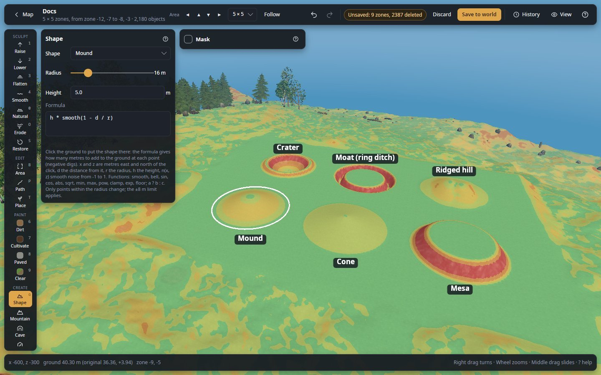
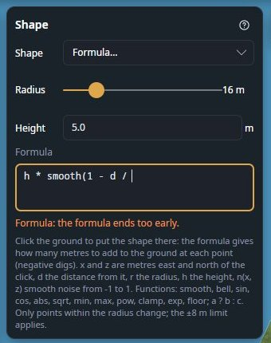

# Shape

Put a whole shape into the ground with one click: a mound, a cone, a mesa, a crater, a moat, a bowl, or any shape
you write as a formula.

**Where:** tool rail, **CREATE** section · **Key:** `G` · **Works in:** saved worlds, live

*Front row from left: Mound, Cone, Mesa. Back row from left: Crater, Moat (ring ditch), Ridged hill, each at the
default radius of 16 m and height of 5 m, with **Slope colours** on in View so their slopes read. The panel shows the
Mound preset and its formula `h * smooth(1 - d / r)`; the ring round the mound is the radius.*

## Use it

1. In the tool rail, click **Shape** (`G`).
2. In the panel, choose a preset in **Shape**.
3. Set **Radius** and **Height**. The ring under the pointer shows the radius.
4. Click the ground where the middle of the shape goes. The shape goes in at once.
5. Not right? `Ctrl+Z` takes it back. Each click is one undo step ("Shape: Mound").

## Settings

| Setting | What it does |
|---|---|
| **Shape** | **Mound**, **Cone**, **Mesa**, **Crater**, **Moat (ring ditch)**, **Bowl**, **Ridged hill**, or **Formula…** for your own. Each preset is a formula you can change: changing it switches the list to **Formula…**. |
| **Radius** | 2 to 80 m (default 16 m). Only the ground within it changes. |
| **Height** | How high it rises, or how deep craters, moats and bowls dig (m, default 5). It is `h` in the formula. |
| **Formula** | How many metres to add to the ground at each point within the radius; a negative number digs. A mistake shows in orange under the box, and the shape cannot be placed until it is fixed. |

*An unfinished formula: the list switched to **Formula…**, and the orange line under the box says what is wrong
("the formula ends too early").*

## Write a formula

The formula is worked out for every ground point within the radius, and the result is added to the ground there.

| Name | Meaning |
|---|---|
| `x`, `z` | Metres east and north of the click. |
| `d`, `r`, `h` | Distance from the click, the radius, the height. |
| `n(x, z)` | Smooth noise from about -1 to 1, from the brushes' pattern (**New pattern** in [Naturalize](terrain.md#naturalize) changes it). Use `n(x / 10, z / 10)` for wide bumps. |
| `pi` | 3.14159… |

Functions: `abs`, `atan2(y, x)`, `bell(t)` (1 at 0, fading out by about ±1), `ceil`, `clamp(v, a, b)`, `cos`, `exp`,
`floor`, `log`, `max(…)` and `min(…)` (any number of values), `pow(a, b)`, `round`, `sign`, `sin`, `smooth(t)` (0
below 0, 1 above 1, a smooth S between), `sqrt`, `tan`.

Operators: `+ - * / %`, `^` (power), comparisons `< > <= >= == !=` (1 or 0), `&&`, `||`, `!`, and `a ? b : c`.

The presets show how it works:

| Preset | Formula |
|---|---|
| **Mound** | `h * smooth(1 - d / r)` |
| **Cone** | `h * max(0, 1 - d / r)` |
| **Bowl** | `-h * smooth(1 - (d / r) ^ 2)` |
| **Moat (ring ditch)** | `-h * bell((d - 0.75 * r) / (0.12 * r))`: a ditch at three quarters of the radius. |

Two more to start from: `h * smooth(1 - d / r) * (1 + 0.3 * n(x / 8, z / 8))` is a bumpy hill, and
`abs(x) < 3 ? -h : 0` digs a 6 m wide trench across the circle.

## Shortcuts

| Key or mouse | What it does |
|---|---|
| `G` | Choose Shape. |
| Click the ground | Put the shape in there. |
| `Ctrl+Z` | Take the last shape back. |
| `Esc` | Leave the tool (back to View). |

## Tips and limits

- **The game's ±8 m limit applies**: a shape stops 8 m from the generated ground, and the status bar says so. For
  taller shapes, choose any sculpt brush, tick **No limit** at the bottom of its panel, then come back to Shape: the
  switch stays on. See [No limit](terrain.md#no-limit).
- **The [Mask](masks.md) applies**: where it leaves ground out, the shape stops in a step.
- **A formula that gives 0 everywhere** changes nothing, and the status bar says so. Points where it gives no number
  (a division by zero) are left as they were.
- **It must be in the open area.** The area's outermost line of points never changes (see
  [The locked edge](concepts/areas-and-zones.md#the-locked-edge)).
- **To soften a shape's edge** afterwards, go over it with the **Smooth** or **Naturalize** brush.
- Your own formula is remembered for next time.

## Related

- [Raise or dig past the game's 8 m limit](guides/raise-past-the-limit.md)
- [Sculpt and paint](terrain.md): brushes and stamps
- [Mountain](mountain.md): a whole mountain in one click
- [Ground limits](concepts/ground-limits.md)
