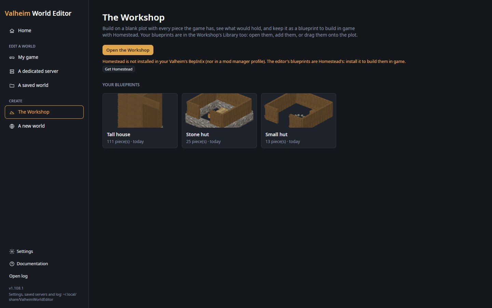
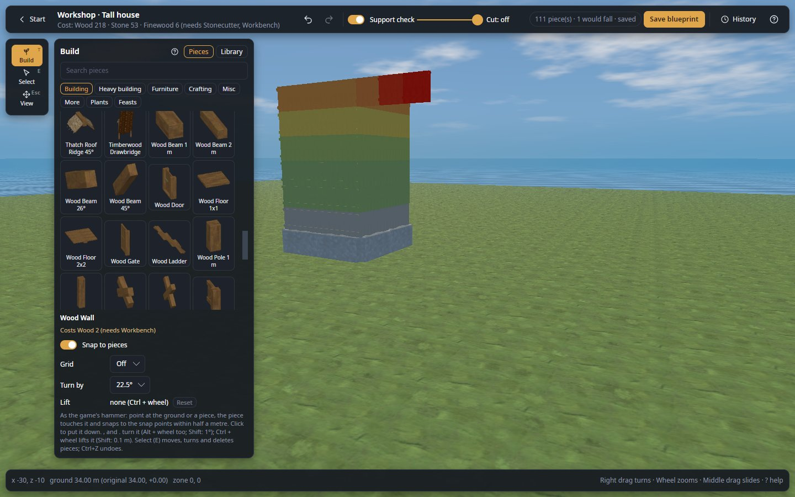
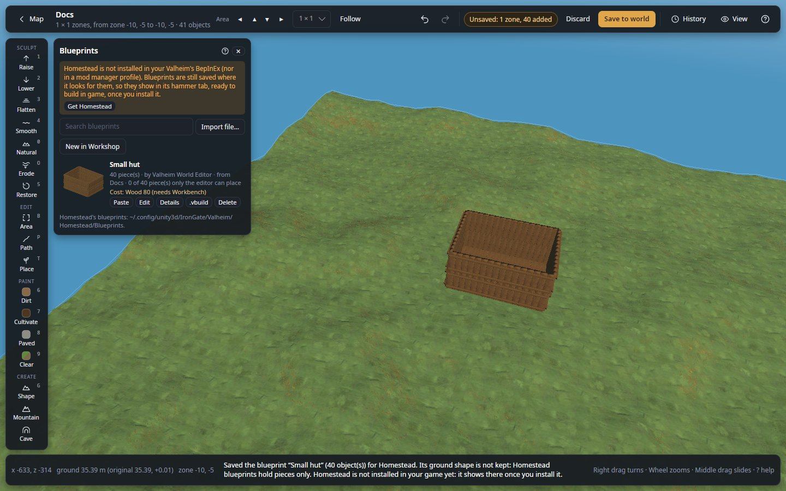

# Your first build

In about fifteen minutes you build a small wooden hut in the Workshop, watch the support check colour it, keep it
as a blueprint, and paste it into a world. You need no world for the first part: the Workshop is a blank plot.

**You need:** the editor installed ([Install the editor](install.md)). For the last part, a world with a backup copy
beside it, as in [Your first edit](first-edit.md).

## 1. Open the Workshop

1. On the start page, click **The Workshop**, then **Open the Workshop**.

*The start page's **The Workshop**: **Open the Workshop**, whether Homestead is installed, and your blueprints (three
here; yours is empty the first time).*

**What you should see:** a flat, empty plot of meadow, the **Build** panel open on the left with its **Pieces** tab,
and the top bar saying "No pieces yet". The rail holds only **Build**, **Select** and **View**.

## 2. Lay a floor

1. In the **Build** panel, type `wood floor` in **Search pieces**.
2. Click the wooden floor's tile. Its name and cost show under the list.
3. Click in the middle of the plot. The floor goes down.
4. Point next to the floor's edge and click again. The new floor snaps to the first, edge to edge, as with the game's
   hammer. Put down four floors in a square.

**What you should see:** a square floor, each piece tinted light blue: it stands on the ground, so it has full
support. The top bar counts "4 piece(s) · not saved as a blueprint", and under the title, the hut's cost.

## 3. Raise the walls

1. Search `wood wall` and click the wooden wall's tile.
2. Point at the outer edge of a floor and click: the wall snaps onto the edge. Press `,` or `.` to turn it first if
   it faces the wrong way.
3. Put walls all around the floor. Leave one gap for a door.
4. Search `wood door`, click its tile, and put the door in the gap.
5. Put a second row of walls on top of the first.

*The support check on a tall house: the stone base light blue, the walls above green, then yellow and orange as their
support runs out, and an overhang red: it would fall.*

**What you should see:** the walls on the floor are green (strong); the second row is lighter green or yellow, with
less support. A piece that would fall in game turns red, and the top bar says how many would fall. Why: see
[The support check](../concepts/objects.md#the-support-check).

A piece in the wrong place? Press `Ctrl+Z` to undo it, or press `E` (**Select**), click the piece, press `Del`, and
press `T` to go back to building.

## 4. Save the blueprint

1. Click **Save blueprint** in the top bar (or press `Ctrl+S`).
2. Type `My first hut` as the **Name**, a few words as the **Description**, and `hut, wood` as the **Tags**.
3. Click **Save**. If some pieces would fall in game, the editor asks first: **Keep building** to fix them (they are
   red), or **Save anyway**.

**What you should see:** the message "Saved the blueprint “My first hut” (… piece(s)) for Homestead.", and the top
bar says "saved". The blueprint is now in your library, with a picture of the hut. With the
[Homestead](https://thunderstore.io/c/valheim/p/sighsorry/Homestead/) mod in your game, it also shows in Homestead's
hammer tab, ready to build in game.

## 5. Paste it into a world

1. Click **Start** at the top left to go back to the start page.
2. Click **A saved world**, then your world (not its backup copy). On its map, click a spot of open ground you have
   visited, and click **Edit in 3D**.
3. On the rail, under **CREATE**, click **Blueprints**. On a short window, scroll the rail with the mouse wheel to
   reach it.
4. Find **My first hut** in the list and click its **Paste** button.
5. Move the mouse over open ground: the hut follows it, see-through. Press `R` to turn it a quarter.
6. Click to put it down, then press `Esc` to stop pasting.

*The **Blueprints** panel next to the rail: a saved hut with its picture, cost and its **Paste** button.*

**What you should see:** the hut standing on the ground. With **Clear the site** on in the Paste panel (it is on at
first), the ground in its way is dug out and the trees and rocks on its site are gone. The top bar says "Unsaved: …
added".

A red outline before the click means the hut does not fit in the open area: open a bigger one from the map.

## 6. Save the world

1. Close Valheim if it runs.
2. Click **Save to world**, check the **World folder** in the question, then click **Save**.
3. Start Valheim, load the world and walk to the spot.

**What you should see:** your hut, standing where you pasted it. Its pieces are player built, so the game treats it
as your base (see [Player-built pieces](../concepts/objects.md#player-built-pieces)).

## If it did not work

- **A piece does not snap**: point closer to the edge or top of the piece already there; snapping takes the closest
  snap points within half a metre.
- **The Workshop says Homestead is not installed**: that is fine. Blueprints are saved where Homestead looks for
  them, and pasting into a world works without it.
- **The paste outline is red**: the hut is too close to the area's edge. Move the mouse inward, or open a bigger area.
- **You do not like the result**: `Ctrl+Z` takes the paste back before you save. After saving, undo it and **Save to
  world** again: see [Undo a step, take back one change, or discard everything](../guides/undo-changes.md).

## Next

- [The Workshop](../workshop.md): every piece tab, the library, Cut and how pieces snap.
- [Paste a blueprint into a world](../guides/paste-a-blueprint.md)
- [Move or copy a building](../guides/move-a-building.md)
