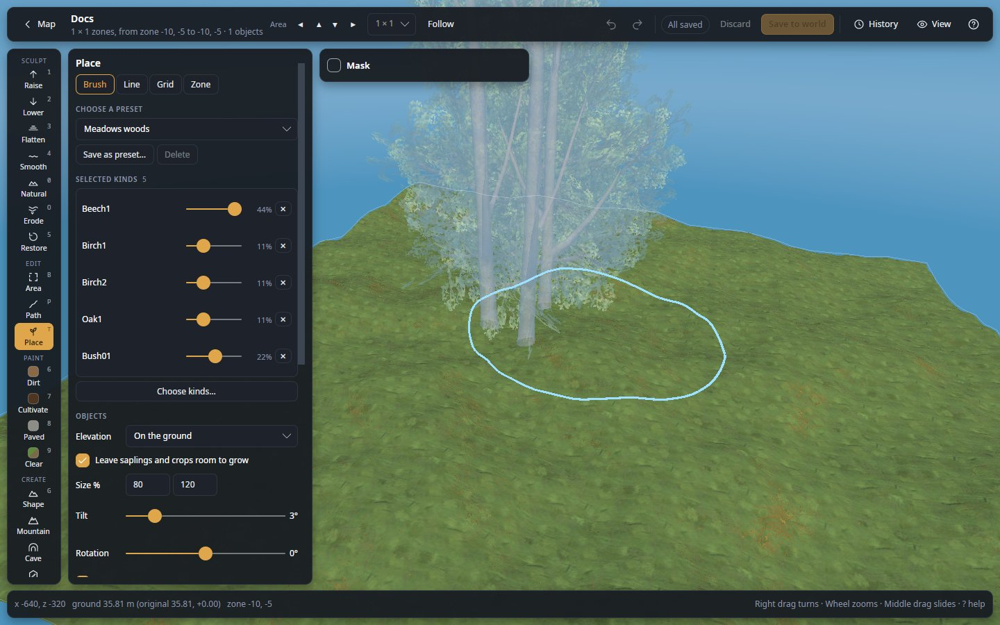

# Your first edit

In about ten minutes you copy a world, raise a small hill and plant a few trees beside your base, undo and redo,
save, and walk up to the result in Valheim. The copy keeps the world as it was, so nothing can be lost.

**You need:** the editor installed ([Install the editor](install.md)), and a single-player world you have played in:
one where you built a base and used the hoe or the pickaxe at least once. Valheim must be closed.

## 1. Copy the world

The copy is your way back: whatever you do next, you can put the world back exactly as it is now.

1. Close Valheim.
2. In the editor, on the start page, click **A saved world** and hover your world's card. The tooltip ends with the
   world's folder, for example `…/IronGate/Valheim/worlds_local/Midgard`.
3. In your file manager, open the `worlds_local` folder that holds it.
4. Copy the world's folder and paste the copy into the same `worlds_local` folder.
5. Rename the copy `<World>_backup_<date>`, for example `Midgard_backup_2026-10-22`.

**What you should see:** after a few seconds, **A saved world** lists both: your world and
`Midgard_backup_2026-10-22`. You edit the world itself; the copy stays untouched beside it. More on copies:
[Back up a world before editing](../guides/back-up-a-world.md).

## 2. Open the world

1. On **A saved world**, click your world (not the copy). It opens on its map.
2. On the map, click a spot of open ground near your base.
3. In the side panel, choose **3 × 3 zones (192 m)** in the size list beside **Edit in 3D**, then click **Edit in
   3D**.

*The map: a click picked a zone (the blue square); **Edit in 3D** opens it with the size chosen beside it.*

**What you should see:** the 3D view of your base and the land around it, the tool rail on the left, and the top
bar saying "All saved". If the view is far away, scroll the wheel to come closer; right drag turns the view.

## 3. Raise a hill

1. Press `1`, or click **Raise** on the rail. Its panel opens next to the rail.
2. In the panel, drag **Size** to about 10 m.
3. On open ground next to your base, hold the left mouse button and move the mouse in small circles for a few
   seconds.

*Raise: the brush's outline on the ground, a mound raised beside it, and the panel with **Size** and **Strength**.*

**What you should see:** the ground rises under the brush, and the top bar says "Unsaved: 1 zone" in amber. Nothing
is written to the world yet: the change is **pending**.

## 4. Plant trees

1. Press `T`, or click **Place** on the rail.
2. In the **Place** panel, click **Brush**, then choose **Meadows woods** under **Choose a preset**.
3. Drag the mouse along the foot of your hill.

*Place with **Brush** and the **Meadows woods** preset: the brush shows the next trees see-through; the ones planted
stand around it.*

**What you should see:** beeches, birches, oaks and bushes appear where you drag, each with a small green dot (not
saved yet), and the top bar adds "… added".

## 5. Undo and redo

1. Press `Ctrl+Z` (`Cmd+Z` on a Mac). The trees you planted last disappear.
2. Press `Ctrl+Y`. They come back.
3. Press `L` to open **History**.

**What you should see:** History lists your steps, newest first: "Placed …", then Raise. **Back to here** on a row goes
back to it, **Remove** takes out that one change only. Press `L` again to close it. More:
[Undo a step, take back one change, or discard everything](../guides/undo-changes.md).

## 6. Save

1. Click **Save to world** in the top bar (or press `Ctrl+S`).
2. Read the question: it says what it writes and the **World folder**. Check that the folder is your world, not the
   copy, then click **Save**.

*The question before saving: check the **World folder** line, then click **Save**.*

**What you should see:** the status bar says "Saved 1 zone(s), … new object(s) to save #…", the top bar says "All
saved", and the green dots are gone. The editor wrote a new save next to the old one and read it back to check it.

## 7. See it in game

1. Click **Map** at the top left, then **Worlds**, to leave the world.
2. Start Valheim and load the world.
3. Walk to the spot next to your base.

**What you should see:** your hill and your trees, as in the editor. The game saves them as usual from now on.

## If it did not work

- **"Not saved: … not generated yet"**: you edited a zone no player has visited, so the world has no data there.
  Pick a spot you have walked through, or visit it in game first.
- **"… the world has no terrain object to copy yet"**: nobody ever dug or levelled the ground in this world. In
  game, use the hoe or the pickaxe once anywhere, save, quit, and save again in the editor.
- **"Valheim saved this world … after the editor read it"**: the game was running, or saved the world, while you
  edited. See [Save to world](../editor-basics.md#save-to-world).
- **You do not like the result**: open the world again and undo (or **Remove** the steps in History), then save. Or
  put the copy back: see [Back up a world before editing](../guides/back-up-a-world.md#undo-it).

## Next

- [Your first build](first-build.md): build a hut in the Workshop and paste it into this world.
- [The editor window](../editor-basics.md): every part of the window.
- [Shortcuts](../help/shortcuts.md): every key and mouse action.
