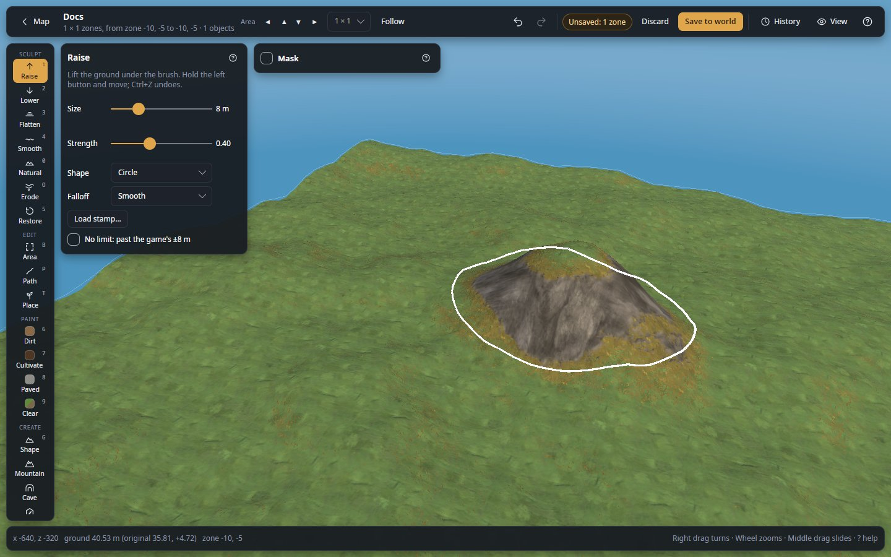
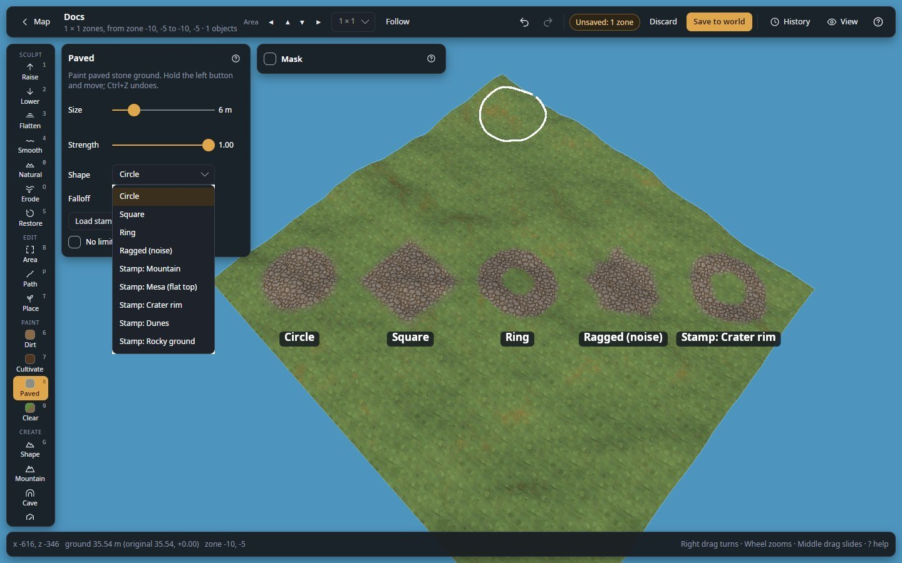
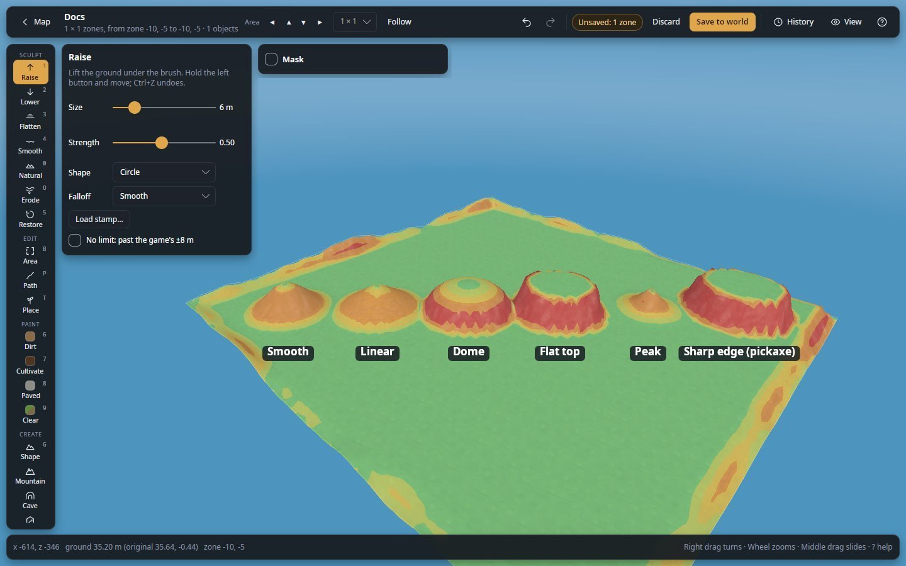
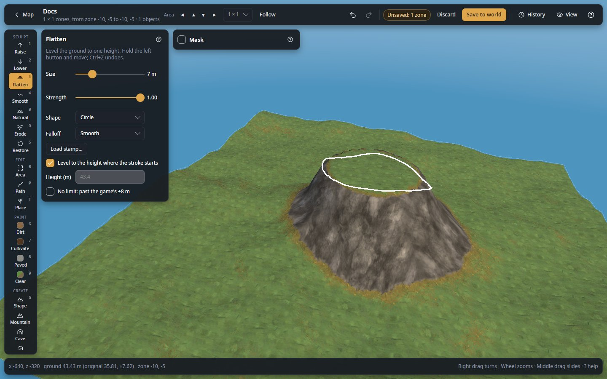
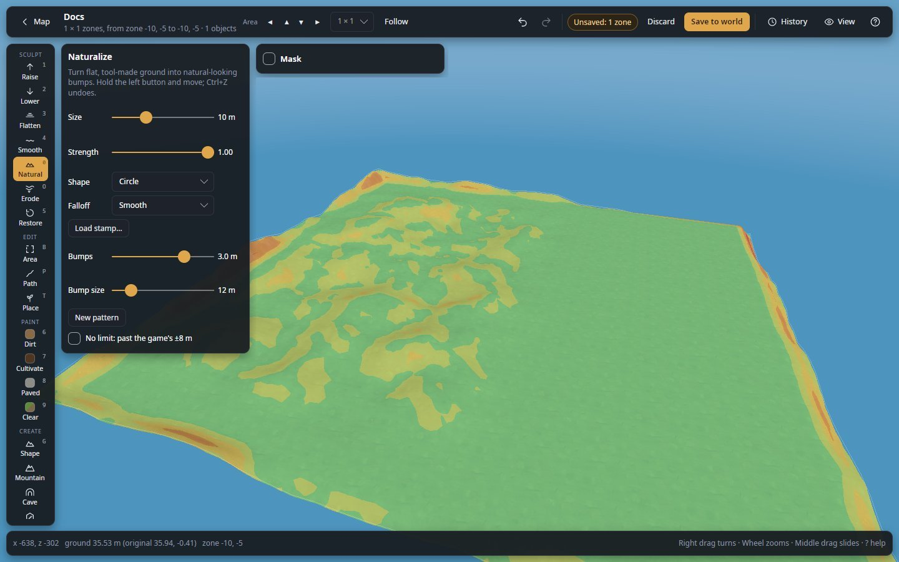
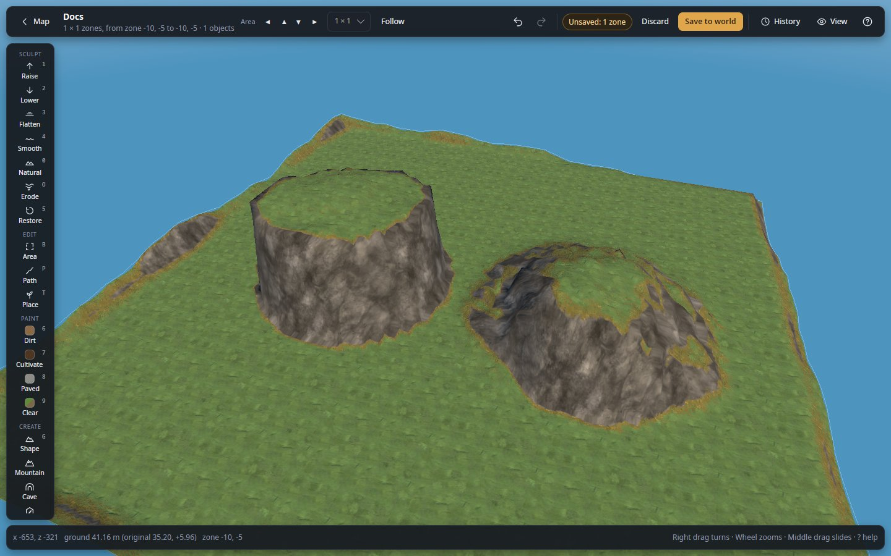
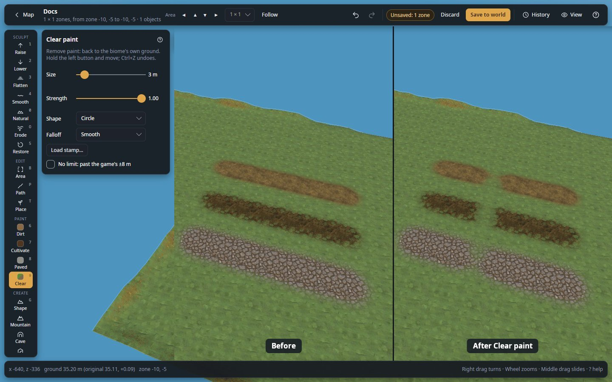
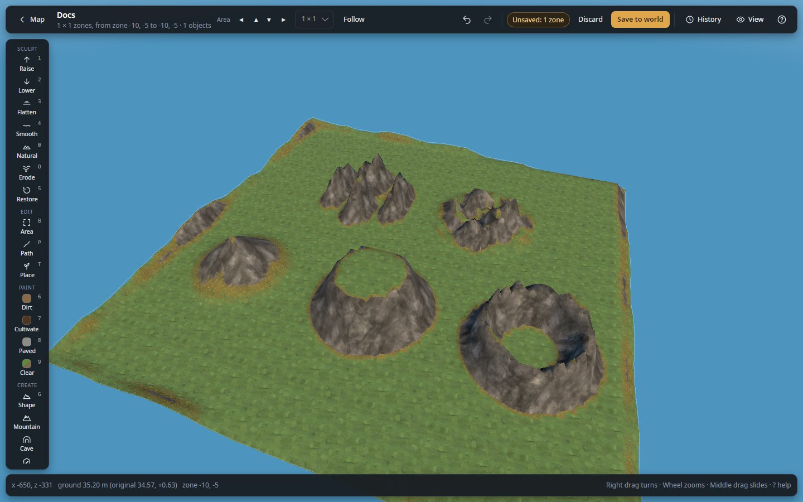
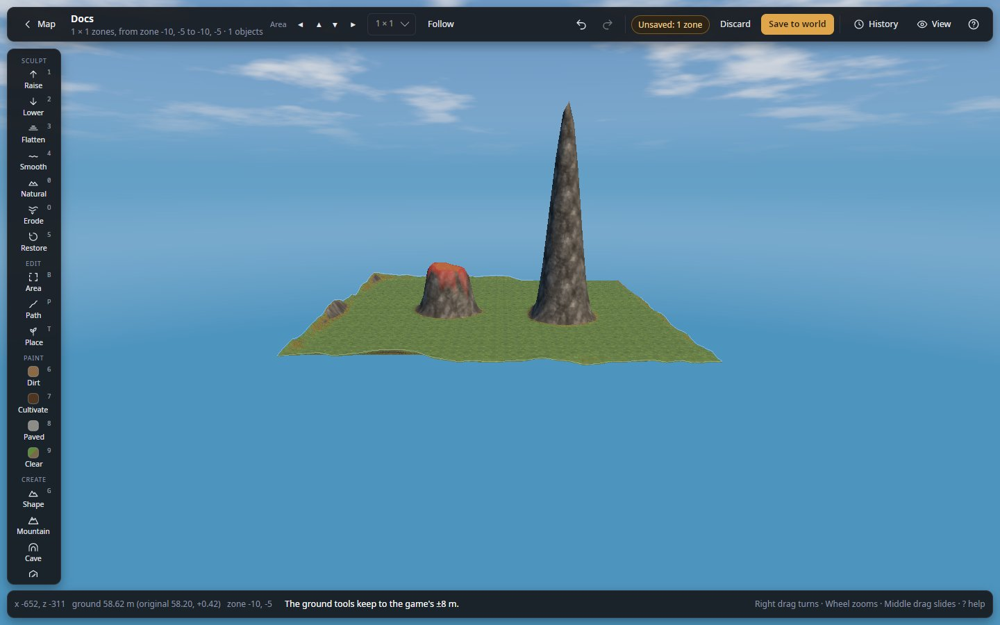

# Sculpt and paint

Raise, lower, level, smooth and paint the ground with a brush you hold and drag, as with the game's hoe, pickaxe and
cultivator, only faster and bigger.

**Where:** tool rail, **SCULPT** and **PAINT** sections · **Keys:** `1` to `9`, `0`, `O` · **Works in:** saved worlds,
live

*A mound made with three Raise strokes. The white ring on its top is the brush; the panel on the left holds its
settings.*

Every change follows the game's own rules, so the world loads in every player's game, console players included, with
no mod. Each stroke is one undo step (`Ctrl+Z`).

## Use it

1. In the tool rail, click a brush in **SCULPT** or **PAINT**, or press its key (see [Shortcuts](#shortcuts)).
2. In the panel, set **Size** and **Strength**. `[` and `]` change the size as you work.
3. Hold the left mouse button on the ground and move. The brush keeps working while the button is down, so holding
   still works the same spot more and more.
4. Let go. The whole stroke is one undo step, named after the brush ("Raise").
5. To keep the change, **Save** (or **Apply live** in [live mode](live-mode.md)). Until then it is
   [pending](concepts/saving-and-history.md#pending-changes).

The ring on the ground follows the hills under it and shows the brush's shape: a square or a stamp shows its turned
outline, the Ring shape a second, inner outline.

## Settings

The panel shows the settings every brush shares, then the chosen brush's own. Shape and Falloff are remembered.

| Setting | What it does |
|---|---|
| **Size** | The brush radius, 1 to 30 m (for a square, half its side). Default 6 m. |
| **Strength** | How fast the brush works, 0.05 to 1 (default 0.40). |
| **Shape** | **Circle**, **Square**, **Ring**, **Ragged (noise)**, or a picture (**Stamp: …**, see [Stamps](#stamps)). |
| **Falloff** | How the effect fades from the middle to the edge (below). Hidden for stamps: a picture has its own fade. |
| **Turn** | **Square** and stamps only: turns the brush, -180° to 180°. |
| **Load stamp…** / **Forget stamp** | Add a picture as a brush shape, or remove one you added (see [Stamps](#stamps)). |
| **Stamp once: a click puts the whole stamp in** / **Height** | Raise and Lower with a stamp only (see [Stamps](#stamps)). |
| Flatten, Naturalize, Erode settings | Shown only for that brush (see [Sculpt brushes](#sculpt-brushes)). |
| **No limit: past the game's ±8 m** | Lets the ground go past the game's limit (see [No limit](#no-limit)). Off each time the editor starts. |

### Shapes

| Shape | What it covers |
|---|---|
| **Circle** | A round brush. |
| **Square** | A square as wide as the brush. It turns with **Turn**. |
| **Ring** | Only a band: nothing inside 40% of the size, full strength at 70%, nothing at the edge. For crater rims, moats and earth walls. |
| **Ragged (noise)** | A round brush whose edge comes and goes by up to a third of the size. The pattern is fixed to the world, so two strokes over the same place have the same edge. |

*From left: Circle, Square, Ring, Ragged (noise) and the Crater rim stamp, each a dab of Paved paint.*

### Falloffs

| Falloff | How it fades | Good for |
|---|---|---|
| **Smooth** (default) | An S-curve: soft in the middle and at the edge. | Most work. |
| **Linear** | Evenly from the middle to the edge. | Cones, even slopes. |
| **Dome** | Stays strong far out, then drops fast near the edge. | Round hills with steep feet. |
| **Flat top** | Full strength over the inner 80%, fading only in the outer fifth. | Pads, terraces, flat-topped hills. |
| **Peak** | Strong only near the middle. | Spires and pits. |
| **Sharp edge (pickaxe)** | Full strength right to the edge, nothing beyond. | Steep walls and straight cuts. |

*The same Raise stroke with each falloff. From left: Smooth, Linear, Dome, Flat top, Peak, Sharp edge (pickaxe).*

## Sculpt brushes

| Brush (rail label) | Key | What it does |
|---|---|---|
| **Raise** | `1` | Lifts the ground while you hold the button. |
| **Lower** | `2` | Digs the ground down. |
| **Flatten** | `3` | Levels the ground to one height: lower ground is raised, higher ground cut. |
| **Smooth** | `4` | Evens out bumps and sharp edges. Go over a place again for more. |
| **Naturalize** (rail: **Natural**) | `0` | Turns flat, tool-made ground into natural-looking bumps. |
| **Erode** | `O` | Weathers the ground: steep slopes slide down, or rain cuts gullies. |
| **Restore** | `5` | Brings the ground back to how the world generated it, and removes paint. |

<!-- picture: lower-smooth-restore.jpg: one strip of three before/after pairs on flat Meadows ground, same camera height: a Lower pit (Lower panel visible), a rough mound after Smooth, a raised mound half taken away by a Restore stroke with the ring on it -->

Flatten, Smooth, Naturalize and Restore never overshoot: each moment they move the ground a share of the way to their
aim, so holding longer only brings it closer.

### Flatten

*One Flatten stroke started on the mound's top levelled it. **Level to the height where the stroke starts** is on, so
**Height (m)** is greyed and shows the height it took: 42.4 m.*

| Setting | What it does |
|---|---|
| **Level to the height where the stroke starts** | On (default): the ground where you press the button sets the height for the whole stroke. **Height (m)** shows it. |
| **Height (m)** | Used when the option above is off: every stroke levels to this height. |

To level to a height you choose, `Alt`+click the ground with any brush: the editor switches to **Flatten**, turns the
option above off and puts that height in **Height (m)**. Use it to make several pads match, or to level a site to
the height of a door you already built.

### Naturalize

| Setting | What it does |
|---|---|
| **Bumps** | How tall the bumps are, 0.2 to 4 m (default 1.2 m). |
| **Bump size** | How wide they are, 4 to 60 m (default 16 m): small values give rough ground, large values gentle swells. |
| **New pattern** | A new random bump pattern for the next Naturalize stroke and for natural paths. |

A second stroke over the same place does not pile up more bumps. The pattern is fixed to the world, so neighbouring
strokes join without seams. The [Path](path.md) tool's **Natural look** and the [Area](area.md) tool's **Naturalize**
use the same settings and pattern.

*Levelled ground, the same camera before and after: the left half was naturalized and shows soft bumps, the right
half stays flat.*

### Erode

| Setting | What it does |
|---|---|
| **Thermal** | Ground steeper than **Rest angle** slides down to its lower neighbours until it rests: screes below cliffs, softened tool-made walls. Ground is only moved, never lost. |
| **Water** | Rain: drops fall under the brush, run downhill, pick up ground where they run fast and drop it where they slow down. Many drops make gullies, fans of material at the foot of slopes and smoother valley floors. **Strength** sets how many drops fall. |
| **Rest angle** | **Thermal** only: the steepest slope that stays put, 10° to 60° (default 33°). Lower values flatten more. |

Material that slides or washes out of the brush can land just outside it. The [Area](area.md) tool's **Erode** does
both kinds over a whole selection at once.

*Left: a steep, smooth-sided mound as it was raised. Right: the same mound after Erode (Water), with gullies, ragged
flanks and material spread at its foot.*

### Restore

**Restore** takes your edits away a little each moment, until the ground is as the world generated it. It also takes
back ground raised or dug with [No limit](#no-limit) that is not saved yet. It removes paint only in the inner part of
the brush, so the paint's edge stays clean.

## Paint brushes

| Brush (rail label) | Key | What it does |
|---|---|---|
| **Dirt** | `6` | Bare dirt, like a trodden path. |
| **Cultivate** | `7` | Cultivated soil, as the cultivator makes. In game, crops can only be planted on it. |
| **Paved** | `8` | Paved stone ground. |
| **Clear paint** (rail: **Clear**) | `9` | Paints plain ground of the biome. |

Paint uses the same Size, Strength, Shape, Falloff and Mask as the sculpt brushes. It changes how the ground looks and
what grows there, never its height. A light stroke or the brush's soft edge gives a blend; hold longer for the full
colour.

**Clear paint or Restore?** **Clear paint** paints plain biome ground over everything, so it also hides dirt the
world generated there. **Restore** removes your paint, so the ground shows what the world generated again.

*Left: paved, cultivated and dirt stripes. Right: the same stripes after one Clear paint stroke across all three (its
panel on the left).*

## Stamps

A stamp is a picture used as the brush shape: white parts work fully, grey parts partly, black parts not at all.
Choose one in **Shape**, where stamps are listed as **Stamp: …**. A stamp covers a square twice as wide as **Size**
and turns with **Turn**. It works with every sculpt and paint brush.

| Stamp | Shape |
|---|---|
| **Mountain** | A rough peak. |
| **Mesa (flat top)** | A flat top with steep, slightly ragged sides. |
| **Crater rim** | A ring wall, for craters (Lower inside it afterwards) and old earthworks. |
| **Dunes** | Parallel ridges inside a round patch. |
| **Rocky ground** | Lumpy, broken ground. |

| Setting | What it does |
|---|---|
| **Load stamp…** | Uses any picture (PNG, JPEG…) as a stamp: a heightmap from another tool, a logo, a hand-drawn shape. Its brightness is the strength; transparent parts count as black. It is kept for next time under its file name. |
| **Forget stamp** | Removes the loaded picture chosen in **Shape**. Shown only for loaded pictures: the built-in stamps stay. |
| **Stamp once: a click puts the whole stamp in** | Raise or Lower only. One click puts the whole picture into the ground at once, instead of painting while you hold the button. One undo step ("Stamp: Mesa (flat top)"). |
| **Height** | With Stamp once: how high (Raise) or deep (Lower) the white parts go (m, default 4). |

*Each built-in stamp put in with Stamp once. Front row from left: Mountain, Mesa (flat top), Crater rim. Back row
from left: Dunes, Rocky ground.*

<!-- picture: stamp-once.jpg: Raise, Shape Stamp: Mesa (flat top), Stamp once on, Height 8 m, panel visible with these rows; left half of the shot the square outline on flat ground before the click, right half the mesa after it, same camera -->

## No limit

The game keeps every ground change within 8 m of the ground it generated. A brush stops there, tints the point red,
and the status bar says "Reached the game limit: ground can only move 8 m from its original height (red points)."
See [The game's 8 m limit](concepts/ground-limits.md#the-games-8-m-limit).

<!-- picture: limit-red.jpg: a Raise stroke held on flat ground until it stops at 8 m, Limit marks on in View, the mound's top tinted red, the status bar showing "Reached the game limit…" and the cursor readout "at the ±8 m limit" -->

**No limit: past the game's ±8 m**, at the bottom of the brush settings, lets the ground tools go up to 400 m from the
generated ground: cliffs, canyons, spires, deep caves. It works with every sculpt brush, Stamp once,
[Shape](shape.md), [Path](path.md) and [Area](area.md) (the same switch shows there). It is off each time the editor
starts. [Mountain](mountain.md) and pasting a copied place always go past the limit.

> [!IMPORTANT]
> Saving No limit ground reads the area again from the world and **clears its History**: you cannot undo past that
> save. Check the shape before you save.

*The same Raise stroke with No limit off (left: stopped at 8 m, its top red) and on (right: far higher). The panel
shows the switch.*

When you save, ground past ±8 m becomes invisible ground discs that every player's game builds the same way. The save
message says how many discs were made and how many trees and rocks were taken away, for example "No limit ground: 312
ground disc(s), 40 tree(s)/rock(s) taken away; some ground is up to 2.5 m off (too steep)". How this works and what
it changes in game: [No limit](concepts/ground-limits.md#no-limit).

After saving:

- Trees, rocks, ore, bushes and pickables where the ground moved more than 2 m are gone (they would be buried or
  float). Building pieces stay.
- The new ground counts as generated: **Restore**, and the game's hoe and pickaxe, work ±8 m from it. To take a saved
  shape away, work it down again with No limit on.
- Very steep walls come out a little softer than drawn.
- Zones no player has visited yet keep their old ground; the message says how many. Visit them in game first.
- The in-game map does not show the new shape.

## Shortcuts

| Key or mouse | What it does |
|---|---|
| `1` `2` `3` `4` `0` `O` `5` | Raise, Lower, Flatten, Smooth, Naturalize, Erode, Restore. |
| `6` `7` `8` `9` | Dirt, Cultivate, Paved, Clear paint. |
| `[` / `]` | Brush size 1 m smaller / larger. |
| Hold the left button and drag | Work the ground. |
| `Alt`+click | Pick the height there: switches to Flatten at that height. |
| `Alt`+`Shift`+click | Turn the [Mask](masks.md) on for 2 m below to 2 m above that spot. |
| Middle button drag | Slide the view (also while a brush is chosen). |
| `Ctrl+Z` | Undo the last stroke. |
| `Esc` | Leave the brush (back to View). |

All keys of the editor: [Shortcuts](help/shortcuts.md).

## Tips and limits

- **Read the ground under the cursor** in the status bar: `ground 41.20 m (original 35.00, +6.20)`. It adds "at the
  ±8 m limit" when the point is there. The sea is at 30 m.
- **The area's outermost line of points never changes**, so the area joins the land around it. To work there, move
  or grow the area: see [The locked edge](concepts/areas-and-zones.md#the-locked-edge).
- **The ground has one height per metre.** A wall always spans about a metre and the ground cannot overhang: caves are
  made with rocks (see [Dig a cave](guides/dig-a-cave.md)). An edge drawn north-east to south-west shows a small
  sawtooth, in game too.
- **Villages, the trader and dungeon entrances level the ground around them.** Your edits sit on top of that; turn on
  **Location flattening** in the View panel to see where. See
  [Locations level the ground](concepts/ground-limits.md#locations-level-the-ground).
- **Speed:** Raise and Lower move the middle of the brush about 2.4 m per second at the default Strength, 6 m per
  second at Strength 1.
- **Nothing changed?** The [Mask](masks.md) may leave out all the ground under the brush; the status bar says so.
- **To take a change back:** `Ctrl+Z` for the last stroke, **Restore** for one place, **Discard** for everything not
  saved. See [Undo changes](guides/undo-changes.md).

## Related

- [Raise or dig past the game's 8 m limit](guides/raise-past-the-limit.md)
- [Clear trees and rocks, level a building site](guides/clear-an-area.md)
- [Ground limits](concepts/ground-limits.md)
- [Mask](masks.md), [Shape](shape.md), [Mountain](mountain.md)
- [How the ground is stored](concepts/ground-limits.md#how-the-ground-is-stored), [how fast a brush works](concepts/ground-limits.md#how-fast-a-brush-works)
