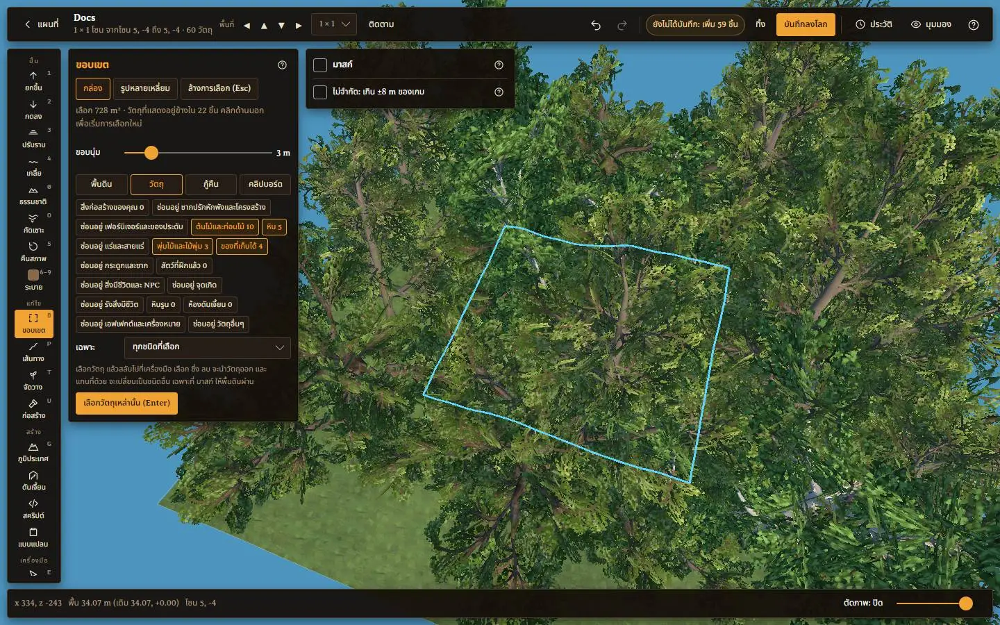
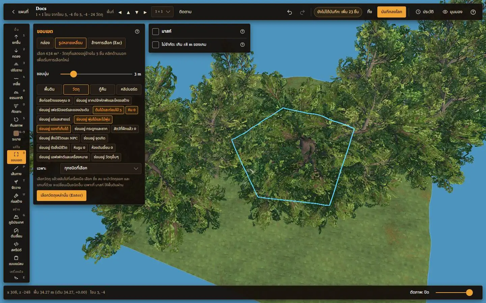
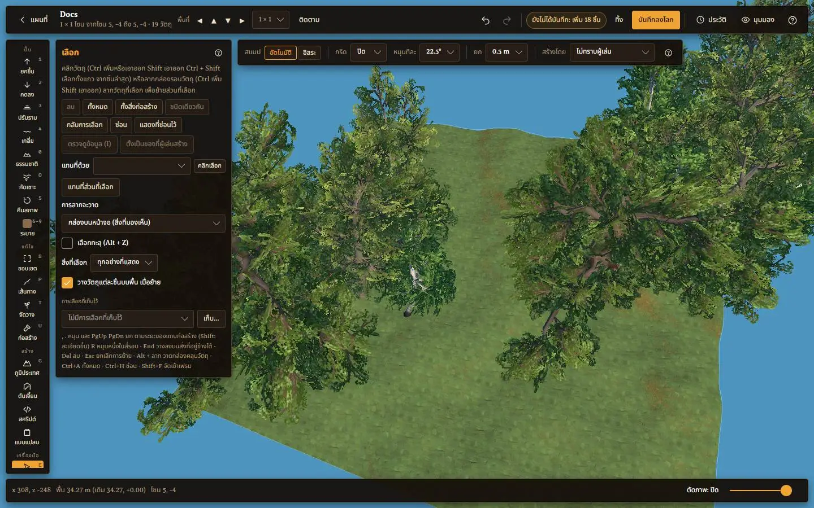
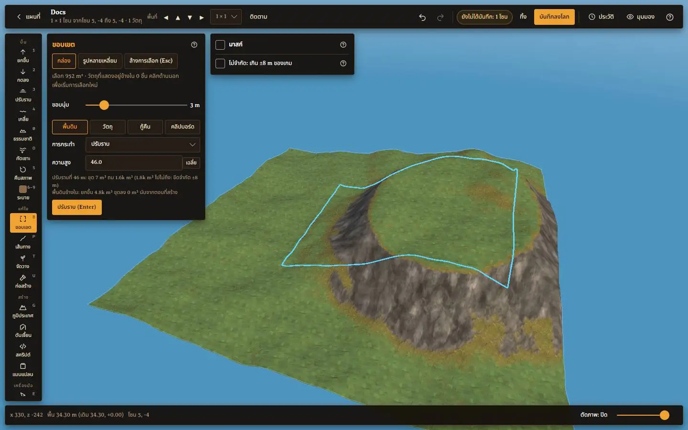
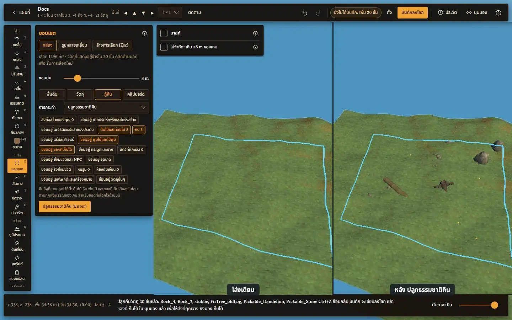
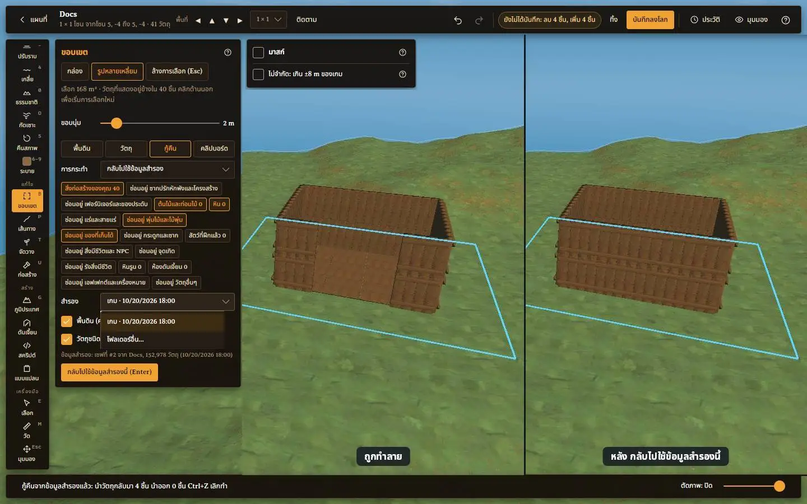
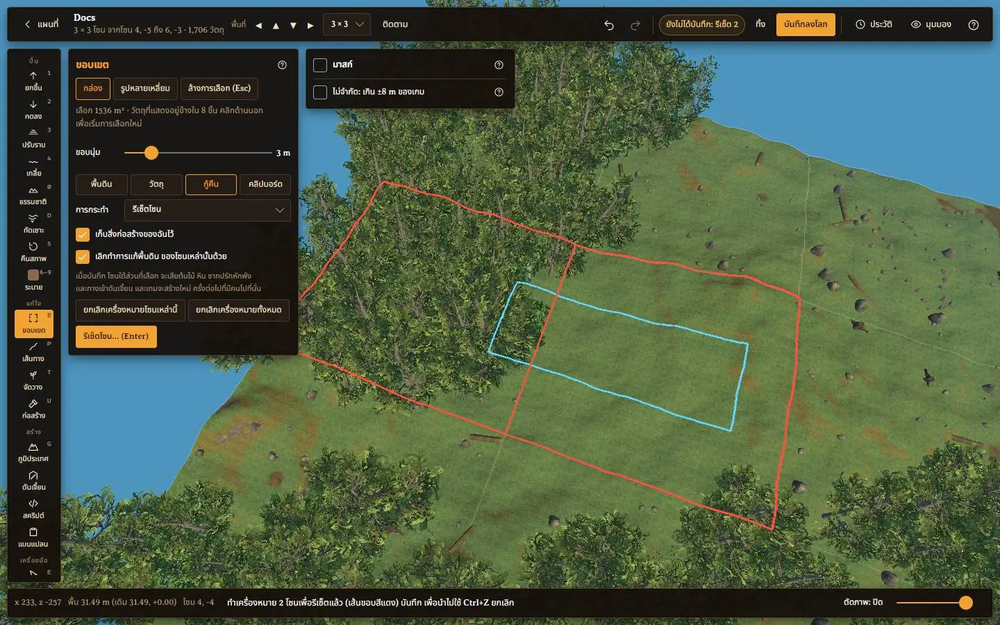
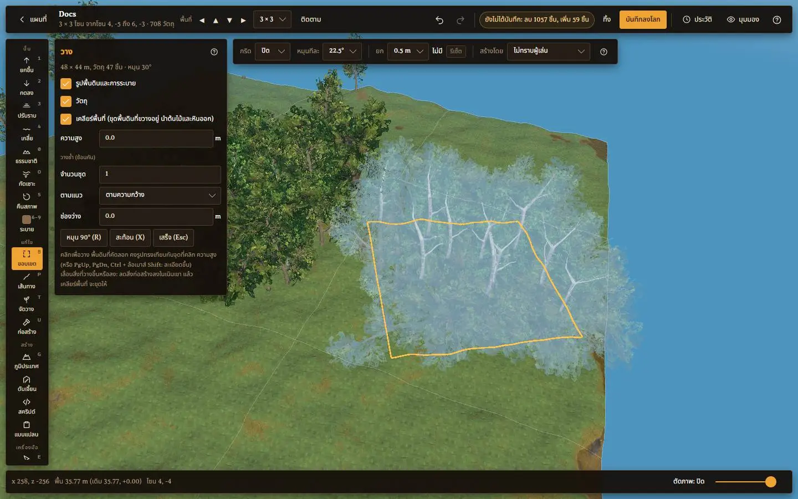
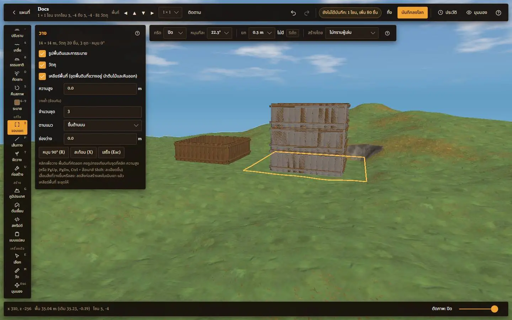
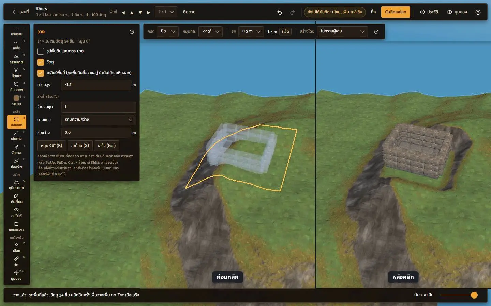

<!-- source: 89a0aafb -->
# ขอบเขต การคัดลอกและวาง

เปลี่ยนทุกอย่าง ภายในกล่องหรือรูปหลายเหลี่ยม ในคราวเดียว: ปรับระดับ หรือระบายพื้นดิน เลือกวัตถุข้างใน เพื่อลบ
หรือแทนที่ คัดลอกและวาง หรือคืนให้เป็นแบบเดิม: พื้นดินที่เกมสร้าง ข้อมูลสำรอง ธรรมชาติของเกมเอง

**ที่อยู่:** แถบเครื่องมือ ส่วน **แก้ไข** · **ปุ่ม:** `B` · **ใช้ได้กับ:** โลกที่บันทึกไว้ ไลฟ์

*กล่องที่ลากรอบกอต้นไม้ โดยเลือก **วัตถุ** ไว้: ชิปชนิด นับต้นไม้ หิน พุ่มไม้ และ
ของที่เก็บได้ข้างใน ยังไม่มีอะไรเปลี่ยน: ปุ่มด้านล่างจะเลือกวัตถุเหล่านั้น*

## ใช้งาน

1. ในแถบเครื่องมือ คลิก **ขอบเขต** (`B`)
2. ที่ด้านบนของแผง เลือก **กล่อง** หรือ **รูปหลายเหลี่ยม** แล้ววาดส่วนที่เลือกบนพื้น
3. เลือกกลุ่ม: **พื้นดิน** **วัตถุ** **กู้คืน** หรือ **คลิปบอร์ด** จากนั้น พื้นดิน และ กู้คืน จะแสดงการกระทำ
   ในรายการ **การกระทำ** แผงแสดงเฉพาะการตั้งค่า ของการกระทำที่เลือก และบรรทัดที่บอกว่าทำอะไร
4. กดปุ่มด้านล่าง หรือ `Enter` ป้ายของปุ่ม คือชื่อการกระทำ: **ปรับราบ (Enter)** **เลือกวัตถุเหล่านั้น
   (Enter)** **ปลูกธรรมชาติคืน (Enter)**…
5. ไม่ถูกใจ? `Ctrl+Z` ย้อนกลับ: การกระทำแต่ละครั้ง เป็นหนึ่งขั้นตอนใน ประวัติ **บันทึกลงโลก** (หรือ **นำไปใช้แบบไลฟ์**)
   จะเก็บไว้

| กลุ่ม | สิ่งที่อยู่ข้างใน |
|---|---|
| **พื้นดิน** | [การกระทำกับพื้นดิน](#การกระทำกบพนดน): ปรับราบ ยกขึ้น กดลง เกลี่ย ธรรมชาติ กัดเซาะ ระบาย และ [แผนที่ความสูง](#แผนทความสง) |
| **วัตถุ** | [เลือกวัตถุ](#การกระทำกบวตถ): วัตถุข้างใน ตามชนิด ส่งต่อให้เครื่องมือ เลือก เพื่อลบ แทนที่ หรือย้าย |
| **กู้คืน** | [สิ่งที่เคยอยู่](#กคนสงทเคยอย) นำกลับมา: [กลับเป็นพื้นดินที่เกมสร้าง](#กลบเปนพนดนทเกมสราง) [ปลูกธรรมชาติคืน](#ปลกธรรมชาตคน) [กลับไปใช้ข้อมูลสำรอง](#กลบไปใชขอมลสำรอง) [รีเซ็ตโซน](#รเซตโซน) |
| **คลิปบอร์ด** | [คัดลอกและวาง](#คดลอกและวาง) และ [พิมพ์เขียว](#พมพเขยว) |

การกระทำที่เลือก จะถูกจำไว้ และแต่ละกลุ่ม จะกลับมาที่การกระทำ ที่ใช้ล่าสุด [มาสก์](masks.md) ซึ่งอยู่ใน
การ์ดของตัวเองข้างแผง จำกัดการกระทำกับพื้นดิน เลือกวัตถุ ปลูกธรรมชาติคืน และ กลับไปใช้ข้อมูลสำรอง ให้อยู่บน
พื้นดินที่มาสก์ยอมให้ผ่าน

## การตั้งค่า

| การตั้งค่า | สิ่งที่ทำ |
|---|---|
| **กล่อง** | ลากสี่เหลี่ยมบนพื้น กล่องที่เล็กกว่าหนึ่งเมตร จะถูกทิ้ง การลากที่อื่น จะเริ่มกล่องใหม่ |
| **รูปหลายเหลี่ยม** | คลิกมุม ดับเบิลคลิก หรือ `Enter` จะปิดรูปทรง (อย่างน้อยสามมุม) `Backspace` ลบมุมสุดท้าย การคลิกหลังปิดรูปแล้ว จะเริ่มรูปใหม่ |
| **ล้างการเลือก (Esc)** | ล้างส่วนที่เลือก เพื่อเริ่มใหม่ |
| **ขอบนุ่ม** | 0 ถึง 20 m (เริ่มต้นที่ 3 m) การกระทำกับพื้นดิน จะค่อยๆ มีผล ตลอดระยะเท่านี้ ภายในเส้นรอบ ผลลัพธ์จึงกลมกลืน กับแผ่นดินรอบๆ ที่ **0** ขอบจะคม และตามเส้นรอบที่เอียง เป็นแนวตรง |
| **พื้นดิน** **วัตถุ** **กู้คืน** **คลิปบอร์ด** | กลุ่มของการกระทำที่แสดง (ดูตารางด้านบน) |
| **การกระทำ** | การกระทำของกลุ่ม สำหรับ พื้นดิน และ กู้คืน วัตถุ และ คลิปบอร์ด มีการกระทำเดียว จึงไม่มีรายการ |

บรรทัดใต้ปุ่ม แสดงพื้นที่ผิว และจำนวนวัตถุที่แสดงอยู่ข้างใน ("เลือก 1250 m² · วัตถุที่แสดงอยู่ข้างใน
84 ชิ้น") ส่วนที่เลือก จะวาดเฉพาะในเครื่องมือ ขอบเขต และขณะวาง และยังคงอยู่ เมื่อคุณใช้
เครื่องมืออื่น

*รูปหลายเหลี่ยมที่ปิดแล้ว รอบส่วนหนึ่งของป่า โดยเลือก **วัตถุ** ไว้*

*หลัง **เลือกวัตถุเหล่านั้น (Enter)** แล้วกด `Del` ในเครื่องมือ เลือก: ต้นไม้ในรูปหลายเหลี่ยม หายไป ต้นที่อยู่
ด้านนอก ยังตั้งอยู่*

## การกระทำกับพื้นดิน

แต่ละจุด จะถูกลดผลตาม **ขอบนุ่ม** และตามมาสก์ การกระทำเหล่านี้ คือการกระทำของ [แปรง](terrain.md) และของเครื่องมือ
[เส้นทาง](path.md) ในชื่อเดียวกัน: ที่นี่ จะใช้กับส่วนที่เลือกทั้งหมด ในครั้งเดียว

| การกระทำ | สิ่งที่ทำ |
|---|---|
| **ปรับราบ** | ปรับพื้นดินข้างใน ไปที่ **ความสูง** (m) **เฉลี่ย** ตั้ง ความสูง เป็นความสูงเฉลี่ย ของพื้นดินข้างใน |
| **ยกขึ้น** / **กดลง** | ยก / ขุดพื้นดินข้างใน ตาม **ปริมาณ** (m) |
| **เกลี่ย** | เกลี่ยเนินให้เรียบ: แต่ละจุด เลื่อนไปทางค่าเฉลี่ย ของพื้นดินภายใน 3 m |
| **ธรรมชาติ** | พื้นดินจะถูกเกลี่ย แล้วเพิ่มเนินแบบธรรมชาติ **เนินเล็ก** **ขนาดเนินเล็ก** และ **ลวดลายใหม่** แสดงอยู่ด้านล่าง: เป็นค่าของแปรง [ธรรมชาติ](terrain.md#ธรรมชาต) ค่าเดียวกัน ไม่ว่าจะตั้งที่ไหน |
| **กัดเซาะ** | ทำให้พื้นดินผุกร่อน ในครั้งเดียว: ทางลาดทรุดตัว ฝนกัดเป็นร่องน้ำ และทิ้งเนินตะกอน แล้วทางลาดทรุดตัวอีกครั้ง **มุมพักตัว** แสดงอยู่ด้านล่าง: เป็นค่าของแปรง [กัดเซาะ](terrain.md#กดเซาะ) ค่าเดียวกัน ไม่ว่าจะตั้งที่ไหน |
| **ระบาย** | ระบายพื้นดินข้างใน ด้วย **ดิน** **ดินพรวน** **ปูหิน** หรือ **ล้างการระบาย** (รายการด้านล่าง) |
| **แผนที่ความสูง** | พื้นดินในรูปภาพขาวดำ ส่งออกและนำกลับเข้า: ดู [แผนที่ความสูง](#แผนทความสง) |

หากต้องการคืนพื้นดิน ให้เป็นแบบที่โลกสร้างไว้ ให้เลือก **กู้คืน** แล้วเลือก
[กลับเป็นพื้นดินที่เกมสร้าง](#กลบเปนพนดนทเกมสราง)

การกระทำกับพื้นดิน อยู่ภายใน ±8 m ของเกม เว้นแต่ติ๊ก **ไม่จำกัด: เกิน ±8 m ของเกม** ไว้ในการ์ด **มาสก์**
ข้างแผง: สวิตช์เดียว สำหรับเครื่องมือพื้นดินทุกอัน ซึ่งเปิดค้างไว้ จนกว่าคุณจะปิด ดู
[ไม่จำกัด](terrain.md#ไมจำกด)

ใต้ **ปรับราบ** **ยกขึ้น** และ **กดลง**:

| การตั้งค่า | สิ่งที่ทำ |
|---|---|
| บรรทัดขุดและถม | ปริมาณพื้นดิน ที่การกระทำจะย้าย ("ปรับราบที่ 35 m: ขุด 120 m³ ถม 340 m³") และสำหรับ ปรับราบ ส่วนที่ไปไม่ถึง ("(40 m³ ไปไม่ถึง: ขีดจำกัด ±8 m)" เมื่อเปิด ไม่จำกัด จะนับเฉพาะส่วนที่เกิน ±400 m) บรรทัดที่สอง "พื้นดินข้างใน: ยกขึ้น … ขุดลง … นับจากตอนที่สร้าง" เทียบกับโลก ตามที่เกมสร้าง ทั้งสองบรรทัด ตามทุกการเปลี่ยนแปลง ขอบนุ่ม และมาสก์ |

*กล่องที่ครอบเนิน โดยใช้ **ปรับราบ** ที่ 46 m และปิด **ไม่จำกัด**: "ปรับราบที่ 46 m: ขุด 0 m³ ถม 1.5k m³ (2.2k
m³ ไปไม่ถึง: ขีดจำกัด ±8 m)" และด้านล่าง คือพื้นดินข้างใน ที่ถูกยกขึ้นแล้ว นับจากตอนที่โลกถูกสร้าง*

### แผนที่ความสูง

ส่งออกพื้นดิน เป็นรูปภาพขาวดำ แก้ไขในโปรแกรมแต่งภาพ (GIMP, Krita…) หรือเครื่องมือสร้างภูมิประเทศ (Gaea, World
Machine…) แล้วนำกลับเข้ามา

| การตั้งค่า | สิ่งที่ทำ |
|---|---|
| **ส่งออก** | เขียนพื้นดินของกล่อง ที่ครอบส่วนที่เลือก หรือของพื้นที่ที่เปิดอยู่ทั้งหมด เมื่อไม่ได้เลือกอะไร เป็น PNG ขาวดำ 16 บิต: สีดำคือจุดต่ำสุด สีขาวคือจุดสูงสุด ทิศเหนืออยู่ด้านบน หนึ่งพิกเซลต่อหนึ่งเมตร (พื้นที่ 3 × 3 ทั้งหมด คือ 193 × 193 พิกเซล) ไฟล์อยู่ในโฟลเดอร์ `heightmaps` ของโฟลเดอร์ข้อมูลของเอดิเตอร์ แถบสถานะบอกว่าอยู่ที่ไหน รูปหลายเหลี่ยม จะส่งออกเป็นกล่อง ที่ครอบรูปนั้น |
| **นำเข้า…** | อ่าน PNG (ขาวดำหรือสี 8 หรือ 16 บิต) แล้วปรับให้พอดี กับกล่องของส่วนที่เลือก หรือกับทั้งพื้นที่ เมื่อไม่ได้เลือกอะไร |
| **ต่ำสุด** / **สูงสุด** | ความสูงของสีดำและสีขาว รูปภาพที่เอดิเตอร์ส่งออก จะมีค่าของตัวเองมาด้วย รูปที่ไม่ได้แก้ไข จึงคืนพื้นดินได้ตรงทุกจุด |
| **ใส่ลงในพื้นดิน** | ตั้งพื้นดิน ตามความสูงของรูปภาพ เป็นการเลิกทำหนึ่งขั้นตอน ภายในส่วนที่เลือก **ขอบนุ่ม** จะผสมให้กลมกลืน มาสก์และขีดจำกัด ±8 m มีผล (เว้นแต่เปิด ไม่จำกัด): จุดที่ไปไม่ถึงความสูง จะเป็นสีแดง และแถบสถานะนับจำนวน |
| **ยกเลิก** | ลืมรูปภาพ โดยไม่เปลี่ยนพื้นดิน |

ใช้ 16 บิต เมื่อทำได้: รูปภาพ 8 บิต มีเพียง 256 ระดับ ระหว่าง ต่ำสุด และ สูงสุด (ระดับละ 20 cm บนช่วง 50 m)

*เมื่อไม่ได้เลือกอะไร หลัง **ส่งออก** แล้ว **นำเข้า…** รูปเดียวกัน: "รูปภาพ 65 × 65 ปรับให้พอดีกับ 65 × 65 m
(ทั้งพื้นที่) ด้วยความสูงตอนที่ส่งออก" **ต่ำสุด** และ **สูงสุด** อ่านจากรูปนั้น ไม่มีอะไรเปลี่ยน
จนกว่าจะกด **ใส่ลงในพื้นดิน***

## การกระทำกับวัตถุ

เครื่องมือ ขอบเขต เลือกว่า **วัตถุไหน**: วัตถุภายในส่วนที่เลือก ของชนิดที่คุณเปิด ในที่ที่มาสก์
ยอมให้พื้นดินผ่าน จากนั้นเครื่องมือ [เลือก](select.md) จะ **ทำอะไร** กับวัตถุเหล่านั้น: ลบ แทนที่ ย้าย หมุน
คัดลอก ซ่อน

แถว **ชิปชนิด** ใช้เลือกชนิด ชิปแต่ละอัน แสดงจำนวนวัตถุ ของชนิดนั้นข้างใน ("ต้นไม้และท่อนไม้
42") ในตอนแรก **ต้นไม้และท่อนไม้** **หิน** **พุ่มไม้และไม้พุ่ม** และ **ของที่เก็บได้** เปิดอยู่ เลือก **สิ่งก่อสร้างของคุณ**
สำหรับชิ้นส่วนที่ผู้เล่นสร้าง **แร่และสายแร่** สำหรับทองแดง ดีบุก เงิน และอื่นๆ ชิปชุดเดียวกัน ใช้เลือกชนิด สำหรับ
[ปลูกธรรมชาติคืน](#ปลกธรรมชาตคน) และ [กลับไปใช้ข้อมูลสำรอง](#กลบไปใชขอมลสำรอง)

ชิปที่แสดง "ซ่อนอยู่" คือชนิดที่ปิดไว้ใน [แผง มุมมอง](editor-basics.md): วัตถุของชนิดนั้น จะไม่ถูกนับ
และไม่ถูกแตะต้อง ยกเว้นโดย **กลับไปใช้ข้อมูลสำรอง**

| การตั้งค่า | สิ่งที่ทำ |
|---|---|
| ชิปชนิด | ชนิดของวัตถุที่จะเอา |
| **เฉพาะ** | **ทุกชนิดที่เลือก** เอาทั้งหมด หรือเลือกวัตถุหนึ่งอย่าง จากที่อยู่ข้างใน ซึ่งแสดงพร้อมจำนวน เรียงจากที่มีมากที่สุด ("Beech1 (42)"): จะเอาเฉพาะวัตถุนั้น รายการเปลี่ยนตามชิป |
| **เลือกวัตถุเหล่านั้น (Enter)** | เลือกวัตถุ แล้วสลับไปที่เครื่องมือ เลือก แถบสถานะบอกว่ากี่ชิ้น เมื่อไม่มีวัตถุ ของชนิดที่เลือกข้างใน จะบอกไว้ และยังอยู่ในเครื่องมือ ขอบเขต |

จากนั้น ในเครื่องมือ เลือก:

| หากต้องการ | ให้ทำแบบนี้ |
|---|---|
| นำออก | กด `Del` (หรือ **ลบ**) เป็นหนึ่งขั้นตอนใน ประวัติ `Ctrl+Z` นำกลับมา กลุ่มที่เชื่อมกัน (เรือของม็อด) จะหายไปทั้งกลุ่ม |
| แทนที่ด้วยชนิดอื่น | เลือกชนิดใน **แทนที่ด้วย** (หรือ **คลิกเลือก** จากโลก) แล้วกด **แทนที่ส่วนที่เลือก** หากต้องการแทนที่ เฉพาะต้นบีชในป่า ให้เลือกต้นบีชใน **เฉพาะ** ก่อน ดู [เลือก](select.md#การตงคา) |
| ย้าย หมุน คัดลอก ซ่อน | เหมือนส่วนที่เลือกทั่วไป: ดู [เลือก](select.md) |
| กลับมา | กด `B`: กล่องหรือรูปหลายเหลี่ยม ยังอยู่ |

## กู้คืนสิ่งที่เคยอยู่

สี่วิธีในการนำสิ่งที่เคยอยู่กลับมา จากเบาที่สุด ไปหนักที่สุด

| การกระทำ | สิ่งที่นำกลับมา |
|---|---|
| **กลับเป็นพื้นดินที่เกมสร้าง** | พื้นดินข้างใน ตามที่โลกสร้างไว้ วัตถุยังอยู่ |
| **ปลูกธรรมชาติคืน** | ต้นไม้ หิน พุ่มไม้ และของที่เก็บได้ ที่เกมปลูกตรงนี้ บนพื้นดินตามที่เป็นอยู่ตอนนี้ |
| **กลับไปใช้ข้อมูลสำรอง** | พื้นดินและวัตถุข้างใน ตามที่เป็นในข้อมูลสำรอง ของโลกนี้ |
| **รีเซ็ตโซน** | ทั้งโซน ที่เกมสร้างใหม่ ครั้งถัดไปที่มีคนไปที่นั่น |

### กลับเป็นพื้นดินที่เกมสร้าง

พื้นดินข้างใน จะกลับเป็นแบบที่โลกสร้างไว้: ความสูง (รวมพื้นดินที่ยก หรือขุดด้วย ไม่จำกัด)
และการระบาย ลดผลตาม **ขอบนุ่ม** และตามมาสก์ เหมือน [การกระทำกับพื้นดิน](#การกระทำกบพนดน) ทำกับ
กล่องหรือรูปหลายเหลี่ยม แบบเดียวกับที่แปรง [คืนสภาพ](terrain.md#คนสภาพ) ทำใต้เคอร์เซอร์

### ปลูกธรรมชาติคืน

*ซ้าย: กล่องบนพื้นโล่ง ขวา: กล่องเดียวกัน หลัง **ปลูกธรรมชาติคืน**: ต้นไม้และหินของเกมเอง สำหรับ
ไบโอมนั้น และแถบสถานะบอกว่าอะไรขึ้นบ้าง*

ปลูกธรรมชาติคืน จะคืนต้นไม้ หิน พุ่มไม้ ของที่เก็บได้ และแร่ ที่เกมปลูกตรงนี้ สำหรับชนิดที่เลือก
ด้วย [ชิปชนิด](#การกระทำกบวตถ) ภายในส่วนที่เลือก และในที่ที่มาสก์ยอมให้ ใช้เพื่อเลิกทำการเคลียร์ป่า หรือตกแต่งพื้นดิน ที่คุณ
ปั้นใหม่

- **เป็นไปตามกฎของเกมเอง** และซีดของโลก: บนพื้นดินที่ยังเป็นแบบที่สร้างไว้ คุณจะได้ต้นไม้เดิม
  ในที่เดิมกลับมา ไบโอมรอง (Dark Meadows, Rock Black Forest…) จะได้สิ่งที่ไบโอมรองเพิ่มเข้ามา
- **ใช้พื้นดินตามที่เป็นอยู่ตอนนี้**: เนินที่คุณยกขึ้น จะได้สิ่งที่ขึ้น ตามความสูงและความชันใหม่
- **ไม่ปลูกซ้ำกับสิ่งที่ตั้งอยู่**: ไม่มีอะไรขึ้น ภายใน 1 m จากวัตถุ ภายใน 3 m จากวัตถุชนิดเดียวกัน หรือภายใน 4 m จาก
  ชิ้นส่วนก่อสร้าง และไม่ขึ้นในที่ ที่สถานที่ (หมู่บ้าน ทางเข้าดันเจี้ยน) เคลียร์พื้นไว้
- **ได้ถึง 16 โซนในครั้งเดียว** (256 × 256 m): เลือกส่วนที่เล็กลง หากต้องการมากกว่านั้น
- หากชนิดที่ปลูกขึ้น ถูกซ่อนไว้ใน มุมมอง จะเปิดชนิดนั้น เพื่อให้สิ่งที่ขึ้นมา ยังมองเห็นได้

กฎทั้งหมด: [กฎการเติบโต](concepts/objects.md#กฎการเตบโต)

### กลับไปใช้ข้อมูลสำรอง

คืนส่วนที่เลือก ให้เป็นแบบในข้อมูลสำรอง ของโลกนี้ เพื่อเลิกทำการก่อกวน การบุกที่เสียหาย หรือการแก้ไขที่คุณเสียใจ
โดยไม่ต้องย้อนทั้งโลก ทีละขั้นตอน: [คืนสภาพพื้นที่หนึ่ง จากข้อมูลสำรอง](guides/restore-from-backup.md)

| การตั้งค่า | สิ่งที่ทำ |
|---|---|
| **สำรอง** | ข้อมูลสำรองข้างโฟลเดอร์ของโลก เรียงจากใหม่สุด: ของเกมเอง ("เกม · วันที่") และของเอดิเตอร์ จากเวอร์ชันเก่า ("เอดิเตอร์ · วันที่") **โฟลเดอร์อื่น…** เลือกสำเนาอื่นใด ของโลกเดียวกัน เช่น ข้อมูลสำรองของเซิร์ฟเวอร์ ที่คัดลอกมาที่คอมพิวเตอร์เครื่องนี้ ในโหมดไลฟ์ รายการจะว่าง จึงต้องใช้วิธีนี้ สำเนาของโลกอื่น (ซีดอื่น) จะถูกปฏิเสธ บรรทัดด้านล่าง บอกว่าเป็นเซฟไหน และมีวัตถุกี่ชิ้น |
| **พื้นดิน (ความสูงและการระบาย)** | พื้นดินข้างใน กลับมาตรงตามข้อมูลสำรอง รวมพื้นดินแบบ ไม่จำกัด ภายใน **ขอบนุ่ม** จะผสมให้กลมกลืน มาสก์มีผล |
| **วัตถุชนิดที่เลือกไว้ด้านบน** | วัตถุของชนิดที่เลือก ด้วย [ชิปชนิด](#การกระทำกบวตถ) จะกลับมาพร้อมข้อมูลทั้งหมด: หีบที่กู้คืน จะมีของข้างใน เลือก **สิ่งก่อสร้างของคุณ** เพื่อนำสิ่งก่อสร้างกลับมา |
| **กลับไปใช้ข้อมูลสำรองนี้ (Enter)** | ดำเนินการ: เป็นหนึ่งขั้นตอนใน ประวัติ |

วัตถุที่เหมือนกันทั้งสองฝั่ง (ชนิด ตำแหน่ง และทิศที่หัน เหมือนกัน) จะไม่ถูกแตะต้อง วัตถุอื่นทุกชิ้น ของชนิดที่เลือก
ข้างใน จะถูกนำออก แม้ซ่อนไว้ใน มุมมอง และวัตถุทุกชิ้น ในข้อมูลสำรองที่ไม่ตรงกัน จะกลับมา หินรูน
ไม่ถูกแตะต้องเลย เมื่อไม่มีอะไรต่างกัน แถบสถานะจะแสดง "ไม่มีอะไรให้กู้คืน: ส่วนที่เลือก เหมือนในข้อมูลสำรองแล้ว"

*ซ้าย: รูปหลายเหลี่ยมรอบกระท่อม ที่ผนังด้านหน้าหายไปบางส่วน เลือก **กลับไปใช้ข้อมูลสำรอง** ไว้ รายการ **สำรอง**
เปิดอยู่ที่ข้อมูลสำรองของเกม และเปิด **สิ่งก่อสร้างของคุณ** ขวา: หลัง **กลับไปใช้ข้อมูลสำรองนี้ (Enter)** ผนัง
กลับมาสมบูรณ์ บรรทัดเหนือปุ่ม ระบุเซฟของข้อมูลสำรอง แถบสถานะนับสิ่งที่กลับมา*

### รีเซ็ตโซน

ทำเครื่องหมายโซนใต้ส่วนที่เลือก เพื่อให้เกมสร้างโซนเหล่านั้นใหม่: ต้นไม้ หิน แร่ และสถานที่ใหม่ หากต้องการเลือก
โซนทั่วทั้งโลก ตามไบโอม หรือระยะห่างจากสิ่งก่อสร้าง ให้ใช้
[แผนที่โลก](map.md#รเซตโซนทวทงโลก) ซึ่งมีสวิตช์สองตัวเดียวกัน และทำเครื่องหมายแบบเดียวกัน ทีละ
ขั้นตอน: [สร้างโซนใหม่](guides/reset-zones.md)

| การตั้งค่า | สิ่งที่ทำ |
|---|---|
| **เก็บสิ่งก่อสร้างของฉันไว้** | วัตถุที่ผู้เล่นสร้างในโซน จะถูกเก็บไว้ เปิดอยู่ตั้งแต่แรก เมื่อปิด สิ่งก่อสร้างในโซน จะหายไปด้วย |
| **เลิกทำการแก้พื้นดิน ของโซนเหล่านั้นด้วย** | เลิกทำการแก้พื้นดินของโซนด้วย: ความสูง (รวมพื้นดินแบบ ไม่จำกัด) และการระบาย มุมมองจะแสดงพื้นดิน กลับเป็นแบบที่สร้างไว้ ทันทีที่ทำเครื่องหมายโซน เปิดอยู่ตั้งแต่แรก |
| **รีเซ็ตโซน… (Enter)** | ทำเครื่องหมายทุกโซน ใต้ส่วนที่เลือก เพื่อรีเซ็ต (เส้นรอบสีแดง) หลังจากถามก่อน |
| **ยกเลิกเครื่องหมายโซนเหล่านี้** | ยกเลิกเครื่องหมายโซน ใต้ส่วนที่เลือก: โซนเหล่านั้นจะไม่ถูกรีเซ็ต |
| **ยกเลิกเครื่องหมายทั้งหมด** | ยกเลิกเครื่องหมายทุกโซน ที่ทำเครื่องหมายเพื่อรีเซ็ต รวมถึงที่ทำบนแผนที่ และนอกพื้นที่ที่เปิดอยู่ เป็นหนึ่งขั้นตอนใน ประวัติ |

โซนจะนับ เมื่อเส้นรอบครอบ จุดพื้นดินของโซนอย่างน้อยหนึ่งจุด ไม่ว่าขอบนุ่มจะเป็นเท่าไร: โซนที่ส่วนที่เลือก
อยู่ด้านนอก จะไม่ถูกรีเซ็ต การรีเซ็ตเกิดขึ้น เมื่อคุณบันทึก (ออฟไลน์) หรือนำไปใช้แบบไลฟ์ (WorldEditorBridge 0.10.0 ขึ้นไป)

> [!CAUTION]
> **เมื่อบันทึกหรือนำไปใช้แล้ว การรีเซ็ตย้อนกลับไม่ได้** ต้นไม้ หิน ซากปรักหักพัง ทางเข้าดันเจี้ยน สิ่งมีชีวิต และไอเทม
> ที่ตกอยู่ในโซน จะหายไปทั้งหมด หลุมศพของผู้เล่นยังอยู่ สัตว์ที่ฝึกแล้ว ไม่มีผู้สร้าง จึงหายไปด้วย: ย้ายออกไป
> ก่อน

*กล่องที่ครอบสองโซน **รีเซ็ตโซน** โดยเปิด **เก็บสิ่งก่อสร้างของฉันไว้** และ **เลิกทำการแก้พื้นดิน ของโซนเหล่านั้นด้วย** หลัง
**รีเซ็ตโซน… (Enter)**: ทั้งสองโซนมีเส้นรอบสีแดง แถบสถานะนับจำนวน ไม่มีอะไรถูกรีเซ็ต จนกว่าคุณจะบันทึก*

## คัดลอกและวาง

*ป่าที่คัดลอกมา มีต้นไม้และหินหลายสิบ ตามเคอร์เซอร์ โปร่งแสง และหมุน 30° บรรทัดที่ด้านบน
ของแผง วาง บอกว่ามีอะไรอยู่ในคลิปบอร์ด คลิกเพื่อวางลง*

กลุ่ม **คลิปบอร์ด** แสดงปุ่มเหล่านี้ `Ctrl+C` และ `Ctrl+X` ใช้ได้กับทุกการกระทำ ของเครื่องมือ ขอบเขต (และใน
เครื่องมือ เลือก) `Ctrl+V` ใช้ได้ในทุกเครื่องมือ

| การตั้งค่า | สิ่งที่ทำ |
|---|---|
| **คัดลอก (Ctrl+C)** | คัดลอกทุกวัตถุ ที่แสดงอยู่ข้างใน (ไม่ว่าชิปชนิดจะเป็นอย่างไร) และพื้นดินที่สิ่งก่อสร้างตั้งอยู่ เมื่อวาง ต้นไม้ หิน และสิ่งที่คล้ายกัน จะคงความสูงเหนือพื้น ตรงที่แต่ละชิ้นลงไป ชิ้นส่วนก่อสร้าง จะคงรูปทรงของสิ่งก่อสร้าง ชนิดที่โลกสร้างไม่ได้ จะไม่ถูกรวม สำเนาจะถูกจำไว้: วางในพื้นที่อื่น โลกอื่น หรือหลังเปิดเอดิเตอร์ใหม่ได้ |
| **ตัด (Ctrl+X)** | คัดลอกแบบเดียวกัน แล้ววัตถุที่คัดลอก จะออกจากโลก (`Ctrl+Z` นำกลับมา) การวางจึงเป็นการย้าย พื้นดินยังอยู่ |
| **วาง (Ctrl+V)** | เริ่มวาง: สำเนาตามเคอร์เซอร์ คลิกเพื่อวางลง วางกี่ชุดก็ได้ `Esc` หยุด |
| **บันทึกพิมพ์เขียว…** / **คลังพิมพ์เขียว…** | ดู [พิมพ์เขียว](#พมพเขยว) |

บรรทัดใต้ปุ่ม บอกว่ามีอะไรในคลิปบอร์ด ("คลิปบอร์ด: 24 × 18 m, วัตถุ 54 ชิ้น" พร้อมชื่อของพิมพ์เขียว
เมื่อมาจากคลัง) ส่วนที่เลือก ที่ไม่มีวัตถุที่แสดงอยู่ข้างใน จะไม่คัดลอกอะไร (พื้นดินจะไปด้วย
ก็ต่อเมื่อมีสิ่งก่อสร้าง): แถบสถานะจะบอกไว้ และคลิปบอร์ดยังเก็บสิ่งเดิมไว้

สำเนาประกอบด้วย:

- **วัตถุ พร้อมข้อมูลทั้งหมด**: ของในหีบ ข้อความบนป้าย พลังชีวิต ผู้สร้าง
- **พื้นดินเฉพาะใต้สิ่งก่อสร้าง**: ใต้ชิ้นส่วนก่อสร้างแต่ละชิ้น บวก 1 m แล้วค่อยๆ จางลง อีก 3 เมตร
  พื้นดินส่วนอื่นของส่วนที่เลือก ไม่ถูกคัดลอก เมืองที่วางลงไป จึงอยู่บนแผ่นดิน ตรงที่วาง
- **ความสูงสองแบบ** ต้นไม้ หิน และธรรมชาติอื่นๆ คงความสูงเหนือพื้น และตามพื้นดิน
  ตรงที่แต่ละชิ้นลงไป ชิ้นส่วนก่อสร้าง และส่วนของกลุ่มที่เชื่อมกัน (เรือของม็อด) คงรูปทรงของสิ่งก่อสร้าง
  วัดจากพื้นดินเฉลี่ยของสำเนา ซึ่งจะไปอยู่ที่ความสูง ของพื้นดินตรงที่คุณคลิก

การคัดลอกของเครื่องมือ [เลือก](select.md) มีเฉพาะวัตถุที่คุณเลือก และพื้นดินใต้ชิ้นส่วนก่อสร้าง
โดยไม่มีการระบาย และวางแบบเดียวกัน

### การวาง

*คลิกหนึ่งครั้ง โดยตั้ง **จำนวนชุด** 3 และ **ตามแนว** ขึ้นด้านบน มองจากพื้น: ข้างกระท่อมต้นฉบับ มีสำเนาสามชุด
ซ้อนกันเป็นสามชั้น (เส้นรอบคือการวางครั้งถัดไป ที่ตามเคอร์เซอร์)*

การวางต้องพอดี กับพื้นที่ที่เปิดอยู่: เส้นรอบจะเป็นสีแดง เมื่อไม่พอดี และการคลิกตรงนั้น จะบอกไว้ เปิดพื้นที่
ที่ใหญ่ขึ้นก่อน (รายการขนาดพื้นที่ในแถบด้านบน หรือ [แผนที่](map.md))

| การตั้งค่า | สิ่งที่ทำ |
|---|---|
| **รูปพื้นดินและการระบาย** | วางพื้นดินใต้สิ่งก่อสร้าง โดยคงรูปทรง เทียบกับจุดที่คุณคลิก เกิน ±8 m ของเกม เมื่อจำเป็น สิ่งก่อสร้างจะตั้งอยู่บนพื้นดิน ที่สร้างไว้ |
| **วัตถุ** | วางวัตถุที่คัดลอกไว้ |
| **เคลียร์พื้นที่ (ขุดพื้นดินที่ขวางอยู่ นำต้นไม้และหินออก)** | เปิดอยู่ตั้งแต่แรก ขุดพื้นดินที่ขวาง ชิ้นส่วนก่อสร้างที่วาง ลงไปถึงชิ้นที่ต่ำที่สุด (ไม่เคยยกพื้นดิน) และนำต้นไม้ หิน แร่ พุ่มไม้ และของที่เก็บได้ ในรอยฐานออก สิ่งก่อสร้างและสิ่งมีชีวิตยังอยู่ |
| **ความสูง** | เลื่อนสิ่งที่วาง ขึ้นหรือลง (m) `PgUp` `PgDn` และ `Ctrl` + ล้อเมาส์ ก็ทำได้ ลดสิ่งก่อสร้าง ลงไปในเนิน แล้ว เคลียร์พื้นที่ จะขุดออกให้ |

ใต้ **วางซ้ำ (ซ้อนกัน)**:

| การตั้งค่า | สิ่งที่ทำ |
|---|---|
| **จำนวนชุด** | จำนวนสำเนา ที่คลิกหนึ่งครั้งวาง 1 ถึง 50 ทั้งหมดเป็นการเลิกทำหนึ่งขั้นตอน |
| **ตามแนว** | ทิศที่สำเนาเรียงต่อกัน: **ตามความกว้าง** หรือ **ตามความลึก** (หมุนและสะท้อน ไปพร้อมสิ่งที่วาง) หรือ **ขึ้นด้านบน** (ชั้นซ้อนกัน) |
| **ช่องว่าง** | ระยะห่างระหว่างสองสำเนา (m) ค่าติดลบ จะซ้อนทับกัน เมื่อขึ้นด้านบน ขนาดของสำเนา คือความสูงบวกหนึ่งเมตร |

ที่ด้านล่างของแผง:

| การตั้งค่า | สิ่งที่ทำ |
|---|---|
| **หมุน 90° (R)** | หมุนหนึ่งในสี่รอบ `,` และ `.` หมุนตามระยะ **หมุนทีละ** ของแถบก่อสร้าง (`Shift`: 1°) |
| **สะท้อน (X)** | สะท้อนสิ่งที่วาง จากตะวันออกไปตะวันตก ก่อนหมุน |
| **เสร็จ (Esc)** | หยุดวาง กลับไปที่เครื่องมือ ขอบเขต |

ขณะวาง [แถบก่อสร้าง](build.md#แถบกอสราง) จะแสดงข้างแผง เป็นแถบเดียวกับที่ ก่อสร้าง และ เลือก
ใช้: **กริด** (สิ่งที่วางจะยึดตามกริด) **หมุนทีละ** และ **ยก** (ระยะของ `,` `.` และของ `PgUp` `PgDn` แถบ
แสดงความสูง **รีเซ็ต** คืนเป็นไม่มี) และ **สร้างโดย**

สำเนาที่วางเรียงข้างกัน จะตั้งอยู่บนพื้นดินตรงที่ลงไป เมื่อซ้อนขึ้นด้านบน มีเพียงชุดแรกที่ปั้นพื้นดิน
บรรทัดที่ด้านบนของแผง บอกว่ามีอะไรในคลิปบอร์ด: ชื่อ ขนาด วัตถุ จำนวนชุด การหมุน การสะท้อน แถบสถานะ
บอกว่าการวางทำอะไร: "วางแล้ว พร้อมพื้นดิน, วัตถุ 54 ชิ้น, เคลียร์ต้นไม้ หิน และสิ่งอื่นๆ 7 ชิ้น ออกจาก
พื้นที่"

*เมื่อเปิด **เคลียร์พื้นที่** (ปิด **รูปพื้นดินและการระบาย** **ความสูง** -1.5 m): ซ้าย สำเนาโปร่งแสง จมลงไป
ในด้านข้างของเนินดิน ขวา หลังคลิก พื้นดินรอบผนัง ถูกขุดออกไป*

## พิมพ์เขียว

พิมพ์เขียว คือสิ่งก่อสร้างที่บันทึกเป็นไฟล์ เพื่อวางลงในโลกใดก็ได้ หรือสร้างในเกมด้วย
[Homestead](https://thunderstore.io/c/valheim/p/sighsorry/Homestead/) คลัง เวิร์กช็อป และการตรวจ
การรับน้ำหนัก อยู่ใน [เวิร์กช็อป](workshop.md)

| การตั้งค่า | สิ่งที่ทำ |
|---|---|
| **บันทึกพิมพ์เขียว…** | บันทึกวัตถุในคลิปบอร์ด (สิ่งที่ ขอบเขต หรือ เลือก คัดลอกล่าสุด) เป็นพิมพ์เขียวของ Homestead พร้อมชื่อ คำอธิบาย และแท็ก และระบุว่าเป็นดันเจี้ยนหรือไม่ (ดู [ดันเจี้ยน](dungeons.md)) พื้นดินและผู้สร้าง ไม่ถูกเก็บไว้ พิมพ์เขียวที่มีชื่อเดียวกัน จะถูกแทนที่ หลังจากถามก่อน |
| **คลังพิมพ์เขียว…** | เปิดคลัง (หรือ **แบบแปลน** บนแถบเครื่องมือ) **วาง** จะใส่พิมพ์เขียวลงในคลิปบอร์ด และเริ่มวาง |

ชิ้นส่วนที่วาง จะคงสิ่งที่พิมพ์เขียวเก็บไว้ (ข้อความบนป้าย ไอเทมบนที่วาง ของในหีบ) และถูกสร้างโดยผู้เล่น
ที่เลือกไว้ใน **สร้างโดย** บน [แถบก่อสร้าง](build.md#แถบกอสราง) (ชิ้นส่วนที่ไม่มีใครสร้าง ยังคงเป็นเช่นนั้น) ชนิดที่เกมไม่รู้จัก (ม็อดที่ไม่ได้
ติดตั้ง) จะไม่ถูกรวม และเอดิเตอร์จะบอกว่าชนิดไหน พิมพ์เขียวดันเจี้ยน จะไปอยู่สูง 5000 m หลังทางเข้าบน
พื้นดิน ตรงที่คุณคลิก ตามที่เกมเก็บดันเจี้ยน

## ปุ่มลัด

| ปุ่มหรือเมาส์ | สิ่งที่ทำ |
|---|---|
| `B` | เลือก ขอบเขต |
| ลาก (กล่อง) / คลิกมุม (รูปหลายเหลี่ยม) | วาดส่วนที่เลือก |
| ดับเบิลคลิก หรือ `Enter` | ปิดรูปหลายเหลี่ยม |
| `Backspace` | ลบมุมสุดท้าย ของรูปหลายเหลี่ยม |
| `Enter` | ทำการกระทำที่เลือก |
| `Enter` แล้ว `Del` | เมื่อเลือก **วัตถุ** ไว้: เลือกวัตถุข้างใน แล้วลบ (ในเครื่องมือ เลือก) |
| `Esc` | ล้างส่วนที่เลือก กด `Esc` ครั้งที่สอง เพื่อออกจากเครื่องมือ |
| `Ctrl+C` / `Ctrl+X` / `Ctrl+V` | คัดลอก / ตัดส่วนที่เลือก / วาง |
| ขณะวาง: `R`, `X` | หมุน 90° สะท้อน |
| ขณะวาง: `,` `.` หรือ `Alt`+ล้อเมาส์ | หมุนตามระยะ **หมุนทีละ** ของแถบก่อสร้าง เริ่มต้นที่ 22.5° (`Shift` ละเอียดขึ้น: 1°) |
| ขณะวาง: `PgUp` / `PgDn` หรือ `Ctrl`+ล้อเมาส์ | ความสูง ตามระยะ **ยก** ของแถบก่อสร้าง เริ่มต้นที่ 0.5 m (`Shift` ละเอียดขึ้น: หนึ่งในห้าของระยะ) |
| ขณะวาง: `Esc` | เสร็จ |

## เคล็ดลับและข้อจำกัด

- **วาดส่วนที่เลือก ให้กว้างกว่าสิ่งก่อสร้าง สักสองสามเมตร**: พื้นดินที่คัดลอก จะจางลงภายใน **ขอบนุ่ม**
  สิ่งก่อสร้างที่อยู่ใกล้เส้นรอบ จึงได้พื้นดินไปน้อยลง
- **เมืองใหญ่ต้องใช้พื้นที่ใหญ่**: เลือก 9 × 9 ขึ้นไป ในรายการขนาดพื้นที่ ก่อนวาง
- **วัตถุที่วาง เป็นวัตถุใหม่** พร้อมข้อมูลที่คัดลอกทั้งหมด การวางจึงใช้ได้ในโลกอื่นด้วย กลุ่มที่เชื่อมกัน
  (เรือของม็อด) ได้ ID ใหม่ของตัวเอง ในโหมดไลฟ์ **ตัด** แล้ววาง จะย้ายวัตถุในเกมที่รันอยู่ เมื่อ
  ทำได้ (ดู [โหมดไลฟ์](live-mode.md))
- **ไม่มีการกระทำใด แตะแนวจุดด้านนอกสุดของพื้นที่** (ดู
  [ขอบที่ล็อก](concepts/areas-and-zones.md#ขอบทลอก))
- **หากต้องการย้อนการกระทำ** ใช้ `Ctrl+Z` ได้แม้หลังบันทึก (แล้วบันทึกอีกครั้ง: [ประวัติ](concepts/saving-and-history.md#ประวต)
  ยังคงอยู่) สำหรับการเปลี่ยนแปลง ที่เก่ากว่าประวัติ ใช้ [คืนสภาพพื้นที่หนึ่ง จากข้อมูลสำรอง](guides/restore-from-backup.md)

## หัวข้อที่เกี่ยวข้อง

- [เคลียร์ต้นไม้และหิน ปรับพื้นที่ก่อสร้างให้ราบ](guides/clear-an-area.md)
- [คืนสภาพพื้นที่หนึ่ง จากข้อมูลสำรอง](guides/restore-from-backup.md)
- [ย้ายหรือคัดลอกสิ่งก่อสร้าง](guides/move-a-building.md)
- [สร้างโซนใหม่](guides/reset-zones.md)
- [วัตถุ](concepts/objects.md) [ข้อมูลสำรอง](concepts/saving-and-history.md#ขอมลสำรอง)
- [วิธีที่การวางเคลียร์พื้นที่](concepts/objects.md#การวางเคลยรทตงอยางไร) [วิธีที่ ปลูกธรรมชาติคืน ตัดสินว่าอะไรจะขึ้น](concepts/objects.md#ปลกคนตดสนอยางไร-วาอะไรจะขน)
