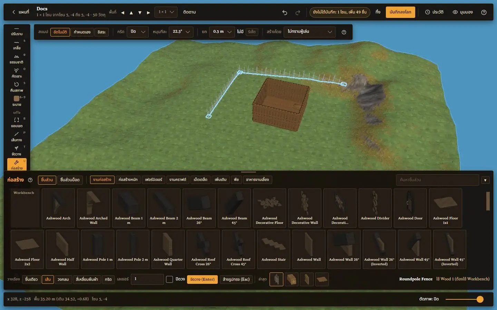
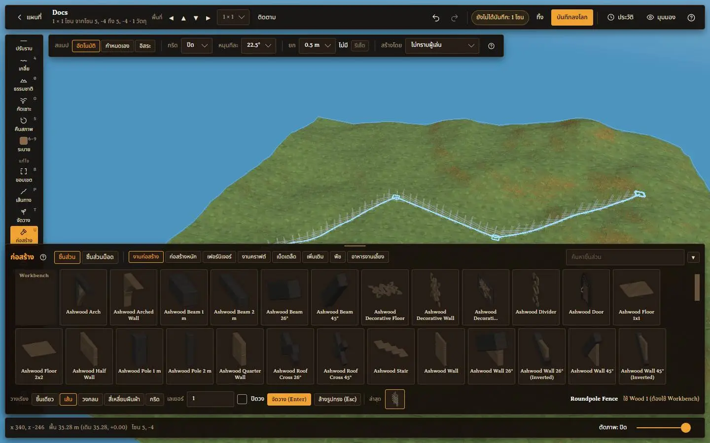
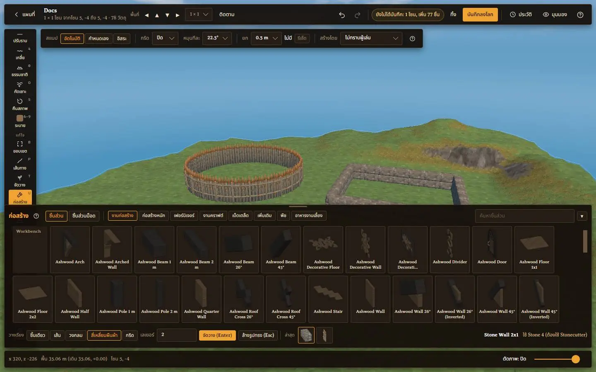
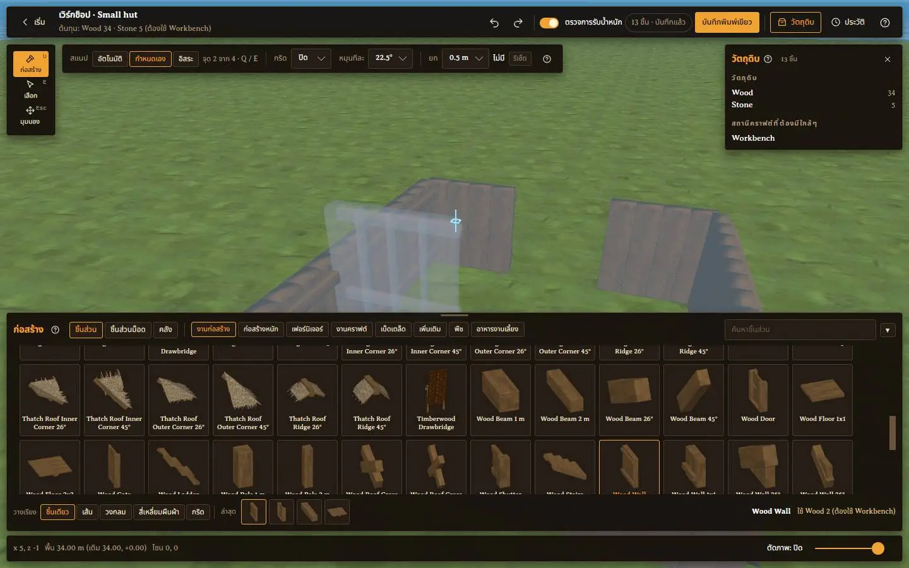

<!-- source: 1f261984 -->
# ก่อสร้าง

วางชิ้นส่วนที่ผู้เล่นสร้าง (ผนัง พื้น หลังคา รั้ว เฟอร์นิเจอร์ สถานีคราฟต์) ทีละชิ้น เหมือนค้อนของเกม
หรือเรียงตามเส้น รอบวงกลม หรือสี่เหลี่ยมผืนผ้า หรือเป็นกริด

**ที่อยู่:** แถบเครื่องมือ ส่วน **แก้ไข** · **ปุ่ม:** `U` (ในเวิร์กช็อป `T` ก็ได้) · **ใช้ได้กับ:** โลกที่บันทึกไว้ ไลฟ์
[เวิร์กช็อป](workshop.md) และห้องของดันเจี้ยน ด้วย [สร้างที่นี่](dungeons.md)

*ก่อสร้าง ในโลก: กระท่อมที่ตั้งบนพื้นที่ปรับราบ และรั้วเสากลม ที่กำลังวางเรียงตามเส้นสามจุด
(**วางเรียง** เป็น **เส้น** แสดงก่อนกด **จัดวาง (Enter)**) ด้านล่าง: แผง ก่อสร้าง กับชิ้นส่วนของแท็บ **งานก่อสร้าง**
และแถว **วางเรียง** ด้านบน: แถบก่อสร้าง กับ **สแนป** **กริด** **หมุนทีละ** **ยก** และ **สร้างโดย***

## ใช้งาน

เพื่อตั้งผนังและรั้วในโลก:

1. กด `U` แผง **ก่อสร้าง** จะเปิดตามด้านล่างของหน้าต่าง และ
   [แถบก่อสร้าง](#แถบกอสราง) จะเปิดข้างแถบเครื่องมือ
2. ในแผง คลิกชิ้นส่วน (ค้นหา `wall`) ชิ้นส่วนจะตามตัวชี้ไป แบบโปร่งใส ตรงที่ค้อนจะวาง
3. ชี้ที่พื้นหรือที่ชิ้นส่วน: ชิ้นใหม่จะสแนป กับชิ้นที่มีอยู่แล้ว คลิกเพื่อวางลง
4. กด `,` หรือ `.` เพื่อหมุนชิ้นถัดไป กด `PgUp` หรือ `PgDn` เพื่อยกหรือลดชิ้นนั้น
5. สำหรับรั้ว ให้เลือกรั้ว แล้วที่ด้านล่างของแผง เลือก **วางเรียง** → **เส้น** คลิกจุดต่างๆ บนพื้น แล้วกด
   `Enter`

การคลิก การลากเป็นแถว หรือการกด `Enter` แต่ละครั้ง คือหนึ่งขั้นตอนเลิกทำ (`Ctrl+Z`) ไม่มีอะไรถูกเขียนลงโลก
จนกว่าคุณจะกด **บันทึกลงโลก** (หรือ **นำไปใช้แบบไลฟ์**) ถ้าจะย้าย หมุน หรือลบชิ้นส่วน ให้ใช้ [เลือก](select.md)
ซึ่งใช้แถบก่อสร้างร่วมกัน

ต้นไม้ หิน พืชผลเป็นแปลง และจุดเกิด วางด้วย [จัดวาง](place.md) ไม่ใช่ ก่อสร้าง

## แผง ก่อสร้าง

แผงนี้กินพื้นที่ ตามด้านล่างของหน้าต่าง แท็บ การค้นหา **ล่าสุด** ต้นทุนของชิ้นส่วน และวิธีลัด
(ลากเป็นแถว `Shift` + คลิกขวา เพื่อนำชิ้นส่วนออก คลิกปุ่มกลาง เพื่อสร้างด้วยชนิดของชิ้นส่วน) เหมือนกัน
ทุกที่: ดู [แผง ก่อสร้าง](workshop.md#แผง-กอสราง) ในหน้าของเวิร์กช็อป

สิ่งที่ต่างกันตามสถานที่:

| ที่ไหน | แผง |
|---|---|
| พื้นโล่งของโลก | **ชิ้นส่วน** และ **ชิ้นส่วนม็อด** ไม่มี **คลัง**: วางพิมพ์เขียวด้วย[แผง แบบแปลน](workshop.md#แผง-แบบแปลน) [มาสก์](masks.md) ไม่มีผลกับ ก่อสร้าง |
| เวิร์กช็อป | **ชิ้นส่วน** **ชิ้นส่วนม็อด** และ **คลัง** ส่วน **วัตถุดิบ** นับต้นทุนของสิ่งก่อสร้าง ไม่มี **สร้างโดย**: พิมพ์เขียวไม่เก็บผู้สร้าง |
| ดันเจี้ยน (**สร้างที่นี่**) | **ชิ้นส่วน** และ **ชิ้นส่วนม็อด** ทีละชิ้น: เส้นและกริดของ **วางเรียง** วาดอยู่บนพื้น ซึ่งอยู่ไกลลงไป ใต้ห้องของดันเจี้ยน |

แถบเครื่องมือ และแผงด้านขวา สิ้นสุดเหนือแผงนี้ แถบเครื่องมือเลื่อนได้ด้วยล้อเมาส์ พับแผงด้วย **▾**
เพื่อให้มีที่มากขึ้น

## วางชิ้นส่วนเรียงตามเส้น หรือเป็นกริด

**วางเรียง** ที่ด้านล่างของแผง เลือกว่าชิ้นส่วนที่เลือกไว้ จะถูกวางอย่างไร ค่านี้จะเก็บไว้ใช้ครั้งหน้า

| วางเรียง | ทำอะไร |
|---|---|
| **ชิ้นเดียว** | วางหนึ่งชิ้นตรงที่คุณชี้ เหมือนค้อน ลากเพื่อวางเป็นแถว |
| **เส้น** | คลิกจุดต่างๆ บนพื้น: ชิ้นส่วนจะถูกวางต่อปลายชนปลาย ตามช่วงเส้นตรงระหว่างจุด แต่ละชิ้นบรรจบกับชิ้นก่อนหน้า ที่จุดสแนป (รั้ว ผนัง ถนนที่ทำจากพื้น) ลากจุดเพื่อย้าย ลากเส้นเพื่อเพิ่มจุด `Ctrl` + คลิก เพื่อลบจุด `Backspace` ลบจุดสุดท้าย **ปิดวง** กลับไปยังจุดแรก เพื่อล้อมรั้วรอบลาน |
| **วงกลม** | กดที่จุดศูนย์กลาง แล้วลากออก ขนาดจะถูกปัด ให้ชิ้นส่วนเต็มชิ้นปิดวงได้พอดี |
| **สี่เหลี่ยมผืนผ้า** | กดที่มุมหนึ่ง แล้วลากไปมุมตรงข้าม ด้านต่างๆ จะเติมจากมุม ให้มุมบรรจบกัน |
| **กริด** | กดที่มุมหนึ่ง แล้วลากไปอีกมุม: หนึ่งชิ้นตรงกลางแต่ละช่อง ห่างกัน **ระยะห่าง** (2 m สำหรับพื้น 2 m ของเกม) เต็มช่องให้มากที่สุดเท่าที่พอดี `,` และ `.` หมุนทั้งกริด |

| การตั้งค่า | ทำอะไร |
|---|---|
| **เลเยอร์** | เส้น วงกลม และสี่เหลี่ยมผืนผ้า: ซ้อนเส้นสูง 1 ถึง 20 ชิ้น (ผนังสูง 3 ชิ้น รั้วสองชั้น) |
| **ระยะห่าง** | กริด: ระยะระหว่างชิ้นส่วน จากศูนย์กลางถึงศูนย์กลาง 0.5 ถึง 30 m |
| **จัดวาง (Enter)** | วางสิ่งที่ภาพตัวอย่าง แบบโปร่งใสแสดงไว้ เป็นหนึ่งขั้นตอนเลิกทำ ดับเบิลคลิกที่จุดสุดท้ายของเส้น ก็ทำแบบเดียวกัน |
| **ล้างรูปทรง (Esc)** | ลบเส้น รูปทรง หรือกล่องที่วาดไว้ รูปทรงยังอยู่หลังวาง โดยภาพตัวอย่างว่างเปล่า จนกว่าคุณจะล้าง |

*รั้วที่วางต่อปลายชนปลาย ตามเส้นผ่านสี่จุด โปร่งใสอยู่ จนกว่า `Enter` จะวางลง*

***วงกลม** (วงแหวนกำแพงไม้แหลม) และ **สี่เหลี่ยมผืนผ้า** (กำแพงหิน **เลเยอร์** 2) แต่ละอันวางด้วย `Enter`*

- เส้นที่เริ่มภายใน 1 m จากชิ้นส่วนที่มีอยู่ จะต่อจากชิ้นนั้น ที่ระดับเดียวกัน (เมื่อ **สแนป** เป็น **อัตโนมัติ** หรือ
  **กำหนดเอง**)
- บนทางลาด ชิ้นส่วนจะอยู่ในแนวระดับ และขึ้นหรือลงเป็นขั้นตามพื้น เหมือนรั้วที่ไต่ขึ้นเนิน ถ้าต้องการ
  ผนังเรียบเสมอกัน ให้ปรับพื้นตามเส้นให้ราบก่อน ([เส้นทาง](path.md) ปรับราบ)
- การยก (`PgUp`, `PgDn`) ยกทั้งเส้นหรือทั้งกริด ขึ้นเหนือพื้น: พื้นที่วางสูงขึ้นไป 2 m คือหลังคา
- ไม่เกิน 2000 ชิ้นต่อเส้นหรือกริด

## แถบก่อสร้าง

แถบข้างแถบเครื่องมือ เก็บการตั้งค่าการก่อสร้าง เป็นแถบเดียว สำหรับ **ก่อสร้าง** [เลือก](select.md) และ
[วาง](area.md#คดลอกและวาง): สิ่งที่ตั้งในเครื่องมือหนึ่ง จะมีผลในเครื่องมืออื่น และเก็บไว้ใช้ครั้งหน้า
แต่ละเครื่องมือ แสดงเฉพาะส่วนที่ใช้ ถ้าหน้าต่างแคบ แถบจะขึ้นเป็นสองแถว

| การตั้งค่า | ก่อสร้าง | เลือก | วาง |
|---|---|---|---|
| **สแนป** | **อัตโนมัติ** (ค่าเริ่มต้น): ชิ้นส่วนสแนป กับชิ้นที่มีอยู่แล้ว เหมือนค้อน **กำหนดเอง**: จุดสแนปของชิ้นส่วน เพียงจุดเดียวบรรจบกับชิ้นอื่น ได้ไกลถึง 1.5 m `Q` และ `E` เลือกจุด ซึ่งมีเครื่องหมายบนชิ้นส่วน (`จุด 2 จาก 8 · Q / E`) **อิสระ**: ชิ้นส่วนอยู่ตรงที่แตะ สิ่งที่คุณชี้ | **อัตโนมัติ**: ชิ้นที่ย้าย จะสแนปกับชิ้นรอบๆ ภายใน 0.75 m **อิสระ**: อยู่ตรงที่คุณลากไป | ไม่ใช้ |
| **กริด** | **ปิด** (เหมือนในเกม) **0.5 m** **1 m** หรือ **2 m**: จุดบนพื้น จะถูกปัดเข้ากริดนี้ นับจากกึ่งกลางของพื้นที่ ชิ้นส่วนที่ชี้ไปที่ชิ้นอื่น จะสแนปตามปกติ | ชิ้นส่วนที่ลากไปบนพื้น โดยไม่สแนป จะยึดตามกริด | การวางยึดตามกริด |
| **หมุนทีละ** | `,` และ `.` (หรือ `Alt` + ล้อเมาส์) หมุนชิ้นส่วนทีละเท่าไร: **1°** **15°** **22.5°** (ระยะของเกม ค่าเริ่มต้น) **45°** หรือ **90°** | ปุ่มเดียวกัน หมุนส่วนที่เลือก | ปุ่มเดียวกัน หมุนสิ่งที่วาง |
| **ยก** | `PgUp`, `PgDn` หรือ `Ctrl` + ล้อเมาส์ ยกชิ้นส่วนทีละเท่าไร: **0.1 m** **0.25 m** **0.5 m** (ค่าเริ่มต้น) หรือ **1 m** แถบแสดงระยะยก (`+1.5 m`) **รีเซ็ต** ทำให้กลับเป็นไม่ยก | ปุ่มเดียวกัน ยกส่วนที่เลือก | ปุ่มเดียวกัน ยกหรือลดสิ่งที่วาง (**ความสูง** ของสิ่งที่วาง) **รีเซ็ต** ทำให้กลับคืน |
| **สร้างโดย** | ผู้เล่นที่ถูกเขียนเป็นผู้สร้าง ของชิ้นส่วนที่คุณวาง | ผู้สร้างที่ **ตั้งเป็นของที่ผู้เล่นสร้าง** และ **แทนที่** เขียนลงไป | ผู้สร้างของชิ้นส่วนที่วาง |

**`Shift` ทำให้แต่ละขั้นละเอียดขึ้นเสมอ** ในทั้งสามเครื่องมือ: `,` และ `.` หมุนทีละ 1° และการยก จะยกทีละหนึ่งในห้า
ของระยะ (0.1 m เมื่อตั้ง 0.5 m) `R` หมุนหนึ่งในสี่รอบ ในทั้งสามเครื่องมือ ไม่ว่าระยะจะตั้งไว้เท่าไร

กด `Alt` ค้างไว้ ขณะก่อสร้าง เพื่อวางชิ้นส่วนทีละหนึ่งในสี่เมตร โดยไม่สแนป ไม่ว่าการตั้งค่า **สแนป** จะเป็นอย่างไร (เหมือน
กด `Alt` ค้างในเกม แต่เป็นขั้นๆ) ดู [การสแนป](concepts/objects.md#การสแนป)

***สแนป** เป็น **กำหนดเอง** กด `E` หนึ่งครั้ง: แถบแสดง `จุด 2 จาก 4 · Q / E` และผนังโปร่งใส ที่ตามตัวชี้
บรรจบกับผนังของกระท่อม ที่มุมบน ซึ่งมีเครื่องหมายกากบาท*

### สร้างโดย

**สร้างโดย** แสดงรายชื่อผู้เล่น ที่เคยสร้างในโลกนี้ (พร้อมจำนวนชิ้นส่วน) ผู้เล่นที่มีชื่อบนเตียง Ward
และป้ายหลุมศพ และตัวละคร บนคอมพิวเตอร์เครื่องนี้ ซึ่งมีเครื่องหมาย "(คอมพิวเตอร์เครื่องนี้)" ตอนแรก จะเลือกผู้เล่น
ที่มีชิ้นส่วนมากที่สุด ถ้าไม่มี ก็เลือกตัวละครของคุณเอง ถ้าไม่มีอีก ก็เลือกผู้เล่นที่มีชื่ออยู่ในโลก **ID ผู้เล่นอื่น…**
ถามหา ID ใดก็ได้ (จำนวนเต็ม) **ไม่มีใคร (ไม่ใช่ของที่ผู้เล่นสร้าง)** วางชิ้นส่วนโดยไม่มีผู้สร้าง เป็นส่วนของซากปรักหักพัง
ถ้าไม่รู้จักผู้เล่นเลย ชิ้นส่วนจะได้ **ไม่ทราบผู้เล่น** (ID 1): Ward และหีบส่วนตัว จะไม่ตอบสนองใคร จึงควรเลือก ID
ของคุณเอง เมื่อทำได้ ตัวเลือกจะถูกจำไว้แยกตามโลก

ในเวิร์กช็อป จะไม่มีตัวเลือกนี้บนแถบ: พิมพ์เขียวไม่เก็บผู้สร้าง และชิ้นส่วนจะได้ผู้สร้าง ตอนที่ถูกวางลงในโลก
ทำไมผู้สร้างจึงสำคัญ: ดู [ชิ้นส่วนที่ผู้เล่นสร้าง](concepts/objects.md#ชนสวนทผเลนสราง)

## ปุ่มลัด

| ปุ่มหรือเมาส์ | ทำอะไร |
|---|---|
| `U` | เปิด ก่อสร้าง (ในเวิร์กช็อป `T` ก็ได้) |
| คลิก | วางชิ้นส่วน (**ชิ้นเดียว**) เพิ่มจุด (**เส้น**) |
| ลาก | **ชิ้นเดียว**: แถวของชิ้นส่วน **วงกลม** **สี่เหลี่ยมผืนผ้า** **กริด**: วาดรูปทรง |
| `,` `.` หรือ `Alt` + ล้อเมาส์ | หมุนชิ้นส่วนตาม **หมุนทีละ** ของแถบ (`Shift`: 1°) ใน **กริด**: หมุนทั้งกริด |
| `R` | หมุนแบบเดียวกัน หนึ่งในสี่รอบ |
| `PgUp` / `PgDn` หรือ `Ctrl` + ล้อเมาส์ | ยกหรือลดชิ้นส่วน ตาม **ยก** ของแถบ (`Shift`: หนึ่งในห้าของระยะ) |
| `Alt` (กดค้าง) | วางทีละหนึ่งในสี่เมตร ไม่สแนป |
| `Q` / `E` | สแนปแบบ **กำหนดเอง**: จุดสแนปก่อนหน้า / ถัดไป ของชิ้นส่วน |
| `Shift` + คลิกขวา | นำชิ้นส่วนใต้ตัวชี้ออก |
| คลิกปุ่มกลาง | สร้างด้วยชนิด ของชิ้นส่วนใต้ตัวชี้ |
| `Enter` | วางเส้น รูปทรง หรือกริด |
| `Backspace` | ลบจุดสุดท้ายของเส้น |
| `Esc` | ล้างเส้น รูปทรง หรือกริด ถ้าไม่ได้วาดอะไรไว้ จะกลับไปที่ **มุมมอง** |
| `Ctrl+Z` | เลิกทำชิ้นส่วน แถว หรือเส้นล่าสุด |

ปุ่มทั้งหมดของเอดิเตอร์ อยู่ใน [ปุ่มลัด](help/shortcuts.md)

## เคล็ดลับและข้อจำกัด

- **เลิกทำ:** `Ctrl+Z` ย้อนชิ้นส่วน แถว หรือทั้งเส้น หลังบันทึกแล้วก็ได้ (จากนั้นบันทึกอีกครั้ง) ดู
  [เลิกทำการเปลี่ยนแปลง](guides/undo-changes.md)
- ชิ้นส่วนวางได้เฉพาะ ภายในพื้นที่ที่เปิดอยู่ ไม่ใช่บนแนวจุดด้านนอกสุด
- เอดิเตอร์ไม่ตรวจว่า ชิ้นส่วนในโลกรับน้ำหนักได้หรือไม่: ใช้
  [ตรวจการรับน้ำหนัก](workshop.md#ตรวจการรบนำหนก) ของเวิร์กช็อป สำหรับสิ่งก่อสร้าง ที่คุณตั้งใจจะเก็บไว้ หรือสร้างในเวิร์กช็อป
  แล้วนำมาวาง
- ชิ้นส่วนใหม่จะเป็นของใหม่: พลังชีวิตเต็ม หีบว่างเปล่า ถ้าจะใส่ของในหีบ ดู
  [เปลี่ยนของในหีบ](guides/fill-a-chest.md)
- แท็บ **พืช** มีต้นกล้าและพืชผล ของเครื่องพรวนดิน ทีละชิ้น หรือเป็น **กริด** [จัดวาง](place.md)
  ก็มีด้วย พร้อมแปรง และเว้นที่ที่พืชต้องใช้ในการเติบโต

## หัวข้อที่เกี่ยวข้อง

- [ออกแบบบ้าน แล้วบันทึกเป็นพิมพ์เขียว](start/first-build.md)
- [เวิร์กช็อป](workshop.md): แปลง คลัง วัตถุดิบ การตรวจการรับน้ำหนัก
- [เลือก](select.md) · [จัดวาง](place.md) · [ขอบเขต การคัดลอกและวาง](area.md)
- [การสแนป](concepts/objects.md#การสแนป) · [ชิ้นส่วนที่ผู้เล่นสร้าง](concepts/objects.md#ชนสวนทผเลนสราง)
