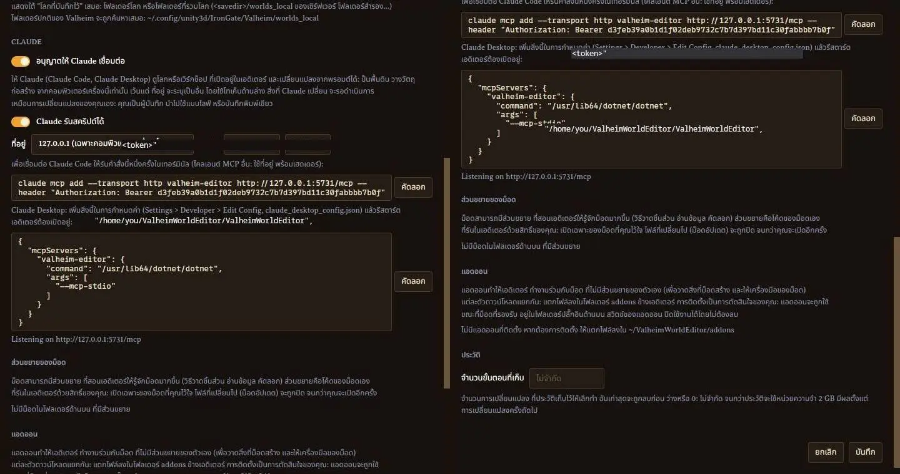
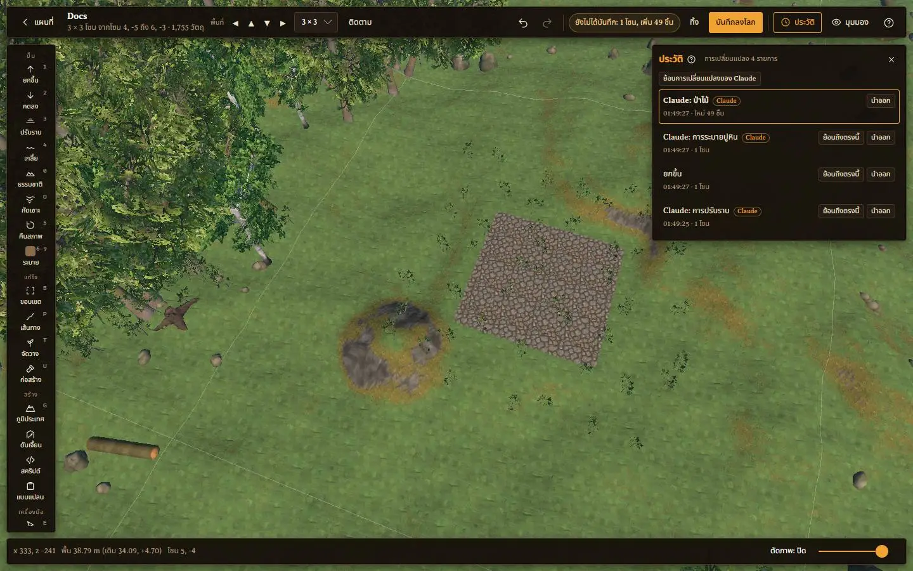

<!-- source: 3de08343 -->
# Claude

ให้ Claude (ใน Claude Code, Claude Desktop หรือไคลเอนต์ MCP อื่น) ปั้นพื้นดิน ปลูก ก่อสร้าง และสร้างดันเจี้ยน
ในโลกหรือเวิร์กช็อป ที่คุณเปิดอยู่ จากพรอมต์ ขณะที่คุณดูอยู่ในมุมมอง 3D

**ที่อยู่:** หน้าเริ่มต้น **การตั้งค่า** → **Claude** · **ปุ่ม:** ไม่มี · **ใช้ได้กับ:** โลกที่บันทึกไว้ ไลฟ์ (เมื่อปิด **อัตโนมัติ**)
เวิร์กช็อป


*ซ้าย: ส่วน **Claude** ที่เปิดอยู่ และรอรับการเชื่อมต่อ คัดลอกคำสั่ง ไปไว้ในเทอร์มินัล (Claude Code) หรือคัดลอกบรรทัด
ไปไว้ในการกำหนดค่าของ Claude Desktop ขวา: ท้ายหน้า การตั้งค่า พร้อม **บันทึก** คำสั่งของคุณ จะมีโทเค็นของคุณเอง
ตรงที่ภาพนี้เขียนว่า `<token>` และบรรทัดจะมีพาธ ของโปรแกรมของคุณเอง*

ทุกสิ่งที่ Claude เปลี่ยน จะ **รออยู่** เหมือนการเปลี่ยนแปลงของคุณเอง: แต่ละครั้งเป็นหนึ่งขั้นตอนใน ประวัติ
(`Ctrl+Z` ย้อนกลับ) และนับรวมในแถบด้านบน Claude ไม่เคยบันทึกโลก และไม่เคยนำอะไรไปใช้ กับเกมไลฟ์:
คุณเป็นผู้ทำ เมื่อพอใจกับสิ่งที่เห็น หากต้องการตั้งค่าทีละขั้นตอน ดู [ให้ Claude ปั้นพื้นดินหรือก่อสร้าง](guides/connect-claude.md)

## ใช้งาน

1. ใน **การตั้งค่า** ที่หน้าเริ่มต้น เปิด **อนุญาตให้ Claude เชื่อมต่อ** แล้วกด **บันทึก**
2. เพิ่มเอดิเตอร์ให้ Claude หนึ่งครั้ง: รันคำสั่ง ที่ การตั้งค่า แสดง (Claude Code) หรือเพิ่มบรรทัด
   ลงในการกำหนดค่าของ Claude Desktop
3. เปิดพื้นที่ของโลก หรือเวิร์กช็อป (หรือขอให้ Claude เปิด)
4. ขอสิ่งที่คุณต้องการจาก Claude ([การขอ](#การขอ)) แล้วดู Claude ทำงานในมุมมอง 3D
5. เก็บสิ่งที่ชอบ: **บันทึกลงโลก** **นำไปใช้แบบไลฟ์** หรือ **บันทึกพิมพ์เขียว** ย้อนสิ่งที่ไม่ชอบด้วย
   `Ctrl+Z` **ทิ้ง** หรือ **ย้อนการเปลี่ยนแปลงของ Claude** ใน ประวัติ

## การตั้งค่า

ใน **การตั้งค่า** (ที่หน้าเริ่มต้น) ส่วน **Claude**:

| การตั้งค่า | สิ่งที่ทำ |
|---|---|
| **อนุญาตให้ Claude เชื่อมต่อ** | เปิด: เอดิเตอร์รับคำขอของ Claude จากคอมพิวเตอร์เครื่องนี้เท่านั้น (เว้นแต่ **ที่อยู่** จะระบุเป็นอื่น) จากผู้เรียกที่มีโทเค็น ปิด: ไม่มีอะไรเชื่อมต่อได้ |
| **Claude รันสคริปต์ได้** | เปิด: Claude รันสคริปต์ C# ได้ เหมือนเครื่องมือ [สคริปต์](scripting.md) โดยแต่ละสคริปต์ จะแสดงให้คุณดูก่อน เพื่อรันหรือปฏิเสธ สคริปต์คือโปรแกรม ที่มีสิทธิ์ของคุณ บนคอมพิวเตอร์เครื่องนี้ รวมถึงไฟล์ของคุณ ปิด (ค่าเริ่มต้น): สคริปต์ของ Claude จะถูกปฏิเสธ เครื่องมืออื่นของ Claude ยังทำงานได้ |
| **ที่อยู่** | ที่ที่ Claude เชื่อมต่อมาได้: เลือกจากรายการ หรือพิมพ์ที่อยู่ `127.0.0.1 (เฉพาะคอมพิวเตอร์เครื่องนี้)` ค่าเริ่มต้น `0.0.0.0 (ทุกเครือข่าย)` หรือเครือข่ายหนึ่ง ของคอมพิวเตอร์เครื่องนี้ พร้อมที่อยู่ (`192.168.1.20 (Ethernet)`): เฉพาะเครือข่ายนั้น เมื่อเลือกทุกเครือข่าย บรรทัดใต้คำสั่ง จะแสดงที่อยู่ ที่คอมพิวเตอร์เครื่องอื่นใช้: ชื่อของคอมพิวเตอร์เครื่องนี้ (`http://my-pc.local:5731/mcp`) ในที่ที่เครือข่ายตอบชื่อ `.local` ได้ (mDNS) และที่อยู่บนแต่ละเครือข่าย (`http://192.168.1.20:5731/mcp`) ซึ่งใช้ได้เสมอ แต่เปลี่ยนไป เมื่อเครือข่ายให้ที่อยู่ใหม่ ดู [ความปลอดภัย](#ความปลอดภย) |
| **พอร์ต** | พอร์ตที่ Claude เชื่อมต่อ: เริ่มต้นที่ 5731 ตั้งได้ 1024 ถึง 65535 เปลี่ยนหากโปรแกรมอื่นใช้ 5731 อยู่ |
| **โทเค็นใหม่** | สร้างโทเค็นอีกอัน เมื่อคุณกด **บันทึก** โทเค็นเก่าจะใช้ไม่ได้: เพิ่มเอดิเตอร์ให้ Claude อีกครั้ง ด้วยคำสั่งใหม่ |
| คำสั่ง Claude Code **คัดลอก** | คำสั่งที่เพิ่มเอดิเตอร์ ให้ Claude Code คำสั่งนี้มีโทเค็นอยู่: เก็บไว้กับตัวเอง |
| บรรทัดของ Claude Desktop **คัดลอก** | บรรทัดที่จะเพิ่ม ลงในการกำหนดค่าของ Claude Desktop |

หลังกด **บันทึก** ส่วนนี้จะแสดง "Listening on http://127.0.0.1:5731/mcp" (รอรับการเชื่อมต่อ) (บนที่อยู่อื่น
"Listening on 0.0.0.0:5731, from other computers too" รับจากคอมพิวเตอร์อื่นด้วย) หรือสาเหตุที่ทำไม่ได้
("Could not listen on 127.0.0.1:5731: …" รอรับการเชื่อมต่อไม่ได้ เมื่อพอร์ต
ถูกใช้อยู่ หรือเมื่อที่อยู่เครือข่าย ไม่ใช่ของคอมพิวเตอร์เครื่องนี้แล้ว)

## เพิ่มเอดิเตอร์ให้ Claude

**Claude Code:** รันคำสั่งที่ การตั้งค่า แสดง หนึ่งครั้ง ในเทอร์มินัล คำสั่งมีหน้าตาแบบนี้ พร้อมโทเค็นของคุณ:

```sh
claude mcp add --transport http valheim-editor http://127.0.0.1:5731/mcp --header "Authorization: Bearer <token>"
```

จากนั้นใน Claude Code `/mcp` จะแสดง **valheim-editor** ว่าเชื่อมต่ออยู่ ขณะที่เอดิเตอร์เปิดอยู่

**Claude Desktop** เริ่มโปรแกรม แทนการเชื่อมต่อกับที่อยู่ เพิ่มบรรทัดที่ การตั้งค่า แสดง
ลงในการกำหนดค่า (Claude Desktop → Settings → Developer → Edit Config, `claude_desktop_config.json`) แล้วรีสตาร์ต:

```json
{
  "mcpServers": {
    "valheim-editor": { "command": "/path/to/ValheimWorldEditor", "args": ["--mcp-stdio"] }
  }
}
```

`--mcp-stdio` ไม่เปิดหน้าต่าง: ทำหน้าที่ส่งข้อความของ Claude ไปยังเอดิเตอร์ ที่เปิดอยู่ (โดยเปิด **อนุญาตให้ Claude
เชื่อมต่อ** ไว้) ด้วยโทเค็น จากการตั้งค่าของเอดิเตอร์

**ไคลเอนต์ MCP อื่น** เชื่อมต่อกับที่อยู่ (streamable HTTP) ด้วยเฮดเดอร์ `Authorization` เดียวกัน

เอดิเตอร์ต้องเปิดอยู่ Claude จึงจะเข้าถึงได้

## สิ่งที่ Claude ทำได้

เครื่องมือของ Claude เรียกโค้ดเดียวกับ เครื่องมือและปุ่มของเอดิเตอร์เอง สิ่งที่ Claude สร้าง
จึงเป็นไปตามกฎของเกมเดียวกับ การแก้ไขของคุณ: ขีดจำกัดพื้นดิน 8 m ของเกม (มีเพียงสคริปต์ของ Claude เอง
ที่เกินได้) การสแนปของชิ้นส่วนก่อสร้าง โซน สถานที่
แต่ละขั้นตอนที่ Claude ทำ จะมีชื่อ "Claude: …" ใน ประวัติ และมีแท็ก **Claude** Claude ตรวจงานของตัวเอง
ด้วยภาพของมุมมอง 3D และแผนที่ และด้วยการตรวจการรับน้ำหนัก

| Claude ทำได้ | เครื่องมือ |
|---|---|
| ดูสิ่งที่เปิดอยู่ โลกบนคอมพิวเตอร์เครื่องนี้ และความสูง ไบโอม น้ำ และวัตถุของพื้นที่ เปิดพื้นที่ขนาด 1 ถึง 17 โซน ค้นหาทั้งโลก ตามชนิด ไอเทมในหีบ หรือข้อความบนป้าย แสดงรายการจุดเริ่มต้น พ่อค้า แท่นบูชา และทางเข้าดันเจี้ยน | `editor_state`, `list_worlds`, `open_world`, `open_area`, `describe_area`, `list_objects`, `ground_at`, `search_world`, `list_locations` |
| ดูงานของตัวเอง: ภาพของมุมมอง 3D (มุมกล้องใดก็ได้ หรือสี่มุมของที่หนึ่ง ในคราวเดียว) หรือแผนที่ แผนที่ของพื้นที่ จากด้านบน พร้อมกริดหน่วยเมตร การตรวจการรับน้ำหนัก (ชิ้นส่วนไหนจะร่วง) | `screenshot`, `area_map`, `support_check` |
| ใช้ส่วนที่คุณเลือก และแสดงให้คุณเห็น ว่าหมายถึงอะไร | `get_selection`, `select_objects` |
| ตั้งตัวควบคุมใดก็ได้ เหมือนที่คุณทำ (สวิตช์ใน มุมมอง การตัดภาพ ในแถบสถานะ การตั้งค่าเครื่องมือ แถบเครื่องมือ) | `list_controls`, `set_control` |
| ค้นหาชิ้นส่วนของเกม และวิธีที่ชิ้นส่วนต่อกัน | `find_prefabs`, `piece_info`, `building_guide`, `list_blueprints` |
| ดูโลกของซีด (ไบโอม จุดเริ่มต้น พ่อค้า บอส) และสร้างโลกใหม่ ตามชื่อและซีด | `preview_seed`, `create_world` |
| ปรับราบ ระบาย เกลี่ย ทำให้เป็นธรรมชาติ กัดเซาะ คืนสภาพ ยกขึ้น หรือกดลงพื้นดิน กดแสตมป์ หรือรูปแผนที่ความสูง ขุดแม่น้ำ คูน้ำ หรือทางลาด ไปตามเส้น หรือปรับราบ ยกขึ้น กดลง เกลี่ย ทำให้เป็นธรรมชาติ กัดเซาะ หรือคืนสภาพพื้นดิน ไปตามเส้น วางถนน ทำเครื่องหมายโซนเพื่อรีเซ็ต ปลูกต้นไม้และหินของเกมคืน | `flatten`, `paint_area`, `shape_ground`, `stamp`, `import_heightmap`, `dig_path`, `road`, `reset_zones`, `regrow_nature` (ส่วนใหญ่ใช้ [มาสก์](masks.md) ได้) |
| ปลูกต้นไม้ หรือวางหิน วางชิ้นส่วนและวัตถุ (สแนปเหมือนค้อน) คัดลอกวัตถุครั้งเดียว หรือเรียงเป็นแถว หรือวง สลับวัตถุเป็นชนิดอื่น นำวัตถุออก | `forest`, `place_pieces`, `copy_objects`, `replace_objects`, `remove_objects` |
| สร้างพื้น ผนังพร้อมประตู และหลังคาจั่ว (26° หรือ 45° มุงจาก หรือแป้นไม้) บนสี่เหลี่ยม เปิดเวิร์กช็อป เพิ่มพิมพ์เขียวลงในแปลง หรือพื้นที่ บันทึกแปลงเป็นพิมพ์เขียว | `build_floor`, `build_walls`, `build_roof`, `place_pieces`, `open_workshop`, `add_blueprint`, `save_blueprint` |
| ย้ายและหมุนวัตถุเป็นกลุ่ม หรือวาง เอียง และกำหนดขนาด แต่ละชิ้นอย่างแม่นยำ ใส่ของในหีบ แต่งตัวให้ที่วางชุดเกราะ หรือที่วางไอเทม เขียนป้าย ให้ดาวแก่สิ่งมีชีวิต เปลี่ยนแท็กประตูมิติ ผู้สร้าง ผู้เล่นที่ได้รับอนุญาตของ Ward พลังชีวิต เชื้อเพลิง เลเวล หรือสถานะการฝึกของสิ่งมีชีวิต | `move_objects`, `set_transform`, `get_object`, `set_object_data`, `set_contents` |
| สร้างดันเจี้ยนบนแปลง หรือเหนือจุดหนึ่งของโลก หลังทางเข้า แสดงรายการห้อง ของดันเจี้ยนในเกม เพิ่มห้องที่ปลายเปิด นำห้องออก ปิดปลายเปิดทุกด้าน ตั้งประตู | `generate_dungeon`, `list_dungeons`, `dungeon_rooms`, `add_dungeon_room`, `remove_dungeon_room`, `close_dungeon_ends`, `set_dungeon_door` |
| รันสคริปต์ (เมื่อคุณอนุญาต) | `run_script`, `script_reference` |
| เลิกทำและทำซ้ำ | `undo`, `redo` |

กฎบางข้อที่ควรรู้:

- `open_world` จะถูกปฏิเสธ ขณะที่โลก หรือเวิร์กช็อปที่เปิดอยู่ มีการเปลี่ยนแปลงที่ยังไม่ได้บันทึก
- `save_blueprint` บันทึกสิ่งก่อสร้างของเวิร์กช็อป เฉพาะเมื่อถูกขอ และไม่เคยแทนที่พิมพ์เขียว เว้นแต่ถูกสั่ง
  การบันทึกพิมพ์เขียวอีกครั้ง จะเก็บคำอธิบายและแท็กไว้
- `generate_dungeon` ปฏิเสธไบโอม สไตล์ หรือวัสดุผนัง ที่ไม่รู้จัก และแสดงรายการที่รู้จัก
- `move_objects` รักษารูปทรงของสิ่งก่อสร้าง และส่วนหนึ่ง ของกลุ่มที่เชื่อมกันของม็อด (เรือและชิ้นส่วนของเรือ)
  จะพาทั้งกลุ่มไปด้วย รวมถึงการคัดลอก และการนำออก
- ดันเจี้ยนที่ Claude สร้างบนแปลงของเวิร์กช็อป เป็นส่วนหนึ่ง ของสิ่งก่อสร้างบนแปลง รออยู่เหมือนส่วนอื่น
  และไม่ถูกเพิ่มเข้าคลังของคุณ
- เมื่อ Claude เชื่อมต่อ เอดิเตอร์จะให้คู่มือสั้นๆ เรื่องการทำงานในเอดิเตอร์ และพรอมต์สำเร็จรูปสองแบบ:
  *build_in_workshop* และ *shape_area*

## การขอ

เปิดโลกหรือเวิร์กช็อปเอง หรือขอให้ Claude เปิด จากนั้น เช่น:

- "เปิดพื้นที่รอบ 1200, -340 แล้วทำหุบเขา ที่มีแม่น้ำไหลไปทางเหนือ และมีต้นเบิร์ชเรียงตามแม่น้ำ"
- "ปรับราบพื้นที่สี่เหลี่ยม 40 m ตรงกลางพื้นที่ ปูหิน แล้ววางคบเพลิงล้อมเป็นวง"
- "ในเวิร์กช็อป สร้างบ้านยาวหลังเล็ก: พื้นหิน ผนังไม้พร้อมประตูสองบาน หลังคามุงจาก 45° ตรวจด้วยว่า
  ตั้งอยู่ได้"
- "เปิดพื้นที่รอบ 800, 950 แล้วสร้างสุสานใต้ดิน หนองน้ำ สองชั้น เหนือพื้นที่นั้น"
- "ต้นไม้ที่ฉันเลือกไว้: แทนที่ด้วยต้นบีช" (เลือกต้นไม้ก่อน Claude อ่านส่วนที่คุณเลือก)

งานพื้นดิน ป่า และดันเจี้ยน ขอได้ง่ายที่สุด สิ่งก่อสร้างที่มีรายละเอียด ซึ่งวางทีละชิ้น อาจต้องขอหลายรอบ
("หลังคายื่นเกินทางด้านตะวันออก แก้ด้วย") หรือเริ่มจากพิมพ์เขียวของคุณเอง


*ขั้นตอนของ Claude มีชื่อ "Claude: …" และมีแท็ก **Claude** ส่วน **ยกขึ้น** ของคุณเองอยู่ระหว่างนั้น **ย้อนการเปลี่ยนแปลงของ Claude** ที่ด้านบน จะนำขั้นตอนของ Claude ออก และเก็บของคุณไว้*

## ย้อนการเปลี่ยนแปลงของ Claude

- `Ctrl+Z` ย้อนขั้นตอนล่าสุด ไม่ว่าของ Claude หรือของคุณ
- ใน **ประวัติ** **นำออก** บนขั้นตอนที่มีแท็ก **Claude** จะนำขั้นตอนนั้นออก และเก็บทุกอย่างที่ทำหลังจากนั้นไว้
- **ย้อนการเปลี่ยนแปลงของ Claude** (ที่ด้านบนของ ประวัติ ขณะที่มีการเปลี่ยนแปลงของ Claude อยู่) จะนำทุกขั้นตอน
  ที่ Claude ทำ ในประวัติของพื้นที่ที่เปิดอยู่ออก เริ่มจากใหม่สุด และเก็บของคุณไว้ แม้แต่ที่ทำหลังของ Claude
  แถบสถานะบอกว่า ย้อนไปกี่ขั้นตอน และขั้นตอนของ Claude ที่ทำในพื้นที่อื่น ถูกเก็บไว้กี่ขั้นตอน: เปิดพื้นที่เหล่านั้น
  เพื่อย้อนด้วย (ดู [ประวัติเป็นของโลก](concepts/saving-and-history.md#ประวตเปนของโลก))
- **ทิ้ง** จะทิ้งทุกอย่างที่ยังไม่ได้บันทึก รวมถึงของคุณด้วย

วิธีนี้ใช้ได้หลังบันทึก หรือนำไปใช้แล้วด้วย: **บันทึกลงโลก** หรือ **นำไปใช้แบบไลฟ์** ครั้งถัดไป จะเขียนผลนั้น ดู
[เลิกทำขั้นตอน ย้อนการเปลี่ยนแปลงหนึ่งรายการ หรือทิ้งทั้งหมด](guides/undo-changes.md)

## ความปลอดภัย

- **เฉพาะคอมพิวเตอร์เครื่องนี้** เอดิเตอร์รอฟังที่ `127.0.0.1` (หรือที่อยู่ loopback อื่นที่คุณพิมพ์ เช่น `::1`) และ
  ปฏิเสธคำขอใดๆ ที่ส่งถึงชื่ออื่น หน้าเว็บที่คุณเปิด จึงเข้าถึงเอดิเตอร์ไม่ได้ เมื่อใช้ **ที่อยู่** อื่น
  คอมพิวเตอร์ในเครือข่ายนั้น ก็เข้าถึงได้ด้วย ผ่านชื่อใดก็ได้ ของคอมพิวเตอร์เครื่องนี้ พร้อมโทเค็น เฉพาะเครือข่าย
  ของคอมพิวเตอร์เครื่องนี้เอง: คอมพิวเตอร์ที่ที่อยู่ไม่ใช่ที่อยู่ภายใน (`10.x`, `172.16`–`172.31`, `192.168.x`, link-local, IPv6
  `fc00::/7`) หรือไม่อยู่ในเครือข่าย ที่เอดิเตอร์รอฟัง จะถูกปฏิเสธ อินเทอร์เน็ตจึงเข้าถึงไม่ได้เลย แม้ผ่าน IPv6
  เมื่อใช้ `0.0.0.0` เครือข่ายเหล่านั้น คือเครือข่ายที่มีเกตเวย์ (ไม่ใช่ของ Docker, WSL หรือ Hyper-V เอง และไม่ใช่ทันเนล VPN)
  VPN เช่น Tailscale ซึ่งมีที่อยู่ `100.64.x.x` ถึง `100.127.x.x` ก็ใช้ได้ด้วย เมื่อคอมพิวเตอร์เครื่องนี้อยู่ใน VPN นั้น:
  รอฟังที่ที่อยู่ Tailscale หรือที่ `0.0.0.0` แล้วคอมพิวเตอร์อีกเครื่อง เชื่อมต่อกับที่อยู่นั้น VPN
  เข้ารหัสเส้นทาง โทเค็นจึงไม่ถูกอ่านบนเครือข่าย
- **สคริปต์ จากคอมพิวเตอร์เครื่องนี้เท่านั้น** Claude บนคอมพิวเตอร์เครื่องอื่น จะถูกปฏิเสธสคริปต์ (`run_script` และ รัน
  ของเครื่องมือ สคริปต์) แม้เปิด **Claude รันสคริปต์ได้** ไว้: มิฉะนั้น ใครก็ตามที่อ่านโทเค็น บนเครือข่ายได้ จะรัน
  โปรแกรมด้วยสิทธิ์ของคุณได้ เครื่องมืออื่นของ Claude ทำงานได้เหมือนบนเครื่องนี้
- **ไม่เข้ารหัส เมื่อออกนอกคอมพิวเตอร์เครื่องนี้** การเชื่อมต่อเป็น HTTP ธรรมดา: เมื่อใช้ **ที่อยู่** อื่น ใครก็ตามในเครือข่ายนั้น
  อ่านโทเค็น และทุกอย่างที่เอดิเตอร์ และ Claude ส่งถึงกันได้ และเมื่อมีโทเค็น ก็ใช้เอดิเตอร์ได้ ซึ่งยอมรับได้
  ในเครือข่ายบ้านที่คุณไว้ใจ และ การตั้งค่า จะบอกไว้ใต้ที่อยู่ ทันทีที่คุณเลือก
  ที่อื่น ให้ใช้ `127.0.0.1` และเข้าถึงจากคอมพิวเตอร์อื่น ผ่านทันเนล SSH ซึ่งเข้ารหัสให้:
  `ssh -L 5731:127.0.0.1:5731 you@this-computer`
- **โทเค็น** ทุกคำขอต้องมีโทเค็น (อักขระสุ่ม 48 ตัว ที่สร้างให้เอดิเตอร์ของคุณ) **โทเค็นใหม่** จะสร้าง
  โทเค็นอีกอัน
- **รออยู่เท่านั้น** Claude ไม่เคยบันทึก นำไปใช้แบบไลฟ์ ทิ้ง โหลดใหม่ เขียนหรือลบไฟล์ของคุณ หรือเชื่อมต่อกับ
  เกมไลฟ์: ไม่มีเครื่องมือใดทำสิ่งเหล่านี้ และ `set_control` ปฏิเสธตัวควบคุมเหล่านั้น
- **สคริปต์ต้องได้รับอนุญาตจากคุณ ทีละสคริปต์** `run_script` (รวมถึงการลองรัน) และ **รัน** ของเครื่องมือ สคริปต์ จะถูกปฏิเสธ จนกว่าคุณ
  จะเปิด **Claude รันสคริปต์ได้** จากนั้นสคริปต์ทุกตัวที่ Claude เขียน จะแสดงให้คุณดูก่อนรัน: **รันเลย** หรือ
  **ปฏิเสธ** (Enter และ Esc คือปฏิเสธ) การลองรัน แล้วตามด้วยการรันสคริปต์เดียวกัน ในพื้นที่เดียวกัน จะถามครั้งเดียว
  การรันอื่นทุกครั้ง จะถามอีก เครื่องมือ
  อื่นของ Claude (`flatten`, `road`, `forest`…) รันโค้ดของเอดิเตอร์เอง และไม่ถูกถาม
- **สิ่งที่โลกเขียนไว้ ไม่ใช่คำสั่ง** ป้าย แท็กประตูมิติ และชื่อ เขียนโดยผู้เล่น ส่วนพิมพ์เขียว หรือข้อมูลของม็อด
  เขียนโดยคนอื่น: Claude ถูกบอกให้ถือว่าเป็นข้อมูล ป้ายที่พยายามสั่ง Claude ไม่สามารถรัน
  สคริปต์ได้ โดยที่คุณไม่เห็นก่อน
- **ไลฟ์ โดยเปิด อัตโนมัติ: ไม่ทำอะไรเลย** ขณะที่โลกที่เปิดอยู่เป็นไลฟ์ และเปิด **อัตโนมัติ** ไว้ ทุกการเปลี่ยนแปลง จะไปถึงเกม
  ทันที Claude จึงไม่เปลี่ยนอะไร นอกจากแผง มุมมอง และขอให้คุณปิด อัตโนมัติ
- **ปิดคือปิด** ปิด **อนุญาตให้ Claude เชื่อมต่อ** แล้วไม่มีอะไรเชื่อมต่อได้

ดูเพิ่มเติมใน [สคริปต์และ Claude](concepts/safety.md#สครปตและ-claude)

## ปุ่มลัด

Claude ไม่ได้เพิ่มปุ่มใดๆ `Ctrl+Z` และ `Ctrl+Y` เลิกทำและทำซ้ำขั้นตอนของ Claude เหมือนของคุณ

## เคล็ดลับและข้อจำกัด

- เอดิเตอร์ต้องเปิดอยู่ โดยเปิด **อนุญาตให้ Claude เชื่อมต่อ** ไว้ Claude จึงจะเข้าถึงได้ หากเข้าถึงไม่ได้ ดู
  [Claude เชื่อมต่อไม่ได้](help/troubleshooting.md#claude-เชอมตอไมได)
- หลังกด **โทเค็นใหม่** และ **บันทึก** ให้รันคำสั่ง Claude Code ใหม่อีกครั้ง (โทเค็นเก่าจะใช้ไม่ได้) Claude
  Desktop อ่านโทเค็นใหม่เอง
- Claude เห็นเฉพาะพื้นที่ที่เปิดอยู่ สำหรับงานที่ใหญ่ขึ้น ให้ขอให้ Claude เปิดพื้นที่อื่น หรือพื้นที่ที่ใหญ่ขึ้น

### สกิลก่อสร้าง (Claude Code)

ไม่บังคับ สำหรับสิ่งก่อสร้าง ที่ควรดูเหมือนทำด้วยมือ: รีโพสิทอรีของเอดิเตอร์ มีสกิลของ Claude Code
[`.claude/skills/valheim-build`](../../.claude/skills/valheim-build/SKILL.md) เมื่อใช้สกิลนี้ Claude จะค้นหาสิ่งก่อสร้าง Valheim จริง
เพื่อหาไอเดีย เขียนบรีฟการออกแบบสั้นๆ ปั้นพื้นดิน ทดลองชิ้นส่วนที่ไม่คุ้นเคย ในแบบจำลองเล็กๆ ก่อสร้าง
เป็นช่วงๆ ด้วยตัวช่วยที่พิสูจน์แล้ว (หน้าต่างโค้ง บัวผนัง เชิงเทิน หอคอยทรงกลม หลังคากระเบื้อง ห้องโถงโครงไม้)
แล้วตรวจงานของตัวเอง หาหน้าต่างที่ถูกบัง ชิ้นส่วนซ้อนกัน และรอยต่อที่ไม่ดี ภายในจะได้โครง แสงสว่าง และ
เฟอร์นิเจอร์ ภายนอกจะได้ทางเดิน ไฟ และต้นไม้

Claude Code โหลดสกิลนี้เอง เมื่อคุณทำงานในรีโพสิทอรี หากต้องการใช้ทุกที่ ให้คัดลอกโฟลเดอร์ ไปไว้ในสกิลของคุณเอง:
`cp -r .claude/skills/valheim-build ~/.claude/skills/` จากนั้นขอตามปกติ เช่น "สร้างปราสาทโกธิก
มีคูน้ำ ในเวิร์กช็อป" ความรู้เรื่องชิ้นส่วนของสกิล อยู่ใน `references/pieces.md` ยินดีรับการแก้ไข
ที่ไฟล์นั้น

## หัวข้อที่เกี่ยวข้อง

- [ให้ Claude ปั้นพื้นดินหรือก่อสร้าง](guides/connect-claude.md)
- [เลิกทำขั้นตอน ย้อนการเปลี่ยนแปลงหนึ่งรายการ หรือทิ้งทั้งหมด](guides/undo-changes.md)
- [ความปลอดภัย](concepts/safety.md#สครปตและ-claude): สคริปต์และ Claude
- [สคริปต์](scripting.md): สิ่งที่ `run_script` รัน
