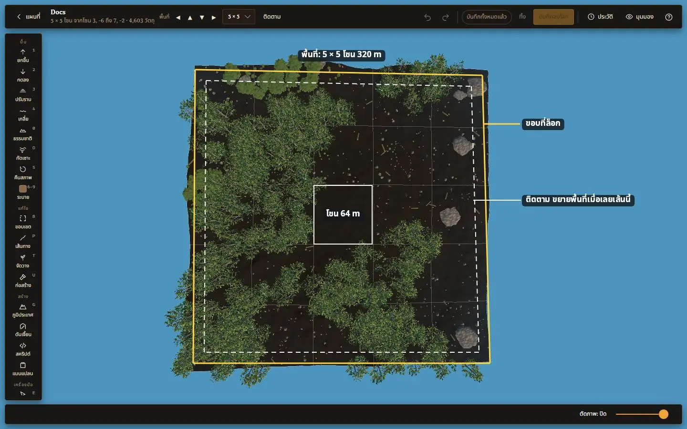

<!-- source: 24741409 -->
# พื้นที่และโซน

Valheim แบ่งโลกเป็น **โซน** สี่เหลี่ยมจัตุรัสขนาด 64 m และเอดิเตอร์เปิดโซนเหล่านั้น ทีละบล็อก เรียกว่า **พื้นที่**
หน้านี้อธิบายว่า ทำไมบางที่จึงยังบันทึกไม่ได้ ทำไมขอบของพื้นที่ จึงไม่เคยขยับ และทำไมพื้นที่ใหญ่จึงช้า


*พื้นที่คือบล็อกของโซน แถวจุดพื้นดินด้านนอกสุด (สีเหลือง) ไม่เคยเปลี่ยน เมื่อเปิด **ติดตาม** โซนจะถูกเพิ่ม
เมื่อจุดที่คุณมอง ผ่านเส้นประ ที่อยู่ด้านใน 12 m*

## โซน

โซนคือสี่เหลี่ยมจัตุรัส ขนาด 64 × 64 m แถบสถานะบอกชื่อโซน ใต้เมาส์ (`โซน 20, -6`) **มุมมอง → ขอบโซน**
วาดเส้นขอบโซนใน 3D และ **กริดโซน** ของแผนที่ วาดเส้นเหล่านั้นบนแผนที่

เกมสร้างโซน ครั้งแรกที่ผู้เล่นเข้าใกล้: ต้นไม้ หิน และแร่ รวมถึงสถานที่ในโซนนั้น (หมู่บ้าน ทางเข้าดันเจี้ยน)
เรียกว่า **การสร้างโซน** ก่อนหน้านั้น ไฟล์ของโลก ไม่มีข้อมูลอะไรตรงนั้นเลย แม้แต่พื้นดิน สำหรับคุณ หมายความว่า:

- **การแก้ไขในโซน ที่ยังไม่มีใครไป บันทึกไม่ได้** ข้อความการบันทึก จะแสดงรายการไว้ ให้เดินผ่านที่นั้นในเกมก่อน
  แล้วจึงแก้ไข
- **โลกใหม่ว่างเปล่า** เอดิเตอร์แสดงผืนดินของซีดได้ ก่อนที่ใครจะเล่น แต่ยังไม่มีอะไรให้แก้ไข
  จนกว่าเกมจะสร้างโซน (ดู [โลกใหม่](../new-world.md))
- **เกมตัดสินใจทีละโซน** เกมวางดันเจี้ยนหนึ่งแห่งต่อโซน รีเซ็ตทั้งโซน (ด้านล่าง) และบรรทัดรอดำเนินการ
  นับโซนที่คุณเปลี่ยนพื้นดิน

แต่ละโซนมีจุดพื้นดิน 65 × 65 จุด หนึ่งจุดต่อเมตร โซนที่อยู่ติดกัน ใช้จุดตามขอบร่วมกัน
ดู [วิธีเก็บพื้นดิน](ground-limits.md#พนดนถกเกบอยางไร)

## พื้นที่

พื้นที่คือบล็อกของโซน ที่เปิดอยู่ในเอดิเตอร์ 3D: ตั้งแต่ 3 × 3 ถึง 17 × 17 โซน รอบจุดที่คุณเลือกบน
[แผนที่](../map.md)

| ขนาด | ความกว้าง | เหมาะสำหรับ |
|---|---|---|
| 3 × 3 | 192 m | บ้าน ไร่ การแก้ไขเร็วๆ เปิดได้เร็วที่สุด |
| 5 × 5 (ค่าเริ่มต้น) | 320 m | ฐานและบริเวณรอบๆ |
| 7 × 7, 9 × 9 | 448 m, 576 m | หมู่บ้าน ถนนยาว การวางเมือง |
| 13 × 13, 17 × 17 | 832 m, 1088 m | แนวเทือกเขา ชายฝั่ง เปิดและวาดช้า |

เอดิเตอร์วาดทุกวัตถุ และทุกจุดพื้นดินของพื้นที่ จึงเปิดทีละบล็อก ไม่ใช่ทั้งโลก ทุกอย่างที่คุณทำ
เกิดขึ้นในพื้นที่นั้น: การวาง ภูเขา หรือสคริปต์ ต้องอยู่ในพื้นที่ที่เปิด จึงควรเปิดพื้นที่ที่ใหญ่ขึ้น ก่อนงานใหญ่

**การเปลี่ยนแปลงของคุณ เป็นของโลก ไม่ใช่ของพื้นที่** เอดิเตอร์เก็บการเปลี่ยนแปลง ที่รออยู่ ชุดเดียวสำหรับทั้งโลก
ย้ายพื้นที่ ปรับขนาด หรือกลับไปที่แผนที่ แล้วเปิดที่อื่น: สิ่งที่คุณทำไว้ที่อื่น ยังรออยู่ และจะถูกบันทึกพร้อมส่วนที่เหลือ
ประวัติก็ตามมาด้วย (ดู [ประวัติ](saving-and-history.md#ประวต))

ลูกศรบนแถบด้านบน ย้ายพื้นที่ทีละโซน (64 m) โดยกล้องอยู่ที่เดิมในโลก รายการขนาด
เปิดพื้นที่ใหม่ในขนาดอื่น รอบโซนกลางเดิม ทั้งสองอย่าง รอสิ่งเดียวกับที่ ติดตาม รอ
และทิ้งสิ่งเดียวกับที่ ติดตาม ทิ้ง (ดู [ติดตาม](#ตดตาม)) การเปิดพื้นที่อื่น จะแสดงวัตถุที่ซ่อนไว้อีกครั้ง

## ขอบที่ล็อก

แถวจุดพื้นดินด้านนอกสุด ของพื้นที่ไม่เคยเปลี่ยน ไม่มีแปรง เส้นทาง การกระทำของ ขอบเขต การวาง หรือสคริปต์ใด
ที่ย้ายแถวนี้ได้ และเครื่องมือ จัดวาง ไม่วางอะไรบนแถวนี้

เหตุผล: จุดเหล่านั้นใช้ร่วมกับโซน ที่อยู่นอกพื้นที่ ซึ่งเอดิเตอร์ไม่ได้โหลด ถ้าเอดิเตอร์ย้ายจุดเหล่านั้น
พื้นดินข้างนอก จะเจอขั้นหรือหน้าผา ที่เอดิเตอร์มองไม่เห็น เมื่อล็อกขอบไว้ พื้นที่จะต่อกับผืนดินรอบๆ
ได้เสมอโดยไม่มีรอยต่อ สคริปต์ที่เขียนลงตรงนั้น จะไม่ถูกหยุด: การเปลี่ยนแปลงนั้น แค่ถูกข้ามไป

```text
 outside   │ locked │        what you can edit         │ locked │   outside
 ──────────┼────────┼──────────────────────────────────┼────────┼──────────
           │  1 m   │  everything else in the area     │  1 m   │
```

ถ้าต้องการทำงานใกล้ขอบ ให้ย้ายพื้นที่ด้วยลูกศร เลือกขนาดที่ใหญ่ขึ้น หรือเปิด **ติดตาม**

## ติดตาม

เมื่อเปิด **ติดตาม** (บนแถบด้านบน) พื้นที่จะขยายเอง เมื่อคุณทำงานเข้าใกล้ขอบ เมื่อจุดที่คุณมอง
เข้ามาในระยะ 12 m จากขอบ แถวโซนจะถูกเพิ่มด้านนั้น หรือทั้งสองด้านเมื่อใกล้มุม พื้นที่ 3 × 3
จะกลายเป็น 4 × 3 แล้วเป็น 4 × 4 ต่อไปเรื่อยๆ

ติดตาม เพิ่มโซนเท่านั้น ไม่เคยทิ้งโซน สิ่งที่คุณกำลังทำ จึงไม่หลุดออกจากพื้นที่ จะหยุดที่ 17 โซนในแต่ละทิศ
(ประมาณ 1 km) และแจ้งให้ทราบ จากนั้นให้ย้ายพื้นที่ด้วยลูกศร หรือเปิดที่อื่นจากแผนที่

ติดตาม จะรอ และแถบสถานะบอกเหตุผล ขณะที่การขยาย จะทำให้เสียบางอย่าง: กำลังบันทึกหรืออ่านโลก
มีวัตถุที่เลือกอยู่ กำลังลากแปรง วาดเส้นทางไว้แต่ยังไม่นำไปใช้ หรือยังส่งการเปลี่ยนแปลง ไปยังเกมไลฟ์ไม่เสร็จ
แต่จะไม่รอกล่องของ ขอบเขต เส้น กริด หรือรูปหลายเหลี่ยมของ จัดวาง หรือการวัด: การขยายจะทิ้งสิ่งเหล่านั้น

## การรีเซ็ตโซน

การรีเซ็ต ทำให้เกมสร้างโซนใหม่ เหมือนไม่เคยมีใครไปที่นั่น ใช้เพื่อให้ได้เนื้อหาใหม่ จากอัปเดตของ Valheim
ในที่ที่ไม่มีใครก่อสร้าง หรือเพื่อเอาป่าหรือดันเจี้ยนกลับมา คุณทำเครื่องหมายโซน ด้วยเครื่องมือ [ขอบเขต](../area.md)
หรือทั่วทั้งโลกจาก [แผนที่](../map.md) ไม่มีอะไรเกิดขึ้น จนกว่าคุณจะบันทึก หรือนำไปใช้แบบไลฟ์

เมื่อเขียนการรีเซ็ตลงไป:

- **ทุกอย่างในโซนหายไป**: ต้นไม้ หิน แร่ ของที่เก็บได้ ซากปรักหักพัง ทางเข้าดันเจี้ยนและห้องข้างใน จุดเกิด
  ไอเทมที่ตกอยู่ และสิ่งมีชีวิต รวมถึงสัตว์ที่ฝึกแล้ว (ย้ายออกไปก่อน)
- **บางอย่างยังอยู่**: หลุมศพของผู้เล่นเสมอ ชิ้นส่วนที่ผู้เล่นสร้าง เมื่อเปิด **เก็บสิ่งก่อสร้างของฉันไว้**
  (บนแผนที่ โซนที่มีสิ่งก่อสร้างอยู่ จะถูกข้ามไปทั้งโซน ถ้าปิดไว้ สิ่งก่อสร้างจะหายไปพร้อมส่วนอื่น)
  และการแก้พื้นดิน เว้นแต่คุณเลือกให้เลิกทำด้วย
- **เกมสร้างใหม่** ครั้งต่อไปที่ผู้เล่นเข้าใกล้: พืชพรรณใหม่ และสถานที่ถูกสร้างใหม่ ที่ตำแหน่งเดิม
  พร้อมของรางวัล และสิ่งมีชีวิตชุดใหม่ ในโหมดไลฟ์ โซนที่มีผู้เล่นอยู่ใกล้ จะถูกสร้างใหม่ทันที

โซนจะนับว่าถูกเลือก เมื่อเส้นรอบของส่วนที่เลือก ครอบจุดพื้นดินของโซนนั้น อย่างน้อยหนึ่งจุด ไม่ว่าขอบนุ่มจะเป็นอย่างไร
ส่วนที่เลือก ที่ล้ำเข้าไปในโซนเพียงนิดเดียว ก็จะรีเซ็ตโซนนั้น

การรีเซ็ต เลิกทำไม่ได้ เมื่อบันทึก หรือนำไปใช้แล้ว ก่อนหน้านั้น ยกเลิกหรือเลิกทำ การทำเครื่องหมายได้ หลังเขียนการรีเซ็ต
เอดิเตอร์จะอ่านโลกใหม่ และประวัติจะตามมา โดยไม่มีสิ่งที่ทำไว้ในโซนที่รีเซ็ต (ดู
[สิ่งที่ขั้นตอนย้อนไม่ได้](saving-and-history.md#สงทขนตอนยอนกลบไมได))
