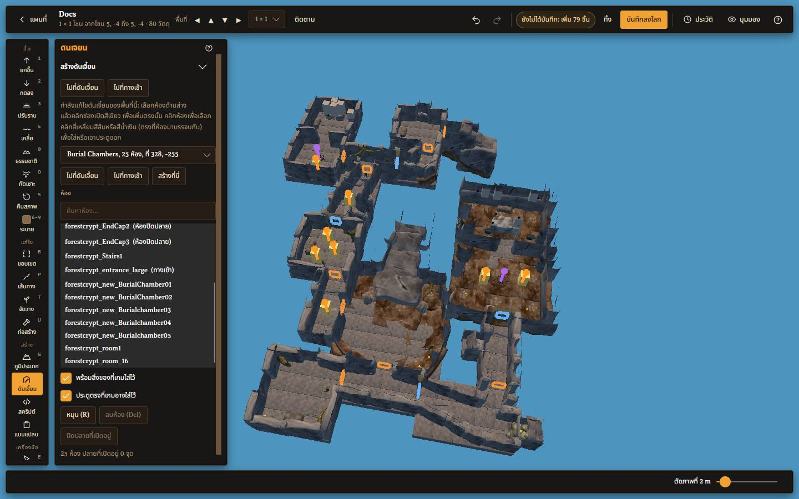

<!-- source: 5e6370cb -->
# ดันเจี้ยน

Valheim เก็บดันเจี้ยนในแบบที่ไม่ธรรมดา: สูงขึ้นไปบนฟ้า เป็นรายการห้อง ที่เกมสร้างขึ้น เมื่อมีคนเข้าใกล้
เมื่อรู้เรื่องนี้ ก็จะเข้าใจว่า ทำไมดันเจี้ยนที่ยังไม่มีใครไป จึงดูว่างเปล่าในเอดิเตอร์ ทำไมดันเจี้ยนที่แก้ไขแล้ว
จึงไม่ต้องใช้ม็อด และทำไมดันเจี้ยน ที่ทำจากชิ้นส่วนก่อสร้าง จึงตั้งอยู่ได้ที่ความสูง 5000 m เครื่องมือ
[ดันเจี้ยน](../dungeons.md) สร้างขึ้นบนหลักการนี้

## วิธีที่เกมเก็บดันเจี้ยน

**ดันเจี้ยนไม่ได้ขุดลงไปในพื้นดิน** แต่ละแห่งคือ **สถานที่** บนผิวดิน (เนินของ burial chamber
ปากถ้ำของ Frost Cave) ซึ่งประตูจะวาร์ปคุณ ไปยังตัวดันเจี้ยน **สูงขึ้นไป 5000 m** เหนือสถานที่นั้น ที่ซึ่งเกม
ถือว่าทุกอย่างอยู่ในอาคาร ในเอดิเตอร์ กล้องจะเลิกตามพื้นดิน เมื่ออยู่บนนั้น และ **มุมมอง → ห้องดันเจี้ยน**
จะแสดงหรือซ่อนห้อง

```text
   5000 m  ┌───────────────┐  the dungeon's rooms
           │ ▢─▢─▢─▢       │  ◄── its door leads back down
           └───────────────┘
              ▲  teleport
   ground  ───┴─── the entrance (a location: mound, cave mouth, mine)
```

**ดันเจี้ยนของเกม คือรายการห้อง** เกมสร้างดันเจี้ยน จากห้องสำเร็จรูป ในเซฟ ดันเจี้ยนหนึ่งแห่ง คือวัตถุหนึ่งชิ้น
ที่เก็บ **รายการห้อง**: ห้องไหน อยู่ที่ไหน หันไปทางใด เมื่อผู้เล่นเข้าใกล้ เกมจะสร้าง
ห้องจากรายการนั้น ไม่ว่าจะมีอะไรอยู่ โดยไม่ตรวจกับกฎของตัวเอง ดันเจี้ยนที่แก้ไขแล้ว จึงใช้ได้
ในเกมของผู้เล่นทุกคน โดยไม่ต้องใช้ม็อด: เอดิเตอร์แค่เปลี่ยนรายการ

**จนกว่าผู้เล่นจะเข้าใกล้ รายการจะว่างเปล่า** เกมวางผังดันเจี้ยน ครั้งแรกที่มีคนมา เอดิเตอร์
จึงไม่มีห้องให้แสดงหรือแก้ไข ก่อนหน้านั้น ให้ไปที่ดันเจี้ยนในเกม แล้วเปิดพื้นที่อีกครั้ง หมู่บ้าน Fuling และ
ฟาร์มทุ่งหญ้า ก็วางผังแบบเดียวกัน แต่อยู่บนพื้นดิน

### ห้อง ช่องเปิด และห้องปิดปลาย


*ดันเจี้ยนของเกม สูงขึ้นไป 5000 m ตัดหลังคาออก: แต่ละห้อง คือหนึ่งรายการในรายการห้อง สี่เหลี่ยมแสดงตรงที่สองห้อง
มาบรรจบกัน: สีน้ำเงินมีประตู สีส้มไม่มี*

ทุกห้องมี **ช่องเปิด** คือช่องประตู ที่ห้องต่อกับห้องถัดไป และแต่ละช่องเปิด มีชนิดของตัวเอง: Frost Cave มี
ช่องเปิดถ้ำธรรมดา ช่องเปิดน้ำแข็ง ช่องเปิดศาลเจ้า และอื่นๆ เกมจะต่อเฉพาะช่องเปิด ชนิดเดียวกัน แม้ว่า
บางห้อง (ทางเดินน้ำแข็ง) จะต่อชนิดหนึ่งกับอีกชนิดได้ **ห้องปิดปลาย** คือห้องเล็ก ที่ปิดช่องเปิด
เพื่อไม่ให้มีทางออกจากดันเจี้ยน

เกมไม่ให้ห้องซ้อนทับกัน และให้อยู่ในพื้นที่ของดันเจี้ยน (สำหรับชนิดส่วนใหญ่ คือ 64 × 64 m รอบกลาง
โซนของดันเจี้ยน) รายการที่เอดิเตอร์เขียน จะถูกสร้างอยู่ดี เอดิเตอร์จึงแค่เตือน เมื่อห้องผิดกฎเหล่านั้น

**สิ่งที่อยู่ในห้อง** เมื่อเกมวางผังดันเจี้ยนครั้งแรก เกมจะสุ่มสิ่งที่อยู่ในแต่ละห้อง: หีบ จุดเกิดสิ่งมีชีวิต
คบเพลิง เตาถ่าน น้ำแข็ง ของตกแต่ง แต่ละส่วนมีโอกาสของตัวเอง จากซีดของโลก ตำแหน่งของห้อง
ธีมของดันเจี้ยน และความสูงของห้อง เอดิเตอร์สุ่มแบบเดียวกัน ห้องที่เอดิเตอร์เพิ่ม จึงมาพร้อมสิ่งที่เกม
จะใส่ไว้ตรงนั้น บางอย่าง (หินย้อยน้ำแข็ง คริสตัล ปลา) จะตกลงบนพื้นผิวที่ใกล้ที่สุดในเกม จึงอาจอยู่
ต่างจากที่เอดิเตอร์แสดงเล็กน้อย

**ประตู** ตรงที่สองห้องมาบรรจบกัน บางครั้งเกมจะใส่ประตู ตามโอกาสของตัวเอง: ม่านผ้าและกำแพงน้ำแข็ง
ของ Frost Cave ประตูกั้นของสุสาน ประตูของเหมือง ดันเจี้ยนแต่ละชนิด มีประตูของตัวเอง สำหรับช่องเปิดแต่ละชนิด และประตู
จะตั้งอยู่ที่ช่องเปิด ของห้องที่อยู่ตรงนั้นก่อน

### ทางเข้า หนึ่งแห่งต่อโซน

เกมวางผัง **ดันเจี้ยนหนึ่งแห่งต่อโซน** และเก็บพื้นที่เหนือทางเข้าไว้ว่าง แม้ก่อนที่จะวางผังดันเจี้ยน
เอดิเตอร์จึงวางดันเจี้ยน หลังทางเข้าของเกม เฉพาะที่ข้างบนยังว่างอยู่ มิฉะนั้น ให้วางทางเข้าในโซนอื่น
ดันเจี้ยนของ ที่ราบ ซึ่งเข้าถึงผ่านประตูมิติแทน จะถูกซ้อนสูงขึ้นไปทีละ 50 m เมื่อพื้นที่
ถูกใช้แล้ว

ทางเข้าของดันเจี้ยนที่วาง คือสถานที่ของเกมเอง สำหรับไบโอมนั้น เขียนแบบเดียวกับ ที่เกมเขียนสถานที่
เกมจึงสร้างประตู หิน และทางเข้า ทุกครั้งที่โหลดโซน ดันเจี้ยนจะไปอยู่ ตรงที่เกมวางดันเจี้ยน
ของทางเข้านั้นเอง (ของ Frost Cave อยู่กลางโซน) หมุนให้ผู้เล่นที่เดินผ่านประตูมา หันหน้าเข้าด้านใน
ที่ราบ ไม่มีดันเจี้ยนของตัวเอง: ตรงนั้น ประตูมิติคู่ที่เชื่อมกัน ทำหน้าที่เป็นทางเข้า บานหนึ่งอยู่บน
พื้นดิน อีกบานอยู่ตรงที่ผู้เล่นมาถึง

เกมวาดดันเจี้ยนให้มืด มีแค่คบเพลิงส่องแสง เอดิเตอร์ส่องแสงดันเจี้ยน เหมือนข้างนอก คุณจึงเห็นสิ่งที่
แก้ไขอยู่

## วิธีที่ตัวสร้างวางผังดันเจี้ยน

ตัวสร้างทำดันเจี้ยนได้ จากสองอย่าง: **ห้องของเกมเอง** หรือ **ชิ้นส่วนก่อสร้าง**

**เมื่อใช้ห้องของเกมเอง** ตัวสร้างจะต่อห้องแบบที่เกมทำ เลือกดันเจี้ยนของไบโอม (burial chamber ใน
ทุ่งหญ้า และป่าดำ sunken crypt ในหนองน้ำ Frost Cave ในภูเขา และดินแดนเหนือสุด infested
mine ในดินแดนหมอก) เริ่มจากห้องทางเข้าห้องหนึ่ง แล้วเพิ่มห้องที่ช่องเปิดที่ยังว่าง ถ่วงน้ำหนักแบบที่เกม
ถ่วง ตรงที่ห้องใส่ได้ จนได้ประมาณ 8, 14, 20 หรือ 26 ห้อง ตามขนาด ตัวสร้างปิดปลายที่เปิดอยู่ทุกปลาย เติมแต่ละห้อง
แบบที่เกมทำ และใส่ประตูตรงที่ห้องมาบรรจบกัน ตามโอกาสของเกม ผลที่ได้ คือวัตถุดันเจี้ยนหนึ่งชิ้น พร้อมรายการ
ห้อง เหมือนของเกมเองทุกประการ เมื่อวางในโลก ห้องจะถูกวางผัง จากวัตถุดันเจี้ยน ตรงที่ทางเข้า
กำหนด และอยู่ในพื้นที่ของโซนนั้น แบบที่เกมทำ: ตำแหน่งในโซน ที่ทางเข้าตั้งอยู่ และทิศที่
หันไป จะเปลี่ยนว่าห้องไหนใส่ได้

**เมื่อใช้ชิ้นส่วนก่อสร้าง** ตัวสร้างจะวางแผนดันเจี้ยน บนกริดช่องละ 2 m ทีละชั้น แล้วสร้างและตกแต่ง
ตัวเลือกและซีดเดียวกัน ให้ดันเจี้ยนเดียวกันเสมอ แต่ละชั้น วางผังตามลำดับนี้:

| | สิ่งที่วางผัง |
|---|---|
| **โถงทางเข้า** | เปิดชั้นแรก ผู้เล่นมาถึงหน้าผนังด้านหลัง โดยมีชื่อดันเจี้ยน บนป้ายข้างตัว |
| **ทางเดินหลัก** | ประมาณสองในห้าห้อง เป็นห้องหลักของรูปแบบ สลับกันไป (โถงใหญ่ ทางแยก แกลเลอรี และโบสถ์ของสุสาน) แต่ละห้องต่อกับห้องก่อนหน้า ส่วนใหญ่ตรงไปข้างหน้า |
| **ลงชั้นล่าง หรือบอส** | ทุกชั้นยกเว้นชั้นสุดท้าย จบที่ช่องบันไดลง (8 × 24 m) ไปยังชั้นล่าง ซึ่งต่ำลง 6 m ชั้นสุดท้าย จบที่ห้องโถงหน้า ลานต่อสู้ของบอส (24 × 24 m) และห้องคลังสมบัติ ที่อยู่ถัดไป |
| **ห้องข้างและปีกอาคาร** | ห้องข้างแตกแขนงออกไป ส่วนใหญ่จากทางแยก และโถงยาว เลือกตามน้ำหนักของรูปแบบ ห้องข้าง มักงอกต่อจากห้องก่อนหน้า และมักเข้าชุดกัน: ห้องครัวข้างโถงงานเลี้ยง ห้องขังข้างห้องยาม โรงตีเหล็กข้างโรงช่าง |
| **ห้องคู่** | ห้องข้าง มักได้ห้องคู่ ที่สะท้อนกัน อยู่ฝั่งตรงข้ามของโถง (วิหารแทบทุกครั้ง รังก็อบลินแทบไม่เคย) ผังจึงดูเหมือนอาคาร ที่มีแนวแกน |
| **ทางวน** | ห้องที่ห่างกันตามทาง ตั้งแต่สามห้องขึ้นไป ซึ่งบังเอิญอยู่ใกล้กัน จะถูกเชื่อมกัน จึงมีทางวนได้มากกว่าหนึ่งทาง |
| **ทางตัน และที่ซ่อนสมบัติ** | ทางเดินหนึ่งหรือสองทาง นำไปสู่ที่ซ่อนสมบัติเท่านั้น ที่ซ่อนลับหนึ่งแห่ง (สองแห่ง เมื่อเกิน 20 ห้อง) อยู่ติดห้องข้าง หลังกำแพงร้าว หรือผ้าแขวนผนัง |
| **กุญแจ** | เมื่อบอสอยู่หลังประตูกั้น กุญแจจะอยู่ในหีบ ในห้องข้าง ที่ไกลจากลานต่อสู้ที่สุด |
| **ประตู** | ประตูกั้นของบอส ใช้กุญแจ ห้องคลังสมบัติ อยู่หลังประตูกั้น ห้องขังได้ประตูกั้นบ่อยกว่า ห้องใหญ่โต บางครั้งได้ประตูกั้นคู่ขนาดใหญ่ ที่เหลือเป็นไปตามรูปแบบ ตรงที่บันไดลงไป ช่องประตูที่เปิดโล่ง จะกลายเป็นประตูกั้น สิ่งที่อยู่ข้างล่าง จึงอยู่ข้างล่าง |

ห้องแตกต่างกันไป ภายในกรอบนี้ **ขนาด** ของห้อง เป็นไปตามชนิด (ห้องเก็บของ อาจเป็น 8 × 8 m โถงใหญ่ กว้าง 12–20 m และ
ยาว 20–32 m) บางห้องมีมุมหยัก มีส่วนโค้งที่ปลาย หรือมุมหายไปหนึ่งมุม **ทางเดิน** ตรงหรือเลี้ยว
และบางห้องต่อกันแบบผนังชนผนัง ห้องสูง 4 m แต่โถงใหญ่ โบสถ์ ห้องบัลลังก์ และลานต่อสู้ อาจสูงถึง
10 m ทะลุชั้นบน ห้องยาว อาจมี **ซอกผนัง** ด้านข้าง

### ทำไมจึงตั้งอยู่ได้ที่ความสูง 5000 m

ทุกชิ้นส่วนก่อสร้าง ต้องได้รับการรับน้ำหนัก จากพื้นดินในเกม และไม่มีพื้นดินอยู่บนนั้น ดันเจี้ยนที่ทำจากชิ้นส่วน
ก่อสร้าง จึงตั้งอยู่บน **แผ่นพื้นหินอ่อนดำ** (8 × 8 m) ที่เป็นทั้งพื้นและหลังคา ของทุกส่วนที่ใช้งาน: เป็นชิ้นส่วนเดียว
ที่เกมไม่เคยตรวจการรับน้ำหนัก (ดู [การตรวจการรับน้ำหนัก](objects.md#การตรวจการรบนำหนก)) ทุกอย่างที่เหลือ ตั้งอยู่บน
แผ่นพื้นนี้ สิ่งที่ตั้งบนพื้น จะถูกยกขึ้น 5 cm เพราะชิ้นส่วนที่จุดกึ่งกลาง อยู่บนพื้นผิวพอดี จะไม่ได้รับการรับน้ำหนัก
จากพื้นผิวนั้น ถ้าต้องการสร้างดันเจี้ยน จากชิ้นส่วนเอง ให้ทำแบบเดียวกัน: พื้นหินอ่อนดำ และทุกอย่างวางบนพื้นนั้น

ทุกอย่างที่ตัวสร้างวาง ไม่มีผู้สร้าง เหมือนในดันเจี้ยนของเกมเอง เกมจึงถือว่าเป็นซากปรักหักพัง (ดู
[ชิ้นส่วนที่ผู้เล่นสร้าง](objects.md#ชนสวนทผเลนสราง))

## การตกแต่ง แสง และผู้คุ้มกัน

ดันเจี้ยนที่ทำจากชิ้นส่วนก่อสร้าง จะถูกตกแต่งทีละห้อง **แสง** และ **ความผุพัง** สุ่มตัวเลขของตัวเอง
การเปลี่ยนค่าเหล่านี้ จึงไม่เปลี่ยนส่วนอื่นของดันเจี้ยน

**ทุกห้องตกแต่งตามหน้าที่** ในแบบใดแบบหนึ่ง จากสองถึงสี่แบบ ที่ซีดเลือก:

| ห้อง | การตกแต่งบางส่วน |
|---|---|
| โถง | แนวเสาพร้อมแท่นบูชา โถงดื่มมี้ดรอบกองไฟ พร้อมโต๊ะยาว โถงแห่งความตาย ที่มีโลงศพบนแท่นยก โถงโล่ง ที่มีเสาล้ม |
| โบสถ์ | ม้านั่งหันหน้าเข้าหาแท่นบูชา ระหว่างรูปปั้น แท่นบูชายกสูง ในวงล้อมเตาถ่าน โถงกลางปูพรม และเทียน |
| ห้องฝังศพ ห้องเก็บกระดูก แกลเลอรี | แถวโลงศพ หรือหลุมฝังศพเดียวบนแท่นยก กระดูกเรียงตามผนัง หรือกองสุม ซอกผนัง รูปปั้น ใยแมงมุม |
| ค่ายทหาร ห้องเก็บของ ห้องทำงาน | เตียงหรือที่นอนม้วน รอบกองไฟ ของเรียงตามผนัง หรือชั้นวางเป็นแถว โต๊ะเขียนหนังสือ และชั้นวาง |
| โถงงานเลี้ยง ห้องบัลลังก์ | โต๊ะยาว หรือโต๊ะประธานบนแท่นยก แนวเสา ห้องวางแผนรบ เสาล้มรอบแท่นยก |
| ลานต่อสู้ ศาลเจ้า | วงเสารอบบอส บัลลังก์เหนือกองกะโหลก หรือหลุมที่จมต่ำกว่าขอบยกรอบๆ |
| ห้องครัว โรงตีเหล็ก โรงช่าง | สถานีจริงของเกม: เตาอบ หม้อต้ม ถังหมัก เตาหลอม เตาตีเหล็กดำ |

**ของข้างในเพิ่มเติม** ห้องหินใหญ่โต อาจมีชั้นลอยบนเสา เหนือทางเข้า ห้องฝังศพ อาจมีห้องเก็บศพชั้นใน
ซอกผนังมีโลงศพ รูปปั้น หรือถัง มุมห้องได้กลุ่มของเล็กๆ ที่เข้ากับห้อง (ที่ตั้งแคมป์ มื้ออาหาร
โต๊ะอาลักษณ์ คลังอาวุธ) และห้องใหญ่ อาจได้ **ชิ้นเด่น** ที่พบเพียงครั้งเดียว ในดันเจี้ยนทั้งหมด: โดลเมน
กะโหลกยักษ์ น้ำพุวิสป์ แต่ละไบโอมเพิ่มของของตัวเอง (รากไม้ในป่า เมือกและน้ำมันดินในหนองน้ำ หินย้อยน้ำแข็ง
ในภูเขา เถาของ seeker ในเหมือง หนามแหลมใน ดินแดนเถ้าถ่าน) และทางเดินก็แตกต่างกัน: พังไปครึ่งหนึ่ง
เรียงรายด้วยกระดูก ปูพรม มีประตูกั้นกลางทาง หรือมีกับดัก ประมาณหนึ่งในสิบสอง ของห้องธรรมดา จะเกือบโล่ง
มีชิ้นส่วนเดียว และแสงหนึ่งดวงในความมืด เมื่อ **เฟอร์นิเจอร์** เป็น มีเฟอร์นิเจอร์ หรือ หรูหรา ห้องหินใหญ่โต
จะได้พื้นกระเบื้องหินอ่อนดำ และห้องพักอาศัยได้พื้นไม้กระดาน อย่างละครึ่งหนึ่งของจำนวนครั้ง

**แสงตามหน้าที่** ห้องส่องแสงด้วยคบเพลิง เชิงเทียนติดผนัง หรือเตาถ่าน ตามแบบแสงของไบโอม: หนึ่งดวงทุก 5 m ของผนัง
เมื่อ **สว่าง** 8 m เมื่อ **สลัว** 12 m เมื่อ **มืด** (และเฉพาะห้องที่สำคัญ) ห้องใหญ่โต
มีแสงถี่กว่า ห้องของผู้ตาย ห้องขัง ห้องเก็บของ และที่ซ่อนสมบัติ ห่างกว่า ในสุสานใต้ดิน และคุก ทางเดินบางส่วน
ยังมืด ระหว่างห้องที่มีแสง

**ยิ่งลึก ยิ่งรวย และยิ่งอันตราย** แต่ละชั้นที่ลึกลงไป มีมอนสเตอร์และสมบัติ เพิ่มขึ้นหนึ่งในห้าของชั้นบนสุด:
ชั้นที่สอง 1.2 เท่าของชั้นบนสุด ชั้นที่หก สองเท่า ชั้นที่สิบหก สี่เท่า

**ผู้คุ้มกัน** ห้องจะได้มอนสเตอร์ ประมาณหนึ่งตัว ต่อพื้นที่ 75 m² ตามอัตราปกติของชนิดห้อง คูณ **มอนสเตอร์** คูณ
ความลึก ยืนห่างจากทางเข้า และหันหน้าเข้าหาทางเข้า หีบกุญแจ มีหนึ่งในตัวพิเศษของไบโอมคุ้มกัน หลุมฝังศพ
มีหนึ่งตัว ห้องบัลลังก์มีสองตัว **บอส** จะถูกวางในลานต่อสู้ หนึ่งครั้งเสมอ เป็นตัวสิ่งมีชีวิตเอง: ไม่มีดาว เมื่อ
**มอนสเตอร์** เป็น ไม่มี หนึ่งดาวที่ × 1 สองดาวที่ × 2 ขึ้นไป เมื่อเปิด **มอนสเตอร์เกิดใหม่** ตัวอื่นๆ จะมาจาก
จุดเกิดของเกม และกลับมาหลังถูกฆ่าไปสักพัก (ดู [จุดเกิด](objects.md#จดเกด)) ห้องของเกมเอง
มีจุดเกิดเสมอ

**สมบัติ** หีบ ทรัพย์สมบัติที่วางอยู่ และเหรียญกับแท่งโลหะของไบโอม ในห้องคลังสมบัติ เพิ่มขึ้นตาม **สมบัติ** และ
ความลึก หีบกุญแจ มีกุญแจสุสาน และของมีค่าเล็กน้อย เขียนลงในหีบไว้ เพื่อไม่ให้เกมเติม
สมบัติของตัวเองลงไป และประตูกั้นของกุญแจ มีป้าย: *Sealed. The key lies within these halls.*

เมื่อสร้างในเกมด้วย Homestead พิมพ์เขียวดันเจี้ยน มีแค่ชิ้นส่วน: ไม่มีกุญแจในหีบ ไม่มีบอส
