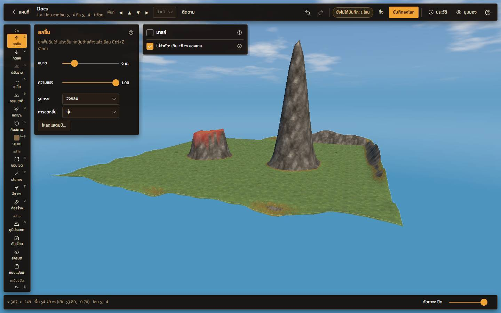
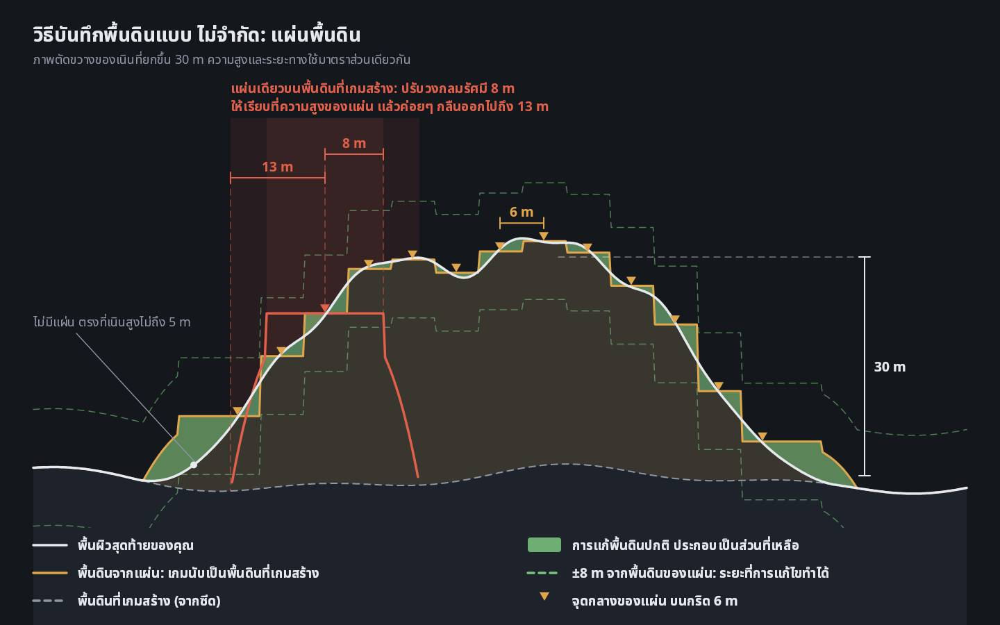
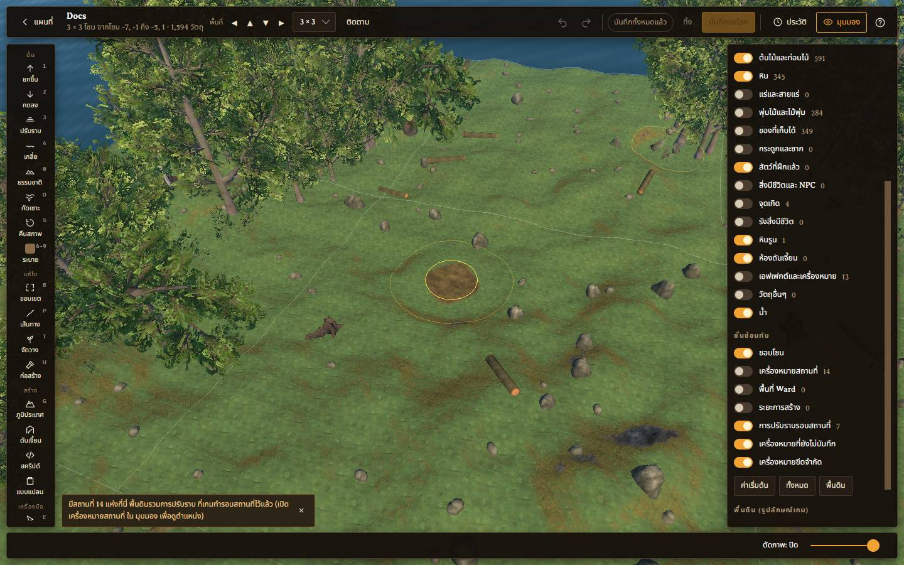

<!-- source: d97e56fa -->
# ขีดจำกัดของพื้นดิน

เกมให้พื้นดิน เลื่อนขึ้นหรือลงได้ไม่เกิน 8 m จากที่โลกสร้างไว้ เอดิเตอร์ทำตามกฎนี้ ทุกโลกที่บันทึก
จึงโหลดได้ในเกมของผู้เล่นทุกคน รวมถึงผู้เล่นคอนโซล โดยไม่ต้องใช้ม็อด **ไม่จำกัด** ทำได้เกินกว่านั้น
ด้วยวิธีที่เกมเองเข้าใจ หน้านี้อธิบายขีดจำกัด วิธีที่ ไม่จำกัด อ้อมขีดจำกัด และวิธีที่สถานที่ของเกม
กำหนดรูปพื้นดิน

## ขีดจำกัด 8 m ของเกม

เกมไม่ได้เก็บความสูงของพื้นดิน แต่เก็บ **ซีด** ของโลก คำนวณพื้นดินที่สร้างจากซีด
และบันทึกเฉพาะ **การเปลี่ยนแปลง** ของคุณ: สำหรับจุดพื้นดินแต่ละจุด ถูกยกหรือขุดไปเท่าไร การเปลี่ยนแปลงนั้น ได้ไม่เกิน
**±8 m** (บวกการเปลี่ยนแปลงแบบเกลี่ย ได้ไม่เกิน ±1 m ซึ่งจอบของเกมทำ) ส่วนที่เกินจะถูกทิ้ง เมื่อ
เกมโหลดโซน เอดิเตอร์ใช้กฎเดียวกัน จุดที่ถึงขีดจำกัด จึงหยุดตรงนั้น

ในทางปฏิบัติ หมายความว่า:

- **วัดจากพื้นดินที่สร้าง ไม่ใช่จากพื้นดินตอนนี้** เนินที่ยกขึ้น 8 m สูงขึ้นอีกไม่ได้
  และพื้นที่ขุดลง 8 m ลึกลงอีกไม่ได้ ไม่ว่าคุณจะทำมาอย่างไร แถบสถานะแสดงความสูงทั้งสอง ใต้เมาส์:
  `พื้น 41.20 m (เดิม 35.00, +6.20)`
- **งานใหญ่ชนขีดจำกัดก่อน**: ลานก่อสร้าง ที่ตัดเข้าไปในไหล่เขา แม่น้ำที่ผ่านพื้นที่สูง (ท้องน้ำต้องต่ำกว่า
  ทะเล ดู [พื้นดินถูกเก็บอย่างไร](#พนดนถกเกบอยางไร)) ภูเขา
- **เครื่องมือของเกมเอง ก็ทำตามเช่นกัน** จอบและพลั่วของผู้เล่น ทำงานภายใน ±8 m ของพื้นดินที่สร้าง ในเกม
  เหมือนในเอดิเตอร์

```text
        ┌──────────────────────── +8 m: สูงสุดที่เกมเก็บไว้
        │      ╭──╮  พื้นดินที่ยกขึ้น หยุดตรงนี้
  ──────┼─────╯    ╰──────────── พื้นดินที่สร้าง (ความสูง "เดิม")
        │
        └──────────────────────── −8 m: ลึกสุดที่เกมเก็บไว้
```

## ไม่จำกัด

สวิตช์ **ไม่จำกัด: เกิน ±8 m ของเกม** ให้เครื่องมือพื้นดิน เลื่อนพื้นดินได้ถึง 400 m จากพื้นดิน
ที่สร้าง: ภูเขา หน้าผา หุบเหว หลุมลึก เป็นสวิตช์เดียว บนการ์ด **มาสก์** ข้างแผงของทุก
เครื่องมือที่สวิตช์นี้ควบคุม (แปรงปั้น สูตรและรูปภาพของ ภูมิประเทศ เส้นทาง และ ขอบเขต) และจะปิด ทุกครั้งที่
เอดิเตอร์เริ่ม ภูเขาของเครื่องมือ [ภูมิประเทศ](../landform.md) และการวางสำเนา จะเกินขีดจำกัดเสมอ เมื่อ
จำเป็น และสคริปต์ก็เกิน เว้นแต่จะสั่งไม่ให้เกิน

ขณะที่คุณทำงาน ส่วนที่เกิน ±8 m จะเก็บแยก เป็นการยกซ้อนบนพื้นดิน เลิกทำ ประวัติ และ **คืนสภาพ**
จัดการส่วนนี้ เหมือนการเปลี่ยนแปลงอื่น แถบสถานะบอกสถานะของสวิตช์ ทุกครั้งที่คุณเปิดหรือปิด


*การลากครั้งเดียวกัน แบบไม่เปิดและเปิด ไม่จำกัด ซ้าย พื้นหยุดที่ 8 m และยอดเป็นสีแดง ขวา พื้นยังคง
สูงขึ้น สวิตช์อยู่บนการ์ด มาสก์*

### บันทึกอย่างไร: แผ่นพื้นดิน

เกมไม่เคยเก็บการแก้ไขพื้นดิน ที่เกิน 8 m แต่เกมปรับพื้นดิน ใต้ **สถานที่** ของเกมให้ราบ (หมู่บ้าน
แคมป์พ่อค้า) โดยไม่มีขีดจำกัด และนับพื้นดินที่ปรับราบนั้น เป็นพื้นดินที่สร้าง (ดู
[สถานที่ปรับพื้นดินให้ราบ](#สถานทปรบพนดนใหราบ)) เอดิเตอร์ใช้ข้อนี้ เมื่อคุณบันทึกหรือนำไปใช้แบบไลฟ์
เอดิเตอร์จะเปลี่ยนพื้นดิน ที่เกินขีดจำกัด เป็น **แผ่นพื้นดิน**: สถานที่ล่องหน ของเกมเอง ที่ไม่มีโมเดล แต่ละแผ่น
ปรับวงกลมรัศมี 8 m ให้ราบ ที่ความสูงของแผ่น และกลืนพื้นดินรอบๆ ออกไปถึงประมาณ 13 m: เลยวงกลมไปนิดเดียว
พื้นดินจะไปถึงประมาณสามในสี่ ของความสูงของแผ่น (เกมนับการกลืน จากกึ่งกลางของแผ่น จึง
เริ่มด้วยขั้นเล็กๆ) แล้วน้อยลงเรื่อยๆ จนไม่มีเลยที่ 13 m

1. แผ่นวางบนกริด 6 m เฉพาะตรงที่พื้นดินของคุณ ต่างจากพื้นดินที่จะเป็น ถ้าไม่มีแผ่น เกิน 5 m
2. เอดิเตอร์คำนวณพื้นดิน ตรงตามที่เกมจะสร้างจากแผ่น ตามลำดับของเกม และปรับ
   ความสูงของแผ่น หลายรอบ ให้ใกล้รูปทรงของคุณที่สุด เท่าที่ทำได้ ตรงที่ยังคลาดเคลื่อนมากเกินไป จะเพิ่ม
   แผ่นแล้วลองอีกครั้ง
3. การแก้ไขพื้นดินปกติ ภายใน ±8 m ของพื้นดินใหม่ เติมส่วนที่เหลือ

เกมของผู้เล่นทุกคน สร้างพื้นดินเดียวกันจากแผ่น รวมถึงผู้เล่นคอนโซล โดยไม่ต้องใช้ม็อด


*เนินที่ยกขึ้น 30 m ตามที่บันทึก ยอดแบนของแผ่น (สีส้ม) ไล่ขึ้นเนิน บนกริด 6 m ใต้ผิวของคุณ
(สีขาว) แผ่นหนึ่ง สีแดง ปรับราบ 8 m รอบกึ่งกลาง และกลืนพื้นดินออกไปถึง 13 m การแก้ไขปกติ (สีเขียว)
เติมส่วนที่เหลือ ภายใน ±8 m ของพื้นดินจากแผ่น ตรงที่เนินสูงไม่ถึง 5 m จะไม่มีแผ่น*

### มีผลกับคุณอย่างไร

| | |
|---|---|
| **ข้อความตอนบันทึก** | บอกว่าสร้างแผ่นกี่แผ่น (และแทนที่แผ่นเก่ากี่แผ่น) นำต้นไม้และหินออกกี่ชิ้น และพื้นดินที่ชันที่สุด ยังคลาดเคลื่อนเท่าไร: "พื้นดินแบบไม่จำกัด: แผ่นพื้นดิน 312 แผ่น, นำต้นไม้/หิน 40 ชิ้นออก; พื้นดินบางส่วนคลาดเคลื่อนได้ถึง 2.5 m (ชันเกินไป)" |
| **ประวัติยังอยู่** | เอดิเตอร์เก็บพื้นดินแบบ ไม่จำกัด ของคุณไว้ และคำนวณแผ่นจากพื้นดินนั้น: เลิกทำการวาง หรือการลากแปรง บันทึกหรือนำไปใช้อีกครั้ง แผ่นของส่วนนั้นจะหายไป และพื้นดินรอบๆ ก็กลับเป็นแบบเดิมด้วย ใช้ได้หลังเปิดโลกอีกครั้งด้วย (ดู [สิ่งที่ขั้นตอนย้อนกลับไม่ได้](saving-and-history.md#สงทขนตอนยอนกลบไมได)) |
| **พื้นดินใหม่ นับเป็นพื้นดินที่สร้าง** | ในเกม จอบและพลั่ว ทำงาน ±8 m จากพื้นดินของแผ่น เมื่อเปิดโลกอีกครั้ง ความสูง "เดิม" ในแถบสถานะ ก็เป็นพื้นดินของแผ่นด้วย **คืนสภาพ** ยังคงนำพื้นดิน กลับเป็นพื้นดินแรกของโลก แม้อยู่ใต้แผ่น ถ้าจะเอารูปทรงที่บันทึกแล้วออก ให้คืนสภาพ เลิกทำใน ประวัติ หรือกดพื้นลงอีกครั้ง โดยเปิด ไม่จำกัด: แผ่นจะถูกคำนวณใหม่ ตอนบันทึกครั้งถัดไป และหายไป ตรงที่ไม่จำเป็นแล้ว |
| **ต้นไม้และหินถูกนำออก** | ต้นไม้ หิน แร่ พุ่มไม้ และของที่เก็บได้ ตรงที่พื้นดินเลื่อนเกิน 2 m จะถูกฝัง หรือลอยอยู่ จึงถูกนำออก ชิ้นส่วนก่อสร้างยังอยู่ |
| **ผนังที่ชันมาก จะนุ่มลง** | แผ่นตามรอยตัด ที่แคบกว่าตัวแผ่นไม่ได้ |
| **โซนที่ยังไม่มีใครไป** | คงพื้นดินเดิมไว้: การยกจะถูกทิ้ง และข้อความบอกจำนวน ไปที่โซนเหล่านั้นในเกมก่อน |
| **แผ่นโหลดก่อน** | เกมของผู้เล่น สร้างแผ่นก่อน ชิ้นส่วนและต้นไม้รอบๆ พื้นดินจึงเสร็จ ในช่วงแรกของการเข้าไป บนเซิร์ฟเวอร์ ปลั๊กอิน WorldEditorBridge ทำให้เป็นแบบนั้น |
| **มองจากไกล** | รูปทรงใหม่ปรากฏ เมื่อคุณเข้าใกล้ เหมือนพื้นดินที่ปรับราบของหมู่บ้าน |
| **แผนที่ในเกม** | วาดจากซีด จึงไม่แสดงรูปทรงใหม่ |
| **ดิน** | เกมระบายพื้นดินของแผ่นเป็นดิน เอดิเตอร์ระบายจุดเหล่านั้นกลับ ด้วยพื้นดินของไบโอมเอง แผ่นจึงไม่ปรากฏให้เห็น |

เอดิเตอร์ซ่อนแผ่น: แผ่นไม่แสดงเป็นสถานที่ เครื่องหมาย หรือวัตถุ

## สถานที่ปรับพื้นดินให้ราบ

หมู่บ้าน พ่อค้า ทางเข้าดันเจี้ยน แท่นบูชาบอส และ **สถานที่** อื่นๆ ของเกม ปรับพื้นดินรอบตัว
ให้ราบ พื้นที่ราบนี้ ไม่ได้เก็บไว้ในเซฟ: เกมปรับให้ราบใหม่ ทุกครั้งที่โหลดโซน ก่อนที่จะ
นำการเปลี่ยนแปลงของใครไปใช้ แล้วจึงเพิ่มการแก้ไขพื้นดิน ที่บันทึกไว้ซ้อนด้านบน

เอดิเตอร์แสดงพื้นดิน ที่ปรับราบแล้ว และการแก้ไขของคุณ ซ้อนอยู่ด้านบน เหมือนในเกม หมายเหตุที่
มุมซ้ายล่าง ของมุมมอง 3D นับสถานที่ในพื้นที่ (และภายใน 40 m) และ **มุมมอง → การปรับราบรอบสถานที่** วาดตำแหน่งที่ปรับราบ: วงแหวนสำหรับส่วนที่ราบ และวงที่จางกว่า ตรงที่กลืนเข้ากับแผ่นดิน


*เปิด มุมมอง → **การปรับราบรอบสถานที่** รอบแท่นบูชาของ Eikthyr: วงแหวนทึบ คือส่วนที่ราบที่เกมปรับ
วงที่จางกว่า คือตรงที่กลืนกลับเข้ากับแผ่นดิน หมายเหตุที่มุมซ้ายล่าง นับสถานที่ในพื้นที่*

ทำไมจึงสำคัญ:

- **±8 m นับจากพื้นดินที่ปรับราบ** เพราะเกมนับเป็นพื้นดินที่สร้าง
- **การนำสถานที่ออก จะนำการปรับราบออกด้วย** การลบหินรูน นำสถานที่ของหินรูนออกถาวร รวมถึง
  การปรับราบเล็กๆ รอบตัว การรีเซ็ตโซน จะวางสถานที่ใหม่ และการปรับราบจะกลับมา
- **ส่วนของสถานที่ ไม่ใช่วัตถุ** หินของทางเข้าสุสาน แคมป์ของพ่อค้า แท่นบูชาบอส หรือผนัง
  ถ้ำโทรลล์ ถูกสร้างใหม่จากสถานที่ ทุกครั้งที่โหลดโซน เอดิเตอร์จึงวาดสิ่งเหล่านี้ (ใต้ **ซากปรักหักพังและโครงสร้าง**) แต่เลือกหรือเปลี่ยนไม่ได้
- **บางสถานที่ เก็บพื้นดินให้โล่ง** ไม่มีอะไรขึ้น ในสี่เหลี่ยมรอบสถานที่ ที่ชนิดของมันเคลียร์
  พื้นดิน และ ปลูกธรรมชาติคืน ก็เก็บไว้แบบนั้น เหมือนเกม (ดู [กฎการเติบโต](objects.md#กฎการเตบโต))
- **แผ่นพื้นดิน** คือกลไกเดียวกันนี้ ที่ใช้อย่างตั้งใจ (ดู [ไม่จำกัด](#ไมจำกด))

## เครื่องหมายขีดจำกัด

พื้นดินที่ถึงขีดจำกัด ±8 m จะเป็น **สีแดง** ในมุมมอง 3D (ใน รูปลักษณ์เกม **มุมมอง → เครื่องหมายขีดจำกัด** เปิดไว้ตอนแรก)
และแถบสถานะ เพิ่ม ", ถึงขีดจำกัด ±8 m" ใต้เมาส์ หลังการลากแปรง ที่ชนขีดจำกัด จะขึ้นว่า "ถึงขีดจำกัดของเกม: พื้นดินเลื่อนได้แค่ 8 m จากความสูงเดิม (จุดสีแดง)"

เครื่องมืออื่น บอกในแบบของตัวเอง:

| เครื่องมือ | แสดงขีดจำกัดอย่างไร |
|---|---|
| [เส้นทาง](../path.md) | จุดพื้นดินที่ถึงขีดจำกัด เป็นสีแดง และแถบสถานะบอกไว้ |
| [ขอบเขต](../area.md): ปรับราบ | บรรทัดขุดและถม บอกว่าเกินเอื้อมไปเท่าไร: "(40 m³ ไปไม่ถึง: ขีดจำกัด ±8 m)" สำหรับ ยกขึ้น และ กดลง บรรทัดนี้นับเฉพาะ พื้นดินที่ขีดจำกัดยอมให้เลื่อน |
| ขอบเขต: แผนที่ความสูง | จุดที่ไปไม่ถึงความสูงของตัวเอง เป็นสีแดง และแถบสถานะนับจำนวน |
| [สคริปต์](../scripting.md) | เมื่อ `Ground.NoLimit = false` บรรทัดผลลัพธ์ นับจุดที่หยุด |

พื้นดินสีแดงไม่ใช่ข้อผิดพลาด: เป็นพื้นดิน ที่เกมไม่ยอมให้ไปต่อ ถ้าจะไปต่อ ให้เปิด **ไม่จำกัด** หรือเปลี่ยน
แผน (แม่น้ำที่ไปตามพื้นที่ต่ำ ลานที่ตัดสูงขึ้นนิดหน่อย)

## พื้นดินถูกเก็บอย่างไร

**หนึ่งความสูงต่อเมตร** พื้นดินมีจุดความสูง หนึ่งจุดต่อเมตร: 65 × 65 จุด ในโซน 64 m โดยโซนข้างเคียง
ใช้จุดขอบร่วมกัน ผนังของพื้นดิน จึงกว้างประมาณหนึ่งเมตรเสมอ: ตั้งชันกว่านั้นไม่ได้
ทั้งในเอดิเตอร์และในเกม และพื้นดินยื่นเป็นชะง่อนไม่ได้เลย อุโมงค์หรือถ้ำจริงใต้พื้นดิน ต้องใช้
ม็อดที่ขุดได้ เช่น Tunnelheim (ดู
[แก้ไขโลกที่สร้างด้วย Expand World, Riverheim หรือ Tunnelheim](../guides/use-mods-worlds.md))

**สองสามเหลี่ยมต่อตารางเมตร** แต่ละตารางเมตร วาดเป็นสองสามเหลี่ยม แบ่งตามเส้นทแยงเดียวกับ
ในเกม จากมุมตะวันออกเฉียงใต้ ไปมุมตะวันตกเฉียงเหนือ ขอบที่วิ่งจากตะวันตกเฉียงเหนือ ไปตะวันออกเฉียงใต้ จะเรียบ ขอบที่
วิ่งจากตะวันออกเฉียงเหนือ ไปตะวันตกเฉียงใต้ จะเป็นฟันเลื่อยเล็กๆ ในเกมก็เช่นกัน

**ความสูงเป็นของเกม** ทะเลอยู่ที่ 30 m Valheim ไม่มีน้ำไหล: น้ำในแม่น้ำและทะเลสาบ คือทะเล
ที่ระดับเดียวกันทุกที่ พื้นดินจะมีน้ำ เฉพาะตรงที่ต่ำกว่า 30 m แม่น้ำที่ผ่านพื้นที่สูง ต้อง
ขุดลึก

**การระบาย** จุดพื้นดินแต่ละจุด มีค่าการระบายด้วย: สัดส่วนของดิน ดินพรวน และพื้นปูหิน และเครื่องหมาย
ที่บอกว่าถูกระบายแล้ว จุดที่ไม่เคยถูกระบาย จะแสดงการระบายที่โลกสร้าง (พื้นดินของไบโอม และดินตรงที่
โลกใส่ไว้) แปรงระบาย เลื่อนสัดส่วนของจุด เข้าหาสีของแปรงทีละน้อย ในแต่ละช่วงเวลา การลากเบาๆ
หรือขอบนุ่มของแปรง จึงให้การผสม นี่คือเหตุผลที่ **ล้างการระบาย** และ **คืนสภาพ** ต่างกัน:

| | ทำอะไรกับจุด |
|---|---|
| **ล้างการระบาย** | ระบายพื้นดินไบโอมธรรมดา จุดยังถือว่าถูกระบาย จึงซ่อนดิน ที่โลกสร้างไว้ตรงนั้นด้วย |
| **คืนสภาพ** | นำเครื่องหมายการระบายออก จุดจึงแสดงสิ่งที่โลกสร้างอีกครั้ง |

**ไบโอม** ไบโอมที่จุดหนึ่ง มาจากซีด การแก้ไขพื้นดิน ไม่เคยเปลี่ยนไบโอม

## มาสก์ตัดสินพื้นดินอย่างไร

[มาสก์](../masks.md) จำกัดเครื่องมือ ให้ทำงานกับพื้นดิน ที่ตรงกับการตั้งค่าทั้งหมด มาสก์ตัดสินจุดพื้นดิน
ทีละจุด และไม่มีการผสม: ตรงที่กันพื้นดินออก เครื่องมือไม่ทำอะไรเลย ตรงที่ให้พื้นดิน
ผ่าน เครื่องมือทำงานตามปกติ

| การตั้งค่า | เปรียบเทียบอะไร |
|---|---|
| **ไบโอม** | ไบโอมที่โลกสร้างไว้ที่จุดนั้น การแก้ไขพื้นดิน ไม่เปลี่ยนไบโอม |
| **ความสูง** | ความสูงของพื้นดินตรงนั้น ตามที่เกมนับ (ทะเลอยู่ที่ 30 m) |
| **ความชัน** | คำนวณจากความสูง 1 m ทั้งสองข้างของจุด ตะวันออก–ตะวันตก และเหนือ–ใต้ |
| **ระบาย** | จุดนับว่าถูกระบาย เมื่อถูกระบายแล้ว และมีสีอยู่บ้าง **ล้างการระบาย** จึงทำให้จุด ไม่ถูกระบายสำหรับ มาสก์ **เฉพาะดิน** **เฉพาะดินพรวน** และ **เฉพาะปูหิน** ต้องมีสีนั้น อย่างน้อยครึ่งหนึ่งของการระบาย |

**การลากแปรง ถูกตัดสินจากพื้นดิน ตอนที่เริ่มลาก** การลาก ยกขึ้น บนพื้นดินที่ต่ำกว่า
ความสูงของ มาสก์ จึงยังสูงขึ้นเกินไป จนกว่าคุณจะปล่อย และการลากที่เปลี่ยนความชัน จะไม่ปิดตัวเอง
กลางทาง การแก้ไขที่ทำทีเดียว (ภูมิประเทศ การวาง เส้นทาง การกระทำของเครื่องมือ ขอบเขต) แต่ละอัน ถูกตัดสินจาก
พื้นดินก่อนหน้านั้นพอดี

เพราะไม่มีขอบนุ่ม การปั้นด้วย มาสก์ อาจทิ้งขั้นบันได ตรงที่พื้นดินที่ตรงเงื่อนไข พบกับพื้นดินที่ถูกกันออก
โดยเฉพาะกับ ยกขึ้น กดลง และ ภูมิประเทศ ให้เกลี่ยภายหลัง โดยปิด มาสก์

## เครื่องมือกำหนดรูปพื้นดินอย่างไร

เครื่องมือส่วนใหญ่ แค่ยก ขุด หรือปรับราบ บางอย่างทำตามรูปแบบหรือโมเดล ที่ควรรู้ เพราะอธิบายได้ว่า
ให้อะไร และทำอะไรไม่ได้

### แปรงทำงานเร็วแค่ไหน

ที่ **ความแรง** 1 ยกขึ้น และ กดลง เลื่อนกลางแปรง ได้สูงสุด 6 m ต่อวินาที (2.4 m ต่อวินาที ที่
ค่าเริ่มต้น 0.40) ปรับราบ เกลี่ย ธรรมชาติ และ คืนสภาพ ไม่ได้เพิ่มค่าคงที่: ในแต่ละช่วงเวลา จะเลื่อนทุกจุด เป็นสัดส่วน
ของระยะ ไปยังเป้าหมาย พื้นดินจึงลงตัวที่เป้าหมาย และไม่เลยไป เกลี่ย เลื่อนแต่ละจุด
เข้าหาค่าเฉลี่ย ของตัวเองกับเพื่อนบ้าน 8 จุด การลากซ้ำที่เดิม จึงเรียบขึ้นอีก คืนสภาพ นำการเปลี่ยนแปลงออก
เป็นสัดส่วน ในแต่ละช่วงเวลา และจุดที่อยู่ภายใน 1 cm ของความสูงที่สร้าง จะนับว่าไม่เปลี่ยนอีกครั้ง
คืนสภาพ นำการระบายออก เฉพาะตรงที่แปรงทำงาน แรงกว่าครึ่ง ขอบของการระบาย จึงไม่ขาดรุ่ย

### รูปแบบของ ธรรมชาติ

**ธรรมชาติ** คำนวณรูปทรงกว้างๆ ของพื้นดินก่อน: พื้นดินที่เบลอไปไม่กี่เมตร ตามที่เป็นตอน
เริ่มลาก แล้วเพิ่มเนินเล็ก จากรูปแบบนอยส์ ลงในรูปทรงนั้น สูง **เนินเล็ก** และกว้าง **ขนาดเนินเล็ก** แล้วดึง
พื้นดินเข้าหาผลลัพธ์ เพราะเป้าหมายคงที่ การลากครั้งที่สองที่เดิม จึงไม่ทำให้เนินเล็กพอกพูน
ขึ้นเรื่อยๆ: แค่เข้าใกล้พื้นดินเดิมมากขึ้น

รูปแบบนี้ผูกกับโลก ไม่ใช่กับแปรง การลากที่อยู่ติดกัน และพื้นที่ข้างเคียง จึงต่อกันโดยไม่มีรอยต่อ
ลักษณะธรรมชาติของเครื่องมือ เส้นทาง ธรรมชาติ ของเครื่องมือ ขอบเขต และ `n(x, z)` ในสูตรของเครื่องมือ ภูมิประเทศ ใช้รูปแบบเดียวกัน **ลวดลายใหม่** เปลี่ยนรูปแบบ ให้ทั้งหมด

### การกัดเซาะ

การกัดเซาะแบบ **เทอร์มอล** เลื่อนพื้นดิน ตรงที่จุดข้างเคียงสองจุด ชันกว่า **มุมพักตัว**: วัสดุเลื่อนไหล
จากจุดที่สูงกว่า ไปยังจุดข้างเคียงที่ต่ำกว่า ทีละครึ่งของส่วนเกิน ความชันจึงลงตัว แทนที่จะแกว่งไปมา
พื้นดินแค่ถูกเลื่อน ไม่เคยหายไป จึงเกิดเนินเศษหินใต้หน้าผา การกัดเซาะแบบ **น้ำ** คือฝน: หยดน้ำตกลงบนจุดสุ่ม
แล้วไหลลงเนิน ได้ถึง 40 ขั้น เก็บพื้นดินไป ตรงที่ไหลเร็ว และทิ้งไว้ ตรงที่ไหลช้าลง
หรือเติมหลุม หยดน้ำจำนวนมาก กัดเป็นร่องตามทางลาด และทิ้งเนินตะกอนรูปพัดไว้ที่เชิง พื้นดินที่อยู่นอก
แปรงเล็กน้อย อาจได้รับสิ่งที่ไหลหรือถูกชะออกมา

### ภูเขาสร้างอย่างไร

ตัวภูเขา มีรูปตัดตามธรรมชาติ ชันที่ด้านบน และลาดลงที่เชิงเขา และเส้นขอบ บิดด้วย
นอยส์ จึงไม่เคยเป็นวงกลมสมบูรณ์ (ไกลกว่ารัศมี ได้ถึง 15 %) **ขรุขระ** เพิ่มเนินกว้างๆ และสันเขา
มีร่องอยู่ระหว่างกัน ไล่ลงตามทางลาด ตามสัดส่วนขนาดของภูเขา และรายละเอียดเล็กๆ เล็กน้อย จำกัดไว้
ไม่กี่เมตร: รอยตัดลึกและแคบ จะดูขาดวิ่น และแผ่นพื้นดิน ตามไม่ได้ ที่ขอบ ภูเขาจะจางกลับเข้า
แผ่นดิน และถูกเพิ่มลงบนพื้นดินที่มีอยู่ จึงคงลักษณะของแผ่นดินเดิมไว้ ภูเขาแต่ละลูก มาจาก **ซีด**:
พรีเซ็ต ค่า และซีดเดียวกัน สร้างภูเขาลูกเดิมอีกครั้ง ทางลาดชันน้อย มีหญ้าและต้นไม้ ทางลาดชันมาก แสดง
หินเปลือย แบบที่เกมวาด ภูเขาเกิน ±8 m เสมอ และการบันทึก จะเปลี่ยนภูเขาเป็น
[แผ่นพื้นดิน](#บนทกอยางไร-แผนพนดน)

### ขอบของเส้นทางจางอย่างไร

จุดพื้นดินทุกจุด ใกล้เส้นทาง จะวัดจากจุดที่ใกล้ที่สุดของเส้น ภายในครึ่งหนึ่งของ **ความกว้าง** การกระทำ
มีผลเต็มที่ ตลอด **ขอบนุ่ม** จะจางออกตามเส้นโค้งรูปตัว S ถนนจึงกลืนเข้ากับทางลาด ด้านบนและด้านล่าง
ที่ขอบนุ่ม 0 จุดที่ขอบตัดผ่าน จะได้สัดส่วนของการเปลี่ยนแปลง ตามระยะที่เส้นผ่านห่างจากจุด
ขอบจึงตามเส้นตรงๆ แทนที่จะเป็นขั้นบันไดจากจุดไปจุด เมื่อใช้ **ดูเป็นธรรมชาติ** ความกว้างจะต่างไป
ได้ถึง 45 % ทั้งสองทาง และขอบไม่เรียบ จากรูปแบบของ ธรรมชาติ ท้องแม่น้ำ เป็นรูปตัว U ใต้ระดับทะเล
ที่ขุดอย่างเดียว จึงไหลลงทะเลสาบหรือทะเลได้
