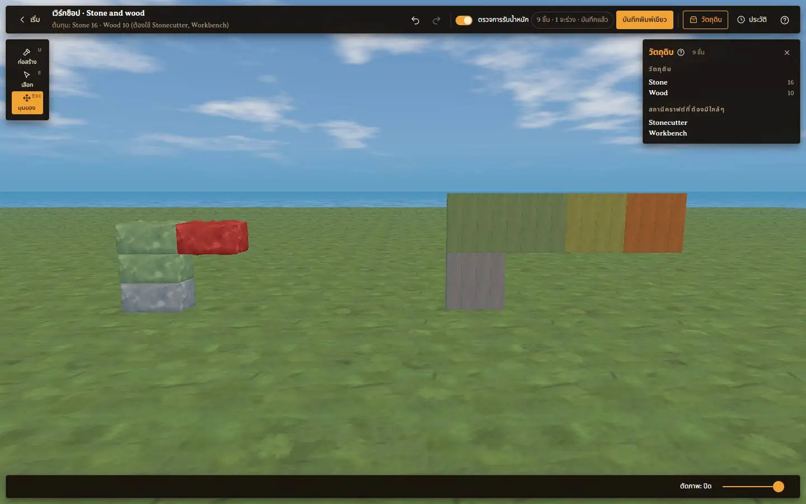
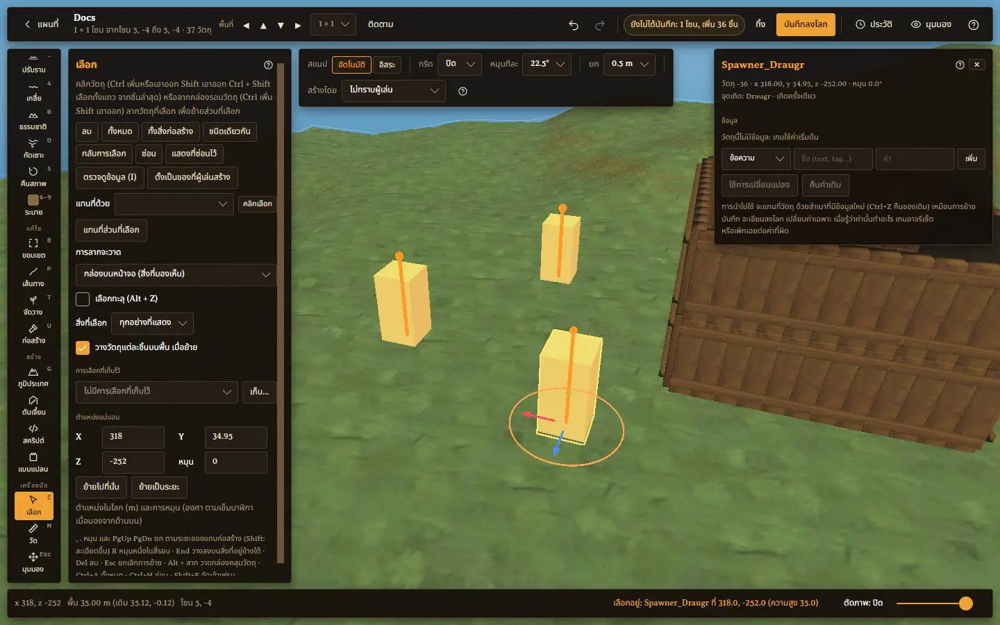
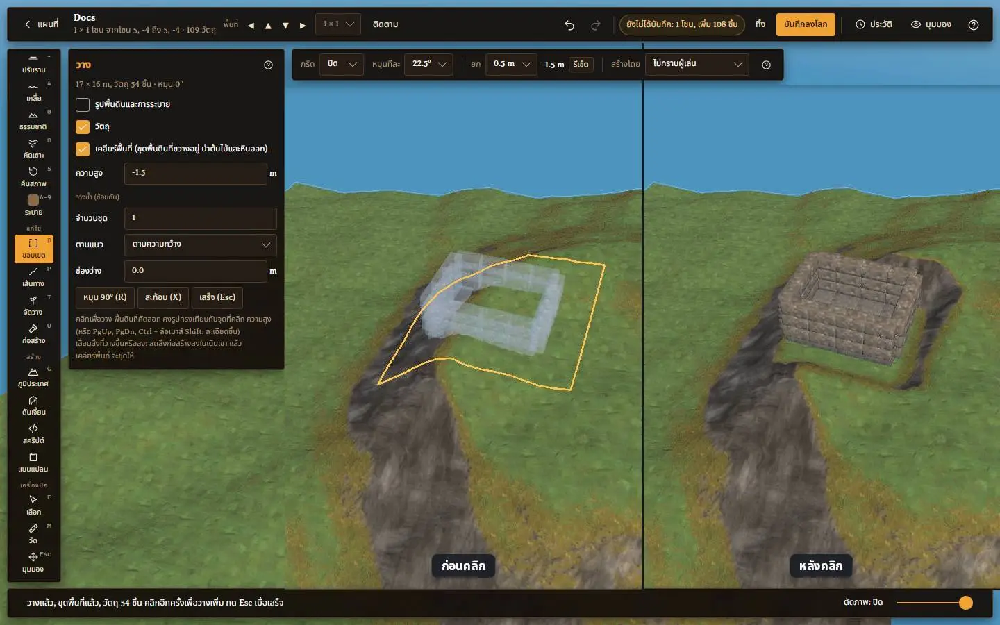

<!-- source: 551a19e3 -->
# วัตถุ

ทุกอย่างในโลก Valheim ที่ไม่ใช่พื้นดิน คือ **วัตถุ**: ต้นไม้ หิน ผนัง หีบ สิ่งมีชีวิต
จุดเกิดล่องหน หน้านี้อธิบายว่า เกมเก็บอะไรของวัตถุแต่ละชิ้น นับว่าใครเป็นผู้สร้าง ชิ้นส่วนก่อสร้าง
สแนปและรับน้ำหนักอย่างไร กฎที่พืชใช้เติบโต และจุดเกิดทำอะไร

## วัตถุคืออะไร

ในเซฟ วัตถุแต่ละชิ้น เป็นระเบียนสั้นๆ:

| ส่วน | ตัวอย่าง |
|---|---|
| **ชนิด** ชื่อที่เกมใช้เรียก (*พรีแฟบ*) | `Beech1`, `rock4_forest`, `piece_chest_wood`, `Spawner_Boar` |
| **ตำแหน่ง** **การหมุน** การเอียง และขนาด | x 1250, z −380 ความสูง 32.4 m หันไปที่ 90° |
| **ข้อมูล**: ค่าที่เกมเก็บไว้ให้วัตถุ | ข้อความบนป้าย ของในหีบ ใครเป็นผู้สร้าง พลังชีวิต เวลาที่ปลูก แท็กของประตูมิติ |

[ตัวตรวจดูข้อมูล](../select.md) แสดงทั้งหมดนี้ ชื่อของค่าต่างๆ มาจากโค้ดของเกม และจากโค้ดของม็อด
ที่คุณใช้ ซึ่งเอดิเตอร์อ่านจากไฟล์ แต่ไม่เคยรัน เปลี่ยนค่าเฉพาะ เมื่อคุณรู้ว่าค่านั้นทำอะไร: เกม
อาจรีเซ็ต หรือเพิกเฉยต่อค่า ที่ไม่ได้คาดไว้

**ID เปลี่ยน แต่ชนิดและตำแหน่งไม่เปลี่ยน** วัตถุแต่ละชิ้นมี ID ด้วย แต่เกมให้ ID ใหม่แก่วัตถุ ตอนบันทึก
และเอดิเตอร์เขียนวัตถุที่ย้าย เป็นสำเนาที่ตำแหน่งใหม่ ดังนั้น ทุกครั้งที่เอดิเตอร์ ต้องหาวัตถุอีกครั้ง
ในภายหลัง จะมองหาชนิดเดียวกัน ที่ตำแหน่งเดียวกัน: การเลือกที่เก็บไว้ (ภายใน 5 cm ทางราบ และ 20 cm ทางสูง)
การเปลี่ยนแปลงของคุณ ที่นำไปใส่ในเซฟใหม่กว่า การกู้คืนจากสำเนาสำรอง การเลิกทำหลังนำไปใช้แบบไลฟ์ วัตถุที่ย้าย
หรือหายไปตั้งแต่นั้น นับว่าหายไป

**วัตถุใหม่ เริ่มต้นใหม่หมด** วัตถุที่วาง เป็นสำเนาสะอาด ของวัตถุชนิดเดียวกันในโลก โดยไม่เก็บสิ่งที่เป็นเอกลักษณ์
(ไม่มีของข้างใน ไม่มีพลังชีวิต) หรือเป็นวัตถุใหม่ ตรงตามที่เกมสร้าง วัตถุที่ถูกแทนที่ ก็เป็นของใหม่เช่นกัน:
หีบที่ถูกแทนที่ ด้วยหีบชนิดอื่น จะว่างเปล่า ในทางกลับกัน สำเนาที่วาง หรือพิมพ์เขียว จะเก็บทุกอย่าง ที่วัตถุ
เคยมีไว้: ของในหีบ ข้อความบนป้าย ชนิดที่โลกสร้างไม่ได้ (จากม็อดที่ไม่ได้ติดตั้ง)
จะถูกตัดออก และเอดิเตอร์จะบอกว่ามีอะไรบ้าง

**ของข้างในที่คุณตั้ง ยังเป็นของคุณ** หีบที่เกมไม่เคยเปิด จะเติมของรางวัลของเกมเอง ในครั้งแรกที่
โหลด เมื่อคุณเปลี่ยนของในหีบ เอดิเตอร์จะทำเครื่องหมาย ว่าเป็นของของหีบเอง เกมจึงไม่แตะต้อง ไอเทม
ที่วางบนแท่นวาง จะบันทึกทั้งชิ้น เป็นของใหม่ และมีความทนทานเต็มตามคุณภาพ

**ไม่ใช่ทุกอย่างที่เห็น จะเป็นวัตถุ** ส่วนของสถานที่ของเกม (หินของทางเข้าสุสาน แคมป์ของพ่อค้า
แท่นบูชาบอส) ถูกสร้างใหม่จากสถานที่ ทุกครั้งที่โหลดโซน จึงเลือกหรือเปลี่ยนไม่ได้ (ดู
[สถานที่ปรับพื้นดินให้ราบ](ground-limits.md#สถานทปรบพนดนใหราบ)) หินรูนก็เช่นกัน: คุณลบได้
ซึ่งจะนำสถานที่ของหินรูนออกถาวร แต่ย้าย คัดลอก หรือตรวจดูไม่ได้

**ม็อดบางตัว ซ่อนวัตถุไว้ลึกใต้ดิน** เช่น สถานีคราฟต์ 10 km ใต้บ้าน กล่อง เส้นขอบ **ทั้งหมด** และ
**ทั้งสิ่งก่อสร้าง** ไม่รวมสิ่งที่อยู่ใต้พื้นดิน เกิน 10 m สิ่งเหล่านั้น จึงไม่ติดไปกับสิ่งที่ตั้งอยู่ด้านบน

### กลุ่มที่เชื่อมกัน: เรือและยานพาหนะ

ม็อดบางตัว สร้างสิ่งหนึ่ง จากวัตถุหลายชิ้น: เรือของม็อดเรือ คือวัตถุราก ที่มีชิ้นส่วนสร้างอยู่บนนั้น
แต่ละชิ้น บันทึกพร้อม ID ของสิ่งที่ตัวเองยึดอยู่ และระยะห่างจากสิ่งนั้น และม็อดวางชิ้นนั้นไว้ที่นั่น เมื่อกลุ่มโหลด
ม็อดบอกเรื่องนี้แก่เอดิเตอร์ ในไฟล์ `worldeditor.json` ที่มากับม็อด เอดิเตอร์ไม่รู้จักม็อดใดด้วยตัวเอง จากนั้น
เอดิเตอร์จะวาดกลุ่ม แบบที่ม็อดสร้าง และย้าย คัดลอก และลบทั้งกลุ่ม ไม่เคยแยกชิ้นเดียว การวางแต่ละครั้ง
ให้ ID ใหม่แก่กลุ่ม เพราะสองกลุ่มที่ใช้ ID ร่วมกัน จะใช้ชิ้นส่วนร่วมกันในเกม

### สิ่งมีชีวิตยืนบนชิ้นส่วน

สิ่งมีชีวิต ที่ตำแหน่งอยู่ข้างในชิ้นส่วนก่อสร้าง (บอสของดันเจี้ยน หมูป่าที่ฝึกแล้วในคอก) จะถูกตั้งไว้บน
ชิ้นส่วนที่สูงที่สุดใต้ตัวมัน ทุกครั้งที่เอดิเตอร์จัดตำแหน่งวัตถุ: การเปิดหรือเพิ่มพิมพ์เขียว การย้าย การวาง สคริปต์
เครื่องมือของ Claude พื้นดินไม่ใช่ชิ้นส่วน: สิ่งมีชีวิตบนพื้นดิน อยู่ตรงที่ถูกวาง

## ชิ้นส่วนที่ผู้เล่นสร้าง

ทุกอย่างที่ผู้เล่นวางได้ ด้วยค้อน จอบ เครื่องพรวนดิน หรือถาดเสิร์ฟ เป็น **ของที่ผู้เล่นสร้าง**
ในเกม: เก็บไว้ว่า **ใครสร้าง** เป็น ID ผู้เล่น เรื่องนี้สำคัญกว่าที่คิด ถ้าไม่มีผู้สร้าง เกมจะถือว่า
ชิ้นส่วนนั้น เป็นส่วนของซากปรักหักพัง:

| | ของที่ผู้เล่นสร้าง | ไม่มีผู้สร้าง (ซากปรักหักพัง) |
|---|---|---|
| การรื้อ | ได้วัตถุดิบคืนทั้งหมด | ได้คืนหนึ่งในสาม |
| ไฟข้างๆ | ทำให้เป็นฐาน: มอนสเตอร์ไม่เกิดที่นั่น | ไม่เป็นฐาน |
| การบุกโจมตี | เล็งเป้า | เพิกเฉย |
| Ward หรือหีบส่วนตัว | ตอบสนองผู้สร้าง | ไม่ตอบสนองใคร |

เอดิเตอร์จึงเขียนผู้สร้าง ลงในทุกชิ้นส่วน ที่วาง แปะ หรือสร้าง: ผู้เล่นที่เลือกไว้ใน **สร้างโดย** บน
[แถบก่อสร้าง](../build.md#แถบกอสราง) รายการนั้นแสดงผู้เล่น ที่เคยสร้างในโลกนี้ (พร้อมจำนวนชิ้นส่วน) ผู้เล่นที่มีชื่อบน
เตียง Ward และป้ายหลุมศพ และตัวละคร บนคอมพิวเตอร์เครื่องนี้ เริ่มต้นด้วยผู้เล่น ที่มีชิ้นส่วนมากที่สุด ถ้าไม่มี
ก็เป็นตัวละครของคุณเอง **ไม่มีใคร (ไม่ใช่ของที่ผู้เล่นสร้าง)** วางชิ้นส่วน เป็นส่วนของซากปรักหักพัง โดยตั้งใจ ถ้าไม่รู้จัก
ผู้เล่นเลย ชิ้นส่วนจะได้ **ไม่ทราบผู้เล่น**: นับว่าเป็นของที่สร้าง แต่ Ward และหีบส่วนตัว ไม่ตอบสนองใคร จึงควรเลือก
ID ของคุณเอง เมื่อทำได้

บางอย่าง เก็บหรือทิ้งผู้สร้างโดยตั้งใจ:

- การย้ายหรือแก้ไขวัตถุ จะเก็บผู้สร้างที่มีอยู่ไว้
- พิมพ์เขียวไม่เก็บผู้สร้าง: ใครก็ตามที่สร้างในเกม จะกลายเป็นผู้สร้าง พิมพ์เขียวที่บันทึกจากซากปรักหักพัง
  จะจำไว้ว่าเป็นซากปรักหักพัง
- ดันเจี้ยนที่สร้างขึ้น ไม่มีผู้สร้าง เหมือนของเกมเอง: การบุกโจมตีเพิกเฉย และให้วัตถุดิบคืนหนึ่งในสาม
- **ตั้งเป็นของที่ผู้เล่นสร้าง** (เครื่องมือ [เลือก](../select.md)) ให้ผู้สร้าง แก่ชิ้นส่วนที่ไม่มี: ซากปรักหักพัง ที่คุณอยาก
  ซ่อมและเก็บไว้ หรือชิ้นส่วนที่วาง ด้วยเอดิเตอร์เวอร์ชันเก่า

ซากปรักหักพัง ที่คุณสร้างต่อ (หอคอยหิน ที่ปะด้วยไม้) นับเป็นสิ่งก่อสร้างของคุณ: ชิ้นส่วนที่แตะของคุณ และ
ชิ้นที่แตะชิ้นเหล่านั้น จะแสดงพร้อมสิ่งก่อสร้างของคุณ ใน มุมมอง และบนแผนที่

## การสแนป

ชิ้นส่วนก่อสร้าง ต่อกันแบบที่ค้อนของเกมต่อ แต่ละชิ้นมี **จุดสแนป** ที่มุมและปลาย
ซึ่งเอดิเตอร์อ่าน จาก Valheim ของคุณ พร้อมรูปทรงจริงของแต่ละชิ้น (คอลไลเดอร์) และกฎการวาง เมื่อ
จุดสแนปสองจุดเข้าใกล้กัน ชิ้นส่วนจะเลื่อน ให้จุดทั้งสองบรรจบกันพอดี: ผนังตั้งต่อปลายชนปลาย พื้นต่อ
ขอบชนขอบ ผนังตั้งบนพื้น

**ค้อนวางชิ้นส่วนอย่างไร** ซึ่ง [ก่อสร้าง](../build.md) ทำตามทีละขั้น ในโลก ในเวิร์กช็อป และใน
ดันเจี้ยน (การสแนปแบบ **อัตโนมัติ**):

1. เส้นของเคอร์เซอร์ ชนสิ่งที่ใกล้ที่สุด: พื้นดิน หรือรูปทรงจริงของชิ้นส่วน (ไม่ใช่กล่องของชิ้นส่วน)
2. ชิ้นส่วนที่หมุนตามที่คุณตั้ง จะถูกเลื่อน ให้จุดของรูปทรง ที่ใกล้จุดชนที่สุด แตะจุดนั้น พรม
   และชิ้นส่วนพื้นอื่นๆ และชิ้นส่วนที่เกมยอมให้จมลง ในสิ่งต่างๆ จะใช้กึ่งกลางแทน
3. จากจุดสแนปทั้งหมด ของชิ้นส่วน และของชิ้นส่วนภายใน 10 m คู่ที่ใกล้ที่สุด ภายในครึ่งเมตร จะบรรจบกัน ชี้
   ที่ยอดผนัง เพื่อวางชิ้นถัดไปบนนั้น ชี้ใกล้ปลาย เพื่อวางชิ้นข้างๆ
4. การสแนป ที่จะวางชิ้นส่วน ตรงที่ชิ้นเดียวกันตั้งอยู่แล้วพอดี จะถูกข้าม

การยก (`PgUp`, `PgDn` หรือ `Ctrl` + ล้อเมาส์) เพิ่มก่อนการสแนป ชิ้นที่ยกขึ้น จึงสแนปกับจุด ใกล้ความสูงใหม่ กริดปัด
เฉพาะจุดบนพื้น: ชิ้นส่วนที่ชี้ไปที่ชิ้นอื่น จะสแนปตามปกติ

แถบก่อสร้าง มีอีกสองแบบ **กำหนดเอง** จำกัดขั้นที่ 3 ไว้ที่จุดสแนปเดียวของชิ้นส่วน คือจุดที่ `Q` และ
`E` เลือก (มีเครื่องหมายบนชิ้นส่วน) และให้ไปได้ไกล 1.5 m: ในมุมที่แออัด ตรงที่คู่ที่ใกล้ที่สุด เป็นขอบที่ผิด
ให้เลือกจุดที่ควรบรรจบ **อิสระ** หรือการกด `Alt` ค้างในทุกแบบ จะข้ามขั้นที่ 3: ชิ้นส่วนอยู่ตรงที่
แตะ และเมื่อกด `Alt` ตำแหน่งทางราบ จะปัดทีละหนึ่งในสี่เมตร จากกึ่งกลางของพื้นที่

เครื่องมืออื่น สแนปด้วยจุดสแนปเดียวกัน แต่ละอันในแบบของตัวเอง:

| ที่ไหน | สแนปอย่างไร |
|---|---|
| [จัดวาง](../place.md) **สแนปกับชิ้นส่วนที่มีอยู่** (ส่วนของซากปรักหักพัง: ชิ้นส่วนที่ผู้เล่นสร้าง วางด้วย ก่อสร้าง) | ทีละชิ้น ใต้เคอร์เซอร์ **ข้างๆ**: ต่อปลายชนปลาย กับชิ้นส่วนข้างเคอร์เซอร์ ที่ระดับเดียวกัน ตรงที่จุดสแนปคู่หนึ่ง บรรจบกันภายใน 1 m **ด้านบน**: ฐานของชิ้นส่วน วางบนยอดของชิ้นใต้เคอร์เซอร์ ชิ้นที่สแนปแล้ว จะหันทางเดียวกับชิ้นที่ต่อ |
| [ก่อสร้าง](../build.md) **วางเรียง** เป็น เส้น วงกลม หรือสี่เหลี่ยมผืนผ้า (และ **ต่อปลายชนปลาย** ของ เส้น ใน [จัดวาง](../place.md) สำหรับส่วนของซากปรักหักพัง) | แต่ละชิ้น เริ่มตรงที่ชิ้นก่อนหน้าจบ ปลายทั้งสองของชิ้นส่วน คือกึ่งกลางของด้านสั้นทั้งสอง หาจากจุดสแนป (ชนิดที่ไม่มีจุดสแนป ใช้กล่องของโมเดล) เส้นที่เริ่มภายใน 1 m จากชิ้นส่วน จะต่อจากชิ้นนั้น |
| [เลือก](../select.md) เมื่อ **สแนป** ของแถบก่อสร้าง เป็น **อัตโนมัติ** | ขณะย้าย จุดสแนปคู่ที่ใกล้ที่สุด (จุดหนึ่งของชิ้นที่ย้าย อีกจุดของชิ้นรอบๆ) ภายใน 0.75 m จะล็อกเข้าด้วยกัน และส่วนที่เลือกทั้งหมด จะเลื่อนให้บรรจบกัน |
| [สคริปต์](../scripting.md) `snap: true` | ชิ้นส่วนที่วาง จะบรรจบกับจุดสแนป ของชิ้นส่วนที่อยู่ตรงนั้น ภายใน 0.5 m |

ตำแหน่งที่พิมพ์ (**ตำแหน่งแน่นอน** ของเครื่องมือ เลือก) ไม่เคยสแนป: เป็นค่าที่แน่นอน

## การตรวจการรับน้ำหนัก

ในเกม ชิ้นส่วนก่อสร้างทุกชิ้น ต้องมี **การรับน้ำหนัก** ซึ่งไหลขึ้นจากพื้นดิน ผ่านชิ้นส่วนที่แตะกัน ชิ้นส่วน
ที่รับน้ำหนักได้น้อยเกินไป จะพังและร่วง ทันทีที่ผู้เล่นเข้าใกล้ **ตรวจการรับน้ำหนัก** ของเวิร์กช็อป คำนวณแบบเดียวกับเกม
จากข้อมูลที่อ่านใน Valheim ของคุณ (รูปทรง วัสดุ และจุดศูนย์กลางมวล ของแต่ละชิ้น) และลงสีแต่ละชิ้น
ตามสีของโหมดก่อสร้างของเกม:

| สี | ความหมาย |
|---|---|
| ฟ้าอ่อน | รับน้ำหนักเต็มที่: ตั้งอยู่บนพื้นดิน |
| เขียว | แข็งแรง: ครึ่งหนึ่ง ของการรับน้ำหนักสูงสุดของวัสดุ หรือมากกว่า |
| เหลือง ส้ม | อ่อนลง |
| แดง | ใกล้พัง หรือกำลังพัง: ในเกมจะร่วงทันที ที่ผู้เล่นเข้าใกล้ |

**การรับน้ำหนักคำนวณอย่างไร**

- ชิ้นส่วนที่รูปทรง เมื่อขยายออก 0.15 m ทุกด้าน แตะพื้นดิน จะรับน้ำหนักเต็มที่
- ชิ้นอื่นๆ ใช้การรับน้ำหนักที่ดีที่สุด ของชิ้นที่แตะอยู่ หักด้วยการสูญเสีย ตามระยะระหว่างจุดศูนย์กลางมวล:
  อัตรา "ขึ้น" เมื่อรับจากด้านล่างตรงๆ อัตรา "ด้านข้าง" เมื่อรับจากด้านข้าง และค่าผสมระหว่างนั้น
  ถ้ารับจากสองด้าน ที่ห่างกันอย่างน้อย 100° (มองจากด้านบน) จะได้ค่าเฉลี่ยของทั้งสอง เมื่อค่านั้นดีกว่า
- ทำซ้ำ จนกว่าไม่มีอะไรเปลี่ยน ชิ้นที่ต่ำกว่าค่าต่ำสุดของวัสดุ จะพัง แล้วทุกอย่างจะถูกคำนวณใหม่
  โดยไม่มีชิ้นเหล่านั้น การถล่มจึงลามไป แบบที่เกิดในเกม

| วัสดุ | สูงสุด | ต่ำสุด | เสียต่อเมตร ทางด้านข้าง | เสียต่อเมตร ทางขึ้น |
|---|---|---|---|---|
| ไม้ (Wood) | 100 | 10 | 20 % | 12.5 % |
| แก่นไม้ (Core wood) | 140 | 10 | 17 % | 10 % |
| ไม้ซุง (Timber) | 200 | 10 | 20 % | 8 % |
| หิน (Stone) | 1000 | 100 | 100 % | 12.5 % |
| น้ำแข็ง (Ice) | 1000 | 100 | 33 % | 12.5 % |
| เหล็ก (Iron) | 1500 | 20 | 8 % | 8 % |
| หินอ่อนดำ (Black marble) | 1500 | 100 | 50 % | 12.5 % |
| Grausten | 2000 | 100 | 33 % | 10 % |
| โบราณ (Ancient) | 5000 | 100 | 25 % | 7 % |


*ซ้าย กำแพงหินสามชั้นซ้อนกัน: ฟ้าอ่อนบนพื้น เขียวด้านบน และกำแพงชิ้นเดียว ที่ยื่นออก 2 m จากด้านบน
เป็นสีแดง พร้อม "1 จะร่วง" ในแถบด้านบน ขวา กำแพงไม้ ที่ยื่นออก 6 m จากเสา: เขียว แล้วเหลือง แล้วส้ม*

นี่คือเหตุผลที่หิน ตั้งได้สูง แต่ยื่นออกไปไม่ได้ (ยื่นไปข้างหนึ่งเมตร ก็หมดการรับน้ำหนัก) และไม้ยื่นออกไป
ได้ไกลกว่าหิน แต่ไม่สูงเท่า

**ข้อยกเว้น เหมือนในเกม** บางชิ้นไม่เคยถูกตรวจ: แผ่นพื้นหินอ่อนดำ หิน Ward เรือ และเกวียน
ชิ้นเหล่านี้ ตั้งอยู่ได้ทุกที่ และแผ่นพื้น ให้การรับน้ำหนักเต็มที่ของวัสดุ แก่สิ่งที่วางอยู่บนนั้น นี่คือวิธีที่
ดันเจี้ยนจากชิ้นส่วนก่อสร้าง ตั้งอยู่ได้ที่ความสูง 5000 m (ดู [ทำไมจึงตั้งอยู่ได้ที่ 5000 m](dungeons.md#ทำไมจงตงอยไดทความสง-5000-m)) ส่วนที่
เคลื่อนที่ได้เอง (บานประตูที่แกว่ง ตัวเรือ) ไม่นับเลย: ไม่มีอะไรวางอยู่บนนั้น ใน
ดันเจี้ยนของเกม พื้นและผนังของห้อง นับเป็นพื้นดิน ชิ้นส่วนที่วางบนนั้น จึงตั้งอยู่ได้

**สิ่งที่การตรวจไม่รวม**: หินและต้นไม้ (เกมนับว่ารับน้ำหนักเต็มที่ แปลงของเวิร์กช็อปไม่มี)
รูปทรงที่แน่นอน ของคอลไลเดอร์โค้ง (นับตามกล่อง) และชิ้นส่วน ที่เกมไม่ให้การรับน้ำหนักเลย (ไม่ถูกลงสี)
 สำหรับพิมพ์เขียว ที่สร้างบนพื้นไม่เรียบ การตรวจถือว่า พื้นดินอยู่ตรงที่สิ่งก่อสร้างแตะพื้น: ที่
จุดสัมผัสพื้น ที่ Homestead บันทึกไว้ ไม่เช่นนั้น ใต้ชิ้นส่วนที่ต่ำที่สุด ของแต่ละจุด

## กฎการเติบโต

ต้นกล้า พืชผล และพืชป่า เป็นไปตามกฎของเกมเอง และเครื่องมือ [จัดวาง](../place.md) และ ปลูกคืน ของเอดิเตอร์
ก็ทำตามเช่นกัน สิ่งที่คุณปลูก จึงเติบโตในเกม

**ที่ว่างให้เติบโต** ต้นกล้าหรือพืชผล จะเติบโต ก็ต่อเมื่อไม่มีอะไรตั้งอยู่ ภายใน **รัศมีการเติบโต** ซึ่งอ่านจากเกมของคุณ:
0.5 m สำหรับพืชผลส่วนใหญ่ 2 ถึง 3 m สำหรับต้นกล้าไม้ใหญ่ เมื่อเปิด **เว้นที่ให้ต้นกล้าและพืชผลเติบโต** (ค่าเริ่มต้น):

- ต้นกล้าและพืชผล เว้นระยะอย่างน้อย เท่ารัศมีการเติบโต จากทุกอย่าง รวมถึงกันเอง
- พืชผลที่โตแล้ว (`Pickable_Carrot`) และต้นไม้ที่โตจากต้นกล้า (`Beech1`, `Oak1`) เว้นที่เท่าที่ต้นกล้า
  ต้องการ เหมือนไร่หรือสวนผลไม้จริง
- พุ่มไม้ไม่ได้โตจากอะไรในเกม จึงมีผลแค่ **ระยะห่าง**

ถ้าปิด คุณปลูกถี่แค่ไหนก็ได้ แต่พืชเหล่านั้น อาจไม่เติบโตเลย

**พืชผลต้องการดินพรวน** เกมให้พืชผลเติบโต บนดินที่พรวนแล้วเท่านั้น จึงต้องระบายก่อน (**พรวนดิน**
ของแปรง ระบาย หรือ ระบาย ของเครื่องมือ ขอบเขต) แผง จัดวาง จะเตือน เมื่อพืชผลที่ติ๊กไว้ ต้องใช้ดินพรวน

**น้ำ** วัตถุที่วางบนพื้น จะถูกตัดออก ตรงที่พื้นอยู่ใต้น้ำ เกิน 0.3 m ยกเว้น
สาหร่ายเคลป์ และสาหร่ายทะเล

**การจับกลุ่ม** ป่าจริงเติบโต เป็นดงที่มีที่โล่งคั่น **การจับกลุ่ม** วางรูปแบบนอยส์ ทับทั้งโลก
โดยแต่ละก้อนกว้าง **ขนาดหย่อม**: ตรงที่รูปแบบมีค่าต่ำ จุดต่างๆ จะถูกทำให้บางลง และยิ่งค่า การจับกลุ่ม สูง
พื้นดินก็ยิ่งถูกเคลียร์มากขึ้น รูปแบบนี้ผูกกับโลก ไม่ใช่กับแปรง การลากที่อยู่ติดกัน จึงเข้ากันได้

### ปลูกคืนตัดสินอย่างไร ว่าอะไรจะขึ้น

**ปลูกธรรมชาติคืน** ของเครื่องมือ ขอบเขต นำสิ่งที่เกมเองจะปลูกกลับมา โดยคำนวณแต่ละโซน แบบที่เกมทำ
ตอนสร้างโซนครั้งแรก:

- **กฎของเกมเอง** อ่านกฎพืชพรรณของเกม จาก Valheim ของคุณ และใช้เลขสุ่มชุดเดียวกัน
  โดยใช้ซีดของโลก โซน และชนิด เป็นตัวตั้ง บนพื้นดินที่ยังเหมือนตอนสร้าง คุณจะได้ต้นไม้ต้นเดิม ที่
  ตำแหน่งเดิม ที่โลกเคยมีครั้งแรก
- **เงื่อนไขของเกม**: ไบโอม (และชนิดนั้น ขึ้นที่ขอบหรือกลางไบโอม) ความสูงเหนือน้ำ
  ความชัน ปัจจัยป่า (ดงและที่โล่ง) ความขรุขระของพื้นดินรอบจุดนั้น ระยะ
  จากกึ่งกลางโลก จำนวนกลุ่มต่อโซน และจำนวนวัตถุต่อกลุ่ม
- **พื้นดินตามที่เป็นอยู่ตอนนี้** เนินที่คุณยกขึ้น จะได้สิ่งที่ขึ้น ตามความสูงและความชันใหม่ ลานที่คุณปรับราบ จะได้
  สิ่งที่ขึ้นบนพื้นราบ
- **ไม่ขึ้นทับสิ่งต่างๆ** จุดจะถูกข้าม เมื่อมีอะไรตั้งอยู่ภายใน 1 m วัตถุชนิดเดียวกัน ภายใน 3 m
  (ต้นไม้ที่ยังตั้งอยู่ จะไม่ถูกเพิ่มซ้ำ) หรือชิ้นส่วนก่อสร้าง ภายใน 4 m
- **ไบโอมย่อย** (Dark Meadows, Rock Black Forest…) อยู่ตรงที่เกมวาง จากซีด พร้อมสิ่งที่เพิ่ม และ
  ไม่มีสิ่งที่กันออก
- **สถานที่** เก็บพื้นดินให้โล่ง เหมือนตอนที่เกมสร้างโซนครั้งแรก

สิ่งที่ไม่อาจรู้ได้: การตรวจทางฟิสิกส์ของเกม กับวัตถุที่ตั้งอยู่แล้ว ทำงานได้ครั้งละไม่เกิน 16 โซน
**ให้ต้นไม้และหินของไบโอม ขึ้นบนนั้น** ของเครื่องมือ ภูมิประเทศ สำหรับภูเขา ใช้กฎเดียวกัน บนทางลาดที่ยกขึ้น

## จุดเกิด

เกมใส่สิ่งมีชีวิต ในแคมป์ หมู่บ้าน และดันเจี้ยน ด้วย **จุดเกิด**: วัตถุล่องหน
(`Spawner_Boar`, `Spawner_Draugr`…) แต่ละอัน ทำให้สิ่งมีชีวิตเกิด ตรงที่ตัวเองตั้งอยู่ สิ่งมีชีวิตชนิดใด กี่ดาว และ
เกิดใหม่หรือไม่ กำหนดโดยชนิดของจุดเกิด ถ้าต้องการสิ่งมีชีวิตอื่น จึงต้องวางจุดเกิดชนิดอื่น

| เกิดอย่างไร | อันไหน |
|---|---|
| **เกิดครั้งเดียว**: ครั้งแรกที่ผู้เล่นเข้าใกล้ ไม่เกิดอีก เมื่อตายแล้ว | จุดเกิดของเกม ส่วนใหญ่ |
| **เกิดใหม่ N นาทีหลังตาย** | แบบ `*_respawn_*`, `Spawner_Location_*`, `Spawner_imp_respawn`, `Spawner_Fish4` มักเป็น 60 นาที |
| **เฉพาะกลางคืน** หรือ **เฉพาะกลางวัน** | บางอันที่รอ |
| **เมื่อมีเหตุการณ์ปลุก** | แบบ `TriggerSpawner_` |

**รังสิ่งมีชีวิต** เป็นแบบที่มองเห็นได้: รังของ greydwarf กองกระดูก และที่คล้ายกัน รังจะทำให้สิ่งมีชีวิต
เกิดรอบตัว ไปเรื่อยๆ จนกว่าจะถูกทำลาย ("Greydwarf, Greydwarf_Elite · สูงสุด 3 ตัวรอบๆ ภายใน 5 m")


*จุดเกิดข้างกระท่อม: กล่องเรียบๆ สำหรับแต่ละอัน พร้อมเครื่องหมายสีส้มด้านบน จุดเกิดดราวเกอร์ที่ถูกเลือก เปิดอยู่
ใน ตัวตรวจดูข้อมูล ซึ่งบรรทัดบอกว่า เกิดอะไร*

เครื่องมือ จัดวาง และ ตัวตรวจดูข้อมูล แสดงบรรทัดนี้ สำหรับแต่ละชนิด โดยอ่านจากเกมของคุณ (`จุดเกิด: Boar · 0–2 ★ · เกิดครั้งเดียว`) ใน 3D จุดเกิดและรังแต่ละอัน แสดงเป็นกล่องเรียบๆ มีเครื่องหมายด้านบน มองทะลุทุกอย่างที่บังอยู่ได้: สีส้ม
สำหรับจุดเกิด (สีแดง เมื่อสิ่งมีชีวิตเกิดใหม่) สีม่วงสำหรับรัง ทั้งสองอย่าง ซ่อนไว้ตอนแรก เพราะเผยให้รู้ว่าสิ่งต่างๆ อยู่ที่ไหน เปิดได้
ในแผง มุมมอง

## การวางเคลียร์ที่ตั้งอย่างไร

สำเนา (จากเครื่องมือ ขอบเขต หรือพิมพ์เขียว) เก็บ:

- **วัตถุ** พร้อมทุกอย่างที่วัตถุเก็บไว้: หีบที่วาง จะเต็มเหมือนต้นฉบับ
- **พื้นดินใต้สิ่งก่อสร้างเท่านั้น**: ใต้ชิ้นส่วนก่อสร้างแต่ละชิ้น (ตามรูปทรงจริง) และรอบๆ 1 m โดยกลืน
  เข้ากับพื้นดิน ตรงที่ลงจอด อีก 3 เมตร พื้นดินส่วนที่เหลือของส่วนที่เลือก จะอยู่ที่เดิม เมืองที่วาง จึงตั้งอยู่
  ในแผ่นดินตรงที่ลงจอด แทนที่จะพาสี่เหลี่ยม ของพื้นดินแปลกถิ่น ติดไปด้วย พิมพ์เขียวไม่มีพื้นดิน
- **ความสูง**: ชิ้นส่วนก่อสร้าง คงรูปทรงของสิ่งก่อสร้าง วัดจากความสูงพื้นดินเฉลี่ย ของสำเนา ซึ่งจะไปอยู่
  ที่ความสูงของพื้นดิน ตรงที่คุณคลิก ต้นไม้ หิน และสิ่งที่คล้ายกัน คงความสูงเหนือพื้นดินไว้ แต่ละอันจึง
  ลงบนพื้นดิน ตรงที่ไปวาง

สำเนาของเครื่องมือ เลือก ก็วางแบบเดียวกัน


*ก่อนคลิก (ซ้าย) เส้นขอบของการวาง ตัดเข้าไปในเนิน หลังคลิก (ขวา) พื้นดินที่ขวางกระท่อม ถูกขุดออก
ลงไปถึงพื้นของกระท่อม ในขั้นตอนเลิกทำเดียวกัน*

เมื่อเปิด **เคลียร์พื้นที่** การวางแต่ละครั้ง จะเตรียมที่ให้ตัวเองด้วย ในขั้นตอนเลิกทำเดียวกัน:

- ตรงที่ชิ้นส่วนก่อสร้างที่วาง ตั้งอยู่ (ตามรูปทรงจริง และรอบๆ 1 m) พื้นดินที่ขวางอยู่ จะถูก **ขุดลง** ไปถึง
  ฐานของชิ้นที่ต่ำที่สุด เกิน ±8 m ถ้าจำเป็น สิ่งก่อสร้างที่วางเข้าไปในเนิน จะไม่ถูกฝังอยู่ในนั้น พื้นดินที่ต่ำกว่า
  ไม่เคยถูกยกขึ้น
- ตรงที่พื้นดินที่คัดลอก ลงไปเต็มที่ จะไม่มีการขุด: สิ่งก่อสร้างตั้งบนพื้นดินนั้น แบบที่ตั้งบนต้นฉบับ
- ชิ้นส่วนที่อยู่ใต้พื้นดิน เกิน 100 m จะถูกเพิกเฉย (ม็อดบางตัว เก็บสถานีคราฟต์ไว้ที่นั่น) และไม่มีการขุด
  ใต้กลุ่มที่เชื่อมกัน เช่น เรือ
- **ต้นไม้ หิน แร่ พุ่มไม้ และของที่เก็บได้** ในพื้นที่นั้น จะถูกนำออก สิ่งก่อสร้าง สิ่งมีชีวิต และสัตว์ที่ฝึกแล้ว
  ยังอยู่

วัตถุที่วาง เป็นวัตถุใหม่ ที่สร้างจากสำเนา การวางจึงใช้ได้ในโลกอื่นด้วย ในแบบไลฟ์ **ตัด** แล้ววาง
จะย้ายวัตถุในเกม โดยใช้ ID เดิมของวัตถุ เมื่อทำได้ (ดู
[การย้ายวัตถุ ยังคงเป็นวัตถุเดิม](live-editing.md#การยายวตถ-ยงคงเปนวตถเดม))

## ไฟล์พิมพ์เขียว

พิมพ์เขียว คือสิ่งก่อสร้างที่เก็บเป็นไฟล์ ในรูปแบบของ
[Homestead](https://thunderstore.io/c/valheim/p/sighsorry/Homestead/) ม็อดก่อสร้างในเกม: ไฟล์เดียวกันนี้ แสดง
ในแท็บค้อนของ Homestead พร้อมสร้างในเกม และวางลงในโลกใดก็ได้ จากเอดิเตอร์ การแชร์สิ่งก่อสร้าง
คือการแชร์ไฟล์ `.blueprint` และรูป `.png` ที่อยู่ข้างกัน

**เก็บอะไร** เฉพาะชิ้นส่วนก่อสร้าง: ต้นไม้ หิน และไอเทมที่วางทิ้งไว้ ไม่ถูกเก็บ และพื้นดินก็ไม่ถูกเก็บ
แต่ละชิ้นเป็นหนึ่งบรรทัด มีชนิด ตำแหน่งเป็นเมตร จาก **จุดยึด** (กึ่งกลางของสิ่งก่อสร้าง ที่ระดับพื้น)
การหมุน และขนาด เรียงจากชิ้นที่ต่ำที่สุดก่อน:

```text
#Name:Small hut
#Creator:Valheim World Editor
#Description:A hut with a fire pit
#Tags:house, wood
#Pieces
woodwall;Building;-3;1;-2;0;0;0;1;"";1;1;1
```

เอดิเตอร์เพิ่มบรรทัดของตัวเอง ที่ Homestead และ PlanBuild ข้ามไป ไฟล์เดียวกันจึงยังสร้างในเกมได้: แท็ก
สิ่งที่วัตถุเก็บไว้ (ของในหีบ ข้อความบนป้าย ดาวของบอส) สิ่งก่อสร้างเป็นซากปรักหักพัง หรือไม่ และชิ้นส่วนใด
ที่วางได้เฉพาะในเอดิเตอร์ (รูปปั้น เรือ สิ่งมีชีวิต: ค้อนของ Homestead ข้ามสิ่งเหล่านี้ และต้นทุนที่แสดง
ไม่รวมสิ่งเหล่านี้) ไม่มีการเขียนผู้สร้างเลย: ใครก็ตามที่สร้างในเกม จะกลายเป็นผู้สร้าง

**อะไรที่กลับมา** เมื่อวางจากเอดิเตอร์ วัตถุของพิมพ์เขียว จะกลับมาพร้อมสิ่งที่เคยเก็บไว้ เมื่อสร้างในเกม
ด้วย Homestead จะมีแค่ชิ้นส่วน: เกมสร้างหีบเปล่า และไม่วางสิ่งมีชีวิต

**ความสูง** เมื่อเปิดในเวิร์กช็อป พิมพ์เขียวจะถูกย้ายทั้งชุด ให้ฐานของชิ้นส่วนก่อสร้างที่ต่ำที่สุด อยู่
บนแปลง (หินและสิ่งอื่นที่จอบวาง ไม่นับ) เอดิเตอร์จำการยกนั้นไว้ และหักออก
อีกครั้ง ตอนบันทึก จุดยึดจึงคงความสูงไว้ และสิ่งก่อสร้างตั้งอยู่แบบเดิม เมื่อ Homestead สร้าง

**ไฟล์อื่น** เอดิเตอร์อ่านไฟล์ `.blueprint` ของ PlanBuild และไฟล์ `.vbuild` ได้ด้วย (BuildShare และเครื่องมือรุ่นเก่า
หนึ่งชิ้นต่อบรรทัด) และเขียน `.vbuild` ได้ ไฟล์เหล่านี้วัดจากมุม จึงถูกจัดให้อยู่กลางแปลง
เครื่องหมายพื้นดินของไฟล์ ไม่ถูกเก็บ ชิ้นส่วนจากม็อดที่คุณไม่มี จะถูกตัดออก และข้อความบอกจำนวน
