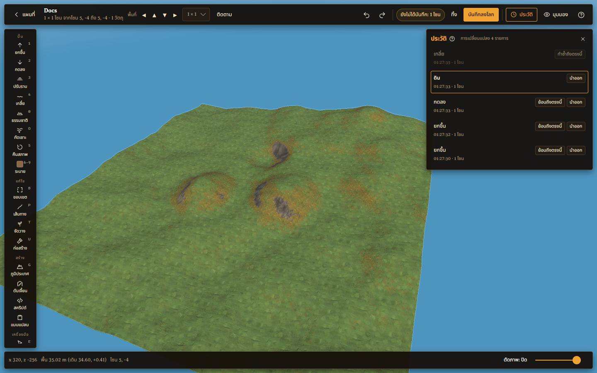

<!-- source: 752963cc -->
# การบันทึกและประวัติ

ไม่มีสิ่งใดที่คุณทำในเอดิเตอร์ แตะต้องโลก จนกว่าคุณจะสั่ง การเปลี่ยนแปลงของคุณ จะรออยู่ในสถานะ **รอดำเนินการ** แล้วเข้าไปในไฟล์ของโลก เมื่อคุณกด **บันทึกลงโลก** หรือเข้าไปในเกมที่กำลังรัน เมื่อคุณกด **นำไปใช้แบบไลฟ์** **ประวัติ** เก็บทุกขั้นตอนไว้ แม้หลังปิดเอดิเตอร์ เพื่อให้คุณย้อนการเปลี่ยนแปลง ได้ในภายหลัง

```text
  your edit ──► pending ──► Save to world ──► a new save in the world's folder   (offline)
                   │
                   └──────► Apply live ─────► the running game, which saves it    (live)
```

## การเปลี่ยนแปลงที่รอดำเนินการ

การลากแปรง การคลิก การวาง หรือการรันสคริปต์แต่ละครั้ง คือหนึ่ง **ขั้นตอน** และอยู่ในสถานะรอดำเนินการ จนกว่าจะถูกบันทึก หรือนำไปใช้ แถบด้านบนนับสิ่งที่รอดำเนินการ เป็นสีเหลืองอำพัน ("ยังไม่ได้บันทึก: 3 โซน, ลบ 1 ชิ้น, เพิ่ม 12 ชิ้น, รีเซ็ต 1" หรือ "ยังไม่ได้นำไปใช้: …" ในโหมดไลฟ์) และแสดง "บันทึกทั้งหมดแล้ว" หรือ "นำไปใช้ทั้งหมดแล้ว" เป็นสีเทา เมื่อไม่มีอะไรรอ:

| ตัวนับ | คืออะไร |
|---|---|
| **โซน** | โซนที่พื้นดิน (ความสูงหรือการระบาย) ต่างจากเซฟจริงๆ การยกขึ้น แล้วกดลงกลับไปที่ความสูงเดิม ไม่นับ |
| **ลบ** | วัตถุของโลก ที่จะถูกนำออก |
| **เพิ่ม** | วัตถุใหม่: ที่จัดวาง วาง คัดลอก หรือสร้างด้วยเครื่องมือ |
| **รีเซ็ต** | โซนที่ทำเครื่องหมาย ให้เกมสร้างใหม่ (ดู [การรีเซ็ตโซน](areas-and-zones.md#การรเซตโซน)) |

เมื่อคุณบันทึกแล้ว ตัวนับคือสิ่งที่ต่างจากเซฟนั้น ดังนั้นการเลิกทำขั้นตอน ที่บันทึกแล้ว จะทำให้ขั้นตอนนั้น กลับมารอดำเนินการอีกครั้ง ในมุมมอง 3D วัตถุใหม่แต่ละชิ้น ที่ยังไม่ได้บันทึก จะมีจุดสีเขียว (**มุมมอง → เครื่องหมายที่ยังไม่บันทึก** ซ่อนจุดเหล่านั้น)

**การเปลี่ยนแปลงที่รอดำเนินการ เป็นของโลก** ยังอยู่เมื่อคุณย้ายพื้นที่ กลับไปที่แผนที่ หรือเปิดที่อื่น และถูกบันทึกพร้อมกันทั้งหมด (ดู [พื้นที่](areas-and-zones.md#พนท)) จะหายไปก็ต่อเมื่อ คุณออกจากโปรแกรม โดยไม่บันทึก (เอดิเตอร์ถามก่อน) ทิ้งไป หรือกด **โหลดใหม่** ในโลกไลฟ์ (ซึ่งถามก่อนเช่นกัน)

**ทิ้ง** ทิ้งสิ่งที่ยังไม่ได้บันทึก หรือนำไปใช้: เลิกทำขั้นตอนที่ยังไม่บันทึก ท้ายประวัติ จากใหม่สุด ทำซ้ำขั้นตอนที่บันทึก หรือนำไปใช้แล้ว ที่คุณเลิกทำไปในระหว่างนั้น และทิ้งรายการทำซ้ำที่เหลือ ขั้นตอนที่บันทึก และนำไปใช้แล้ว ยังอยู่

การเปลี่ยนแปลงที่รอดำเนินการ บางรายการ ไม่มีขั้นตอน ในประวัติของพื้นที่ที่เปิดอยู่ (ทำในพื้นที่อื่น หรือทำก่อนที่โลก จะถูกอ่านใหม่) การเปลี่ยนแปลงเหล่านั้น จะหายไปได้ ด้วยการอ่านทั้งโลกใหม่ จากไฟล์หรือจากเกมเท่านั้น ซึ่งจะทิ้งการเปลี่ยนแปลง ที่รอดำเนินการทั้งหมด ทิ้ง จึงถามอีกครั้ง ก่อนทำแบบนั้น

เมื่ออ่านใหม่ ประวัติจะเป็นแบบที่โลกมี: จากไฟล์ คือประวัติที่เก็บไว้ ตอนบันทึกครั้งล่าสุด ในโหมดไลฟ์ (**ทิ้ง** หรือ **โหลดใหม่**) คือทุกขั้นตอนที่เกมมี ซึ่งนำไปใช้แล้ว และยังเลิกทำได้ ส่วนขั้นตอนที่ยังไม่ได้นำไปใช้ จะหายไปพร้อมการเปลี่ยนแปลง

## การบันทึกโลก

เกมเก็บโลกเป็นโฟลเดอร์ ของ **เซฟที่มีหมายเลข**: เซฟแต่ละอัน คือชุดของไฟล์ (`_main.<n>.chunks`, `.db2`, `.fwl2` และตัวบอก `.ok` เล็กๆ) บวกไฟล์ chunk ที่เก็บวัตถุและพื้นดิน **บันทึกลงโลก** ทำงานแบบที่เกมทำ ดังนั้นโลกที่บันทึกด้วยเอดิเตอร์ จะเปิดในเกม เหมือนโลกอื่นๆ:

1. **เขียนเซฟใหม่** ด้วยหมายเลขถัดไป เขียนใหม่เฉพาะไฟล์ chunk ที่เปลี่ยน วัตถุที่ไม่ถูกแตะ จะคัดลอกทีละไบต์ ตัวบอก `.ok` เขียนท้ายสุด เพราะเกมเชื่อถือเฉพาะเซฟ ที่มีตัวบอกนี้ เซฟที่ถูกตัดกลางคัน จึงไม่ถูกนับเป็นเซฟที่ดี แต่ละไฟล์ เก็บรูปแบบเซฟ ที่อ่านมา ดังนั้นโลกจาก Valheim 1.0.20 ขึ้นไป และจากเวอร์ชันเก่ากว่า บันทึกได้ทั้งคู่ และเปิดในเกมที่สร้างโลกนั้นได้
2. **อ่านเซฟใหม่กลับมา** และเทียบกับสิ่งที่ตั้งใจเขียน: พื้นดินของโซนที่เปลี่ยน พื้นดินของโซนอื่นทุกโซน จำนวนวัตถุ โซนที่รีเซ็ต ถ้ามีอะไรต่างกัน หรือล้มเหลว ไฟล์ใหม่จะถูกลบ และข้อความจะจบด้วย "ไม่มีอะไรเปลี่ยน" ถึงตอนนั้น เซฟเก่ายังไม่ถูกแตะ
3. **จัดเก็บให้เรียบร้อย** เซฟที่คุณใช้เปิดโลก จะเก็บไว้ ขณะที่โลกเปิดอยู่ เพราะเซฟแต่ละอัน สร้างจากเซฟนั้น เซฟที่คุณทำก่อนหน้า ในเซสชันเดียวกัน จะถูกลบ เมื่อคุณบันทึกอีกครั้ง เมื่อคุณออกจากโลก จะเหลือเฉพาะเซฟล่าสุด
4. **เขียนประวัติ** ไปพร้อมกับโลก (ดู [ประวัติ](#ประวต))

**ปิดเกมก่อน** เกมหรือเซิร์ฟเวอร์ที่กำลังรัน เก็บโลกไว้ในหน่วยความจำ และจะเขียนทับเซฟของคุณ ในครั้งถัดไปที่บันทึก ถ้าจะเปลี่ยนโลก ขณะที่เกมรันอยู่ ให้ใช้ [โหมดไลฟ์](live-editing.md)

**สิ่งที่บันทึกไม่ได้** จะแสดงพร้อมเหตุผล: การแก้ไขในโซน ที่ยังไม่มีผู้เล่นคนใดเข้าใกล้ (โลกยังไม่มีข้อมูลตรงนั้น: ดู [โซน](areas-and-zones.md#โซน)) และพื้นดินใหม่ ในโลกที่ไม่เคยมีใคร ขุดหรือปรับระดับในเกม (เอดิเตอร์แก้ไขพื้นดิน โดยคัดลอกการแก้ไข ที่เกมทำไว้ จึงต้องขุดในเกมสักครั้ง ที่ไหนก็ได้ก่อน)

### เกมบันทึกไปแล้ว หลังจากที่คุณเปิด

ถ้าเกมบันทึกโลก หลังจากเอดิเตอร์อ่านโลกนั้น (คุณเล่นเกม ระหว่างการบันทึกสองครั้ง) การบันทึก จะทิ้งสิ่งที่เกิดขึ้นในเกม เอดิเตอร์จึงไม่บันทึกอะไร แต่จะเสนอให้ **นำการเปลี่ยนแปลงของคุณไปใส่** ในเซฟของเกมแทน: เอดิเตอร์ทำการเปลี่ยนแปลง ที่รอดำเนินการของคุณ ซ้ำลงบนเซฟนั้นทีละรายการ โดยหาวัตถุ จากชนิดและตำแหน่ง เพราะ ID เปลี่ยนไป ทุกครั้งที่บันทึก (ดู [วัตถุคืออะไร](objects.md#วตถคออะไร))

ตรงที่เกมเปลี่ยนสิ่งเดียวกัน เอดิเตอร์จะถามครั้งเดียวต่อชนิด **ใช้ของฉัน** หรือ **ใช้ของเกม**:

| สิ่งที่ขัดกัน | ใช้ของฉัน |
|---|---|
| โซนที่ทั้งคุณและเกม เปลี่ยนพื้นดิน | จุดและการระบาย ที่คุณเปลี่ยน จะทับของเกม พื้นดินของเกม ยังอยู่ในส่วนอื่นของโซนเหล่านั้น |
| วัตถุที่เกมเปลี่ยน (หีบที่ใช้ ป้าย พืชที่กำลังโต) ซึ่งคุณลบ ย้าย หรือแก้ไข | ถูกลบ ย้าย หรือแก้ไข แบบที่คุณทำ |
| วัตถุที่เกมนำออก (ถูกเก็บ ถูกทำลาย หรือสิ่งมีชีวิต หรือเรือที่เคลื่อนที่ไป) ซึ่งคุณย้ายหรือแก้ไข | กลับมาตรงที่คุณวางไว้ วัตถุที่แค่เคลื่อนที่ไป จะมีสองชิ้น |

ยังไม่มีอะไรถูกเขียน: ตอนนี้โลก คือเซฟของเกม พร้อมการเปลี่ยนแปลงของคุณ ที่รอดำเนินการอยู่ ตรวจดูให้เรียบร้อย แล้วบันทึก ขั้นตอนในประวัติ ที่แตะสิ่งที่คุณยกให้เป็นแบบของเกม จะเลิกทำไม่ได้อีก และขั้นตอนก่อนหน้านั้น ก็เช่นกัน ข้อความบอกว่า ทิ้งไปกี่ขั้นตอน

## การนำไปใช้แบบไลฟ์

ใน [โหมดไลฟ์](live-editing.md) ปุ่มเดียวกันนี้คือ **นำไปใช้แบบไลฟ์** ปุ่มนี้ส่งพื้นดิน วัตถุ และการรีเซ็ตโซน ที่รอดำเนินการ ไปยังเกมที่กำลังรัน ซึ่งจะแบ่งปันให้ผู้เล่นทุกคนในนั้น และบันทึกเอง เหมือนสิ่งที่ผู้เล่นสร้าง ขั้นตอนที่ส่งแล้ว จะติดป้าย **นำไปใช้แล้ว** ใน ประวัติ เมื่อเปิด **อัตโนมัติ** ทุกขั้นตอน จะถูกนำไปใช้ทันที ที่คุณทำเสร็จ

ขั้นตอนที่นำไปใช้แล้ว ยังเลิกทำได้: เลิกทำ (หรือ **นำออก** ใน ประวัติ) แล้วนำไปใช้อีกครั้ง

- วัตถุที่ **ลบ** จะกลับมา เป็นสำเนาของสิ่งที่เป็นอยู่ ตอนที่อ่านโลก พร้อมข้อมูล (หีบพร้อมของข้างใน แบบที่เคยเป็น) สำหรับเกม นี่คือวัตถุใหม่
- วัตถุที่ **วาง** จะถูกนำออกอีกครั้ง แม้ม็อดอื่น จะสร้างใหม่ด้วย ID ใหม่ ในระหว่างนั้น: ปลั๊กอินหาวัตถุ จากชนิดและตำแหน่ง
- วัตถุที่ **ย้าย** จะย้ายกลับ
- **การรีเซ็ตโซน** เลิกทำไม่ได้ เมื่อนำไปใช้แล้ว

## ประวัติ

**ประวัติ** (`L`) แสดงทุกขั้นตอน เรียงจากใหม่สุด: ชื่อ ("ยกขึ้น" "วาง ×3" "เอาออก: จัดวาง") เวลา และสิ่งที่ขั้นตอนนั้นแตะ ป้ายบอกว่าขั้นตอน **นำไปใช้แล้ว** (บันทึก หรือส่งไปยังเกมแล้ว) ทำโดย **Claude** หรือมาจาก **เซสชันก่อน** ตามค่าเริ่มต้น ประวัติเก็บทุกขั้นตอน ตราบที่ใช้หน่วยความจำไม่ถึง 2 GB (เกินกว่านั้น รายการที่เก่าที่สุดจะออกก่อน) **การตั้งค่า → ประวัติ → จำนวนขั้นตอนที่เก็บ** จะเก็บเฉพาะจำนวนนั้นแทน


*ขั้นตอนล่าสุด ถูกเลิกทำด้วย **ย้อนถึงตรงนี้**: เป็นสีเทา และมีปุ่ม **ทำซ้ำถึงตรงนี้***

มีสองวิธีในการย้อนกลับ:

| | สิ่งที่ทำ | ตัวอย่าง |
|---|---|---|
| **ย้อนถึงตรงนี้** | เลิกทำทุกขั้นตอน หลังจากอันนี้ เหมือนกด `Ctrl+Z` หลายครั้ง ขั้นตอนที่ตามมา ยังเป็นสีเทา ให้ทำซ้ำได้ การเปลี่ยนแปลงใหม่ จะทิ้งขั้นตอนเหล่านั้น | คุณลองทำสามอย่าง และต้องการให้โลก กลับเป็นแบบก่อนหน้านั้น |
| **นำออก** | เอาออกเฉพาะขั้นตอนนี้ และเก็บทุกอย่าง ที่ทำหลังจากนั้นไว้: การเปลี่ยนความสูง ออกจากจุดที่แตะ การระบาย หายไปตรงที่ ไม่มีการระบายทับในระหว่างนั้น วัตถุของขั้นตอนนั้น หายไป และวัตถุที่ขั้นตอนนั้นลบ กลับมา การรีเซ็ตถูกยกเลิก การนำออก เป็นขั้นตอนใหม่ ดังนั้น `Ctrl+Z` จะนำกลับมา | นำแนวต้นไม้ ที่ปลูกเมื่อชั่วโมงก่อนออก โดยไม่เสียงานปรับพื้น ที่ทำหลังจากนั้น |

**ย้อนการเปลี่ยนแปลงของ Claude** ทำ **นำออก** กับทุกขั้นตอน ที่ Claude ทำ ในประวัติของพื้นที่ที่เปิดอยู่ และเก็บของคุณไว้ ขั้นตอนของ Claude ในพื้นที่อื่น จะเก็บแยกไว้ (ดูด้านล่าง): เปิดพื้นที่เหล่านั้น เพื่อย้อนด้วย

### ประวัติเป็นของโลก

ประวัติตามมาด้วย เมื่อคุณย้าย หรือปรับขนาดพื้นที่ เมื่อ ติดตาม ขยายพื้นที่ และเมื่อผ่านแผนที่ ขั้นตอนที่ทำ ในพื้นที่อื่นทั้งหมด จะเก็บแยกไว้ ขณะที่พื้นที่นี้เปิดอยู่ ("N ขั้นตอนที่ทำในพื้นที่อื่น ยังเก็บไว้") และจะกลับมา พร้อมให้เลิกทำ เมื่อคุณเปิดพื้นที่ ที่มีขั้นตอนนั้น ขั้นตอนที่อยู่ในพื้นที่ที่เปิด เพียงบางส่วน เลิกทำจากที่นี่ไม่ได้ และขั้นตอนก่อนหน้านั้น ก็เช่นกัน การบันทึก หรือนำไปใช้ จากพื้นที่ใดก็ได้ จะทำเครื่องหมายขั้นตอน ของทุกพื้นที่ ว่าบันทึกแล้ว

### เก็บไว้หลังปิดเอดิเตอร์

หลัง **บันทึกลงโลก** หรือ **นำไปใช้แบบไลฟ์** แต่ละครั้ง ประวัติจะถูกเขียน ลงในโฟลเดอร์ข้อมูลของเอดิเตอร์ (`history/` หนึ่งไฟล์ต่อหนึ่งโฟลเดอร์โลก ในโหมดไลฟ์ หนึ่งไฟล์ต่อการเชื่อมต่อและโลก) เปิดโลกอีกครั้ง แม้หลายวันต่อมา ขั้นตอนก็กลับมา พร้อมป้าย **เซสชันก่อน** การเลิกทำ นำพื้นดินกลับมา นำวัตถุที่ลบ กลับมาพร้อมของข้างใน และนำวัตถุที่วาง ออกไป การเปลี่ยนแปลงที่คุณไม่ได้บันทึก หรือนำไปใช้ จะไม่ถูกเก็บ

โลกอาจเปลี่ยนไปแล้ว ในระหว่างนั้น (ผู้เล่นสร้างและขุด หรือเกมบันทึกโลกอีกครั้ง) เอดิเตอร์จึงถามครั้งเดียว ก่อนเลิกทำ หรือทำซ้ำขั้นตอนแรก จากเซสชันก่อน: การทำแบบนั้น จะนำสิ่งต่างๆ กลับเป็นแบบเดิม ทับสิ่งที่เปลี่ยนไปในระหว่างนั้น โลกที่มีแค่เอดิเตอร์ บันทึกในระหว่างนั้น จะไม่ถาม

### สิ่งที่ขั้นตอนย้อนกลับไม่ได้

ประวัติถูกเก็บไว้ ผ่านการบันทึก และการนำไปใช้ทุกครั้ง รวมการรีเซ็ตโซน และพื้นดิน [ไม่จำกัด](ground-limits.md#ไมจำกด) ที่ถูกทำเป็นแผ่นพื้นดิน มีบางอย่าง ที่อยู่นอกเหนือขอบเขต:

- **การรีเซ็ตโซน เมื่อบันทึก หรือนำไปใช้แล้ว** เกมสร้างโซนใหม่: สิ่งที่ขั้นตอนต่างๆ ทำตรงนั้น จะถูกตัดออกจากขั้นตอน (ขั้นตอนที่อยู่ตรงนั้นทั้งหมด จะหายไป) และขั้นตอน ที่ทำเครื่องหมายรีเซ็ต ก็เช่นกัน ขั้นตอนที่อื่นยังอยู่
- **ต้นไม้และหิน ที่ถูกนำออก ใต้พื้นดิน ไม่จำกัด** เมื่อนำไปใช้แบบไลฟ์แล้ว หรือเมื่อเปิดโลกอีกครั้ง: การเลิกทำ จะไม่นำกลับมา ใช้ [ปลูกธรรมชาติคืน](../area.md#ปลกธรรมชาตคน)
- **พื้นดินที่ผู้เล่นเปลี่ยน ในระหว่างนั้น** เมื่อเปิดอีกครั้ง พื้นดิน ไม่จำกัด ของโซน ที่บันทึกเป็นแผ่นพื้นดิน จะกลับมาพร้อมประวัติ ดังนั้นการเลิกทำ จะนำพื้นดินทั้งหมด ที่ขั้นตอนเปลี่ยนกลับมา รวมรอบๆ แผ่นด้วย ตรงที่ผู้เล่นขุด ในโซนนั้นในระหว่างนั้น โซนจะเก็บสิ่งที่เกมมี: การเลิกทำ นำกลับมาเฉพาะพื้นดิน ของขั้นตอนนั้นเอง

## ข้อมูลสำรอง

เอดิเตอร์ไม่สร้างโฟลเดอร์สำรอง ของตัวเอง: เอดิเตอร์ไม่แตะเซฟเก่า จนกว่าเซฟใหม่ จะอ่านกลับได้ถูกต้อง และเซฟที่คุณใช้เปิด ยังอยู่ จนกว่าคุณจะออกจากโลก วิธีนี้ป้องกันเซฟที่ผิดพลาด แต่ไม่ป้องกันการแก้ไข ที่คุณเสียใจ หลังออกจากโลกไปแล้ว สำหรับกรณีนั้น ให้เก็บสำเนาของคุณเอง ของโลกที่คุณให้ความสำคัญ (ดู [สำรองโลกก่อนแก้ไข](../guides/back-up-a-world.md))

เกมเก็บข้อมูลสำรองของตัวเอง ข้างโฟลเดอร์โลก (`<World>_backup_auto-<date>`) และเอดิเตอร์เวอร์ชันก่อนๆ เก็บของตัวเองเป็น `<World>_backup_terraineditor-<date>` **กลับไปใช้ข้อมูลสำรอง** ของเครื่องมือ ขอบเขต นำส่วนที่เลือกหนึ่งส่วน กลับเป็นแบบในสำเนานั้น โดยไม่ย้อนทั้งโลก (ดู [คืนสภาพพื้นที่หนึ่ง จากข้อมูลสำรอง](../guides/restore-from-backup.md)) เครื่องมือจับคู่วัตถุ แบบนี้:

- วัตถุที่อยู่ในส่วนที่เลือกตอนนี้ และในข้อมูลสำรอง ชนิดเดียวกัน ตำแหน่งเดียวกัน (ภายใน 1 cm) และหันไปทางเดียวกัน จะถูกปล่อยไว้
- วัตถุอื่นทุกชิ้น ของชนิดที่เลือก ในส่วนที่เลือกตอนนี้ จะถูกนำออก แม้ชนิดนั้น จะถูกซ่อนใน มุมมอง
- วัตถุทุกชิ้นของข้อมูลสำรอง ที่ไม่มีคู่ จะกลับมา พร้อมข้อมูลทั้งหมด: หีบพร้อมของข้างใน ป้ายพร้อมข้อความ
- หินรูนไม่ถูกแตะเลย

พื้นดินกลับมา เหมือนในข้อมูลสำรองทุกประการ รวมพื้นดิน ไม่จำกัด สำเนาของโลกอื่น (ซีดอื่น) จะถูกปฏิเสธ
