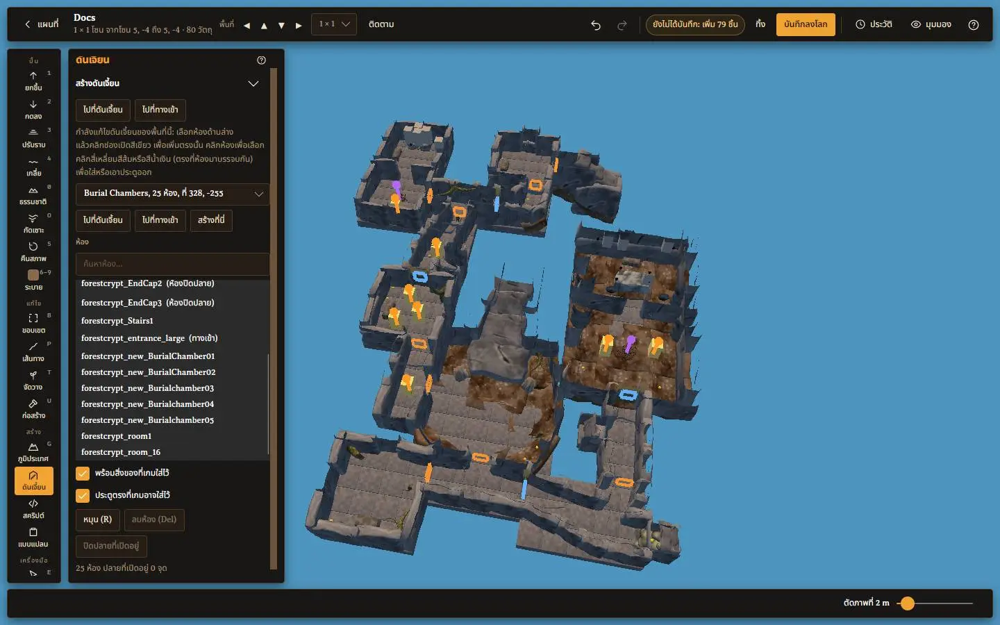
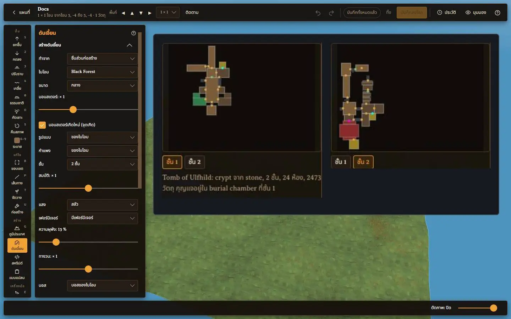
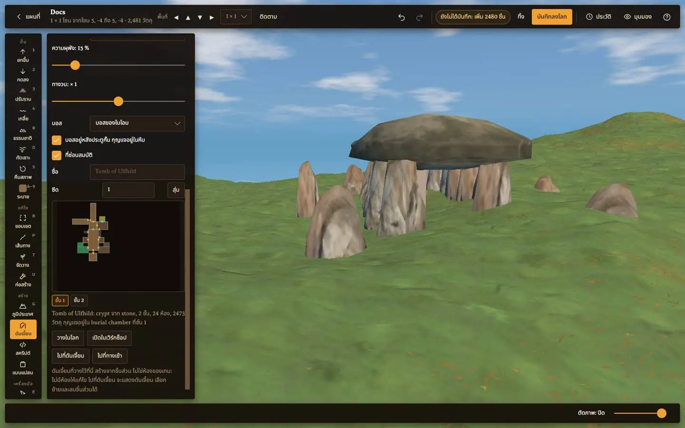
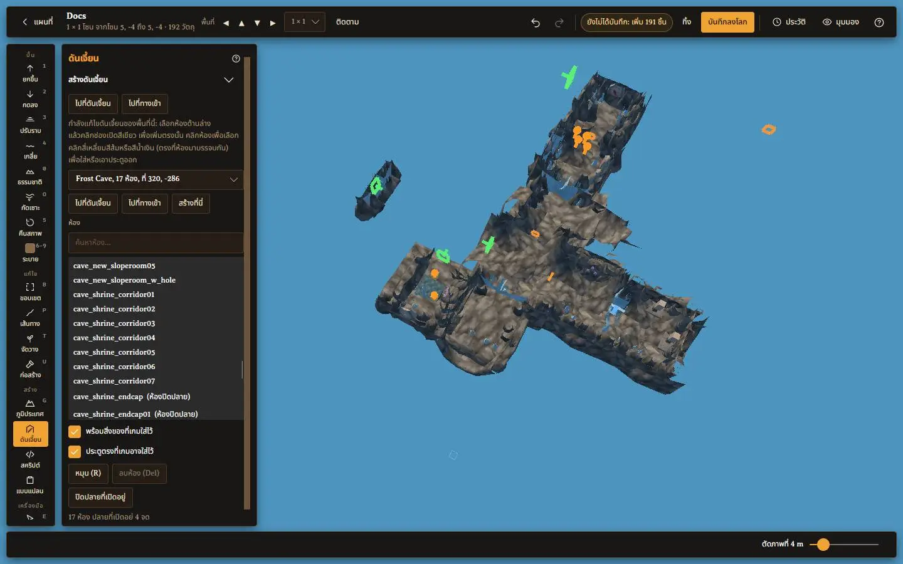
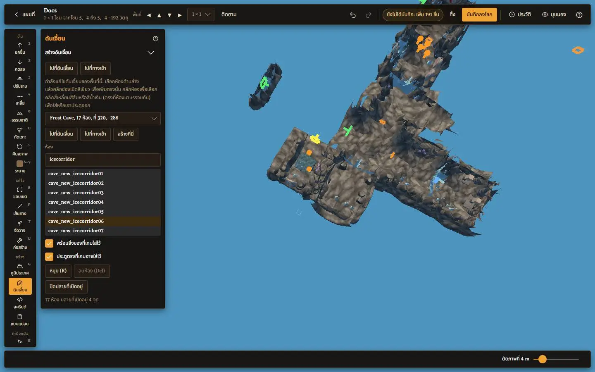
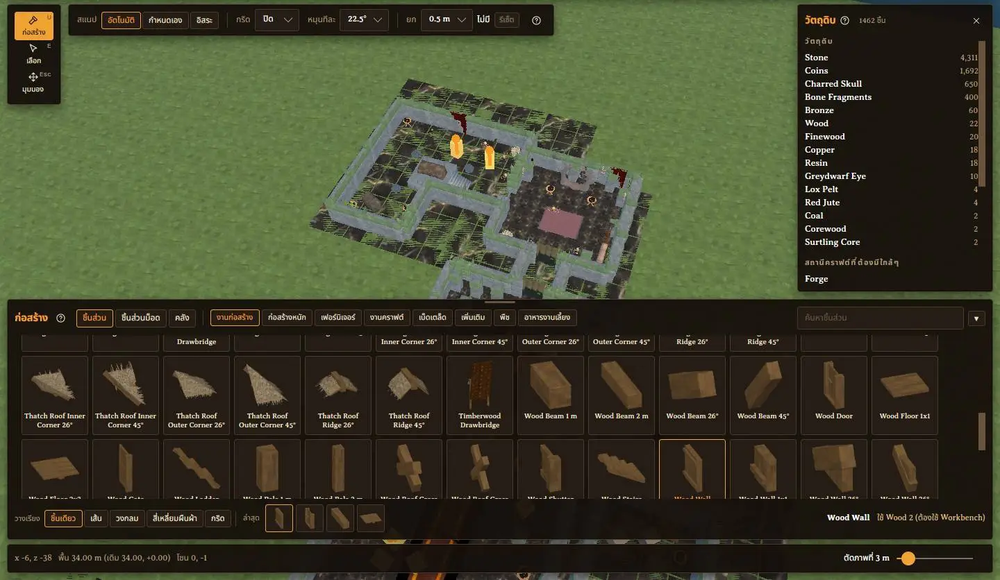

<!-- source: 16125394 -->
# ดันเจี้ยน

สร้างดันเจี้ยนทั้งหลัง แล้ววางลงในโลกของคุณ หลังทางเข้า แก้ไขดันเจี้ยนของเกมเอง ทีละห้อง และก่อสร้างข้างในดันเจี้ยน

**ที่อยู่:** แถบเครื่องมือ ส่วน **สร้าง** · **ปุ่ม:** ไม่มี · **ใช้ได้กับ:** โลกที่บันทึกไว้ ไลฟ์ ตัวสร้างดันเจี้ยน ใช้ในเวิร์กช็อปได้ด้วย (**คลัง** → **สร้างดันเจี้ยน…**)

*ดันเจี้ยนที่ใช้ห้องของเกมเอง (Burial Chambers 25 ห้อง) สูง 5000 m และตัดภาพที่ 2 m เหนือพื้น สี่เหลี่ยมสีส้ม และสีน้ำเงิน บอกตำแหน่งที่ห้องต่อกัน **ลบห้อง (Del)** เป็นสีเทา จนกว่าจะเลือกห้อง*

ดันเจี้ยนของ Valheim คือสถานที่บนพื้นดิน (เนินดิน ปากถ้ำ) ซึ่งประตูนำไปสู่ห้อง ที่เก็บไว้สูงกว่านั้น 5000 m ดู [เกมเก็บดันเจี้ยนอย่างไร](concepts/dungeons.md#วธทเกมเกบดนเจยน)

## ใช้งาน

วิธีสร้างดันเจี้ยน แล้ววางลงในโลก:

1. เปิดพื้นที่ของโลก แล้วคลิก **ดันเจี้ยน** บนแถบเครื่องมือ
2. ใต้ **สร้างดันเจี้ยน** เลือก **ไบโอม** **ขนาด** และ **ชั้น** ผังจะวาดใหม่ ครู่หนึ่งหลังการเปลี่ยนแต่ละครั้ง
3. ไม่บังคับ: คลิก **สุ่ม** จนกว่าจะชอบผัง ตรวจดูแต่ละชั้น ด้วยปุ่ม **ชั้น 1** **ชั้น 2**... ใต้ผัง
4. หมุนมุมมอง ให้หันไปที่จุดที่จะวางทางเข้า โดยให้จุดนั้นอยู่ตรงกลาง
5. คลิก **วางในโลก**
6. คลิก **ไปที่ดันเจี้ยน** เพื่อดูข้างใน **ไปที่ทางเข้า** พามุมมองกลับลงมา
7. คลิก **บันทึกลงโลก** (หรือ **นำไปใช้แบบไลฟ์**)

การวางทั้งหมด เป็นการเลิกทำขั้นตอนเดียว: `Ctrl+Z` ย้อนทั้งหมด ตัวเลือกและซีดเดียวกัน สร้างดันเจี้ยนจากชิ้นส่วนก่อสร้าง แบบเดียวกันเสมอ ส่วนดันเจี้ยนที่ใช้ [ห้องของเกมเอง](#ทำจากหองของเกมเอง) ยังขึ้นกับตำแหน่งทางเข้า และทิศที่ทางเข้าหันไปด้วย วิธีทำแบบครบทุกขั้นตอน ดู [สร้างดันเจี้ยนแล้ววางลงในโลก](guides/make-a-dungeon.md)

***สร้างดันเจี้ยน** สำหรับดันเจี้ยน ป่าดำ ขนาดกลาง 2 ชั้น บอสอยู่หลังประตูกั้น ข้างแผงคือผัง ที่วาดขนาดใหญ่ ชั้นละหนึ่งผัง: ห้องกุญแจสีเขียว ในชั้น 1 ลานต่อสู้สีแดง พร้อมจุดประตูกั้นสีม่วงแดง และห้องสมบัติสีทอง ในชั้น 2 และสรุปผลอยู่ข้างใต้*

## การตั้งค่า

### สร้างดันเจี้ยน

**สร้างดันเจี้ยน** อยู่ด้านบนสุดของแผง ดันเจี้ยน: เปิดอยู่ เมื่อพื้นที่ไม่มีดันเจี้ยน พับไว้ เมื่อมีดันเจี้ยน

| การตั้งค่า | สิ่งที่ทำ |
|---|---|
| **ทำจาก** | **ชิ้นส่วนก่อสร้าง**: ห้องที่สร้างแบบที่ผู้เล่นสร้าง ตกแต่งตามหน้าที่ของห้อง **ห้องของเกมเอง**: ห้องดันเจี้ยนของไบโอม ต่อกันแบบที่เกมต่อ (ดู [ทำจากห้องของเกมเอง](#ทำจากหองของเกมเอง)) ไม่แสดงในเวิร์กช็อป ซึ่งรับเฉพาะชิ้นส่วนก่อสร้าง |
| **ไบโอม** | **ทุ่งหญ้า** **ป่าดำ** (ค่าเริ่มต้น) **หนองน้ำ** **ภูเขา** **ที่ราบ** **ดินแดนหมอก** **ดินแดนเถ้าถ่าน** **ดินแดนเหนือสุด** กำหนดมอนสเตอร์ สมบัติ แสง ทางเข้าบนพื้นดิน และรูปแบบกับกำแพง ถ้าคุณไม่ได้เลือกเอง |
| **ขนาด** | **เล็ก** **กลาง** (ค่าเริ่มต้น) **ใหญ่** **ใหญ่มาก**: ประมาณ 5, 8, 12 หรือ 17 ห้อง ในแต่ละชั้น |
| **มอนสเตอร์: × 1** | ตั้งแต่ **ไม่มี** ถึง 3 เท่าของปกติ ทีละ 0.25 |
| **มอนสเตอร์เกิดใหม่ (จุดเกิด)** | เปิด: จุดเกิดของเกม ซึ่งมอนสเตอร์จะเกิดใหม่ หลังถูกฆ่าไปสักพัก ปิด: ตัวมอนสเตอร์เอง วางครั้งเดียว บอสวางครั้งเดียวเสมอ |
| **รูปแบบ** | **ของไบโอม** หรือ **Crypt** (สุสาน) **Catacombs** (สุสานใต้ดิน) **Temple** (วิหาร) **Fortress** (ป้อมปราการ) **Prison** (คุก) **Dvergr hold** (ที่มั่นของ Dvergr) **Goblin warren** (รังก็อบลิน) **Ruins** (ซากปรักหักพัง): มีห้องแบบไหน และจัดวางอย่างไร |
| **กำแพง** | **ของไบโอม** หรือ **Stone** (หิน) **Marble** (หินอ่อน) **Wood** (ไม้) **Stave** (ไม้แบบโบสถ์สเตฟ) **Grausten** **Dvergr** **Goblin** |
| **ชั้น** | **1 ชั้น** ถึง **16 ชั้น** (ค่าเริ่มต้น 2) เชื่อมกันด้วยบันได บอสรออยู่ชั้นสุดท้าย |
| **สมบัติ: × 1** | หีบและสมบัติ: ตั้งแต่ **ไม่มี** ถึงสองเท่าของปกติ ชั้นที่ลึกกว่า มีมากกว่า เมื่อใช้ห้องของเกมเอง จะเก็บหีบของห้องไว้ หรือเพิ่มเป็นสองเท่า |
| **แสง** | **มืด** **สลัว** (ค่าเริ่มต้น) หรือ **สว่าง**: จำนวนคบเพลิง และเชิงไฟ |
| **เฟอร์นิเจอร์** | **โล่ง** **มีเฟอร์นิเจอร์** (ค่าเริ่มต้น) หรือ **หรูหรา** |
| **ความผุพัง: 15 %** | ผุพังมากแค่ไหน 0 ถึง 100 % ทีละ 5: เศษหิน เสาที่ล้ม คบเพลิงที่ดับ การเลือกรูปแบบ จะตั้งค่าของรูปแบบนั้นเอง การเลือกไบโอม ขณะที่ **รูปแบบ** เป็น **ของไบโอม** ก็เช่นกัน |
| **ทางวน: × 1** | ห้องที่อยู่ห่างกันตามเส้นทาง ถูกเชื่อมกันบ่อยแค่ไหน เพื่อให้มีทางเดินวนได้ มากกว่าหนึ่งทาง: ตั้งแต่ **ไม่มี (แบบต้นไม้)** ถึงสองเท่าของปกติ |
| **บอส** | **บอสของไบโอม** **ไม่มีบอส** หรือบอส หรือตัวพิเศษของไบโอมใดก็ได้ ตามชื่อ (`Troll`, `Draugr_Elite`, `StoneGolem`...) |
| **บอสอยู่หลังประตูกั้น กุญแจอยู่ในหีบ** | ประตูกั้นของลานต่อสู้ เปิดด้วยกุญแจสุสาน ซึ่งอยู่ในหีบที่ห่างไกล (ผู้เล่นที่ถือกุญแจ จาก Elder ก็เปิดได้) ปิด: ประตูคู่ใหญ่ เปิดให้ทุกคน |
| **ที่ซ่อนสมบัติ** | ห้องสมบัติเล็กๆ หลังกำแพงร้าว ที่ต้องทุบ หรือหลังผ้าทอแขวนผนัง |
| **ชื่อ** | เขียนบนป้าย ในโถงทางเข้า ว่าง: ชื่อที่สร้างจากซีด แสดงเป็นสีเทา (`Barrow of Sigrun`) |
| **ซีด** และ **สุ่ม** | หมายเลขของดันเจี้ยนเอง จำนวนเต็มใดก็ได้ จะสร้างดันเจี้ยนอื่น ด้วยตัวเลือกเดิม |

การเปลี่ยน **แสง** หรือ **ความผุพัง** ไม่เปลี่ยนอย่างอื่นของดันเจี้ยน เมื่อใช้ **ห้องของเกมเอง** จะใช้เฉพาะ **ไบโอม** **ขนาด** **มอนสเตอร์** **สมบัติ** และซีด แถวอื่นๆ และผัง จะถูกซ่อน ตัวสร้างดันเจี้ยน วางอะไรไว้ตรงไหน อยู่ใน [ตัวสร้างจัดผังดันเจี้ยนอย่างไร](concepts/dungeons.md#วธทตวสรางวางผงดนเจยน) และ [การตกแต่ง แสง และผู้เฝ้า](concepts/dungeons.md#การตกแตง-แสง-และผคมกน)

สิ่งที่แต่ละไบโอมให้ เมื่อไม่ได้เลือกอย่างอื่น:

| ไบโอม | รูปแบบ | กำแพง | บอส | ทางเข้าบนพื้นดิน |
|---|---|---|---|---|
| ทุ่งหญ้า | Crypt | Stone | `Skeleton_Hildir` | เนินของ burial chamber |
| ป่าดำ | Crypt | Stone | `Troll` | เนินของ burial chamber |
| หนองน้ำ | Crypt | Stone | `Draugr_Elite` | ประตูของ sunken crypt |
| ภูเขา | Fortress | Stone | `StoneGolem` | ปากถ้ำของ Frost Cave |
| ที่ราบ | Goblin warren | Goblin | `GoblinBrute` | ไม่มีทางเข้าของตัวเอง: ประตูมิติคู่ ที่เชื่อมกัน |
| ดินแดนหมอก | Dvergr hold | Dvergr | `SeekerBrute` | ทางเข้าของ infested mine |
| ดินแดนเถ้าถ่าน | Fortress | Grausten | `Charred_Melee_Dyrnwyn` | Morgen hole |
| ดินแดนเหนือสุด | Temple | Stave | `JotunWarrior` | ปากถ้ำของ Frost Cave |

**ผัง** วาดชั้นที่แสดงอยู่ จากด้านบน: ห้องบนเส้นทางหลัก สีน้ำตาลอ่อน ห้องข้าง สีน้ำตาลเข้มกว่า ทางเดิน สีเทาเข้ม ลานต่อสู้บอส สีแดง ห้องสมบัติ และที่ซ่อนสมบัติ สีทอง ห้องกุญแจ สีเขียว ช่องประตูเป็นจุด: ประตูกั้นที่ล็อก สีม่วงแดง ทางลับ สีฟ้าอมเขียว ซุ้มเปิด สีเขียว ประตูและประตูกั้น สีส้ม ชี้ที่ห้อง เพื่อดูชื่อห้อง สรุปผลข้างใต้ บอกสิ่งที่สร้างขึ้น (`Barrow of Sigrun: crypt จาก stone, 2 ชั้น, 15 ห้อง, 2140 วัตถุ กุญแจอยู่ใน ossuary ที่ชั้น 2`)
และสิ่งที่สร้างไม่ได้ (`ไม่มีที่สำหรับบันไดลงจากชั้น 3 ชั้นที่อยู่ด้านล่างจึงไม่ได้ใส่`)

| ปุ่ม | สิ่งที่ทำ |
|---|---|
| **วางในโลก** | วางทางเข้าบนพื้นดิน ตรงกลางมุมมอง ให้ประตูหันมาหาคุณ และวางดันเจี้ยน สูงกว่านั้น 5000 m |
| **เปิดในเวิร์กช็อป** | เขียนดันเจี้ยน (ชิ้นส่วนก่อสร้าง) เป็นพิมพ์เขียว และเปิดใน [เวิร์กช็อป](workshop.md) เพื่อแก้ไข: ดู [เปิดในเวิร์กช็อป](#เปดในเวรกชอป) ไม่แสดง เมื่อใช้ **ห้องของเกมเอง** |
| **ไปที่ดันเจี้ยน** / **ไปที่ทางเข้า** | แสดงเมื่อวางดันเจี้ยนแล้ว (และจนกว่า `Ctrl+Z` จะย้อน): พามุมมองขึ้นไปที่ชั้นแรก โดยตัดหลังคาออก และพากลับลงมา |

*เนินของ burial chamber ที่วางด้วย **วางในโลก** ประตูหันมาทางกล้อง ใต้สรุปผล ตอนนี้แสดง **ไปที่ดันเจี้ยน** และ **ไปที่ทางเข้า** แล้ว*

### ห้องของดันเจี้ยน

ใต้ตัวสร้างดันเจี้ยน เมื่อพื้นที่มีดันเจี้ยน แผงจะแสดงรายการดันเจี้ยน และแก้ไขห้องของดันเจี้ยนเหล่านั้น

| การตั้งค่า | สิ่งที่ทำ |
|---|---|
| รายการดันเจี้ยน | ดันเจี้ยนของพื้นที่ แต่ละอันพร้อมชนิด ห้อง และตำแหน่ง (`Frost Cave, 34 ห้อง, ที่ 1520, -2240`) หมู่บ้าน Fuling และฟาร์มทุ่งหญ้า ซึ่งจัดผังแบบเดียวกันบนพื้นดิน ก็แสดงด้วย |
| **ไปที่ดันเจี้ยน** | พามุมมองขึ้นไป ที่กลางห้องของดันเจี้ยน และตัดหลังคาออก (ที่ 4 m เหนือพื้น เมื่อการตัดภาพปิดอยู่) |
| **ไปที่ทางเข้า** | พามุมมองกลับลงมา ที่ทางเข้าบนพื้นดิน โดยไม่ตัดอะไร |
| **สร้างที่นี่** | เปิด [ก่อสร้าง](build.md) เหนือดันเจี้ยน พร้อมแผงที่ด้านล่าง: ดู [ก่อสร้างข้างในดันเจี้ยน](#กอสรางขางในดนเจยน) |
| **ห้อง** + **ค้นหาห้อง…** | ห้องที่ดันเจี้ยนชนิดนี้ใช้ได้ พิมพ์เพื่อกรองตามชื่อ ห้องปิดปลาย และห้องทางเข้า มีเครื่องหมาย `(ห้องปิดปลาย)` และ `(ทางเข้า)` |
| **พร้อมสิ่งของที่เกมใส่ไว้** | เปิด (ค่าเริ่มต้น): ห้องที่เพิ่ม มาพร้อมสิ่งที่เกมจะสร้างไว้ ในห้องนั้น ตรงนั้น (หีบ จุดเกิด คบเพลิง ของตกแต่ง) ปิด: ห้องเปล่า |
| **ประตูตรงที่เกมอาจใส่ไว้** | เปิด (ค่าเริ่มต้น): ห้องที่เพิ่ม จะได้ประตูตรงที่ต่อกัน ตามโอกาสของเกมเอง |
| **หมุน (R)** | ต่อห้องที่แสดงอยู่ ด้วยช่องเปิดถัดไป ที่เป็นชนิดเดียวกัน |
| **ลบห้อง (Del)** | นำห้องที่เลือกออก |
| **ปิดปลายที่เปิดอยู่** | ใส่ห้องปิดปลายของเกม ที่ปลายที่เปิดอยู่ทุกจุด เพื่อไม่ให้มีทางออกไปข้างนอก ข้อความบอกจำนวนปลายที่เปิดอยู่ ที่ไม่มีห้องปิดปลาย ชนิดเดียวกัน |

หลังคาถูกตัด ด้วยแถบเลื่อน **ตัดภาพ** ในแถบสถานะ อันเดียวกับในโลก และในเวิร์กช็อป ขณะใช้เครื่องมือ ดันเจี้ยน (หรือ **สร้างที่นี่**) โดยเปิดดันเจี้ยนอยู่ เมตรจะนับจาก ประมาณพื้นของทางเข้าดันเจี้ยน 0 ถึง 29 m: ปลายซ้ายตัดที่พื้น ปลายขวา (**ตัดภาพ: ปิด**) แสดงหลังคา การออกจากเครื่องมือ จะนำการตัดของโลกกลับมา และการตัดของดันเจี้ยน จะเก็บไว้ สำหรับเมื่อคุณกลับมา ดู [ตัดภาพ](editor-basics.md#ตดภาพ)

บรรทัดที่ด้านล่าง นับห้อง ปลายที่เปิดอยู่ และคู่ที่ซ้อนทับกัน (`24 ห้อง ปลายที่เปิดอยู่ 3 จุด ซ้อนทับกัน 1 คู่`)

## เปิดดันเจี้ยน

1. เปิดพื้นที่เหนือทางเข้าดันเจี้ยน (เครื่องหมายสถานที่ บนแผนที่ แสดงทางเข้า)
2. คลิก **ดันเจี้ยน** บนแถบเครื่องมือ: รายการแสดงดันเจี้ยนของพื้นที่
3. คลิก **ไปที่ดันเจี้ยน** ใต้รายการ
4. ไม่บังคับ: เลื่อนแถบ **ตัดภาพ** ในแถบสถานะ เพื่อดูกำแพงมากขึ้น หรือน้อยลง

บนนั้น กล้องไม่เดินตามพื้นแล้ว: หมุนรอบ เลื่อน และบินไปรอบห้อง ได้ตามปกติ **ห้องดันเจี้ยน** ใน [แผงมุมมอง](editor-basics.md) แสดงหรือซ่อนห้องเหล่านั้น

ดันเจี้ยนที่ยังไม่มีใครเข้าใกล้ ยังไม่มีห้อง: แผงจะบอกว่า *เกมยังไม่ได้วางผังดันเจี้ยนนี้ (ยังไม่มีใครเข้าใกล้)* ไปที่นั่นในเกม แล้วเปิดพื้นที่อีกครั้ง

*Frost Cave หลัง **ไปที่ดันเจี้ยน** หลังคาตัดที่ 4 m เหนือพื้น: แผงแสดงรายการ (`Frost Cave, 17 ห้อง, ที่ -640, -350`) กรอบสีเขียว บอกปลายที่เปิดอยู่ (มีห้องถูกลบ) สี่เหลี่ยมสีส้ม บอกที่ที่ห้องต่อกัน โดยไม่มีประตู*

## เพิ่มห้อง

ทุกห้องมี **ช่องเปิด** คือช่องประตู ตรงที่ห้องต่อกับห้องถัดไป เกมต่อเฉพาะช่องเปิด ชนิดเดียวกัน

1. หากรอบสีเขียว: กรอบนี้บอก **ปลายที่เปิดอยู่** คือช่องเปิด ที่ยังไม่มีห้องมาต่อ
2. เลือกห้องในรายการ ใต้ **ห้อง**
3. ชี้ที่ปลายที่เปิดอยู่ (ภายใน 1.5 m): ห้องจะแสดงตรงนั้น แบบโปร่งใส ต่อกันแบบที่เกมต่อห้อง
4. ไม่บังคับ: กด `R` (**หมุน (R)**) เพื่อต่อด้วยช่องเปิดอื่นของห้อง
5. คลิกเพื่อเพิ่ม ห้องยังถูกเลือกอยู่ ดังนั้น `Del` จะเอาออกอีกครั้งได้

ห้องที่จะซ้อนทับห้องอื่น หรือเกินพื้นที่ของดันเจี้ยน (64 × 64 m รอบกลางโซน สำหรับชนิดส่วนใหญ่) จะเป็นสีแดง และบรรทัดจะเตือน เกมสร้างรายการอยู่ดี: เป็นแค่คำเตือน

*`cave_new_icecorridor01` ที่เลือกใต้ **ห้อง** (กรองด้วย "icecorridor") และชี้ที่ปลายที่เปิดอยู่: ห้องแสดงตรงนั้น แบบโปร่งใส ต่อกันแบบของเกม บรรทัดด้านล่างแสดง `17 ห้อง ปลายที่เปิดอยู่ 4 จุด`*

## ประตู

สี่เหลี่ยมบอกทุกตำแหน่ง ที่สองห้องต่อกัน และตั้งประตูได้: **สีน้ำเงิน** มีประตู **สีส้ม** ไม่มี คลิกเพื่อใส่ประตูของดันเจี้ยน ตรงนั้น หรือเอาออก แต่ละคลิก เป็นการเลิกทำหนึ่งขั้นตอน

## ลบห้อง

คลิกห้องเพื่อเลือก (กล่องของห้องจะแสดง) แล้วคลิก **ลบห้อง (Del)** สิ่งที่อยู่ในห้อง (หีบ จุดเกิด...) ออกไปด้วย และประตูตรงที่ห้องนั้นต่อกับห้องอื่น ก็เช่นกัน ห้องข้างเคียง จะมีปลายที่เปิดอยู่อีกครั้ง: **ปิดปลายที่เปิดอยู่** ปิดให้

## ก่อสร้างข้างในดันเจี้ยน

**สร้างที่นี่** เปิด [ก่อสร้าง](build.md) เหนือดันเจี้ยน พร้อม [แผง ก่อสร้าง](workshop.md#แผง-กอสราง) และแถบก่อสร้าง: เฉพาะแท็บ **ชิ้นส่วน** และ **ชิ้นส่วนม็อด** (พิมพ์เขียวใน **คลัง** วางบนแปลงของเวิร์กช็อป) ทีละชิ้น (เส้นของ **วางเรียง** วาดบนพื้นดิน ไกลลงไปข้างล่าง): เลือกชิ้นส่วน แล้วคลิกบนพื้นหรือผนังห้อง หรือบนชิ้นส่วน ที่อยู่ตรงนั้นแล้ว ชิ้นส่วนจะสแนป แบบเดียวกับค้อน และเคอร์เซอร์ทะลุ สิ่งที่การตัดซ่อนไว้ เลือกเครื่องมืออื่น เพื่อหยุดก่อสร้าง

พื้นและผนังของห้อง นับเป็นพื้นดินในเกม ชิ้นส่วนที่วางอยู่บนนั้น จึงรับน้ำหนักได้ ชิ้นส่วนที่ลอยอยู่กลางอากาศ ห่างจากห้อง จะพังทันที ที่มีผู้เล่นเข้าใกล้

## ทำจากห้องของเกมเอง

เมื่อตั้ง **ทำจาก** เป็น **ห้องของเกมเอง** เอดิเตอร์จะต่อ ห้องดันเจี้ยนของไบโอม แบบของเกม: burial chamber ใน ทุ่งหญ้า และ ป่าดำ sunken crypt ใน หนองน้ำ Frost Cave ใน ภูเขา และ ดินแดนเหนือสุด infested mine ใน ดินแดนหมอก และแบบของ ดินแดนเถ้าถ่าน กับ ที่ราบ เอง เอดิเตอร์เพิ่มห้อง จนมีประมาณ 8, 14, 20 หรือ 26 ห้อง (ตาม **ขนาด**) โดยไม่ซ้อนทับกัน ปิดปลายที่เปิดอยู่ทุกจุด ใส่สิ่งที่เกมจะใส่ ลงในแต่ละห้อง และใส่ประตู ตรงที่เกมจะใส่ **มอนสเตอร์** คัดลอกจุดเกิดแต่ละจุด ประมาณตามจำนวนเท่านั้น **สมบัติ** เก็บหีบแต่ละใบไว้ ตามโอกาสนั้น เมื่อต่ำกว่า × 1 และเพิ่มใบที่สองข้างๆ ตามโอกาสที่เกิน ชนิดดันเจี้ยน ที่ไม่มีห้องให้ต่อ (ค่าย หมู่บ้าน) จะกลายเป็น Frost Cave และสรุปผลจะบอกไว้

เมื่อวางในโลก จะเป็นดันเจี้ยนแบบห้อง หนึ่งดันเจี้ยน เหมือนที่เกมเก็บของตัวเอง ทุกประการ: แสดงในรายการดันเจี้ยน ให้แก้ไขทีละห้อง ห้องจะถูกจัดผังใหม่ จากทางเข้า แบบที่เกมจัดผังของตัวเอง: จากตำแหน่งที่ทางเข้า วางดันเจี้ยนไว้ อยู่ภายในพื้นที่ของโซนนั้น ดังนั้นห้องที่วาง จึงไม่ใช่ห้องในสรุปผล และการวางที่อื่นในโซน หรือหันไปทางอื่น จะได้ห้องอื่น จุดและทิศเดิม จะได้ห้องเดิมอีกครั้ง เมื่อเปิดใช้ไฟล์ห้อง และดันเจี้ยนของ Expand World Data ตัวสร้างดันเจี้ยน รายการห้อง และห้องที่วาด จะเป็นไปตามไฟล์เหล่านั้น: ดู [แก้ไขโลกที่สร้างด้วย Expand World, Riverheim หรือ Tunnelheim](guides/use-mods-worlds.md)

## เปิดในเวิร์กช็อป

*ดันเจี้ยนที่สร้างขึ้น (หนึ่งชั้น) เปิดบนแปลงของเวิร์กช็อป และตัดภาพที่ 3 m แผง ก่อสร้าง กลับมาที่แท็บ **ชิ้นส่วน**: ด้านบนคือโถงทางเข้า พร้อมประตูมิติ ที่ผู้เล่นมาถึง ด้านล่างคือลานต่อสู้บอส*

**เปิดในเวิร์กช็อป** เขียนดันเจี้ยนเป็นพิมพ์เขียว ในโฟลเดอร์ของ Homestead แล้วเปิด เพื่อแก้ไข: เปิดหีบ ย้ายเฟอร์นิเจอร์ ใส่รายละเอียดของคุณเอง แล้วกด **บันทึกพิมพ์เขียว** เวิร์กช็อปจะเข้ามาแทนที่โลก: เมื่อมีการเปลี่ยนแปลง ที่ยังไม่ได้บันทึก (หรือนำไปใช้) จะถามก่อน ถ้าจะใส่ดันเจี้ยนลงในโลก ภายหลัง ให้เปิดโลกอีกครั้ง แล้ววางพิมพ์เขียว (ดู [ดันเจี้ยนจากพิมพ์เขียว](#ดนเจยนจากพมพเขยว)) พิมพ์เขียวนี้:

- เก็บสิ่งที่วัตถุถืออยู่ (กุญแจในหีบ ป้าย บอสและดาวของบอส) และการเป็นซากปรักหักพัง
- ติดแท็ก `dungeon` และ `generated` และคำอธิบาย บอกซีดและสรุปผล
- มี **ประตูมิติ** ในโถงทางเข้า ที่ผู้เล่นมาถึง

ถ้ามีพิมพ์เขียวชื่อนั้นอยู่แล้ว จะเก็บไว้ อันใหม่จะใส่หมายเลข เมื่อสร้างในเกมด้วย Homestead จะมีแค่ชิ้นส่วน: ไม่มีกุญแจในหีบ ไม่มีบอส

## ดันเจี้ยนจากพิมพ์เขียว

พิมพ์เขียวใดก็เป็นดันเจี้ยนได้: เปิด **ดันเจี้ยน** เมื่อบันทึกในเวิร์กช็อป (หรือใน **รายละเอียด** ของแผง แบบแปลน) เมื่อวางลงในโลก จากแผง แบบแปลน จะไม่ไปอยู่บนพื้นดิน:

- ทางเข้าของดันเจี้ยนของไบโอม ไปอยู่ตรงที่คุณคลิก หันหน้าเข้าหาคุณ และสิ่งก่อสร้าง อยู่สูงกว่านั้น 5000 m
- การหมุน และการกลับด้านของเครื่องมือวาง มีผล (`R`, `X`, `,` `.`) ส่วน **ความสูง** และ **จำนวนชุด** ไม่มีผล แม้แผงจะแสดงอยู่
- วาง **ประตูมิติ** (`portal_wood`) ในสิ่งก่อสร้าง ตรงที่ผู้เล่นควรมาถึง หันไปทางที่ผู้เล่นควรมอง: ประตูของทางเข้า จะเปิดไปที่นั่น และประตูมิติอันนั้น จะไม่ถูกใส่ ถ้าไม่มี ผู้เล่นจะมาถึงกลางสิ่งก่อสร้าง หันไปทางเหนือ
- ใน ที่ราบ ประตูมิติคู่ที่เชื่อมกัน ใช้แทนทางเข้า

ชิ้นส่วนลอยอยู่บนฟ้าได้ เฉพาะบนสิ่งที่เกม ไม่เคยตรวจการรับน้ำหนัก: ทำพื้นด้วยหินอ่อนดำ (`blackmarble_floor_large`) และตั้งทุกอย่างบนพื้นนั้น

## ปุ่มลัด

| ปุ่มหรือเมาส์ | สิ่งที่ทำ |
|---|---|
| คลิกกรอบสีเขียว | เพิ่มห้องที่แสดงตรงนั้น |
| คลิกห้อง | เลือกห้องนั้น |
| คลิกสี่เหลี่ยม | ใส่ประตูตรงนั้น หรือเอาออก |
| `R` | ต่อห้องที่แสดงอยู่ ด้วยช่องเปิดถัดไป |
| `Del` | ลบห้องที่เลือก |
| `Ctrl+Z` | เลิกทำการเปลี่ยนแปลงล่าสุด (การวาง ห้อง ประตู) |

ปุ่มทั้งหมดของเอดิเตอร์ อยู่ใน [ปุ่มลัด](help/shortcuts.md)

## เคล็ดลับและข้อจำกัด

- **กู้คืน:** การวาง ห้อง หรือประตูแต่ละครั้ง เป็นการเลิกทำหนึ่งขั้นตอน (`Ctrl+Z`) ทำผังที่ชอบหายไป ตัวเลือกและซีดเดียวกัน จะสร้างดันเจี้ยน จากชิ้นส่วนก่อสร้างแบบเดิมอีกครั้ง (ดันเจี้ยนที่ใช้ห้องของเกมเอง ต้องใช้จุดและทิศเดิมด้วย) ไม่มีอะไรถูกเขียน จนกว่าจะกด **บันทึกลงโลก** หรือ **นำไปใช้แบบไลฟ์**
- **หนึ่งดันเจี้ยนต่อโซน** (64 × 64 m): หลังทางเข้าของเกมเอง เมื่อมีบางอย่างอยู่ข้างบนแล้ว เอดิเตอร์จะบอก และไม่วางอะไร ให้วางทางเข้าในโซนอื่น ใน ที่ราบ (เข้าทางประตูมิติ) ดันเจี้ยนจะไปสูงขึ้นแทน ดูด้านล่าง
- ดันเจี้ยนจากชิ้นส่วนก่อสร้าง เป็นวัตถุธรรมดา ไม่ใช่ดันเจี้ยนแบบห้อง: [เลือก](select.md) ย้ายและลบชิ้นส่วนได้ และรายการดันเจี้ยน ไม่แสดงดันเจี้ยนนี้ (แผงบอกว่า สร้างจากชิ้นส่วน ไม่มีห้องให้แก้ไข) ใช้ **ไปที่ดันเจี้ยน**
- ทุกอย่างที่ดันเจี้ยนที่สร้างวางไว้ ไม่มีผู้สร้าง เหมือนของเกมเอง: การบุกโจมตีไม่สนใจ ไม่นับเป็นฐานสำหรับก่อไฟ และการรื้อ จะได้วัตถุดิบคืนหนึ่งในสาม ดู [ชิ้นส่วนที่ผู้เล่นสร้าง](concepts/objects.md#ชนสวนทผเลนสราง)
- ทางเข้า คือสถานที่ของเกมเอง สำหรับไบโอมนั้น: เกมสร้างประตู และก้อนหินของทางเข้า ทุกครั้งที่โหลดโซน ดันเจี้ยนไปอยู่ ตรงที่เกมวางดันเจี้ยน ของทางเข้านั้นเอง (ของ Frost Cave อยู่เหนือกลางโซน) หมุนให้ผู้เล่น ที่เดินผ่านประตูเข้ามา มาถึงโถงทางเข้า โดยหันหน้าเข้าด้านใน มุมมองอยู่ที่ทางเข้า
- ใน ที่ราบ ประตูมิติบนพื้นดิน (ห่างจากจุด 3 m) นำเข้าไปข้างใน และประตูมิติคู่กัน ในโถงทางเข้า นำกลับออกมา เชื่อมกันด้วยแท็ก เช่น `dg123` เมื่อไม่มีทางเข้าขวางอยู่ ดันเจี้ยนจะไปสูงขึ้น ทีละ 50 m เมื่อมีบางอย่างอยู่ข้างบนแล้ว
- บางอย่างที่เกมใส่ในห้อง (หินย้อยน้ำแข็ง คริสตัล ปลา) จะตกลงบนพื้นผิวที่ใกล้ที่สุดในเกม จึงอาจอยู่ต่างจาก ที่เอดิเตอร์แสดงเล็กน้อย
- เกมวาดดันเจี้ยนให้มืด เอดิเตอร์ให้แสงเหมือนข้างนอก เพื่อให้คุณเห็นสิ่งที่แก้ไข
- **Claude** สร้างดันเจี้ยน และแก้ไขห้องได้: ดู [Claude](claude.md)

## หัวข้อที่เกี่ยวข้อง

- [สร้างดันเจี้ยนแล้ววางลงในโลก](guides/make-a-dungeon.md)
- [วางพิมพ์เขียวลงในโลก](guides/paste-a-blueprint.md)
- [เกมเก็บดันเจี้ยนอย่างไร](concepts/dungeons.md#วธทเกมเกบดนเจยน)
- [เวิร์กช็อป](workshop.md) · [เลือก](select.md)
