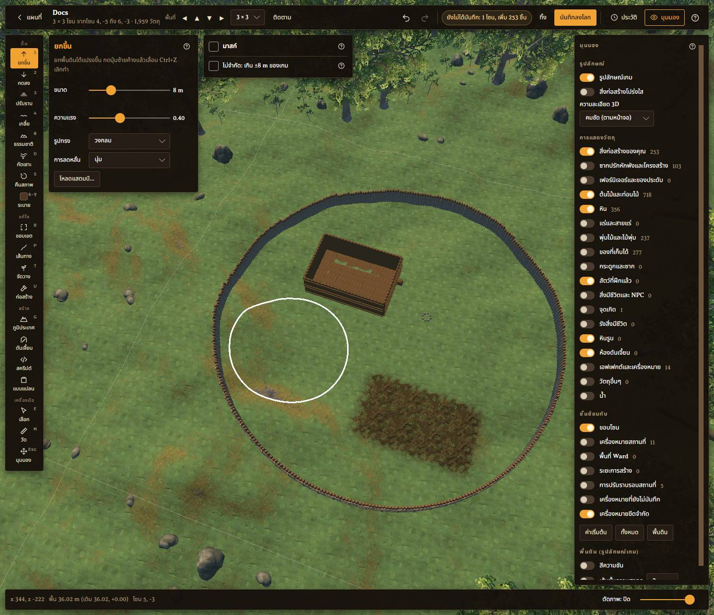
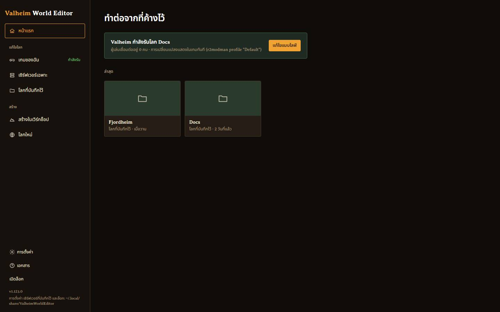
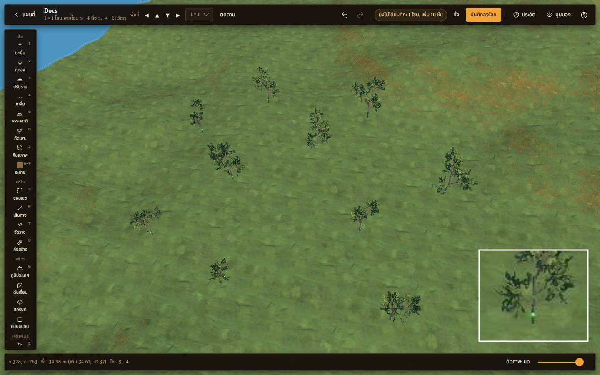
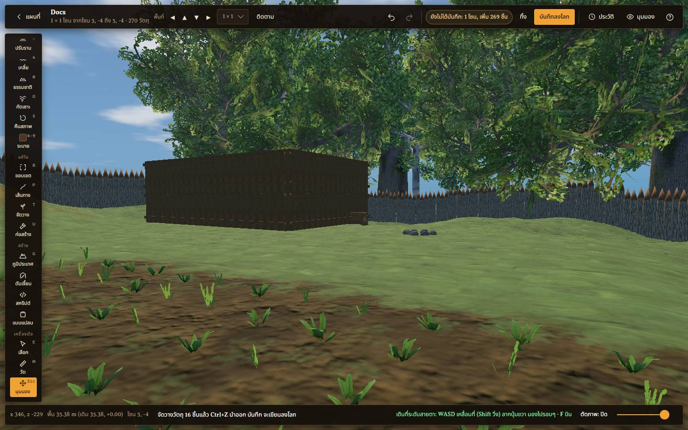
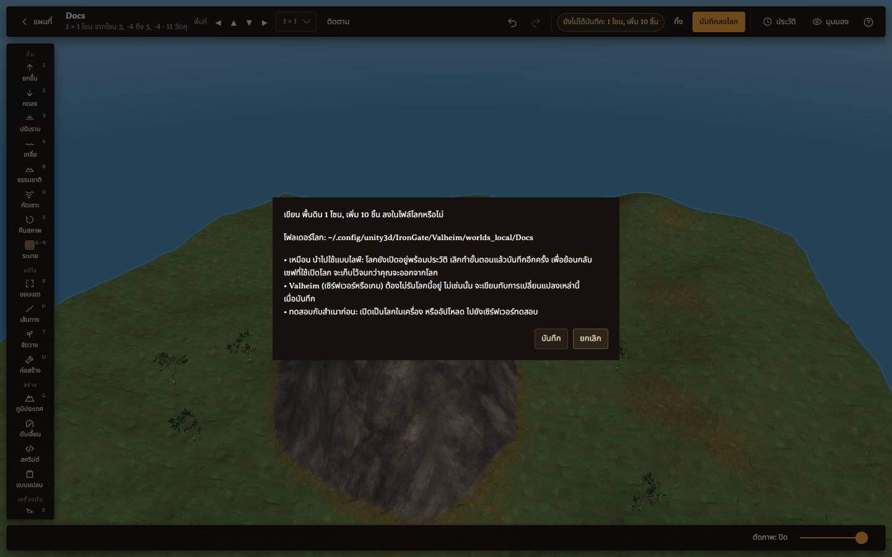
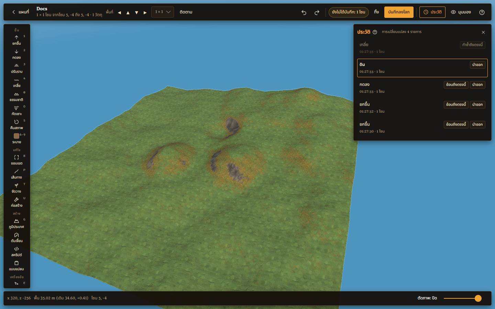
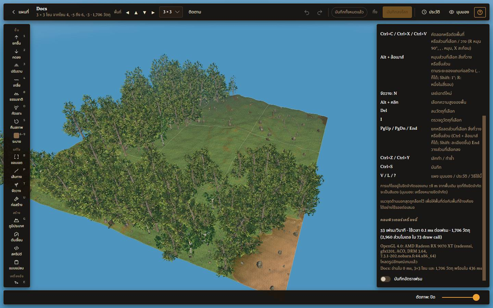
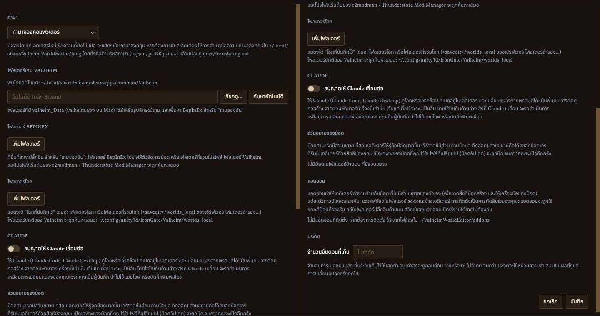

<!-- source: 1d85c1a0 -->
# หน้าต่างเอดิเตอร์

ทำความรู้จักเอดิเตอร์: หน้าเริ่มต้น หน้าต่าง 3D พร้อมแถบด้านบน แถบเครื่องมือ และแผงต่างๆ กล้อง การบันทึก ประวัติ และแผง มุมมอง

**ที่อยู่:** หน้าเริ่มต้นเปิดขึ้นก่อน โลกจะเปิดที่ [แผนที่](map.md) ของโลกนั้น แล้วกด **แก้ไขใน 3D** · **ปุ่ม:** `?` หรือ `F3` สำหรับการ์ดวิธีใช้ `F1` สำหรับวิธีใช้นี้ ตรงหน้าของเครื่องมือที่ใช้อยู่ · **ใช้ได้กับ:** โลกที่บันทึกไว้ ไลฟ์ เวิร์กช็อป

*ฐานเล็กๆ ในพื้นที่ 3 × 3 เลือกแปรง ยกขึ้น ไว้ (วงของแปรงอยู่บนหญ้า) ซ้าย: แถบเครื่องมือ และแผงของเครื่องมือ บน: แถบด้านบน ขวา: แผง มุมมอง ล่าง: แถบสถานะ ที่อ่านค่าพื้นดิน ใต้ตัวชี้*

## ใช้งาน

1. ที่หน้าเริ่มต้น เลือกวิธีแก้ไข: **เกมของฉัน** **เซิร์ฟเวอร์เฉพาะ** หรือ **โลกที่บันทึกไว้** (หรือ **สร้างในเวิร์กช็อป** เพื่อก่อสร้างโดยไม่ใช้โลก)
2. คลิกโลกของคุณ โลกจะเปิดที่ [แผนที่](map.md) ของโลกนั้น
3. บนแผนที่ คลิกตำแหน่งที่จะแก้ไข เลือกขนาดพื้นที่ แล้วกด **แก้ไขใน 3D**
4. เลือกเครื่องมือบนแถบ ตั้งค่าในแผงของเครื่องมือ แล้วใช้ในมุมมอง
5. ตรวจดูสิ่งที่รออยู่ ในบรรทัดรอดำเนินการ ของแถบด้านบน แล้วกด **บันทึกลงโลก** (หรือ **นำไปใช้แบบไลฟ์**)
6. หากต้องการย้อนการเปลี่ยนแปลง กด `Ctrl+Z` หรือเปิด **ประวัติ** (`L`)

ทุกการเปลี่ยนแปลง จะอยู่ในสถานะ [รอดำเนินการ](concepts/saving-and-history.md#การเปลยนแปลงทรอดำเนนการ) จนกว่าคุณจะบันทึก หรือนำไปใช้

## หน้าเริ่มต้น

*หน้าแรก: การ์ดของเกมที่กำลังรัน พร้อม **แก้ไขแบบไลฟ์** ตามด้วยโลก และพิมพ์เขียวที่เปิดล่าสุด*

เมนูด้านข้างมี **หน้าแรก** ตามด้วยสองส่วน คือ **แก้ไขโลก** และ **สร้าง** คุณกลับมาที่นี่ได้ จากแผนที่ของโลก (**รายการโลก**) หรือจากเวิร์กช็อป (**เริ่ม**)

| รายการ | สิ่งที่แสดง |
|---|---|
| **หน้าแรก** | จุดที่คุณทำค้างไว้ เมื่อ Valheim รันอยู่พร้อมปลั๊กอิน WorldEditorBridge การ์ดจะบอกว่า "Valheim กำลังรันโลก …" และมีผู้เล่นเชื่อมต่ออยู่กี่คน พร้อม **แก้ไขแบบไลฟ์** ใต้ **ล่าสุด**: โลกที่บันทึกไว้ และพิมพ์เขียว ที่คุณเปิดหรือบันทึกล่าสุด (พิมพ์เขียวแสดงพร้อมรูปภาพ) เรียงจากใหม่สุด และเซิร์ฟเวอร์ที่บันทึกไว้ ซึ่งเชื่อมต่อได้ในคลิกเดียว (มีรหัสผ่านที่จำไว้ หรือไฟล์คีย์) |
| **เกมของฉัน** | เกมของคุณเอง แบบไลฟ์: สิ่งที่ยังขาด (BepInEx ปลั๊กอิน การเปิดเกมครั้งแรก) หรือโลกที่เกมกำลังรัน พร้อม **แก้ไขแบบไลฟ์** *กำลังรัน* จะแสดงข้างๆ ขณะเกมรันอยู่ เอดิเตอร์ตรวจทุกๆ ไม่กี่วินาที ดู [โหมดไลฟ์](live-mode.md) |
| **เซิร์ฟเวอร์เฉพาะ** | เซิร์ฟเวอร์ที่บันทึกไว้ (**เชื่อมต่อ** **แก้** **เลิกจำ**) และฟอร์ม สำหรับเชื่อมต่อเซิร์ฟเวอร์อื่น ดู [โหมดไลฟ์](live-mode.md) |
| **โลกที่บันทึกไว้** | โลกบนคอมพิวเตอร์เครื่องนี้ สำหรับเปิดขณะปิดเกมอยู่ รายการจะตามโฟลเดอร์โลก ที่เพิ่มหรือนำออก ทุกๆ ไม่กี่วินาที **รีเฟรช** จะตรวจทันที วางเมาส์บนโลก เพื่อดูโฟลเดอร์ของโลกนั้น **โฟลเดอร์โลกอื่น** เปิดโฟลเดอร์ใดก็ได้ ที่มีไฟล์ `_main.<n>.chunks` ดู [เปิดโลกที่ไม่อยู่ในรายการ](guides/open-a-world.md) |
| **สร้างในเวิร์กช็อป** | **เปิดเวิร์กช็อป** สถานะว่าติดตั้ง Homestead แล้วหรือไม่ และพิมพ์เขียวทุกอัน เรียงจากใหม่สุด: คลิกอันใดอันหนึ่ง เพื่อเปิด ดู [เวิร์กช็อป](workshop.md) |
| **โลกใหม่** | **สร้างโลกใหม่**: โลกของซีดหนึ่ง ก่อนที่จะมีอยู่จริง และการค้นหาโลก ที่เหมาะกับคุณ ดู [โลกใหม่](new-world.md) |

ด้านล่างของเมนู: **การตั้งค่า** (ดู [การตั้งค่า](#การตงคา)) **เอกสาร** (วิธีใช้นี้ ในหน้าต่างของตัวเอง) **เปิดล็อก** เวอร์ชัน และโฟลเดอร์ ที่เก็บการตั้งค่า และล็อกของเอดิเตอร์

## หน้าต่าง

หน้าต่าง 3D มีห้าส่วน:

- **แถบด้านบน**: ชื่อโลกและพื้นที่ ตัวควบคุมพื้นที่ เลิกทำและทำซ้ำ สิ่งที่รอดำเนินการ **ทิ้ง** **บันทึกลงโลก** หรือ **นำไปใช้แบบไลฟ์** ตามด้วย **ประวัติ** **มุมมอง** และ **?** ดู [แถบด้านบน](#แถบดานบน)
- **แถบเครื่องมือ** (ขอบซ้าย): เครื่องมือทุกอัน พร้อมปุ่มลัด ที่มุมปุ่ม ดู [แถบเครื่องมือ](#แถบเครองมอ)
- **แผงของเครื่องมือ** (ถัดจากแถบ): ชื่อเครื่องมือที่เลือก หนึ่งบรรทัดบอกวิธีใช้ และการตั้งค่า [มาสก์](masks.md) แสดงการ์ดของตัวเองข้างๆ สำหรับเครื่องมือที่ใช้ร่วมกันได้ (แปรงต่างๆ เส้นทาง ขอบเขต ภูมิประเทศ และจัดวาง) การ์ดเดียวกันนี้มี **ไม่จำกัด** ซึ่งเป็นสวิตช์ร่วมอีกตัว ของเครื่องมือพื้นดิน (ดู [ไม่จำกัด](terrain.md#ไมจำกด))
- **แผงด้านขวา**: **มุมมอง** (`V`) **ประวัติ** (`L`) การ์ดวิธีใช้ **การควบคุม** (`?` หรือ `F3`) หรือ [ตัวตรวจดูข้อมูล](select.md) (`I`) ทั้งหมดใช้ที่เดียวกัน จึงแสดงได้ทีละอัน กดปุ่มเดิมอีกครั้ง เพื่อปิด
- **แถบสถานะ** (ล่าง): ตำแหน่งเมาส์ ข้อความล่าสุด ส่วนที่เลือก เดินหรือบิน แถบเลื่อน **ตัดภาพ** (ดู [ตัดภาพ](#ตดภาพ)) และในหน้าต่าง ที่กว้างประมาณ 1500 px ขึ้นไป จะมีคำเตือนวิธีใช้เมาส์ ("ลากปุ่มขวา หมุน · ล้อเมาส์ ซูม · ลากปุ่มกลาง เลื่อน · ? วิธีใช้") ในหน้าต่างที่แคบกว่า ที่ตรงนั้นจะใช้แสดงข้อความแทน

ค่าที่อ่านจากเมาส์ มีลักษณะแบบ `x 1250, z -380   พื้น 32.40 m (เดิม 30.10, +2.30)   โซน 20, -6`: ตำแหน่งเป็นเมตร ความสูงพื้นดินตอนนี้ ความสูงก่อนการเปลี่ยนแปลงใดๆ และผลต่าง แล้วตามด้วยโซน เมื่อถึงขีดจำกัดของเกม จะเพิ่ม ", ถึงขีดจำกัด ±8 m" ส่วนที่เลือก จะแสดงแบบ "เลือกอยู่: วัตถุ 15 ชิ้น (Beech ×12, Rock ×3)" พร้อมชนิดที่พบบ่อยที่สุด สี่ชนิด

แถบเลื่อน สวิตช์ และปุ่มทุกตัว จะอธิบายตัวเอง เมื่อวางเมาส์ไว้ เอดิเตอร์จำตัวเลือกของคุณไว้ ระหว่างการเปิดแต่ละครั้ง: สิ่งที่ มุมมอง แสดง ตัวเลือกรูปลักษณ์ รูปทรงและการลดหลั่นของแปรง การกระทำของ ขอบเขต ชนิดของ ภูมิประเทศ พรีเซ็ตของ สูตร และสูตรของคุณเอง ตัวเลือกของ เลือก หมวดของ จัดวาง ที่เปิดไว้ การตั้งค่าของแถบก่อสร้าง และขนาดของแผง ก่อสร้าง แผงด้านขวา ที่คุณเปิดค้างไว้ **ติดตาม** **อัตโนมัติ** ตำแหน่งบนแผนที่ และคลิปบอร์ด ส่วน **ไม่จำกัด** ไม่ถูกจำ: จะปิดทุกครั้งที่เอดิเตอร์เริ่มทำงาน

## แถบด้านบน

| ตัวควบคุม | สิ่งที่ทำ |
|---|---|
| **แผนที่** | กลับไปที่แผนที่โลก สิ่งที่ยังไม่ได้บันทึก หรือนำไปใช้ ยังคงรอดำเนินการ ในเวิร์กช็อป ปุ่มนี้คือ **เริ่ม** |
| ชื่อและพื้นที่ | ชื่อโลก ใต้ชื่อเป็นขนาดพื้นที่ โซนแรกและโซนสุดท้าย และจำนวนวัตถุในพื้นที่ |
| **พื้นที่** ◀ ▲ ▼ ▶ รายการขนาด **ติดตาม** | ย้ายพื้นที่ เปลี่ยนขนาด ให้พื้นที่ขยายตาม เมื่อคุณมองไปรอบๆ ดู [พื้นที่](#พนท) |
| เลิกทำ ทำซ้ำ (ลูกศรโค้ง) | เลิกทำการเปลี่ยนแปลงล่าสุด (`Ctrl+Z`) ทำซ้ำ (`Ctrl+Y` หรือ `Ctrl+Shift+Z`) ข้อความเมื่อวางเมาส์ จะบอกชื่อขั้นตอน เช่น "เลิกทำ ยกขึ้น (Ctrl+Z)" ขั้นตอนจากเซสชันก่อน อาจถามก่อน |
| **ไลฟ์** (ไลฟ์) | แสดงว่าคุณเชื่อมต่อ กับเกมที่กำลังรัน ผ่านปลั๊กอิน WorldEditorBridge |
| รายชื่อผู้เล่น **ไป** (ไลฟ์) | ข้าง **ไลฟ์** ขณะมีผู้เล่นเชื่อมต่อ: เลือกผู้เล่นที่เชื่อมต่ออยู่ แล้วกด **ไป** กล้องจะหันไปหาผู้เล่น เมื่อผู้เล่นอยู่ในพื้นที่ ไม่เช่นนั้น พื้นที่จะย้ายไปหาผู้เล่น ผู้เล่นแสดงในมุมมอง เป็นเสาสีน้ำเงิน พร้อมชื่อ |
| **โหลดใหม่** (ไลฟ์) | โหลดโลกจากเกมอีกครั้ง โดยถามก่อน เมื่อมีการเปลี่ยนแปลง ที่ยังไม่ได้นำไปใช้ (การเปลี่ยนแปลงเหล่านั้น จะหายไปพร้อมขั้นตอน) ขั้นตอนที่เกมมีอยู่ ยังอยู่ใน ประวัติ คุณยังอยู่ที่เดิม |
| **อัตโนมัติ** (ไลฟ์) | นำทุกการเปลี่ยนแปลงไปใช้ในเกม ทันทีที่ทำเสร็จ: ทุกครั้งที่ปล่อยแปรง ทุกเครื่องมือ การเลิกทำและทำซ้ำ การเปิดสวิตช์นี้ จะส่งสิ่งที่รออยู่ทันที ระบบจำค่านี้ไว้ |
| บรรทัดรอดำเนินการ | "ยังไม่ได้บันทึก: 3 โซน, ลบ 1 ชิ้น, เพิ่ม 12 ชิ้น, รีเซ็ต 1" (ออฟไลน์) หรือ "ยังไม่ได้นำไปใช้: …" (ไลฟ์) เป็นสีเหลืองอำพัน "บันทึกทั้งหมดแล้ว" หรือ "นำไปใช้ทั้งหมดแล้ว" เป็นสีเทา เมื่อไม่มีอะไรรอ สิ่งที่นับ: ดู [การเปลี่ยนแปลงที่รอดำเนินการ](concepts/saving-and-history.md#การเปลยนแปลงทรอดำเนนการ) |
| **ทิ้ง** | ทิ้งสิ่งที่ยังไม่ได้บันทึก หรือนำไปใช้ หลังจากถาม ดู [ทิ้ง](#ทง) |
| **บันทึกลงโลก** (ออฟไลน์) | เขียนการเปลี่ยนแปลง ลงในไฟล์ของโลก (`Ctrl+S`) ดู [บันทึกลงโลก](#บนทกลงโลก) |
| **นำไปใช้แบบไลฟ์** (ไลฟ์) | ส่งการเปลี่ยนแปลง ไปยังเกมที่กำลังรัน (`Ctrl+S`): ทุกคนในเกม เห็นทันที ดู [นำไปใช้แบบไลฟ์](#นำไปใชแบบไลฟ) |
| **ประวัติ** | ทุกการเปลี่ยนแปลงของเซสชัน (`L`) ดู [ประวัติ](#ประวต) |
| **มุมมอง** | สิ่งที่แสดง และวิธีแสดง (`V`) ดู [แผงมุมมอง](#แผงมมมอง) |
| **?** | การ์ดวิธีใช้ **การควบคุม** (`?` หรือ `F3`) ดู [การ์ดวิธีใช้](#การดวธใช) แต่ละแผง มี **?** เล็กๆ ของตัวเองที่ด้านบน: หน้าต่างวิธีใช้ ที่หน้าของเครื่องมือนั้น (`F1` ทำแบบเดียวกัน สำหรับเครื่องมือที่ใช้อยู่) |

ในหน้าต่างที่แคบ บรรทัดชื่อและพื้นที่ จะจบด้วย "…" (วางเมาส์ไว้ เพื่ออ่านทั้งหมด) และเมื่อยังไม่พอ **แผนที่** **โหลดใหม่** **ประวัติ** และ **มุมมอง** จะแสดงแค่ไอคอน

ในมุมมอง วัตถุใหม่ทุกชิ้น ที่ยังไม่ได้บันทึก หรือนำไปใช้ จะมี **จุดสีเขียว** ยกเว้นขณะที่ถูกเลือก (ตอนนั้นเส้นขอบจะบอกแทน) **มุมมอง → เครื่องหมายที่ยังไม่บันทึก** ซ่อนจุด แต่วัตถุยังอยู่

*ต้นไม้อ่อนที่เพิ่งปลูก: แต่ละต้นมีจุดสีเขียวเล็กๆ ที่โคน จนกว่าจะบันทึก (หนึ่งต้นขยายไว้ที่มุม) และบรรทัดรอดำเนินการ นับต้นไม้เหล่านั้น: "ยังไม่ได้บันทึก: 1 โซน, เพิ่ม 10 ชิ้น"*

## แถบเครื่องมือ

| ส่วน | ปุ่มบนแถบ (ปุ่มลัด) | สิ่งที่เปิด |
|---|---|---|
| **ปั้น** | **ยกขึ้น** (`1`) **กดลง** (`2`) **ปรับราบ** (`3`) **เกลี่ย** (`4`) **ธรรมชาติ** (`0`) **กัดเซาะ** (`O`) **คืนสภาพ** (`5`) **ระบาย** (`6` ถึง `9`) | แปรงพื้นดิน **ระบาย** เป็นแปรงเดียว สำหรับการระบายทั้งสี่แบบ เลือกในแผง หรือด้วยปุ่มลัด: ดิน (`6`) พรวนดิน (`7`) ปูหิน (`8`) ล้างการระบาย (`9`) ดู [ปั้นและระบาย](terrain.md) |
| **แก้ไข** | **ขอบเขต** (`B`) **เส้นทาง** (`P`) **จัดวาง** (`T`) **ก่อสร้าง** (`U`) | [ขอบเขต](area.md) (การกระทำในกล่อง หรือรูปหลายเหลี่ยม คัดลอกและวาง) [เส้นทาง](path.md) (ถนน ทางลาด แม่น้ำ) [จัดวาง](place.md) (ต้นไม้ หิน พืชผล จุดเกิด) [ก่อสร้าง](build.md) (ชิ้นส่วนที่ผู้เล่นสร้าง พร้อมแผง ก่อสร้าง และแถบก่อสร้าง) |
| **สร้าง** | **ภูมิประเทศ** (`G`) **ดันเจี้ยน** **สคริปต์** **แบบแปลน** | [ภูมิประเทศ](landform.md) (ภูมิประเทศทั้งก้อน ในคลิกเดียว: รูปทรงจากสูตร ภูเขา หรือรูปภาพ) [ดันเจี้ยน](dungeons.md) [สคริปต์](scripting.md) และคลังพิมพ์เขียว สำหรับวาง (ดู [เวิร์กช็อป](workshop.md)) มีแค่ ภูมิประเทศ ที่มีปุ่มลัด |
| **เครื่องมือ** | **เลือก** (`E`) **วัด** (`M`) **มุมมอง** (`Esc` หรือ `H`) | [เลือก](select.md) [วัด](measure.md) และ มุมมอง: มองไปรอบๆ ลากปุ่มซ้าย เพื่อเลื่อนมุมมอง คลิกเพื่อเลือกวัตถุ ดับเบิลคลิกที่วัตถุ เพื่อสลับไปที่ เลือก โดยเลือกวัตถุนั้นไว้ |
| **ม็อด** | ปุ่มละหนึ่งเครื่องมือ ที่ [ส่วนขยาย](modding.md) ของม็อดนำมา: ชื่อ รูปภาพ หรืออักษรตัวแรก วางเมาส์ไว้ จะบอกชื่อม็อด | เครื่องมือของม็อด: การ์ดการตั้งค่าถัดจากแถบ วิธีใช้อยู่ในคำแนะนำเครื่องมือ การเปลี่ยนแปลงของเครื่องมือนี้ เข้าไปอยู่ใน ประวัติ และเลิกทำ ทำซ้ำ บันทึก ได้เหมือนของเอดิเตอร์เอง แสดงเฉพาะเมื่อ ส่วนขยายที่รันอยู่มีเครื่องมือ |

แถบจะเลื่อนได้ เมื่อหน้าต่างเตี้ยเกินไป (และจบเหนือแผง ก่อสร้าง ขณะที่เปิดอยู่) ในเวิร์กช็อป แถบเหลือแค่ **ก่อสร้าง** (`U` หรือ `T`) **เลือก** และ **มุมมอง**

## กล้อง

| การกระทำ | วิธี |
|---|---|
| หมุนมุมมอง | ลากปุ่มขวา |
| ซูม | ล้อเมาส์ ตั้งแต่ 3 m ถึง 3 km จากจุดที่คุณมอง |
| เลื่อนมุมมอง | ลากปุ่มกลาง `Space` + ลากปุ่มซ้าย หรือ `Shift` + ลากปุ่มขวา (ในเครื่องมือใดก็ได้) หรือลากปุ่มซ้าย ด้วยเครื่องมือ **มุมมอง** |
| เคลื่อนที่ไปรอบๆ | `W` `A` `S` `D` หรือปุ่มลูกศร ยิ่งซูมออกไกล ยิ่งเร็ว จุดที่คุณมอง อยู่บนพื้นดิน (หรือผิวน้ำ) เสมอ |
| ดูแบบผู้เล่น | `F`: เดิน แล้วบิน แล้วกลับสู่มุมมองปกติ |

### เดินและบิน

*โหมดเดิน (`F`): ฐานแบบที่ผู้เล่น ซึ่งยืนข้างแปลงเห็น สายตาสูงจากพื้น 1.8 m*

`F` วนผ่านสามมุมมอง:

1. **เดิน**: สายตาของคุณ สูงจากพื้น 1.8 m (หรือสูงจากผิวน้ำ ในที่ที่น้ำลึกกว่า) คุณเริ่มตรงที่มุมมองปกติ มองอยู่ `W` `A` `S` `D` เคลื่อนที่ไปทางที่มอง ด้วยความเร็ว 6 m/s `Shift` วิ่งที่ 12 m/s ลากปุ่มขวา เพื่อมองไปรอบๆ คุณจะเดินตามพื้น ที่สูงขึ้นและต่ำลง รวมถึงพื้นที่แก้ไขแล้ว
2. **บิน**: กด `F` อีกครั้ง `Space` ขึ้น `C` ลง ที่ 15 m/s (`Shift`: 45 m/s) `C` ยังพาคุณทะลุพื้นดิน เข้าไปในสิ่งที่ม็อดขุดไว้ข้างใต้ (อุโมงค์และห้องใต้ดินของ Tunnelheim) `Space` พาคุณกลับขึ้นมา
3. **มุมมองปกติ**: กด `F` ครั้งที่สาม มุมมองจะหมุนรอบจุดบนพื้น ห่างไปข้างหน้า 20 m จากที่คุณอยู่

แถบสถานะบอกว่า เปิดโหมดไหนอยู่ และปุ่มของโหมดนั้น ขณะเดินหรือบิน ล้อเมาส์ไม่ซูม และการลากไม่เลื่อนมุมมอง เครื่องมือทุกอันยังใช้ได้ ในดันเจี้ยน (สูง 5000 m ที่ซึ่งเกมเก็บห้องดันเจี้ยน) กล้องไม่เดินตามพื้น

## พื้นที่

หน้าต่าง 3D แสดง **พื้นที่** หนึ่งพื้นที่: กลุ่มของโซน (โซนหนึ่งคือ 64 × 64 m) รอบจุดที่คุณเปิดจากแผนที่ แนวจุดพื้นดินด้านนอกสุด ถูกล็อกไว้ ดังนั้นถ้าจะทำงานใกล้ขอบ ให้ย้ายพื้นที่ หรือขยายให้ใหญ่ขึ้น เหตุผลที่เอดิเตอร์ทำงานแบบนี้: ดู [พื้นที่และโซน](concepts/areas-and-zones.md)

| ตัวควบคุม | สิ่งที่ทำ |
|---|---|
| **◀ ▲ ▼ ▶** (หลัง "พื้นที่") | ย้ายพื้นที่หนึ่งโซน (64 m) ไปทางตะวันตก เหนือ ใต้ หรือตะวันออก กล้องอยู่ที่เดิมในโลก และการเปลี่ยนแปลง ที่รอดำเนินการ กับ ประวัติ ตามมาด้วย |
| รายการขนาด | เปิดพื้นที่ใหม่ รอบโซนกลางเดิม ที่ขนาด **3 × 3** **5 × 5** **7 × 7** **9 × 9** **13 × 13** หรือ **17 × 17** โซน มุมมอง การเปลี่ยนแปลง และ ประวัติ ยังอยู่ พื้นที่ที่ ติดตาม ขยายไว้ (เช่น 4 × 3) แสดงขนาดของตัวเอง พื้นที่ใหญ่ (กว้างถึง 1088 m) เปิดและวาดได้ช้า |
| **ติดตาม** | เมื่อจุดที่คุณมอง เข้ามาใกล้ขอบพื้นที่ภายใน 12 m พื้นที่จะขยายเพิ่มหนึ่งแถวโซน ทางด้านนั้น และเก็บโซนที่มีอยู่ไว้ ได้ถึง 17 โซนในแต่ละทิศ คลิกเพื่อเปิดหรือปิด ระบบจำค่านี้ไว้ ดู [ติดตาม](concepts/areas-and-zones.md#ตดตาม) |

ลูกศร ติดตาม และรายการขนาด จะรอ ขณะที่มีบางอย่างจะสูญหาย และแถบสถานะบอกเหตุผล: มีวัตถุถูกเลือกอยู่ (`Alt+A` ใน เลือก จะล้างการเลือก) กำลังลากแปรงอยู่ มีเส้นทางวาดไว้ (นำไปใช้ หรือล้างเส้นทางนั้น) หรือยังส่งการเปลี่ยนแปลง ไปยังเกมอยู่ ตัวควบคุมเหล่านี้ไม่รอ กล่องหรือรูปหลายเหลี่ยมของ ขอบเขต เส้น กริด หรือโซนของ จัดวาง หรือการวัด: สิ่งเหล่านั้นจะหายไป เมื่อพื้นที่ย้าย ขยาย หรือเปลี่ยนขนาด ในเวิร์กช็อปไม่มีตัวควบคุมพื้นที่

## บันทึก นำไปใช้ และทิ้ง

### บันทึกลงโลก

**บันทึกลงโลก** (`Ctrl+S`) จะถามก่อนใน **บันทึกลงในโลก** โดยแสดงสิ่งที่จะเขียน และโฟลเดอร์ของโลก ปิด Valheim (เกมหรือเซิร์ฟเวอร์) ก่อนบันทึก: เกมที่กำลังรัน จะเขียนทับการเปลี่ยนแปลงของคุณ ในครั้งถัดไปที่บันทึก

*ไม่มีอะไรถูกเขียน จนกว่าคุณจะคลิก **บันทึก**: คำถามนับสิ่งที่จะเขียนลงไป บอก **โฟลเดอร์โลก** และเตือนให้ปิด Valheim ก่อน*

ผลลัพธ์บอกสิ่งที่บันทึกแล้ว ("บันทึก 4 โซน, ลบวัตถุ 2 ชิ้น, วัตถุใหม่ 12 ชิ้น ลงเซฟที่ #37 แล้ว") และบอกรายการ ที่บันทึกไม่ได้ พร้อมเหตุผล:

- โซน หรือวัตถุใหม่ในโซน ที่ **not generated yet** (ยังไม่ถูกสร้าง): ยังไม่มีผู้เล่นคนใดไปที่นั่น โลกจึงไม่มีข้อมูลตรงนั้น ไปที่นั่นในเกมก่อน
- พื้นดินใหม่ ในโลกที่ **ยังไม่มีวัตถุพื้นดินให้คัดลอก**: ไม่เคยมีใครขุด หรือปรับระดับพื้นในเกมเลย แก้พื้นดินในเกมสักครั้ง ที่ไหนก็ได้ก่อน

หลังบันทึก พื้นที่และ ประวัติ ยังคงเหมือนเดิม ถ้าจะย้อนการเปลี่ยนแปลง ที่บันทึกแล้ว ให้เลิกทำ (หรือ **นำออก** ใน ประวัติ) แล้วบันทึกอีกครั้ง: การบันทึก จะเอาการเปลี่ยนแปลงนั้น ออกจากโลก เมื่อไม่เหลือสิ่งที่คุณบันทึกไว้แล้ว ข้อความจะบอกว่า โลกกลับเป็นแบบตอนที่คุณเปิด วิธีเขียนและตรวจการบันทึก: ดู [การบันทึกโลก](concepts/saving-and-history.md#การบนทกโลก)

**เมื่อเกมบันทึกไปแล้วในระหว่างนั้น** ถ้าเกมบันทึกโลก หลังจากเอดิเตอร์อ่านโลกนั้น จะไม่มีอะไรถูกบันทึก: การบันทึก จะทิ้งสิ่งที่ทำไปในเกม คำถาม **เกมบันทึกโลกนี้แล้ว** มีตัวเลือก **นำการเปลี่ยนแปลงของฉันไปใส่**: เอดิเตอร์จะอ่านเซฟของเกม แล้วทำการเปลี่ยนแปลง ที่ยังไม่ได้บันทึกของคุณ ซ้ำลงไปทีละรายการ ตรงที่เกมเปลี่ยนโซน หรือวัตถุเดียวกัน เอดิเตอร์จะถามครั้งเดียวต่อชนิด **ใช้ของฉัน** หรือ **ใช้ของเกม** ไม่มีอะไรถูกเขียน จนกว่าคุณจะบันทึกอีกครั้ง **ไม่ใช่ตอนนี้** ปล่อยทุกอย่างไว้ตามเดิม ดู [การบันทึกโลก](concepts/saving-and-history.md#การบนทกโลก)

### นำไปใช้แบบไลฟ์

ในโหมดไลฟ์ ปุ่มเดียวกันนี้คือ **นำไปใช้แบบไลฟ์** ปุ่มนี้ส่งพื้นดิน การเปลี่ยนแปลงวัตถุ และการรีเซ็ตโซน ไปยังเกมที่กำลังรัน และขั้นตอนที่ส่งแล้ว จะติดป้าย **นำไปใช้แล้ว** ใน ประวัติ ขั้นตอนเหล่านั้น ยังเลิกทำได้: การนำไปใช้ครั้งถัดไป จะส่งการเลิกทำไปด้วย เมื่อผู้เล่นเปลี่ยนพื้นดิน ของโซนที่คุณเปลี่ยนด้วย เอดิเตอร์จะถามก่อน (**นำไปใช้** หรือ **ไม่ใช่ตอนนี้**) ดู [การนำไปใช้แบบไลฟ์](concepts/saving-and-history.md#การนำไปใชแบบไลฟ) และ [โหมดไลฟ์](live-mode.md)

### ทิ้ง

**ทิ้ง** เลิกทำทุกอย่าง ที่ยังไม่ได้บันทึก หรือนำไปใช้ หลังจากถาม ("N ขั้นตอนล่าสุดใน ประวัติ จะถูกเลิกทำ") ปุ่มนี้เลิกทำขั้นตอน ที่ยังไม่บันทึก ท้าย ประวัติ จากใหม่สุด ทำซ้ำขั้นตอนที่บันทึก หรือนำไปใช้แล้ว ที่คุณเลิกทำไปในระหว่างนั้น และทิ้งรายการทำซ้ำที่เหลือ การเปลี่ยนแปลงที่บันทึก หรือนำไปใช้แล้ว ยังอยู่ เช่นเดียวกับ ประวัติ ส่วนที่เหลือ กล้อง และเครื่องมือ

การเปลี่ยนแปลง ที่รอดำเนินการบางรายการ อาจไม่มีขั้นตอนใน ประวัติ ของพื้นที่นี้ (ทำในพื้นที่อื่น หรือทำก่อนที่โลก จะถูกอ่านใหม่) ทิ้ง จะถามอีกครั้ง: **อ่านใหม่** อ่านโลกจากไฟล์ (หรือจากเกม ในโหมดไลฟ์) และทิ้งการเปลี่ยนแปลง ที่รอดำเนินการทั้งหมด ของทั้งโลก ประวัติ เก็บสิ่งที่โลกมีไว้: ประวัติที่เก็บไว้ ตอนบันทึกครั้งล่าสุด หรือในโหมดไลฟ์ คือทุกขั้นตอนที่เกมมี

### การออกและการปิด

**แผนที่** ลูกศร และรายการขนาด เก็บทุกอย่างที่รอดำเนินการไว้ การออกจากโลก ไปที่หน้าเริ่มต้น (**รายการโลก** บนแผนที่) และการปิดหน้าต่าง จะทำให้สิ่งที่รอดำเนินการหายไป จึงถามก่อนทั้งสองกรณี: **ออกเลย** / **อยู่ต่อ** และ **ออกจากโปรแกรมเลย** / **แก้ไขต่อ**

## ประวัติ

*การเปลี่ยนแปลงล่าสุด ถูกเลิกทำด้วย **ย้อนถึงตรงนี้**: รายการเป็นสีเทา และมีปุ่ม **ทำซ้ำถึงตรงนี้***

**ประวัติ** (`L`) แสดงทุกการเปลี่ยนแปลง ของเซสชัน เรียงจากใหม่สุด แต่ละแถวแสดงชื่อขั้นตอน (เครื่องมือ หรือการกระทำ เช่น "ยกขึ้น" "วาง ×3" "เอาออก: ยกขึ้น") เวลา (พร้อมวันที่ สำหรับรายการที่เก่ากว่า) และสิ่งที่ขั้นตอนนั้นแตะ เช่น "3 โซน · ใหม่ 12 · เอาออก 2 · รีเซ็ตโซน 1 รายการ" ขั้นตอนปัจจุบัน ซึ่ง `Ctrl+Z` จะเลิกทำเป็นลำดับถัดไป มีเส้นกรอบ หัวแผงนับขั้นตอน ที่คุณเลิกทำได้ แผงแสดง 200 แถวล่าสุด **แสดงที่เก่ากว่า (N)** ที่ด้านล่าง เพิ่มอีก 200 แถว

| ตัวควบคุม | สิ่งที่ทำ |
|---|---|
| **ย้อนถึงตรงนี้** | เลิกทำทุกการเปลี่ยนแปลง ที่ทำหลังจากอันนี้ การเปลี่ยนแปลงที่ตามมา ยังอยู่ในรายการ เป็นสีเทา |
| **ทำซ้ำถึงตรงนี้** | บนการเปลี่ยนแปลงสีเทา: ทำซ้ำทุกการเปลี่ยนแปลง จนถึงและรวมอันนี้ |
| **นำออก** | เอาออกเฉพาะการเปลี่ยนแปลงนี้ และเก็บทุกอย่างที่ทำหลังจากนั้นไว้ การนำออกเป็นขั้นตอนใหม่ ("เอาออก: …") ดังนั้น `Ctrl+Z` จะนำการเปลี่ยนแปลงกลับมา การเปลี่ยนแปลงที่นำออก จะมีเส้นขีดทับ |
| **ย้อนการเปลี่ยนแปลงของ Claude** | แสดงเมื่อ Claude ทำการเปลี่ยนแปลง ในประวัติของพื้นที่นี้ นำการเปลี่ยนแปลงเหล่านั้นออก ทีละรายการ แบบที่ **นำออก** ทำ และเก็บของคุณไว้ แม้แต่ที่ทำหลังจากนั้น การเปลี่ยนแปลงของ Claude ในพื้นที่อื่น ยังอยู่ และแถบสถานะบอกจำนวน: เปิดพื้นที่เหล่านั้น เพื่อย้อนที่นั่น |

ป้ายบนแถว: **นำไปใช้แล้ว** (ส่งไปยังเกม หรือบันทึกแล้ว) **Claude** (ทำผ่าน [การเชื่อมต่อ Claude](claude.md)) **เซสชันก่อน** (เก็บไว้ จากการเปิดเอดิเตอร์ครั้งก่อน) การเปลี่ยนแปลงใหม่ ที่ทำหลังเลิกทำ จะทิ้งขั้นตอนสีเทา ประวัติถูกเขียนลงดิสก์เมื่อใด ย้อนไปได้ไกลแค่ไหน และขั้นตอนที่ทำในพื้นที่อื่น จะเป็นอย่างไร: ดู [ประวัติ](concepts/saving-and-history.md#ประวต)

## แผงมุมมอง

**มุมมอง** (`V`) เลือกสิ่งที่วาด และวิธีวาด สวิตช์แต่ละตัว แสดงจำนวนที่มีในพื้นที่ เลือกหรือคลิกได้ เฉพาะสิ่งที่แสดงอยู่ ดังนั้นการซ่อนชนิดหนึ่ง ยังกันไม่ให้ถูกคลิกโดยไม่ตั้งใจด้วย

| ส่วน | ตัวควบคุม | สิ่งที่ทำ |
|---|---|---|
| รูปลักษณ์ | **รูปลักษณ์เกม** | วาดโลกด้วยพื้นผิว โมเดล น้ำ และท้องฟ้า ของเกมเอง ปิด: สีเรียบๆ และกล่อง เร็วกว่า |
| | **สิ่งก่อสร้างโปร่งใส** | วาดสิ่งก่อสร้างของผู้เล่น แบบโปร่งครึ่งหนึ่ง เพื่อดูสิ่งที่อยู่ข้างในหรือข้างหลัง ต้นไม้และหิน ยังทึบ |
| | **ความละเอียด 3D** | **คมชัด (ตามหน้าจอ)** **สมดุล** (หนึ่งพิกเซลต่อหนึ่งจุดบนหน้าจอ: น้อยลง บนหน้าจอความละเอียดสูง ที่ปรับสเกล) หรือ **เร็ว** (น้อยลงอีก) พิกเซลน้อยลง ให้เฟรมต่อวินาทีมากขึ้น บนคอมพิวเตอร์ที่ช้า แถบสถานะบอกขนาด |
| การแสดงวัตถุ | **สิ่งก่อสร้างของคุณ** **ซากปรักหักพังและโครงสร้าง** **เฟอร์นิเจอร์และของประดับ** **ต้นไม้และท่อนไม้** **หิน** **แร่และสายแร่** **พุ่มไม้และไม้พุ่ม** **ของที่เก็บได้** **กระดูกและซาก** **สัตว์ที่ฝึกแล้ว** **สิ่งมีชีวิตและ NPC** **จุดเกิด** **รังสิ่งมีชีวิต** **หินรูน** **ห้องดันเจี้ยน** **เอฟเฟกต์และเครื่องหมาย** **วัตถุอื่นๆ** | แสดงหรือซ่อนแต่ละชนิด ตอนแรกเปิดไว้แค่ **สิ่งก่อสร้างของคุณ** **ต้นไม้และท่อนไม้** **หิน** **สัตว์ที่ฝึกแล้ว** **หินรูน** และ **ห้องดันเจี้ยน** เพื่อให้เอดิเตอร์ ไม่เปิดเผยสิ่งที่ยังรอให้ค้นพบ |
| | **น้ำ** | ผิวน้ำทะเลและทะเลสาบ |
| ชั้นซ้อนทับ | **ขอบโซน** | เส้นโซน 64 m (เปิดไว้ตอนแรก) |
| | **เครื่องหมายสถานที่** | เสาบนทุกสถานที่ (หมู่บ้าน พ่อค้า ทางเข้าดันเจี้ยน…) |
| | **พื้นที่ Ward** | วงที่ Ward แต่ละอันปกป้อง (32 m) |
| | **ระยะการสร้าง** | วงที่โต๊ะช่าง เตาหลอม หรือสถานีคราฟต์อื่นๆ แต่ละอัน ให้คุณสร้างได้ (10–40 m แล้วแต่ชนิด) |
| | **การปรับราบรอบสถานที่** | ตรงที่สถานที่ ปรับพื้นให้ราบ: วงหนึ่งสำหรับส่วนที่ราบ อีกวงจางกว่า ตรงที่กลืนเข้ากับพื้นรอบๆ |
| | **เครื่องหมายที่ยังไม่บันทึก** | จุดสีเขียว เหนือวัตถุใหม่แต่ละชิ้น ที่ยังไม่ได้บันทึก หรือนำไปใช้ |
| | **เครื่องหมายขีดจำกัด** | สีแดงบนพื้นดิน ที่ถึงขีดจำกัด ±8 m ของเกม (ใน รูปลักษณ์เกม) ดู [เครื่องหมายขีดจำกัด](concepts/ground-limits.md#เครองหมายขดจำกด) |
| | **ค่าเริ่มต้น** / **ทั้งหมด** / **พื้นดิน** | สวิตช์ตามปกติ / เปิดทุกอย่าง / เฉพาะพื้นดิน ปุ่มเหล่านี้ตั้งค่าวัตถุ น้ำ และชั้นซ้อนทับ ไม่รวมรูปลักษณ์ |
| พื้นดิน (รูปลักษณ์เกม) | **สีความชัน** **เส้นชั้นความสูงทุก** 1 / 2 / 5 / 10 **m** | ชั้นซ้อนทับบนพื้นดิน ดู [วัด](measure.md) |

มีสองอย่างเกี่ยวกับมุมมอง ที่ไม่อยู่ในแผงนี้ เพราะต้องใช้ ในตอนที่แผงไม่ได้เปิดอยู่: แถบเลื่อน **ตัดภาพ** อยู่ในแถบสถานะ (ดู [ตัดภาพ](#ตดภาพ)) และการไปหาผู้เล่นที่เชื่อมต่ออยู่ อยู่ในแถบด้านบน ข้าง **ไลฟ์**

สิ่งที่แต่ละชนิดรวมไว้:

- **ซากปรักหักพังและโครงสร้าง** ยังแสดงส่วนของสถานที่ของเกม ที่ไม่ใช่วัตถุในเซฟด้วย (หินของทางเข้าสุสาน ค่ายของพ่อค้า แท่นบูชาของบอส) เกมสร้างส่วนเหล่านี้ใหม่ ทุกครั้งที่โหลดโซน จึงเลือกหรือเปลี่ยนไม่ได้
- ซากปรักหักพัง ที่คุณสร้างต่อเติม นับเป็นสิ่งก่อสร้างของคุณ: ชิ้นส่วนที่แตะชิ้นส่วนของคุณ และชิ้นส่วนที่แตะชิ้นเหล่านั้น อยู่ใต้ **สิ่งก่อสร้างของคุณ**
- **สัตว์ที่ฝึกแล้ว** คือสิ่งมีชีวิต ที่ผู้เล่นฝึกไว้ สัตว์ป่าอยู่ใต้ **สิ่งมีชีวิตและ NPC**
- **จุดเกิด** คือจุดเกิดที่มองไม่เห็นของเกม แสดงด้วยเครื่องหมาย และชื่อสิ่งมีชีวิต **รังสิ่งมีชีวิต** คือรังของ Greydwarf กองกระดูก และอะไรทำนองนั้น
- **ห้องดันเจี้ยน** อยู่สูงเหนือทางเข้า (สูง 5000 m) แก้ไขด้วยเครื่องมือ [ดันเจี้ยน](dungeons.md)
- สิ่งที่ขาตั้งไอเทม และขาตั้งชุดเกราะถืออยู่ จะวาดไปพร้อมขาตั้ง ใน รูปลักษณ์เกม และแสดงหรือซ่อน ตามชนิดของสิ่งนั้น โล่และผ้าคลุม แสดงในแบบแรก ขาตั้งชุดเกราะ แสดงในท่าพัก เลือกไอเทมเหล่านั้นไม่ได้: ให้เลือกขาตั้ง
- การจัดวาง หรือวางชนิดที่ปิดอยู่ จะเปิดชนิดนั้น เพื่อให้สิ่งที่คุณวาง ยังมองเห็นได้ (ข้อความจะบอก)

**สร้างโดย** คือผู้เล่นที่ถูกเขียนเป็นผู้สร้าง ของชิ้นส่วนที่คุณสร้าง วาง หรือแทนที่ อยู่บน [แถบก่อสร้าง](build.md#แถบกอสราง) พร้อม ก่อสร้าง เลือก และ วาง

เมื่อพื้นที่มีสถานที่อยู่ (หรือมีภายในระยะ 40 m) จะมีหมายเหตุ ที่ด้านล่างของมุมมอง ข้างแผงของเครื่องมือ บอกจำนวน และบอกว่าพื้นดิน รวมการปรับราบ ที่เกมทำรอบสถานที่เหล่านั้นไว้แล้ว ปิดด้วย × ของหมายเหตุ ดู [สถานที่ปรับพื้นให้ราบ](concepts/ground-limits.md#สถานทปรบพนดนใหราบ)

## ตัดภาพ

แถบเลื่อน **ตัดภาพ** ในแถบสถานะ ซ่อนทุกอย่างที่อยู่เหนือความสูงหนึ่ง และเคอร์เซอร์จะทะลุสิ่งที่ซ่อนอยู่: มองเข้าไปในสิ่งก่อสร้าง จากด้านบน เลือกสิ่งที่อยู่ข้างใน หรือก่อสร้างตรงนั้น เป็นตัวควบคุมเดียว สำหรับทุกมุมมอง 3D มีแค่จุดที่ใช้นับเมตร ที่ต่างกัน

| ที่ไหน | นับเมตรจาก | ช่วง |
|---|---|---|
| โลก | พื้นดิน (หรือทะเล) ตรงกลางมุมมอง ขณะเดินหรือบิน คือพื้นใต้กล้อง การตัดจะตามมุมมอง เมื่อมุมมองเคลื่อนที่ | 0 ถึง 39 m |
| [เวิร์กช็อป](workshop.md#ตดภาพ) | แปลง | 0 ถึง 39 m |
| ดันเจี้ยน ด้วยเครื่องมือ [ดันเจี้ยน](dungeons.md) หรือ **สร้างที่นี่** | ประมาณพื้นของทางเข้าดันเจี้ยน | 0 ถึง 29 m |

แถบเลื่อนขยับทีละ 1 m ปลายซ้ายตัดที่พื้นดิน แปลง หรือพื้นห้อง ปลายขวาคือปิด ข้างแถบเลื่อน จะแสดง "ตัดภาพที่ N m" หรือ "ตัดภาพ: ปิด" ปิดทุกครั้งที่เอดิเตอร์เริ่มทำงาน

- **เฉพาะวัตถุ** การตัดซ่อนสิ่งที่อยู่เหนือความสูงนั้น (สิ่งก่อสร้าง ต้นไม้ หิน ห้องดันเจี้ยน) พื้นดินและน้ำ ยังวาดเต็ม
- **ในโลก การตัดเคลื่อนตามมุมมอง** บนทางลาด ให้หมุนมุมมองรอบสิ่งก่อสร้าง แทนการเลื่อน: ความสูงนับจากพื้นดิน ตรงกลางมุมมอง
- **โลกและดันเจี้ยน ต่างเก็บการตัดของตัวเอง** การเลือกเครื่องมือ ดันเจี้ยน จะใช้การตัดของดันเจี้ยน (ตอนแรกปิด **ไปที่ดันเจี้ยน** ตัดที่ 4 m) และการออกจากเครื่องมือ จะนำการตัดของโลกกลับมา เวิร์กช็อปเริ่มต้นโดยไม่มีการตัด
- **วิธีอื่นในการดูข้างใน**: **มุมมอง → สิ่งก่อสร้างโปร่งใส** และ **ซ่อน** กับ **เลือกทะลุ** ของเครื่องมือ [เลือก](select.md)

## การ์ดวิธีใช้

*การ์ด **การควบคุม** (`F3`) ที่เลื่อนจนสุด: ปุ่มสุดท้าย ตามด้วย **คอมพิวเตอร์เครื่องนี้** พร้อมอัตราเฟรม การ์ดจอ และ **บันทึกอัตราเฟรม***

**?** `?` หรือ `F3` เปิดการ์ด **การควบคุม**: การกระทำหลักของเมาส์ และปุ่มต่างๆ พร้อมคำเตือนเรื่อง ขีดจำกัด ±8 m และขอบที่ล็อก ทุกปุ่มอยู่ใน [ปุ่มลัด](help/shortcuts.md)

ใต้ปุ่มเหล่านั้น **คอมพิวเตอร์เครื่องนี้** บอกว่าอะไรวาดมุมมอง 3D (การ์ดจอ และเวอร์ชัน OpenGL) พื้นที่โหลดอย่างไร และขณะที่มุมมองเคลื่อนที่ จะบอกอัตราเฟรม พร้อมงานของเอดิเตอร์เอง ต่อเฟรม และจำนวนวัตถุ ส่วนของโมเดล และการวาด มุมมองจะวาดด้วยความเร็วเต็มที่ เฉพาะขณะที่มีบางอย่างเกิดขึ้น นอกนั้นวาดไม่กี่ครั้งต่อวินาที

**บันทึกอัตราเฟรม** (ปิดทุกครั้งที่เปิดเอดิเตอร์) เขียนอัตราเฟรมลง `perf-native.log` ในโฟลเดอร์ข้อมูลของเอดิเตอร์ หนึ่งบรรทัดทุก 0.2 s ขณะใช้มุมมอง: กล้อง **moving** (เคลื่อนที่) หรือ **still** (อยู่นิ่ง) ขณะที่อย่างอื่นเกิดขึ้น เฟรมต่อวินาที งานของเอดิเตอร์ต่อเฟรม และช่วงห่างที่ยาวที่สุด ระหว่างสองเฟรม บรรทัดหัว (`#`) บอกวันที่ เวอร์ชัน ขนาดมุมมอง การ์ดจอ และสิ่งที่โหลดอยู่ ช่วงที่ไม่ได้ใช้งาน จะไม่ถูกเขียน

## แถบด้านบนของเวิร์กช็อป

ใน [เวิร์กช็อป](workshop.md) หน้าต่างแสดงแปลงว่าง แทนโลก และแถบด้านบนเปลี่ยนไป:

| ตัวควบคุม | สิ่งที่ทำ |
|---|---|
| **เริ่ม** | กลับไปที่หน้าเริ่มต้น โดยถามก่อน เมื่อสิ่งก่อสร้าง ยังไม่ได้บันทึกเป็นพิมพ์เขียว |
| ชื่อและต้นทุน | ชื่อสิ่งก่อสร้าง ใต้ชื่อเป็น "ต้นทุน: …" (วางเมาส์ไว้ เพื่อดูวัตถุดิบทุกอย่าง และสถานีคราฟต์ที่ต้องใช้) หรือ "แปลงว่าง: พิมพ์เขียวเก็บเฉพาะสิ่งก่อสร้าง" |
| **ตรวจการรับน้ำหนัก** | ตอนแรกเปิดอยู่: ชิ้นส่วนก่อสร้างแต่ละชิ้น มีสีตามที่เกมให้ สำหรับการรับน้ำหนัก ในโหมดก่อสร้าง และชิ้นส่วนที่จะร่วงในเกม เป็นสีแดง ปิด: สร้างได้อิสระ ดู [การตรวจการรับน้ำหนัก](concepts/objects.md#การตรวจการรบนำหนก) |
| รอดำเนินการ | "N ชิ้น" จำนวนที่จะร่วง และ "ยังไม่ได้บันทึกเป็นพิมพ์เขียว" หรือ "บันทึกแล้ว" "ยังไม่มีชิ้นส่วน" บนแปลงว่าง |
| **บันทึกพิมพ์เขียว** | บันทึกชิ้นส่วนก่อสร้างบนแปลง เป็นพิมพ์เขียวของ Homestead (`Ctrl+S`) ไม่เก็บอย่างอื่น |
| **วัตถุดิบ** | เปิดหรือปิดแผง วัตถุดิบ ทางขวา: สิ่งก่อสร้างนี้มีต้นทุนเท่าไรในเกม ดู [วัตถุดิบ](workshop.md#วตถดบ) |
| **ประวัติ** **?** | เหมือนในโลก |

แถบเลื่อน **ตัดภาพ** อยู่ในแถบสถานะ เหมือนในโลก: ในเวิร์กช็อป นับเมตรจากแปลง (ดู [ตัดภาพ](#ตดภาพ))

เวิร์กช็อปไม่มีตัวควบคุมพื้นที่ ไม่มี **ทิ้ง** และไม่มีแผง **มุมมอง**: สิ่งก่อสร้างวาดแบบทึบ และขอบโซน กับจุดสีเขียว ปิดอยู่

## การตั้งค่า

**การตั้งค่า** ที่ด้านล่างของเมนูหน้าเริ่มต้น กำหนดว่าเอดิเตอร์ จะหาสิ่งต่างๆ ที่ไหนบนคอมพิวเตอร์เครื่องนี้ เอดิเตอร์หาที่ปกติได้เอง: Valheim ในทุกคลัง Steam (รวม Steam แบบ Flatpak และคลังเพิ่มเติม) BepInEx ในโฟลเดอร์ Valheim และในโปรไฟล์เริ่มต้น ของ r2modman และ Thunderstore Mod Manager และโลกในโฟลเดอร์โลกของ Valheim เอง (รวมของ Proton)

*การตั้งค่าเลื่อนได้: ส่วนบนอยู่ทางซ้าย ส่วนท้ายอยู่ทางขวา ลงไปถึง **ประวัติ** และ **บันทึก** **การแสดงผล** แสดงเฉพาะบน Windows*

| การตั้งค่า | สิ่งที่ทำ |
|---|---|
| **ภาษา** | ภาษาของเอดิเตอร์ ตอนแรกคือภาษาของคอมพิวเตอร์ ถ้าเอดิเตอร์มีภาษานั้น ไม่เช่นนั้นเป็นภาษาอังกฤษ มีผลเมื่อเอดิเตอร์เริ่มใหม่ ดู [การแปล](translating.md) |
| **โฟลเดอร์เกม Valheim** | โฟลเดอร์ที่มี `valheim_Data` (`valheim.app` บน Mac) สำหรับสำเนาที่อยู่นอก Steam หรือการติดตั้งชุดที่สอง **ค้นหาอัตโนมัติ** กลับไปค้นหาในคลัง Steam |
| **โฟลเดอร์ BepInEx** | ที่เพิ่มเติม สำหรับหาปลั๊กอิน ของ **เกมของฉัน**: โฟลเดอร์ `BepInEx` โปรไฟล์ของตัวจัดการม็อด หรือโฟลเดอร์ที่รวมโปรไฟล์ |
| **โฟลเดอร์โลก** | โลก หรือโฟลเดอร์ที่รวมโลก (สำเนา `<savedir>/worlds_local` ของเซิร์ฟเวอร์ โฟลเดอร์สำรอง…) ที่แสดงใต้ **โลกที่บันทึกไว้** เสมอ |
| **Claude** | **อนุญาตให้ Claude เชื่อมต่อ** พอร์ตและโทเค็น **Claude รันสคริปต์ได้** และบรรทัด ที่จะให้ Claude Code หรือ Claude Desktop ดู [Claude](claude.md) |
| **ส่วนขยายของม็อด** | สวิตช์หนึ่งตัว ต่อหนึ่งส่วนขยาย ที่ม็อดในโฟลเดอร์ข้างต้นมีให้ เปิดเฉพาะของม็อดที่คุณไว้ใจ ดู [สำหรับผู้สร้างม็อด](modding.md) |
| **แอดออน** | แอดออนที่แตกไฟล์ไว้ ในโฟลเดอร์ `addons` ข้างเอดิเตอร์ สถานะว่าแต่ละอันใช้อยู่หรือไม่ และสวิตช์ สำหรับปิดโดยไม่ต้องนำออก แอดออนจะถูกใช้ ขณะที่ม็อดของแอดออนนั้น อยู่ในโฟลเดอร์ปลั๊กอินข้างต้น |
| **ประวัติ** | **จำนวนขั้นตอนที่เก็บ**: จำนวนการเปลี่ยนแปลง ที่ ประวัติ เก็บไว้ให้เลิกทำ ว่างหรือ 0: ไม่จำกัด จนกว่า ประวัติ จะใช้หน่วยความจำ 2 GB รายการที่เก่าที่สุดจะออกก่อน |
| **การแสดงผล** (Windows) | **วาดด้วย OpenGL ของไดรเวอร์การ์ดจอ** ปิดไว้ตามค่าเริ่มต้น: เอดิเตอร์วาดผ่าน Direct3D แบบที่เกมทำ มีผลเมื่อเอดิเตอร์เริ่มใหม่ |

## ปุ่มลัด

| ปุ่ม | การกระทำ |
|---|---|
| `Ctrl+Z` / `Ctrl+Y` หรือ `Ctrl+Shift+Z` | เลิกทำ / ทำซ้ำ |
| `Ctrl+S` | บันทึกลงโลก นำไปใช้แบบไลฟ์ หรือบันทึกพิมพ์เขียว |
| `V` / `L` / `?` หรือ `F3` | แผงมุมมอง / ประวัติ / การ์ดวิธีใช้ |
| `F1` | หน้าต่างวิธีใช้ ที่หน้าของเครื่องมือที่ใช้อยู่ |
| `F` | เดิน บิน กลับสู่มุมมองปกติ |
| `W` `A` `S` `D` | เคลื่อนที่ไปรอบๆ |
| `Esc` | ยกเลิกสิ่งที่เครื่องมือกำลังทำ ไม่เช่นนั้น ไปที่เครื่องมือ มุมมอง |

ทุกปุ่ม และการกระทำของเมาส์ แยกตามเครื่องมือ: [ปุ่มลัด](help/shortcuts.md) บน Mac `Cmd` ใช้ได้ทุกที่ ที่เขียนว่า `Ctrl`

## เคล็ดลับและข้อจำกัด

- พื้นดินขยับขึ้นหรือลงได้ไม่เกิน 8 m จากความสูงเดิม ซึ่งเป็นขีดจำกัดของเกมเอง จุดที่ถึงขีดจำกัด จะเป็นสีแดง ดู [ขีดจำกัด 8 m ของเกม](concepts/ground-limits.md#ขดจำกด-8-m-ของเกม)
- แนวจุดด้านนอกสุดของพื้นที่ ถูกล็อกไว้ เพื่อให้พื้นที่ ต่อกับพื้นที่ข้างเคียงเสมอ ถ้าจะแก้ไขตรงนั้น ให้ย้ายพื้นที่ หรือขยายให้ใหญ่ขึ้น ดู [ขอบที่ล็อก](concepts/areas-and-zones.md#ขอบทลอก)
- โซนที่ยังไม่มีผู้เล่นไป ไม่มีข้อมูลในไฟล์ของโลก: การแก้ไขตรงนั้น บันทึกไม่ได้ ไปที่โซนเหล่านั้นในเกมก่อน
- การลากไฟล์ `.blueprint` หรือ `.vbuild` มาวางบนมุมมอง 3D จะเพิ่มไฟล์นั้น ลงในคลังพิมพ์เขียวของคุณ ในเวิร์กช็อป ยังเพิ่มลงบนแปลง ตรงที่คุณวางด้วย
- มีอะไรผิดพลาด `Ctrl+Z` เลิกทำ **ประวัติ** ย้อนการเปลี่ยนแปลงทีละรายการ **ทิ้ง** ทิ้งทุกอย่างที่ยังไม่บันทึก ดู [เลิกทำขั้นตอน ย้อนการเปลี่ยนแปลงหนึ่งรายการ หรือทิ้งทั้งหมด](guides/undo-changes.md)
- หากต้องการรายงานปัญหา ให้แนบล็อก: **เปิดล็อก** ที่ด้านล่างของเมนูหน้าเริ่มต้น ล็อกจะเริ่มใหม่ ทุกครั้งที่เปิดโปรแกรม จึงแนบก่อนเปิดเอดิเตอร์อีกครั้ง

## หัวข้อที่เกี่ยวข้อง

- [การแก้ไขครั้งแรกของคุณ](start/first-edit.md)
- [เลิกทำขั้นตอน ย้อนการเปลี่ยนแปลงหนึ่งรายการ หรือทิ้งทั้งหมด](guides/undo-changes.md)
- [การบันทึกและประวัติ](concepts/saving-and-history.md)
- [พื้นที่และโซน](concepts/areas-and-zones.md)
- [ปุ่มลัด](help/shortcuts.md)
