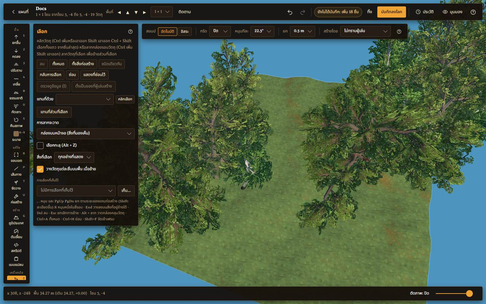

<!-- source: 133e1e92 -->
# เคลียร์ต้นไม้และหิน ปรับพื้นที่ก่อสร้างให้ราบ

เอาต้นไม้ หิน และพุ่มไม้ออกจากที่หนึ่ง แล้วปรับให้เป็นพื้นราบ สำหรับก่อสร้าง

**สิ่งที่ต้องมี:** โลกที่เปิดอยู่ใน 3D โดยปิดเกมไว้ หรืออยู่ใน [โหมดไลฟ์](edit-your-game-live.md)

1. กด `B` ([ขอบเขต](../area.md)) ที่ด้านบนของแผง เลือก **รูปหลายเหลี่ยม**
2. คลิกมุมรอบพื้นที่ ให้กว้างกว่าสิ่งก่อสร้าง สองสามเมตร แล้วดับเบิลคลิก เพื่อปิดรูป
3. เลือก **วัตถุ**
4. ตรวจชิปชนิด: **ต้นไม้และท่อนไม้** **หิน** **พุ่มไม้และไม้พุ่ม** และ **ของที่เก็บได้** เปิดอยู่ตั้งแต่แรก
   ปล่อย **สิ่งก่อสร้างของคุณ** ปิดไว้
5. กด **เลือกวัตถุเหล่านั้น (Enter)** เครื่องมือ เลือก จะเปิดขึ้น โดยเลือกวัตถุเหล่านั้นไว้
6. กด `Del` วัตถุจะหายไป
7. กด `B` เพื่อกลับไปที่เครื่องมือ ขอบเขต: รูปหลายเหลี่ยมยังอยู่ เลือก **พื้นดิน** แล้วเลือก **ปรับราบ** ใน
   **การกระทำ**
8. กด **เฉลี่ย** เพื่อใช้ความสูงเฉลี่ยข้างใน หรือพิมพ์ **ความสูง** ถ้าต้องการให้ตรงกับประตู ที่สร้างไว้แล้ว
   ให้ชี้ไปที่พื้นตรงธรณีประตู แล้วอ่านความสูง ในแถบสถานะ
9. ตั้ง **ขอบนุ่ม** (3 m ตั้งแต่แรก) เพื่อให้พื้นที่กลืนเข้ากับทางลาด บรรทัดใต้การตั้งค่า จะบอกปริมาณพื้นดิน
   ที่จะขุดและถม และส่วนที่เกินระยะ 8 m ของเกม
10. กด **ปรับราบ (Enter)**
11. ไม่บังคับ: ใน **การกระทำ** เลือก **ระบาย** แล้วเลือก **ดิน** หรือ **ปูหิน** และกด **ระบาย (Enter)**
12. คลิก **บันทึกลงโลก** (หรือ **นำไปใช้แบบไลฟ์**)

*หลัง **เลือกวัตถุเหล่านั้น (Enter)** และ `Del`: ต้นไม้ในรูปหลายเหลี่ยมหายไป ต้นที่อยู่ข้างนอกยังตั้งอยู่*

## ตรวจว่าได้ผล

- กด `M` ([วัด](../measure.md)) แล้ววัดข้ามพื้นที่: **ต่ำสุด / สูงสุด** ควรเท่ากัน
- หรือเปิด **สีความชัน** ในแผง มุมมอง: พื้นที่จะแสดงเป็นสีเขียว

## เลิกทำ

- แต่ละการกระทำ เป็นหนึ่งขั้นตอน: `Ctrl+Z` ย้อนขั้นตอนล่าสุด หลังบันทึก ให้เลิกทำแล้วบันทึกอีกครั้ง (ดู
  [เลิกทำขั้นตอน ย้อนการเปลี่ยนแปลงหนึ่งรายการ หรือทิ้งทั้งหมด](undo-changes.md))
- ถ้าต้องการให้ต้นไม้ขึ้นคืน ในภายหลัง ให้เลือกพื้นที่นั้น เลือก **กู้คืน** แล้วใช้ **ปลูกธรรมชาติคืน** (ดู
  [ขอบเขต](../area.md#ปลกธรรมชาตคน))

## หัวข้อที่เกี่ยวข้อง

- [ขอบเขต การคัดลอกและวาง](../area.md)
- [มาสก์](../masks.md): ปรับราบเฉพาะส่วนล่าง ของทางลาด
- [ทำถนน หรือทางลาดขึ้นเนิน](make-a-road.md)
