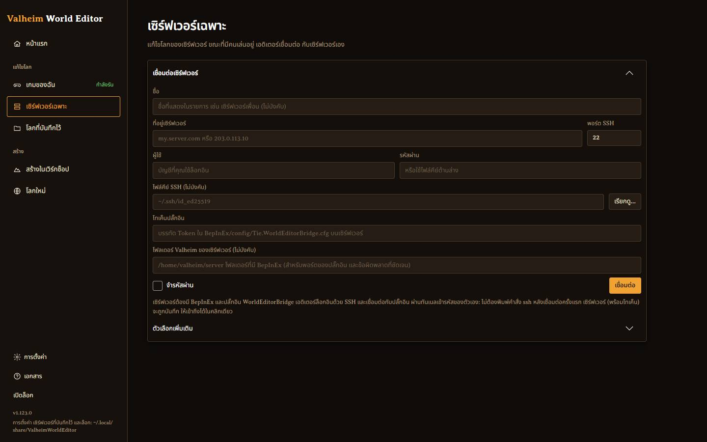

<!-- source: 52199907 -->
# แก้ไขเซิร์ฟเวอร์เฉพาะ ขณะที่มีคนเล่น

เชื่อมต่อเอดิเตอร์ กับเซิร์ฟเวอร์เฉพาะของคุณ แล้วเปลี่ยนโลก ขณะที่ผู้เล่นยังออนไลน์อยู่

**สิ่งที่ต้องมี:** การเข้าถึงเครื่อง ที่รันเซิร์ฟเวอร์ผ่าน SSH (ล็อกอินเข้าเชลล์ ด้วยรหัสผ่านหรือไฟล์คีย์: แค่ SFTP
หรือตัวจัดการไฟล์ ของแผงควบคุมบนเว็บ ไม่พอ) สิทธิ์ติดตั้ง BepInEx และปลั๊กอิน WorldEditorBridge ที่นั่น
และสิทธิ์รีสตาร์ตเซิร์ฟเวอร์ สำหรับเซิร์ฟเวอร์เกม ที่เช่าจากผู้ให้บริการ (แผงควบคุมบนเว็บและ FTP ไม่มี SSH)
หรือเซิร์ฟเวอร์ที่แผงควบคุมเกม เช่น Pterodactyl รันในคอนเทนเนอร์: ดู
[แก้ไขเซิร์ฟเวอร์ที่เช่า หรือโฮสต์ผ่านแผงควบคุม](edit-a-rented-server.md)

*ฟอร์มใต้ **เซิร์ฟเวอร์เฉพาะ** หลังเชื่อมต่อครั้งแรก เซิร์ฟเวอร์จะถูกบันทึกไว้ เหนือฟอร์ม ให้เข้าถึงได้ในคลิกเดียว*

1. บนเซิร์ฟเวอร์ ติดตั้ง BepInEx ([BepInExPack for Valheim](https://thunderstore.io/c/valheim/p/denikson/BepInExPack_Valheim/)
   ตามคำแนะนำ สำหรับเซิร์ฟเวอร์เฉพาะ)
2. คัดลอก `WorldEditorBridge.dll` (จาก `WorldEditorBridge-<version>.zip` ใน
   [หน้ารุ่นเผยแพร่](https://github.com/Shuiei/valheim-world-editor/releases/latest)) ไปไว้ใน
   `BepInEx/plugins` ของเซิร์ฟเวอร์ หรือติดตั้ง WorldEditorBridge ในโปรไฟล์เซิร์ฟเวอร์ ของตัวจัดการม็อด
3. รีสตาร์ตเซิร์ฟเวอร์พร้อม BepInEx ตอนนี้ `BepInEx/LogOutput.log` จะแสดง `WorldEditorBridge <version> listening on
   http://127.0.0.1:5182/`
4. บนเซิร์ฟเวอร์ เปิด `BepInEx/config/Tie.WorldEditorBridge.cfg` แล้วคัดลอกค่าของบรรทัด `Token`
   ไฟล์นี้จะมีก็ต่อเมื่อ เซิร์ฟเวอร์เริ่มทำงาน พร้อมปลั๊กอินแล้ว
5. ที่หน้าเริ่มต้นของเอดิเตอร์ เลือก **เซิร์ฟเวอร์เฉพาะ** แล้วเลือก **เชื่อมต่อเซิร์ฟเวอร์**
6. กรอก **ที่อยู่เซิร์ฟเวอร์** **ผู้ใช้** และ **รหัสผ่าน** หรือ **ไฟล์คีย์ SSH (ไม่บังคับ)** วางโทเค็นลงใน
   **โทเค็นปลั๊กอิน**
7. ไม่บังคับ: กรอก **โฟลเดอร์ Valheim ของเซิร์ฟเวอร์ (ไม่บังคับ)** (โฟลเดอร์ที่มี `BepInEx`) เพื่อให้เอดิเตอร์
   บอกได้แน่ชัดว่าผิดพลาดตรงไหน หากปลั๊กอินไม่ตอบ ติ๊ก **จำรหัสผ่าน** เพื่อไม่ต้องพิมพ์อีก
8. กด **เชื่อมต่อ** เอดิเตอร์จะล็อกอินผ่าน SSH เปิดทันเนลเข้ารหัสของตัวเอง ไปยังปลั๊กอิน แล้วโหลดโลก
9. บนแผนที่ เลือกจุดหนึ่ง กด **แก้ไขใน 3D** เปลี่ยนแปลงบางอย่าง แล้วกด **นำไปใช้แบบไลฟ์**

## ตรวจว่าได้ผล

- แถบด้านบนแสดง **ไลฟ์** หลังนำไปใช้ แถบสถานะจะแสดง "นำไปใช้ทั้งหมดแล้ว" และ
  "นำไปใช้กับเกมที่รันอยู่แล้ว: …"
- ผู้เล่นที่อยู่ใกล้การเปลี่ยนแปลง จะเห็นทันที
- ตอนนี้เซิร์ฟเวอร์ จะแสดงเหนือฟอร์ม และใน **หน้าแรก** ให้เข้าถึงได้ในคลิกเดียว ในครั้งถัดไป

หากมีข้อความปรากฏใต้ฟอร์มแทน ดู [เซิร์ฟเวอร์เชื่อมต่อไม่ได้](../help/troubleshooting.md#เซรฟเวอรเชอมตอไมได)

## เลิกทำ

กด `Ctrl+Z` (หรือ **นำออก** ขั้นตอนนั้นใน ประวัติ) แล้วกด **นำไปใช้แบบไลฟ์** อีกครั้ง การรีเซ็ตโซน
ย้อนกลับไม่ได้ เมื่อนำไปใช้แล้ว

## ช่องอื่นๆ ของฟอร์ม

| ช่อง | คืออะไร |
|---|---|
| **ชื่อ** | ชื่อที่เซิร์ฟเวอร์แสดง ในรายการของคุณ (ไม่บังคับ หากเว้นว่าง จะใช้ที่อยู่) |
| **ที่อยู่เซิร์ฟเวอร์** | ชื่อหรือที่อยู่ IP ของเซิร์ฟเวอร์ พิมพ์ `user@address` ที่นี่ก็ได้ |
| **พอร์ต SSH** | 22 เว้นแต่ SSH ของเซิร์ฟเวอร์ ถูกเปลี่ยนไว้ |
| **ไฟล์คีย์ SSH (ไม่บังคับ)** | คีย์ส่วนตัวของคุณ (กด **เรียกดู…** เพื่อเลือก) หากเว้นว่าง จะลองคีย์ปกติใน `~/.ssh` (`id_ed25519`, `id_ecdsa`, `id_rsa`) คีย์ที่เอดิเตอร์ใช้ไม่ได้ จะถูกข้าม และยังลองคีย์อื่น และรหัสผ่านต่อไป |
| **โทเค็นปลั๊กอิน** | คุณต้องพิมพ์เองเสมอ: เอดิเตอร์ไม่อ่านโทเค็น จากเซิร์ฟเวอร์ ดังนั้นแค่ล็อกอิน SSH อย่างเดียว เปลี่ยนโลกไม่ได้ |
| **ตัวเลือกเพิ่มเติม** → **วลีรหัสของคีย์** | วลีรหัสของคีย์ หากมี ไม่ถูกบันทึกเลย |
| **ตัวเลือกเพิ่มเติม** → **พอร์ตปลั๊กอิน** | พอร์ตของปลั๊กอินบนเซิร์ฟเวอร์ เมื่อไม่ใช่ 5182 และไม่ได้ระบุโฟลเดอร์ |
| **ตัวเลือกเพิ่มเติม** → **ฉันสร้างทันเนลเอง** | **ที่อยู่บริดจ์** และ **โทเค็น** แล้วกด **เชื่อมต่อ**: สำหรับทันเนลที่คุณสร้างด้วย `ssh -L` หรือ PuTTY |

## เซิร์ฟเวอร์ที่บันทึกไว้

หลังเชื่อมต่อครั้งแรก เซิร์ฟเวอร์จะแสดงเหนือฟอร์ม เรียงจากล่าสุด พร้อม **เชื่อมต่อ** **แก้** และ **เลิกจำ**
ฟอร์มจะพับเก็บไว้ใต้ **เชื่อมต่อเซิร์ฟเวอร์อื่น** แต่ละแถวแสดง `user@address` ว่าใช้ไฟล์คีย์
ใช้รหัสผ่านที่บันทึกไว้ หรือถามรหัสผ่าน และมีช่องสำหรับสิ่งที่ไม่ได้บันทึก

- **แก้** จะกรอกฟอร์มด้วยข้อมูลเซิร์ฟเวอร์ เปลี่ยนสิ่งที่ต้องการ แล้วกด **เชื่อมต่อ** เพื่ออัปเดต
- **เลิกจำ** จะลบเซิร์ฟเวอร์ออก พร้อมรหัสผ่านและโทเค็น

เซิร์ฟเวอร์ถูกเก็บไว้ใน `servers.cfg` ในโฟลเดอร์ข้อมูลของเอดิเตอร์ (เมนูด้านข้างของหน้าเริ่มต้น แสดงโฟลเดอร์นี้)
หนึ่งส่วนต่อหนึ่งเซิร์ฟเวอร์ (`Host`, `SshPort`, `User`, `Password`, `KeyFile`, `Token`, `BridgePort`, `GameFolder`, `HostKey`)
คุณจึงแก้ไขด้วยมือได้ด้วย เซิร์ฟเวอร์หนึ่งตัว คือบัญชีหนึ่งบัญชี บนที่อยู่และพอร์ตหนึ่ง:
การเชื่อมต่ออีกครั้ง ด้วยค่าเดิม จะอัปเดตส่วนของเซิร์ฟเวอร์นั้น

`Password` จะมีค่าก็ต่อเมื่อ ติ๊ก **จำรหัสผ่าน** ไว้ โดยเก็บเป็นข้อความธรรมดา (บน Linux มีแค่คุณที่อ่านไฟล์ได้):
ควรใช้คีย์ SSH มากกว่า

`HostKey` คือตัวตนของเซิร์ฟเวอร์ ที่จำไว้ตั้งแต่การเชื่อมต่อครั้งแรก หากเปลี่ยนไปเมื่อใด เอดิเตอร์จะปฏิเสธการเชื่อมต่อ
เพราะอาจมีคนแอบอ้าง เป็นเซิร์ฟเวอร์ของคุณ หากคุณติดตั้งเซิร์ฟเวอร์ใหม่ ให้ลบค่าในบรรทัด `HostKey`
ของเซิร์ฟเวอร์ที่บันทึกไว้ทุกตัว ที่ใช้ที่อยู่นั้น เพื่อยอมรับตัวตนใหม่

## หัวข้อที่เกี่ยวข้อง

- [โหมดไลฟ์](../live-mode.md): นำไปใช้แบบไลฟ์ อัตโนมัติ การติดตามเกม ผู้เล่น
- [แก้ไขเซิร์ฟเวอร์ที่เช่า หรือโฮสต์ผ่านแผงควบคุม](edit-a-rented-server.md): เซิร์ฟเวอร์เกมของผู้ให้บริการ Pterodactyl, Docker
- [การแก้ไขแบบไลฟ์](../concepts/live-editing.md#การเชอมตอทำงานอยางไร): ทันเนล SSH และโทเค็น
- [แก้ไขโลกที่คุณกำลังเล่น](edit-your-game-live.md)
- [สำรองโลกก่อนแก้ไข](back-up-a-world.md)
