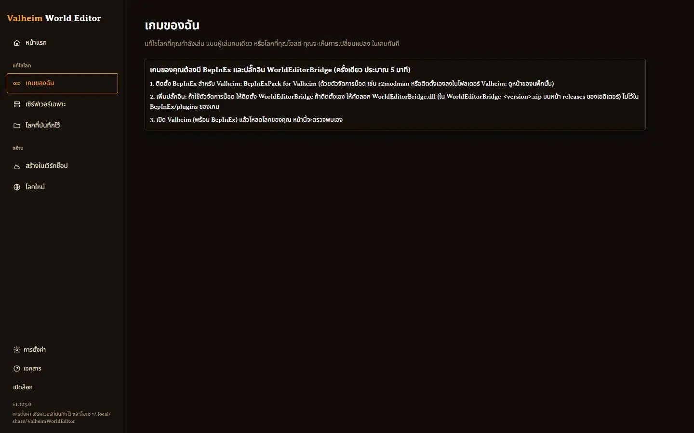
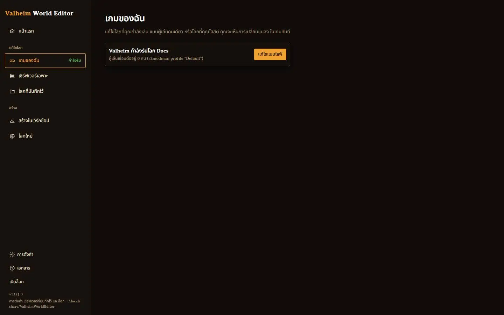

<!-- source: 0fe62110 -->
# แก้ไขโลกที่คุณกำลังเล่น

เปลี่ยนโลกของเกมที่คุณกำลังรันอยู่ (เล่นคนเดียว หรือโลกที่คุณโฮสต์) และเห็นการเปลี่ยนแปลง แต่ละอย่าง ในเกมทันที

**สิ่งที่ต้องมี:** Valheim บนคอมพิวเตอร์เครื่องนี้ เอดิเตอร์ และเวลาประมาณ 5 นาที เพื่อติดตั้ง BepInEx
และปลั๊กอิน WorldEditorBridge หนึ่งครั้ง

*สิ่งที่ **เกมของฉัน** แสดง ก่อนติดตั้ง BepInEx และปลั๊กอิน: ขั้นตอนด้านล่าง แบบย่อ*

1. ติดตั้ง **BepInEx** ใน Valheim ของคุณ หนึ่งครั้ง: [BepInExPack for Valheim](https://thunderstore.io/c/valheim/p/denikson/BepInExPack_Valheim/)
   ด้วยตัวจัดการม็อด (r2modman, Thunderstore Mod Manager) หรือติดตั้งเองลงในโฟลเดอร์ Valheim ตามที่หน้านั้นอธิบาย
   บน Linux กับเกมเนทีฟ BepInEx เริ่มทำงาน ผ่านสคริปต์เริ่มต้นของแพ็ก (หน้าของแพ็ก แสดง Launch Options ของ Steam)
   ตัวจัดการม็อดทำส่วนนี้ให้คุณ
2. เพิ่มปลั๊กอิน ถ้าใช้ตัวจัดการม็อด ให้ติดตั้ง **WorldEditorBridge** จาก
   [Thunderstore](https://thunderstore.io/c/valheim/p/Tie/WorldEditorBridge/) หรือ
   [Hexium](https://valheim.hexium.gg/mods/Tie/WorldEditorBridge) ถ้าติดตั้งเอง ให้คัดลอก `WorldEditorBridge.dll` จาก
   `WorldEditorBridge-<version>.zip` (บน [หน้า releases](https://github.com/Shuiei/valheim-world-editor/releases/latest) ของเอดิเตอร์)
   ไปไว้ใน `BepInEx/plugins` ของ Valheim หรือของโปรไฟล์ตัวจัดการม็อด ใช้ปลั๊กอินจากรุ่นเดียวกับ เอดิเตอร์ของคุณ
3. เปิด Valheim พร้อม BepInEx แล้วโหลดโลกของคุณ (เล่นคนเดียว หรือเริ่มเซิร์ฟเวอร์จากในเกม เพื่อโฮสต์)
   ในการเปิดครั้งแรกนี้ ปลั๊กอินจะเขียนการตั้งค่า และโทเค็นลับ ซึ่งเอดิเตอร์อ่านได้เอง
4. ในเอดิเตอร์ เปิดหน้าเริ่มต้น **หน้าแรก** แสดง "Valheim กำลังรันโลก …" และจำนวนผู้เล่น ที่เชื่อมต่ออยู่
   **เกมของฉัน** ในเมนูด้านข้าง แสดง *กำลังรัน*
5. คลิก **แก้ไขแบบไลฟ์** โลกจะเปิดบนแผนที่
6. คลิกจุดใกล้ตัวคุณ แล้วเลือก **แก้ไขใน 3D**
7. ทำการเปลี่ยนแปลง เช่น ยกเนินเขาเล็กๆ ด้วยแปรง **ยกขึ้น**
8. กด **นำไปใช้แบบไลฟ์** (หรือ `Ctrl+S`)

*หน้าเริ่มต้นตรวจพบเกม ที่กำลังรันได้เอง: **แก้ไขแบบไลฟ์** จะเปิดโลกของเกมนั้น*

## ตรวจว่าได้ผล

- แถบด้านบนแสดง **ไลฟ์** และหลังการนำไปใช้ แสดง "นำไปใช้ทั้งหมดแล้ว"
- แถบสถานะแสดง "นำไปใช้กับเกมที่รันอยู่แล้ว: …"
- ในเกม เนินเขาปรากฏขึ้นทันที เกมบันทึกไว้ เหมือนการเปลี่ยนแปลงอื่นๆ

จนกว่าเกมจะพร้อม **เกมของฉัน** จะบอกสิ่งที่ยังขาด: สามขั้นตอน "ติดตั้ง BepInEx แล้ว: เหลือเพียงขั้นตอนที่ 2 และ 3"
"เปิด Valheim พร้อม BepInEx หนึ่งครั้ง" (ปลั๊กอินยังไม่เคยทำงาน) หรือ "เปิด Valheim แล้วโหลดโลกของคุณ" ถ้ายังค้างอยู่ตรงนั้น
ดู [เกมของฉัน แสดงขั้นตอนที่ต้องทำ](../help/troubleshooting.md#เกมของฉน-แสดงขนตอนทตองทำ)

## เลิกทำ

กด `Ctrl+Z` (หรือ **นำออก** ขั้นตอนนั้นใน ประวัติ) แล้วกด **นำไปใช้แบบไลฟ์** อีกครั้ง: เกมจะย้อนการเปลี่ยนแปลงนั้น
การรีเซ็ตโซน เลิกทำไม่ได้ เมื่อนำไปใช้แล้ว ถ้าต้องการให้นำ ทุกการเปลี่ยนแปลงไปใช้ ทันทีที่ทำ ให้เปิด **อัตโนมัติ**

## หัวข้อที่เกี่ยวข้อง

- [โหมดไลฟ์](../live-mode.md): นำไปใช้แบบไลฟ์ อัตโนมัติ การติดตามเกม ผู้เล่น
- [แก้ไขเซิร์ฟเวอร์เฉพาะ ขณะที่มีคนเล่น](edit-a-server-live.md)
- [การแก้ไขแบบไลฟ์](../concepts/live-editing.md#การเชอมตอทำงานอยางไร): วิธีที่เอดิเตอร์เข้าถึงเกม
- [เลิกทำขั้นตอน ย้อนการเปลี่ยนแปลงหนึ่งรายการ หรือทิ้งทั้งหมด](undo-changes.md)
