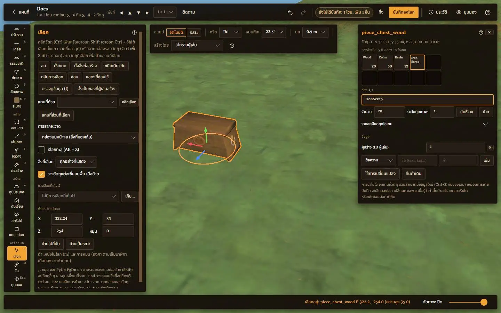

<!-- source: 0fb1e9cf -->
# เปลี่ยนของในหีบ หรือข้อความบนป้าย

ใส่ไอเทมลงในหีบ เอาออก หรือเขียนข้อความใหม่บนป้าย ด้วยตัวตรวจดูข้อมูล

**สิ่งที่ต้องมี:** โลกที่เปิดอยู่ในเอดิเตอร์ โดยเปิดพื้นที่รอบหีบหรือป้ายไว้ หากต้องการหาก่อน ดู
[หาวัตถุ ไอเทมในหีบ หรือป้าย](find-things.md)

## หีบ

1. กด `E` เพื่อเปิด [เลือก](../select.md)
2. ดับเบิลคลิกหีบ: หีบจะถูกเลือกเพียงอย่างเดียว และเปิดในตัวตรวจดูข้อมูล โดยแสดงช่องเหมือนในเกม
3. คลิกช่องว่าง
4. ใน **ค้นหาไอเทม…** พิมพ์ตัวอักษรสองสามตัวของไอเทม (`iron`, `mead`) แล้วเลือกในรายการ
5. ตั้ง **จำนวน** และสำหรับเครื่องมือและเกราะ ตั้ง **ระดับคุณภาพ**
6. ทำซ้ำกับช่องอื่น หากต้องการเอาไอเทมออก คลิกช่องของไอเทม แล้วกด **ทำให้ว่าง** หากต้องการย้าย กด **ย้าย**
   แล้วคลิกอีกช่องหนึ่ง
7. คลิก **ใช้การเปลี่ยนแปลง**
8. คลิก **บันทึกลงโลก** (หรือ **นำไปใช้แบบไลฟ์**)

จำนวนจะถูกตัด ให้เท่ากับกองใหญ่สุด ที่เกมยอมให้สำหรับไอเทมนั้น ของข้างในที่เปลี่ยนแล้ว เป็นของหีบนั้นเอง:
หีบที่ยังไม่มีใครเปิด จะไม่เติมของปล้นของเกม ทับลงไป

*คลิกช่องที่ 4 แล้ว เลือก IronScrap ใน **ค้นหาไอเทม…** และตั้ง **จำนวน** เป็น 20 ส่วน Wood, Coins และ Resin
อยู่ในสามช่องแรก **ใช้การเปลี่ยนแปลง** จะใส่ของเหล่านี้ลงในหีบ*

## ป้าย

1. กด `E` แล้วคลิกป้าย
2. กด `I` (**ตรวจดูข้อมูล (I)**): การดับเบิลคลิกป้าย จะเลือกทั้งสิ่งก่อสร้าง
3. ใต้ **ข้อมูล** หา **ข้อความ (ป้าย)** แล้วพิมพ์ข้อความใหม่
4. คลิก **ใช้การเปลี่ยนแปลง** แล้วคลิก **บันทึกลงโลก** (หรือ **นำไปใช้แบบไลฟ์**)

สำหรับป้ายที่ยังไม่มีข้อความ ใช้ **เพิ่ม**: เลือก **ข้อความ** พิมพ์ `text` เป็นชื่อ แล้วพิมพ์ข้อความ

## ตรวจว่าได้ผล

เลือกหีบหรือป้ายอีกครั้ง แล้วกด `I`: ตัวตรวจดูข้อมูล จะแสดงของข้างใน หรือข้อความใหม่ หลังบันทึกแล้ว
เปิดหีบหรืออ่านป้ายในเกม

## เลิกทำ

- ก่อนใช้การเปลี่ยนแปลง: **คืนค่าเดิม** จะลืมการเปลี่ยนแปลงในการ์ด
- หลังใช้การเปลี่ยนแปลง: `Ctrl+Z` จะนำหีบหรือป้ายเดิมกลับมา
- หลังบันทึก: ดู [เลิกทำขั้นตอน ย้อนการเปลี่ยนแปลงหนึ่งรายการ หรือทิ้งทั้งหมด](undo-changes.md)

## หัวข้อที่เกี่ยวข้อง

- [ตัวตรวจดูข้อมูล](../select.md#ตวตรวจดขอมล) (ในหน้า เลือก)
- [วัตถุคืออะไร](../concepts/objects.md#วตถคออะไร)
- [หาวัตถุ ไอเทมในหีบ หรือป้าย](find-things.md)
