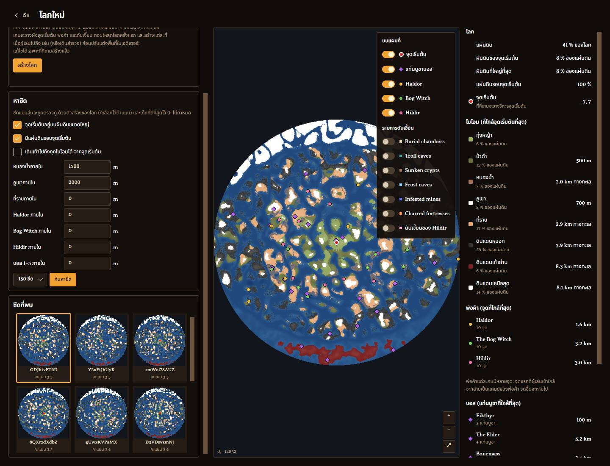

<!-- source: cccbe33c -->
# หาซีดที่มีสิ่งที่ต้องการ ใกล้จุดเริ่มต้น

ให้เอดิเตอร์ตรวจดูซีดจำนวนมาก แล้วเลือกซีด ที่จุดเริ่มต้นมีไบโอม พ่อค้า หรือบอส ที่คุณต้องการอยู่ใกล้ๆ
จากนั้นจึงสร้างโลก

**สิ่งที่ต้องมี:** เอดิเตอร์และ Valheim บนคอมพิวเตอร์เครื่องนี้ ไม่ต้องเปิดโลกใดไว้

1. ที่หน้าเริ่มต้น เลือก **โลกใหม่** ใต้ **สร้าง** แล้วเลือก **สร้างโลกใหม่**
2. ใต้ **หาซีด** เปิด **จุดเริ่มต้นอยู่บนผืนดินขนาดใหญ่** และ **มีแผ่นดินรอบจุดเริ่มต้น** ไว้ตามเดิม
   หรือปิดไว้ หากคุณชอบเกาะ
3. ไม่บังคับ: เปิด **เดินเท้าไปถึงทุกไบโอมได้ จากจุดเริ่มต้น** เพื่อไม่ต้องใช้เรือตั้งแต่ช่วงแรก
4. ตั้งระยะที่ต้องการเป็นเมตร: **หนองน้ำภายใน** **ภูเขาภายใน** **ที่ราบภายใน** พ่อค้า
   (**Haldor ภายใน** **Bog Witch ภายใน** **Hildir ภายใน**) หรือ **บอส 1–5 ภายใน** ปล่อยช่องเป็น 0
   หากไม่ต้องการ ความต้องการเรื่องพ่อค้าและบอส ทำให้การค้นหาช้าลงหลายเท่า
5. เลือกจำนวนซีดที่จะตรวจดู: **60 ซีด** **150 ซีด** หรือ **400 ซีด**
6. กด **ค้นหาซีด** แถบจะแสดงความคืบหน้า **หยุด** จะเก็บซีดที่ดีที่สุด ที่พบจนถึงตอนนั้น
7. ใต้ **ซีดที่พบ** วางเมาส์เหนือซีด เพื่อดูข้อมูล แล้วคลิก เพื่อดูบนแผนที่ใหญ่
8. ตรวจดูบนแผนที่ใหญ่: การค้นหาตรวจดูแต่ละซีด อย่างหยาบๆ และอาจพลาดเกาะเล็ก หรือช่องแคบแคบๆ
   ไม่บังคับ: เปิดชนิดใน **รายการดันเจี้ยน** ที่คุณสนใจ
9. พิมพ์ **ชื่อ** ของโลก เลือก **บันทึกใน** แล้วกด **สร้างโลก**
10. เปิด Valheim และโหลดโลกหนึ่งครั้ง ก่อนแก้ไขในเอดิเตอร์: เกมจะสร้างแต่ละที่
    เมื่อผู้เล่นเข้าไปใกล้

*ความต้องการอยู่ทางซ้าย ซีดที่ดีที่สุดอยู่ใต้ **ซีดที่พบ** เรียงจากดีที่สุด แต่ละซีดมีคะแนนของตัวเอง*

## ตรวจว่าได้ผล

- เอดิเตอร์เปิดแผนที่ของโลกใหม่ พร้อมข้อความ "สร้าง … แล้ว (ซีด …)"
- ใน Valheim โลกจะอยู่ในรายการ ของโฟลเดอร์ที่คุณเลือก ตัวละครใหม่จะมาถึง ที่ตำแหน่งของจุดสีแดง
- ที่ตั้งของพ่อค้าและบอส อยู่ตรงที่หน้านั้นแสดงไว้

## เลิกทำ

ไม่มีอะไรถูกสร้าง จนกว่าจะกด **สร้างโลก** หากต้องการลบโลกที่สร้างไว้ ให้ลบโฟลเดอร์ของโลก
ออกจากโฟลเดอร์โลกที่บันทึกไว้ (ตัวเลือก **บันทึกใน**) ซีดที่ชอบ พิมพ์ใหม่ได้เสมอ:
ซีดเดียวกันสร้างโลกเดียวกัน

## หัวข้อที่เกี่ยวข้อง

- [โลกใหม่](../new-world.md): ทุกตัวควบคุม แผนที่ ข้อมูล และวิธีให้คะแนนซีด
- [เปิดโลกที่ไม่อยู่ในรายการ](open-a-world.md)
- [แก้ไขโลกที่สร้างด้วย Expand World, Riverheim หรือ Tunnelheim](use-mods-worlds.md)
